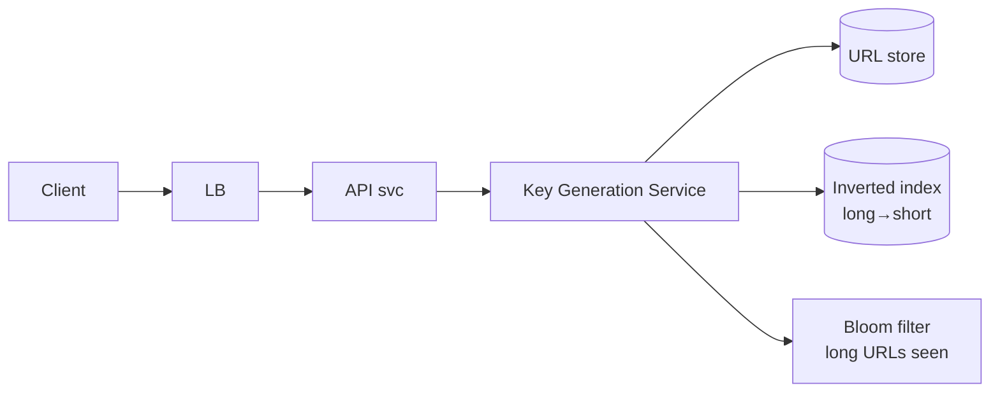
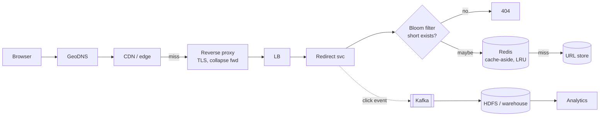

# 01 — URL Shortener (TinyURL / Bitly)

*Um reference design construído sobre building blocks verificados. Como foi pesquisado e o que não foi conferido está em **Sources and provenance**, perto do fim.*

## At a glance

**Em 60 segundos.** Um URL shortener mapeia uma chave curta para uma URL longa e faz o redirect. As leituras superam as escritas em cerca de 100 para 1, então o caminho do redirect é um problema de cache e CDN, e a parte difícil do caminho de escrita é gerar chaves únicas e difíceis de adivinhar sem consultar o banco a cada escrita. O design abaixo usa faixas de contador alocadas por lease, codificação base62 e um Bloom filter na frente do store.

**Números principais**
- 7 caracteres base62 dão 62⁷ ≈ 3,5 trilhões de chaves (aritmética).
- 301 é heuristicamente cacheável e 302 não é, então o status code decide se cada clique chega até você `[CONFIRMED]` (RFC 9110).
- Premissas de entrevista: 100M de novos links/dia ≈ 1,2k escritas/s e ~100k leituras/s `[SPECULATIVE]`.

**Decisões e trade-offs**

| Decisão | Por quê | Custo |
|---|---|---|
| Geração de chaves por token-range | Sem colisões, O(1), sem consulta ao banco a cada escrita | Um crash desperdiça a parte não usada de uma faixa |
| 301 vs 302 | 301 reduz o tráfego na origem | Os navegadores escondem os cliques repetidos da sua analytics |
| Bloom filter antes do store | 404 barato para chaves que nunca existiram | Falsos positivos ainda chegam ao store, e ele não consegue remover itens |

**Erros comuns**
- Aplicar hash e truncar para 7 caracteres, o que torna colisões prováveis (a causa é o truncamento, não o tamanho do hash).
- Usar um índice único na URL longa para impor 1:1 sem perguntar se 1:1 é necessário.
- Esquecer que respostas 301 ficam em cache nos navegadores ao prometer analytics por clique.


---

## 🧒 Non-technical explanation

Um URL shortener é um **guarda-volumes**. Você entrega seu casaco longo e volumoso (um endereço web longo) e recebe uma **senha pequena** (`sho.rt/xy725ab`). Quem mostrar essa senha é levado até o seu casaco.

As partes difíceis:
- **Nunca dar o mesmo número de senha a dois casacos**, mesmo com 100 atendentes trabalhando ao mesmo tempo.
- **Tornar os números das senhas difíceis de adivinhar**, para que ninguém consiga passear pelos casacos dos outros.
- **Devolver os casacos bem rápido**, porque as pessoas resgatam senhas 100× mais do que deixam casacos. Mantenha os casacos populares bem ao lado do balcão (cache).

---

## TL;DR for engineers

- **Muita leitura (100:1)**: otimize os redirects com CDN/edge + cache Redis + Bloom filters.
- **A geração de chaves é o problema central.** Recomendado: **token ranges** (faixas de contador pré-alocadas e sem sobreposição por instância de KGS, coordenadas por ZooKeeper/DynamoDB) + codificação **base62** (7 caracteres ≈ 3,5 trilhões de IDs).
- **KV NoSQL** para `short → long`, mais um **índice invertido** `long → short` se o mapeamento 1:1 for exigido.
- **301 vs 302** é uma decisão de produto: SEO e cacheabilidade vs analytics por clique.

---

## 1. Requirements

**Perguntas e respostas de esclarecimento:** 100M de DAU (escritas) · retenção de 5 anos · 100:1 de leitura:escrita · a maioria dos links é acessada uma vez após a criação · público geral · máximo de 9 caracteres.

**Funcionais:**
- Encurtar uma URL longa → URL curta. Redirecionar curta → longa.
- **Mesma URL longa → mesma URL curta** (1:1). Isso é opcional em muitos produtos reais.
- As URLs curtas devem ser legíveis, sem colisões e **imprevisíveis**. Aliases personalizados permitidos. Expiração opcional.
- Analytics fora de tempo real (contagem de cliques, referrers, geo).

**Não funcionais:** alta disponibilidade, baixa latência, escalável, durável, tolerante a falhas.

**Fora do escopo:** cadastro, configurações de visibilidade.

---

## 2. API

```http
PUT /url                       # PUT because the operation is idempotent (1:1 mapping); RFC 9110 §9.2.2
Authorization: Bearer <JWT>
{ "long-url": "https://en.wikipedia.org/wiki/URL_shortening",
  "tags": ["productivity"], "expires": "2030-01-01T00:00:00Z", "custom": "my-alias" }

→ 200 OK
{ "long-url": "...", "short-url": "xy725ab", "created-at": "...", "is-active": true }
→ 401 Unauthorized | 403 Forbidden
```

```http
GET /:short-url
→ 301 Moved Permanently   Location: <long-url>
→ 404 Not Found
```

| Status | Significado | Use quando |
|---|---|---|
| **301** | Permanente. Heuristicamente cacheável, então os navegadores o mantêm a menos que `Cache-Control` diga o contrário ([RFC 9110 §15.4.2](https://www.rfc-editor.org/rfc/rfc9110.html#name-301-moved-permanently)). O Google trata o destino como canônico ([Google](https://developers.google.com/search/docs/crawling-indexing/301-redirects)). | SEO importa. Menos acessos ao servidor. |
| **302** | Temporário (um POST pode virar GET). Não é heuristicamente cacheável: só entra em cache com headers de freshness explícitos ([RFC 9110 §15.4.3](https://www.rfc-editor.org/rfc/rfc9110.html#name-302-found)). | Você quer que **todo clique chegue aos seus servidores** para a analytics. |
| **307** | Temporário, **preserva método e corpo** ([RFC 9110 §15.4.8](https://www.rfc-editor.org/rfc/rfc9110.html#name-307-temporary-redirect)) | Redirecionar requisições que não são GET |
| **308** | Permanente + preserva o método. Heuristicamente cacheável como o 301. | Raro em shorteners |

**API pública → REST** (baixo acoplamento, fácil de depurar). **Serviço a serviço interno → RPC (gRPC)** depois de estável, por desempenho.

---

## 3. Data model & store choice

```
URL table (NoSQL KV, e.g. DynamoDB / Cassandra)
  short_url (PK) | long_url | user_id | created_at | expires_at | last_visited | hits

Users table (SQL, e.g. Postgres)
  user_id (PK) | email | name | api_key | created_at
```

- **Tabela de URLs → NoSQL:** sem joins, schema flexível, escala de TB–PB, IOPS muito alto, escala horizontal fácil.
- **Tabela de usuários → SQL:** schema rígido, relacional, ACID.
- "Quem é o dono desta URL curta?" → join **no nível da aplicação**.

---

## 4. Capacity planning

| Métrica | Valor |
|---|---|
| QPS de escrita | 100M/dia ÷ 86.400 s ≈ 1.157/s, arredondado via ÷10⁵ para **~1k/s** |
| QPS de leitura | ×100 ≈ **~100k/s** |
| Tamanho do registro | ~2,5 KB (URL longa de até 2 KB + metadados) |
| Storage (5 anos) | 100M × 365 × 5 = 1,8×10¹¹ registros × 2,5 KB ≈ **~456 TB** (× RF 3 ≈ 1,4 PB) |
| Cache | regra 80/20 → cachear ~20% dos redirects quentes do dia, TTL ≈ 1 dia |

Dicas: 1M req/dia ≈ 12 req/s. Arredonde com vontade e **anote as unidades**.

---

## 5. Encoding

**Base62** (`[0-9a-zA-Z]`). Base58 elimina os caracteres ambíguos `0 O I l`.

| Tamanho | Combinações em base62 |
|---|---|
| 6 | 56,8 B |
| **7** | **3,52 T** (3,52×10¹² ÷ 1k/s ≈ 111 anos) |
| 8 | 218 T |

Total = base^tamanho. Cada caractere base62 carrega log₂62 ≈ 5,95 bits, então 7 caracteres ≈ 41,7 bits ("42 bits" em números redondos). A conversão de base é O(k), na prática O(1) para k fixo.

---

## 6. Write path: three ways to generate keys



| Abordagem | Como | Veredito |
|---|---|---|
| **Random ID / UUID** | Valor aleatório de 42 bits → base62 | ❌ Colisões exigem consulta ao banco a cada escrita. Quebra o 1:1. Precisa de coordenação. |
| **Snowflake ID** | 64 bits: 1 não usado + timestamp de 41 bits em ms + machine id de 10 bits (5 DC + 5 worker) + sequência de 12 bits `[CONFIRMED]` ([README](https://github.com/twitter-archive/snowflake/blob/snowflake-2010/README.mkd) dá 41/10/12 bits. A divisão 5+5 datacenter/worker dos 10 bits está em [IdWorker.scala](https://github.com/twitter-archive/snowflake/blob/snowflake-2010/src/main/scala/com/twitter/service/snowflake/IdWorker.scala)) | ❌ 11 caracteres base62 (longo demais; os IDs de ~61 bits de hoje passam de 62¹⁰). Previsível. Precisa de sincronização de relógio (NTP). |
| **Hash (MD5/SHA-256) + truncar** `[INDUSTRY PATTERN]` | hash(long) → base62 (os 128 bits do MD5 → 22 caracteres) → pegar os 7 primeiros | ❌ Truncamento → colisões. Previsível. Precisa de verificação de colisão + rehash/salt. |
| **Token range** ✅ `[INDUSTRY PATTERN]` | Cada instância de KGS pega por lease uma faixa de contador sem sobreposição (ex.: 1M de ids) de um **token range service** (ZooKeeper / DynamoDB fortemente consistente). Serve a partir da memória. | ✅ Sem colisões, O(1), escala horizontalmente |

**Detalhes do token range:**
- Uma nova instância de KGS pega uma faixa e pega outra quando a atual se esgota. Perder uma faixa em memória num crash só **desperdiça IDs**. Com 3,5T de chaves isso costuma ser aceitável, e o artigo sugere mover as faixas para um cache externo para reduzir o desperdício.
- Contadores são **previsíveis** → acrescente bits aleatórios, ou distribua **faixas embaralhadas/aleatorizadas**, ou (🔧) aplique um embaralhamento bijetivo reversível (ex.: cifra de Feistel sobre o inteiro).
- Mantenha as faixas num cache externo (Redis) se precisar de mais resiliência.
- Codifique dentro do token server para evitar um salto de rede extra.

**Impondo 1:1 (mesma long → mesma short):**
- Um Bloom filter sobre as URLs longas responde "definitivamente nunca vista" de forma barata: tem falsos positivos, mas não falsos negativos ([Bloom filter](https://en.wikipedia.org/wiki/Bloom_filter)). Em caso de "talvez", consulte o **índice invertido** (`long_url → short_url`, KV particionado pela URL longa).
- **Requisições idênticas concorrentes:** adquira um **lock distribuído sobre a URL longa** (Redis/Chubby/ZK), verifique, crie, libere. Dê um TTL ao lock para evitar starvation.

```
check bloom(long) → lock(long) → shorten → write url + inverted index → add to bloom → unlock
```

---

## 7. Read path (redirects)



- **Cache-aside + LRU**, TTL de ~1 dia. Particione o cache pela URL curta, com réplicas leader-follower para leitura.
- **Bloom filter nas URLs curtas** devolve 404 para chaves inexistentes sem tocar no cache nem no banco (protege contra tráfego de enumeração/varredura). 🔧 Um Bloom filter padrão não consegue remover itens, então links expirados ainda respondem "talvez" e caem na consulta.
- **Evite cache thrashing** com links "acessados só uma vez": só coloque em cache no **segundo** acesso (registre o primeiro acesso com um Bloom filter). A Akamai faz o mesmo com os "one-hit wonders": num cluster típico de servidores de CDN, 74% dos cerca de 400 milhões de objetos em cache foram acessados uma única vez, e a regra de filtragem de cache dela é guardar um objeto só quando ele é acessado pela segunda vez, registrado num Bloom filter ([Maggs and Sitaraman, SIGCOMM CCR 2015](https://people.cs.umass.edu/~ramesh/Site/HOME_files/CCRpaper_1.pdf)) `[CONFIRMED]`.
- **Collapsed forwarding / request coalescing** no proxy/cache: 10k misses simultâneos num link viral → 1 requisição à origem `[CONFIRMED]` que o Squid suporta isso (um revisor constatou que a documentação do Squid diz que a diretiva não está disponível no Squid v8 e vem desligada por padrão, então confira sua versão) ([Squid `collapsed_forwarding`](https://www.squid-cache.org/Doc/config/collapsed_forwarding/)).
- **Separe os caminhos de leitura e de escrita** (serviços/frotas diferentes) para que o tráfego de redirect nunca deixe o encurtamento sem recursos.

---

## 8. Deep dive checklist

| Área | Abordagem |
|---|---|
| **Disponibilidade** | LBs e KGS active-active. Backups diários no S3. Multi-AZ. |
| **Rate limiting** | Por API key (JWT/header), cookie (anônimos), IP. Protege contra abuso/DDoS. |
| **Escalabilidade** | Benchmark → profile → corrigir o gargalo, repetir. Stateless + particionar + replicar. |
| **Tolerância a falhas** | Microsserviços falham de forma independente. Kafka entre o redirect e a analytics. Back-pressure, exponential backoff, leader election com Raft/Paxos, checkpoint dos Bloom filters. |
| **Particionamento** | Store de URLs pela URL curta (consistent hashing). Índice invertido pela URL longa. Cache pela URL curta. |
| **Concorrência** | Estrutura atômica/mutex no KGS. Lock distribuído para o 1:1 e para aliases personalizados. BitSet concorrente / Bloom filter striped. |
| **Analytics** | Redirect → emite evento (headers: User-Agent, Referer, IP→geo) → Kafka → lote para HDFS/warehouse (Redshift/Snowflake). |
| **Limpeza** | **Remoção lazy** no acesso + um **job de limpeza dedicado fora do pico** (pausa sob carga). |
| **Arquivamento** | `last_visited` com mais de 3 anos → comprimir → object storage. |
| **Monitoramento** | Agentes/sidecars → métricas centralizadas. SO, cache hit ratio, QPS, latência, taxa de erro, KPIs de negócio. |
| **Segurança** | Autenticação JWT, rate limiting, criptografia, sanitização contra XSS, queries parametrizadas, least privilege, 🔧 **varredura de URLs maliciosas** (ex.: Google Safe Browsing). |

---

## Failure modes worth naming in an interview

Todos `[INDUSTRY PATTERN]`.

| Falha | Efeito | Mitigação |
|---|---|---|
| Instância de KGS cai segurando uma faixa | A parte não usada da faixa é perdida | Aceitar o desperdício (3,5T de chaves), ou fazer checkpoint do cursor da faixa |
| Token-range service indisponível | Novas instâncias de KGS não conseguem pegar lease, mas as que estão rodando continuam servindo até esgotar a faixa | Pegar faixas grandes, alertar sobre a folga restante |
| Perda de um nó de cache | Os misses vão para o store de URLs | Réplicas do cache, request coalescing, um caminho de warm-up |
| Link viral | Uma hot key numa única partição de cache/banco | Cache em CDN ou edge mais coalescing. Replicar a hot key |
| Varredura de enumeração | Atacantes percorrem o espaço de chaves | Chaves não sequenciais, Bloom filter para 404s, rate limiting |
| Clock skew (só Snowflake) | O gerador se recusa a emitir IDs até o relógio alcançar `[CONFIRMED]` (README) | Rodar NTP para que ele não volte no tempo |

---

## ⚠️ Reviewer notes on the source

1. **"SHA-256 has a higher collision probability because its output is 256 bits"**: incorreto. Um digest mais longo *reduz* a probabilidade de colisão. As colisões vêm do **truncamento** para 7 caracteres (42 bits), qualquer que seja o hash. Pelo birthday bound, 50% de chance de colisão chega depois de ≈1,18·√(62⁷) ≈ 2,2M de URLs (cerca de 2^21).
2. **"cache-control: public prevents caching on the client"**: não exatamente. `public` marca explicitamente a resposta como cacheável por caches compartilhados (CDN) **e** por navegadores ([RFC 9111 §5.2.2.9](https://www.rfc-editor.org/rfc/rfc9111.html#name-public)); um 301 já é cacheável sem ele. `private` só o mantém fora dos caches compartilhados ([§5.2.2.7](https://www.rfc-editor.org/rfc/rfc9111.html#name-private)). Para forçar todo clique a passar pelos seus servidores para a analytics, use `302` sem headers de freshness, ou `301` com `Cache-Control: no-store` ([§5.2.2.5](https://www.rfc-editor.org/rfc/rfc9111.html#name-no-store)). `private, max-age=0` / `no-cache` deixa o navegador guardá-lo, mas força revalidação a cada uso. `[CONFIRMED]` por observação direta, não por uma publicação da Bitly: em 2026-10-27, `curl -sI https://bit.ly/github` devolveu `301` com `cache-control: private, max-age=90`. Esse header significa que um navegador pode reutilizar o redirect por 90 s sem contatar a Bitly, então cliques repetidos dentro dessa janela não são vistos pelo servidor. O motivo da escolha da Bitly é `[SPECULATIVE]`.
3. **Usar PUT em `/url` sem a chave no path** é incomum. Muitas APIs reais usam `POST /links` com um header **Idempotency-Key**. Ambos são defensáveis se você explicar a semântica.
4. 🔧 A maioria dos shorteners em produção **não impõe 1:1** (cada usuário recebe seu próprio link para analytics por campanha). Pergunte ao entrevistador, porque abandonar o 1:1 elimina o índice invertido *e* o lock distribuído.
5. **"Status codes 301 and 302 automatically convert the HTTP requests to HTTP GET"**: exagerado. A RFC 9110 diz que um user agent *PODE* mudar **POST** para GET em 301/302 por razões históricas ([RFC 9110 §15.4.2–15.4.3](https://www.rfc-editor.org/rfc/rfc9110.html#name-301-moved-permanently)). Os navegadores só fazem isso com POST ([Fetch spec, HTTP-redirect fetch](https://fetch.spec.whatwg.org/#http-redirect-fetch)), então um PUT é reenviado como PUT. A regra segura continua valendo: use 307/308 quando o método precisar ser preservado.
6. **"Each base62 character consumes 6 bits"**: um pouco impreciso. Ele carrega log₂62 ≈ 5,95 bits, então 7 caracteres ≈ 41,7 bits. As respostas derivadas (≈42 bits, 11 caracteres para um Snowflake ID de 64 bits, 22 caracteres para o MD5 de 128 bits) continuam válidas.
7. **Snowflake "probability of collision is higher due to the overlapping bits"**: os Snowflake IDs são únicos por construção, desde que os machine IDs sejam únicos e o relógio não volte no tempo, o que o gerador evita ([Snowflake README](https://github.com/twitter-archive/snowflake/tree/snowflake-2010)). As objeções reais são o tamanho, a previsibilidade e a dependência do relógio.

---

## 🏛️ Architecture lens (Fundamentals of Software Architecture)

> 🔧 Extensão. Vocabulário em [neokim-post/00-fundamentals.md §4](https://github.com/allmonty/study/blob/main/architecture/neokim-post/00-fundamentals.md#architecture-thinking).

- **Características dominantes (Ch 4–5):** **performance** (latência do redirect), **disponibilidade**, **escalabilidade** (100k leituras/s) e **elasticidade** (uma celebridade tuíta um link). A **confiabilidade** no lado da escrita significa chaves sem colisão. Segurança (chaves imprevisíveis, varredura de URLs maliciosas) é em sua maior parte higiene de *design*, não de estrutura.
- **Estilo (Ch 13):** uma **service-based architecture**: um punhado de serviços de granularidade grossa (shorten, redirect, KGS, analytics) que o artigo chama de microsserviços. Encaixa no perfil de 4–12 domain services do livro, e os serviços de redirect e de escrita compartilham um único store de URLs.
- **Quanta (Ch 7):** **dois**, apesar das frotas separadas de leitura e escrita. Shorten, redirect e KGS compartilham o store de URLs e chamam uns aos outros de forma síncrona, então formam **um quantum**: podem escalar separadamente, mas não podem ter uma *disponibilidade* diferente da do store que compartilham. A analytics fica atrás do Kafka com seu próprio warehouse, então é um **segundo quantum** que pode atrasar ou falhar sem prejudicar os redirects.
- **Trade-off (First Law, Ch 1):** 301 vs 302 é um trade-off puro entre **performance/custo** (os navegadores guardam o redirect em cache) e **fidelidade da analytics** (todo clique chega até você). Nenhuma resposta é "certa", só a certa para o fator de negócio.
- **Esboço de ADR (Ch 19):** *"Vamos emitir 301s com `Cache-Control: private, max-age=90`. Aceitamos subcontar cliques repetidos dentro de 90 s em troca de menos acessos à origem."* (Espelha os headers observados em bit.ly, veja a Reviewer note 2. Este ADR é nosso, não uma declaração da Bitly.)
- Em linguagem simples: o guarda-volumes e a impressora de senhas dividem o mesmo cabideiro, então na prática são uma loja só. O atendente que faz a contagem das senhas nos fundos pode fazer uma pausa sem que ninguém perceba.

---

## Interview questions to practice

1. Por que token-range é melhor do que hashing? O que acontece quando um nó de KGS morre no meio de uma faixa?
2. Como você impede a enumeração de todos os links curtos?
3. Uma celebridade tuíta um link curto. Descreva o primeiro segundo de tráfego.
4. Como você suportaria aliases personalizados sem race conditions?
5. Como a analytics mudaria se você precisasse de contagem de cliques em tempo real?

## Interview practice

Estes roteiros são raciocínio nosso (`[INDUSTRY PATTERN]`), não afirmações das fontes citadas.

**Um roteiro de 45 minutos**

1. Esclarecer: aliases personalizados, expiração, analytics, 1:1 ou não, escala.
2. Estimar: escritas/s, leituras/s, storage para 5 anos.
3. API: `PUT/POST /url` e `GET /:key` com 301 ou 302.
4. Design: KGS com faixas por lease, key-value store, cache, CDN.
5. Deep dive: geração de chaves, caching e o Bloom filter.
6. Falhas e escala: crash do KGS, link quente, varreduras de enumeração, limpeza de links expirados.

**Se crescer 10×**
- Um link viral vira uma hot key: adicione cache na edge e request coalescing.
- O storage cresce linearmente: particione o store pela chave e arquive os links frios.
- O volume de analytics pede um stream (Kafka) para um warehouse, fora do caminho do redirect.

**Roteiros de resposta** (tente as perguntas acima primeiro)

<details><summary>Por que token-range é melhor do que hashing?</summary>

Não há tratamento de colisões, porque as faixas nunca se sobrepõem. Cada gerador serve chaves a partir da memória. Um gerador morto só desperdiça o resto da sua faixa, o que é aceitável entre 3,5 trilhões de chaves.

</details>

<details><summary>Como impedir que as pessoas enumerem os links?</summary>

Torne as chaves não sequenciais (faixas embaralhadas ou um embaralhamento reversível), rejeite chaves desconhecidas de forma barata com um Bloom filter e aplique rate limiting por chave e por IP.

</details>

<details><summary>Uma celebridade publica um link curto. Primeiro segundo de tráfego?</summary>

A CDN absorve as leituras repetidas. Os misses concorrentes colapsam numa única requisição à origem. O cache e o store veem só esse único miss, e o evento de clique vai para um stream de forma assíncrona.

</details>

## 📚 Further reading

- [Knowledge test: URL shortening (systemdesign.one)](https://systemdesign.one/knowledge-test-url-shortening-system-design/)
- [Bitly: Lessons learned building a distributed system that handles 6 billion clicks a month](https://highscalability.com/bitly-lessons-learned-building-a-distributed-system-that-han/) (resumo de uma palestra de 2014 sobre lições de sistemas distribuídos, **não** o design de geração de URLs da Bitly. Fonte do número "6 billion clicks a month".)
- [Twitter: Announcing Snowflake](https://blog.twitter.com/engineering/en_us/a/2010/announcing-snowflake) · [Snowflake source (2010 README with bit layout)](https://github.com/twitter-archive/snowflake/tree/snowflake-2010)
- [Consistent hashing explained](https://systemdesign.one/consistent-hashing-explained/) · [Bloom filters explained](https://systemdesign.one/bloom-filters-explained/)
- [MDN: HTTP redirections](https://developer.mozilla.org/en-US/docs/Web/HTTP/Guides/Redirections) · [MDN: Cache-Control](https://developer.mozilla.org/en-US/docs/Web/HTTP/Reference/Headers/Cache-Control)
- [System Design Primer: Pastebin/Bit.ly](https://github.com/donnemartin/system-design-primer/tree/master/solutions/system_design/pastebin)

## Sources and provenance

> **Kind:** reference design. A Bitly, a TinyURL e outras não publicam seus internals, então a arquitetura abaixo é o design padrão de entrevista, não uma afirmação sobre como alguma empresa a constrói. O que *tem* fonte em documentos primários: a semântica de redirect do HTTP (RFC 9110/9111), o layout do Snowflake ID e os headers de redirect observados da Bitly.
> **Basis:** atualizado a partir de [`neokim-post/05`](https://github.com/allmonty/study/blob/main/architecture/neokim-post/05-how-url-shortener-works.md), ele próprio uma paráfrase de [systemdesign.one](https://systemdesign.one/url-shortening-system-design/) (CC BY-NC-ND 4.0). Re-verified on 2026-10-27 (veja o log no final).
> **Tags:** `[CONFIRMED]` afirmado por uma fonte primária · `[INDUSTRY PATTERN]` prática padrão, sem autoridade única · `[SPECULATIVE]` escolha de design plausível. A aritmética sem tag pode ser conferida à mão.

---
## ✅ Verification log
*Inherited log (neokim-post/05), 2026-10-03:* Verified 24 · Corrected 6 · Softened/removed 2.

*Re-verification for this folder, 2026-10-27:* Verified 6 · Corrected 2 · Softened 2. Checked against primary text: RFC 9110 §15.4.2/15.4.3/15.4.8/15.4.9 (POST→GET note; 301 heuristically cacheable; 307 MUST NOT change method), RFC 9111 §5.2.2 (`no-store`, `private`, `public`, `no-cache`), Snowflake README and `IdWorker.scala` (2010 tag), live headers from bit.ly.
- Corrected: Snowflake citation. The README only states 41/10/12 bits. The 5+5 datacenter/worker split comes from `IdWorker.scala`, now cited separately.
- Corrected: the Highscalability link was presented as Bitly design material. The fetched article says it is not about Bitly's architecture, so it is labelled as a talk summary.
- Softened: "Bitly uses 301s … accepting some unseen clicks" now separates the observed header (`[CONFIRMED]`) from the motive (`[SPECULATIVE]`).
- Softened: the "Bitly's actual choice" ADR line now says it mirrors the observed header.
- Not re-verified here (carried over from the earlier log): Fetch spec POST→GET behaviour, Squid `collapsed_forwarding`, Google 301 guidance, birthday-bound arithmetic. The arithmetic was rechecked by hand (1.18·√(62⁷) ≈ 2.2M).
- Corrected: Status table: 301/308 "cached" → "heuristically cacheable" and 302 "method may change" → "a POST may become GET" (RFC 9110 §15.4).
- Corrected: Reviewer note 2: `public` is an explicit cacheable marker, not the thing that enables browser caching; `private, max-age=0` forces revalidation, so `no-store` is the stronger option (RFC 9111 §5.2.2).
- Corrected: Reviewer note 1: birthday-bound threshold made precise (≈2.2M, not exactly 2^21).
- Corrected: Encoding: base62 is ≈5.95 bits/char (7 chars ≈ 41.7 bits); "~100 years" made explicit as ≈111 years at 1k/s.
- Corrected: Capacity: shows the exact 1,157/s and ≈456 TB alongside the rounded figures.
- Corrected: Links: MDN and highscalability URLs updated to their current canonical locations; Snowflake repo added as primary source.
- Softened/removed: "losing a range is acceptable" → "usually acceptable" (the article treats it as a downside and suggests an external cache).
- Softened/removed: Feistel scramble, Safe Browsing and "most shorteners don't enforce 1:1" marked 🔧 (not in the original article).
- Added: Reviewer notes 5–7 (301/302 → GET only for POST; 6 vs 5.95 bits; Snowflake collision claim).
- Verified (review follow-up, 2026-10-27): the Akamai figures and the "cache on the second access, tracked in a Bloom filter" rule against the Maggs and Sitaraman paper (Figure 5: 74% of about 400 million objects accessed once; 90% fewer than four times). The note now cites the paper instead of Wikipedia.
