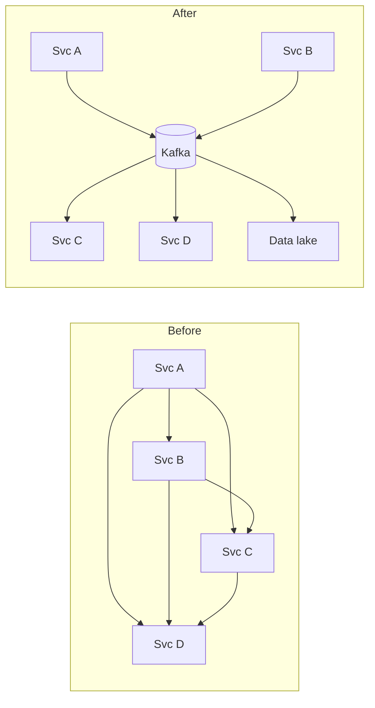
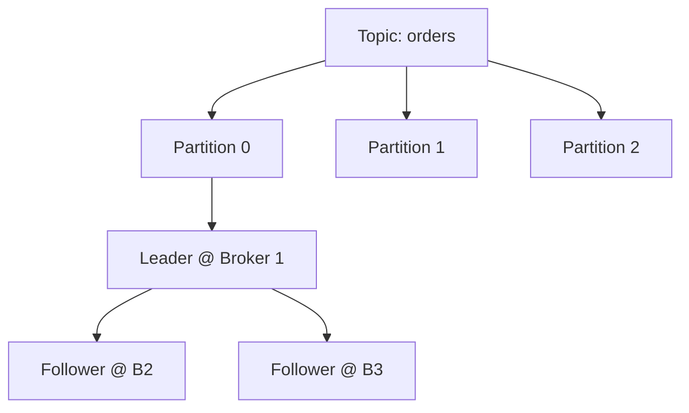
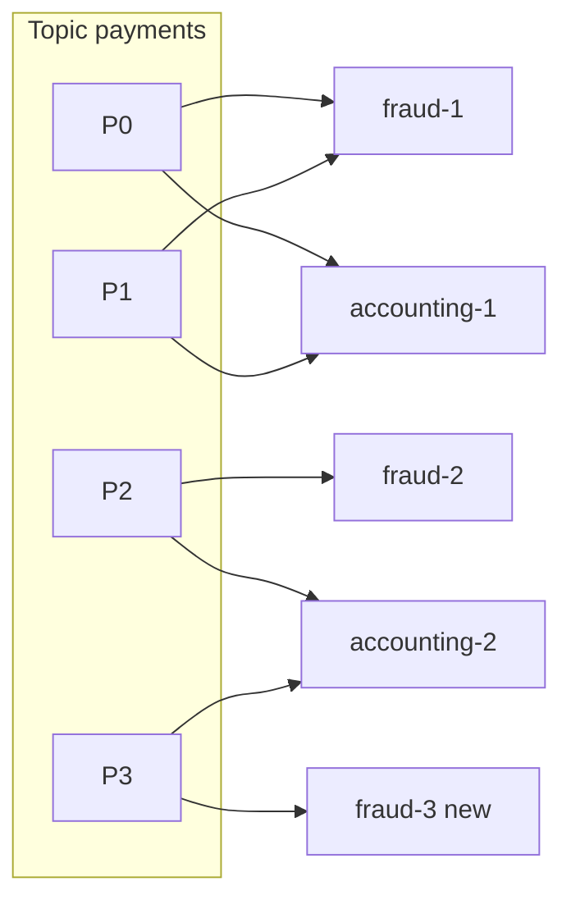

# 04 — Message Queue / Log (Apache Kafka)

*Um sistema real documentado. Como foi pesquisado e o que não foi conferido está em **Sources and provenance**, perto do fim.*

## At a glance

**Em 60 segundos.** O Kafka é um log particionado, replicado e append-only. Os producers acrescentam, os consumers puxam no seu próprio ritmo, e a retenção é por tempo ou tamanho, não por consumo, então os dados podem ser reprocessados. A durabilidade vem de replicar cada partição e só confirmar depois que as réplicas in-sync a têm. Um quorum Raft (KRaft) gerencia os metadados do cluster.

**Números principais**
- Defaults: `acks=all`, `min.insync.replicas=1`, `unclean.leader.election.enable=false`, `default.replication.factor=1` `[CONFIRMED]`.
- Session timeout do broker de 9 s, heartbeat de 2 s `[CONFIRMED]`.
- O Kafka 4.0 (2025-03-18) é a primeira versão sem ZooKeeper `[CONFIRMED]`.

**Decisões e trade-offs**

| Decisão | Por quê | Custo |
|---|---|---|
| A partição como unidade de ordem | Paralelismo e ordem por chave | Sem ordem global, e reparticionar quebra a ordem por chave |
| `acks=all` + `min.insync.replicas` | Escritas confirmadas sobrevivem à perda de um broker | Latência maior, e escritas rejeitadas quando o ISR encolhe |
| Tiered storage | Retenção longa barata | Leituras remotas são mais lentas |

**Erros comuns**
- Presumir que o replication factor padrão é 3 (o padrão do broker é 1).
- Esperar ordem global entre partições.
- Afirmar exactly-once para efeitos colaterais externos: vale apenas para processamento de Kafka para Kafka.

---

## 🧒 Non-technical explanation

O Kafka é como um **arquivo de jornal para a empresa inteira**.

- Os departamentos **publicam** artigos (eventos) em seções temáticas chamadas **topics**: "orders", "payments", "clicks".
- Quem se interessa **assina** e lê no seu próprio ritmo. Ler um artigo **não o remove**. Dez departamentos podem ler o mesmo, e alguém pode voltar e reler o jornal da semana passada.
- O arquivo é enorme, então cada seção é dividida em vários **fichários** (partitions) espalhados por muitas prateleiras (servidores), e cada fichário tem **três fotocópias** em prédios diferentes, caso um deles pegue fogo.
- Antes do Kafka, cada departamento mantinha seu próprio mensageiro para todos os outros departamentos, o que dava centenas de rotas frágeis. O Kafka as substituiu por um único lugar central em que todo mundo escreve e de onde todo mundo lê.

---

## TL;DR for engineers

- O Kafka é um **log particionado, replicado e append-only**. Uma partição é a unidade de ordem e de paralelismo `[CONFIRMED]` (documentação de design do Kafka).
- **Botões de durabilidade:** `acks=all` (o padrão) espera as réplicas in-sync. `min.insync.replicas` (padrão 1) define quantas precisam confirmar. `unclean.leader.election.enable=false` (padrão) prefere consistência a disponibilidade `[CONFIRMED]`.
- **Os consumers puxam.** Um consumer group atribui cada partição a exatamente um membro, então escale as leituras com partições e groups `[CONFIRMED]`.
- Os **metadados** ficam num quorum de controllers KRaft (Raft). O Kafka 4.0 removeu o ZooKeeper `[CONFIRMED]`.
- **A retenção é por tempo/tamanho, não por consumo**, então o replay é possível. O tiered storage (KIP-405) descarrega segmentos antigos para o object storage `[CONFIRMED]`.
- **Exactly-once** vale para processamento de Kafka para Kafka (producer idempotente + transações). Efeitos colaterais externos ainda exigem idempotency `[CONFIRMED]` (documentação de design) mais `[INDUSTRY PATTERN]` para o conselho de outbox/consumer idempotente.

---

## The one-sentence definition, decoded

> *"Kafka is an **open-source**, **distributed**, **durable**, very **scalable**, **fault-tolerant** **pub/sub messaging system** with rich **integration** and **stream processing** capabilities."*

| Palavra | Mecanismo |
|---|---|
| 💡 open-source | Criado no LinkedIn e depois doado à Apache (a newsletter diz 2010 e 2011. Não conseguimos reverificar os anos numa fonte primária) |
| 💡 pub/sub | Os producers escrevem uma vez, muitos consumer groups independentes leem |
| 💡 distributed | Cluster de brokers, ≥3 em deploys normais |
| 💡 scalable | Logs append-only particionados. Mais brokers → mais throughput. |
| 💡 durable | Replication factor (geralmente 3) entre availability zones |
| 💡 fault-tolerant | Um único leader por partição. O controller elege novos leaders quando um broker morre. |
| 💡 stream processing | Kafka Streams (exactly-once com transações) |
| 💡 rich integration | Kafka Connect + centenas de conectores |

---

## 1. Why Kafka exists: the O(N²) integration problem

O LinkedIn tinha N sistemas que precisavam dos dados uns dos outros, o que dá N² pipelines ponto a ponto. O Kafka transforma isso em **N escritores + M leitores contra um único log**:

Escritores e leitores ficam desacoplados. Os dados são retidos por um tempo (ex.: 7 dias) e o **fan-out de leitura é esperado**, então o throughput de leitura costuma ser um múltiplo do de escrita.

---

## 2. The core abstraction: the log

- **Append-only**, ordenado, imutável. Cada registro recebe um **offset** monotonicamente crescente.
- **Appends O(1) sem lock.** As leituras são sequenciais, o que é ideal para HDDs *e* para o page cache do SO.
- **Registro** = `byte[] key` (opcional) + `byte[] value` + timestamp + headers. **O Kafka não tem tipos.** A serialização (Avro/Protobuf/JSON) é trabalho do cliente.

### Topics → Partitions → Replicas

- **Topic** = categoria (como uma tabela).
- **Partition** = shard. Cada uma é um log independente e é a **unidade de paralelismo e de ordem**.
- **A ordem só é garantida dentro de uma partição.** Mesma chave → mesma partição (partitioner padrão: murmur2(key) mod N) → ordem por chave, desde que o número de partições não mude.

### Clients
- O Kafka fala seu **próprio protocolo binário sobre TCP** (não HTTP). Use as bibliotecas de cliente oficiais/da comunidade.
- `producer.send(new ProducerRecord<>(topic, key, value))`: o registro pode nomear uma partição explicitamente; caso contrário o partitioner escolhe uma (pelo hash da chave quando há chave).
- `KafkaConsumer.subscribe(topics)` e depois um loop de `poll()`.

---

## 3. Kafka as a distributed system

### Brokers, replication, leaders
- **Broker** = nó servidor do Kafka. **Cluster** = todos os brokers.
- **Replication factor** (tipicamente 3; o padrão do broker `default.replication.factor` na verdade é 1, veja as Reviewer notes): uma réplica **leader** aceita escritas, e os **followers** buscam do leader (hot standbys). Espalhados entre AZs.
- Quando um broker morre, os outros assumem a liderança das partições dele.

> ⚙️🔧 **Notas de engenharia (extensão)**
> - **ISR (In-Sync Replicas):** followers que estão em dia. Com `acks=all`, o leader só confirma uma escrita quando **todo membro atual do ISR** a tem. `min.insync.replicas=2` faz o leader **rejeitar** escritas se o ISR encolher abaixo de 2, então uma escrita confirmada está sempre em ≥2 réplicas. Esse par é o botão de durabilidade ([producer `acks`](https://kafka.apache.org/40/configuration/producer-configs/), [broker `min.insync.replicas`](https://kafka.apache.org/40/configuration/broker-configs/); note que `min.insync.replicas` tem padrão 1 e `acks` tem padrão `all` nos clients atuais).
> - **High watermark:** os consumers só veem registros replicados para todo o ISR (e que atendam `min.insync.replicas`), então nunca leem dados que poderiam sumir num failover limpo ([broker configs](https://kafka.apache.org/40/configuration/broker-configs/)).
> - `acks=0/1/all` troca latência por durabilidade. `unclean.leader.election.enable=false` (o padrão desde a 0.11.0) prefere indisponibilidade a perda de dados (comportamento CP) ([design: replication](https://kafka.apache.org/40/design/design/#replication)).

### Metadata log, controllers & KRaft
- Todos os metadados do cluster (topics, leaders de partição, configs) são armazenados como eventos num topic interno de uma única partição, o **`__cluster_metadata`**. Reproduzi-lo reconstrói o estado do cluster de forma determinística (event sourcing, veja a dualidade stream–table).
- Os **controllers** (geralmente 3) formam um **quorum Raft** (KRaft). O leader Raft = **active controller**, que:
  - escreve as decisões de metadados (novos topics, eleições de leader de partição)
  - acompanha a **liveness dos brokers** por heartbeats, aplicando **fencing** a um broker após ~6 s de silêncio e movendo suas lideranças (o número da fonte; o padrão configurado de `broker.session.timeout.ms` é 9 s, veja as Reviewer notes).
- Leader election em dois níveis:
  1. Os controllers elegem o active controller via **KRaft** (variante do Raft).
  2. O active controller elege os leaders de partição dos topics normais.
- Histórico: antes eram o **ZooKeeper** (consenso Zab) + um broker controller. O KRaft o substituiu ([KIP-500](https://cwiki.apache.org/confluence/display/KAFKA/KIP-500%3A+Replace+ZooKeeper+with+a+Self-Managed+Metadata+Quorum)), e o Kafka 4.0 (18 de março de 2025) removeu o ZooKeeper por completo ([anúncio do 4.0](https://kafka.apache.org/blog/2025/03/18/apache-kafka-4.0.0-release-announcement/)).
- Contraste: o **Redpanda** roda um grupo Raft *por partição* (C++, thread-per-core via Seastar) ([Redpanda architecture](https://docs.redpanda.com/current/get-started/architecture/)).

---

## 4. Features that set Kafka apart

### Retention & replay
- As mensagens são apagadas por **política de tempo/tamanho**, *não* no consumo. Isso permite o **replay**: corrija um bug no consumer, volte os offsets, reprocesse.
- Também há **log compaction** (manter o último valor por chave), que transforma um topic num changelog/tabela.

### Tiered storage ([KIP-405](https://cwiki.apache.org/confluence/display/KAFKA/KIP-405%3A+Kafka+Tiered+Storage))
- Problema: 1 GiB/s × 604.800 s (7 dias) × RF3 = 1.814.400 GiB ≈ **1.772 TiB** nos discos dos brokers. Isso torna o cluster inelástico (o rebalanceamento move TBs) e caro (o autor estima que armazenamento em disco replicado e auto-hospedado custa ~10× o S3).
- Solução: **hot tier** nos discos dos brokers (horas), **cold tier** descarregado de forma assíncrona para S3/GCS/Azure Blob. As leituras de dados antigos são servidas de forma transparente pelo object storage.
- Resultado (números do autor): retenção longa >10× mais barata, escala mais rápida, e SSDs se tornam viáveis para o conjunto quente.
- Status: o KIP-405 está marcado como pronto para produção desde o Kafka 3.9 ([KIP-405](https://cwiki.apache.org/confluence/display/KAFKA/KIP-405%3A+Kafka+Tiered+Storage)).

### Consumer groups (read parallelism)
- Um **consumer group** divide o trabalho: **cada partição é consumida por exatamente um membro** do group, o que preserva a ordem sem locks.
- Escale as leituras **adicionando membros** (até o nº de partições) ou **adicionando groups** (aplicações independentes relendo os mesmos dados).

- A coordenação é **centralizada por um broker Group Coordinator**. Os consumers enviam heartbeats a ele e recebem as atribuições de partição. Os consumers nunca conversam entre si.
- O progresso é guardado como `{group, topic, partition} → offset` no topic interno **`__consumer_offsets`**. Suas partições se espalham pelos brokers, então a carga de coordenação também se espalha.
- O protocolo de group é genérico o bastante para que **Kafka Streams e Kafka Connect** o reutilizem para a sua própria membership e leader election.

> ⚙️🔧 O **rebalancing** pausa o consumo ("stop-the-world") no protocolo clássico. O rebalancing cooperativo/incremental e o novo protocolo de consumer ([KIP-848](https://cwiki.apache.org/confluence/display/KAFKA/KIP-848%3A+The+Next+Generation+of+the+Consumer+Rebalance+Protocol)) reduzem isso. O KIP-848 chegou a GA no Kafka 4.0 como opt-in (`group.protocol=consumer`) ([anúncio do 4.0](https://kafka.apache.org/blog/2025/03/18/apache-kafka-4.0.0-release-announcement/)).

### Transactions & exactly-once
- **Producer idempotente:** producer ID + números de sequência por partição fazem com que um retry após um soluço de rede não duplique. Ativado por padrão nos clients atuais ([`enable.idempotence`](https://kafka.apache.org/40/configuration/producer-configs/)).
- Os **producer epochs** (por `transactional.id`) aplicam fencing às instâncias "zumbi" de producer após um restart.
- **Transações:** escrevem de forma atômica em várias partições/topics. Usam **two-phase commit** via um **Transaction Coordinator**. Os consumers com `isolation.level=read_committed` pulam os registros abortados.
- O **processamento exactly-once** só vale quando **tanto a entrada quanto a saída são Kafka** (consume-transform-produce). Com efeitos colaterais externos (HTTP, banco), você ainda precisa de idempotency nas bordas.

### Kafka Streams
Biblioteca Java do lado do cliente para processamento de streams com estado (map/filter/join/agregação com janelas) de topics de entrada para topics de saída. Escala como os consumer groups (mais threads). Exactly-once via transações. Os state stores são apoiados por topics de changelog compactados.

### Schema Registry
O Kafka não tem schema (o autor considera isso um erro). Convenção: um **schema registry** externo (Confluent SR, Karapace, Apicurio, AWS Glue). O producer registra um schema, embute o **schema ID** em cada mensagem, e os consumers buscam e guardam em cache o schema para desserializar. Imponha **regras de compatibilidade** (backward/forward) para evoluir com segurança.

### Kafka Connect
Runtime de integração no-code/low-code. **Source connectors** (banco/CDC → Kafka) e **sink connectors** (Kafka → Snowflake/ES/S3). Os workers formam um cluster coordenado pelo protocolo de group. O Debezium CDC é a fonte clássica.

---

## 5. ⚙️🔧 Why Kafka is fast (extension)

| Técnica | Efeito |
|---|---|
| I/O sequencial em segmentos append-only | Throughput de disco próximo do máximo do hardware |
| Depende do **page cache do SO** (não de um cache no heap da JVM) | Dados recentes são servidos da memória, e o cache continua quente entre restarts do broker ([design](https://kafka.apache.org/40/design/design/)) |
| **Zero-copy** (`sendfile`) do page cache para o socket | Sem cópias em user-space nas leituras dos consumers ([design](https://kafka.apache.org/40/design/design/)). Não com TLS: o transporte SSL lê para um buffer para criptografar ([`SslTransportLayer`](https://github.com/apache/kafka/blob/trunk/clients/src/main/java/org/apache/kafka/common/network/SslTransportLayer.java)) |
| **Batching + compressão** (lz4/zstd) de ponta a ponta | Menos syscalls e idas e vindas de rede |
| Particionamento | Paralelismo horizontal |
| Consumers pull-based | Os consumers controlam a própria taxa (back-pressure natural) |

---

## 6. What's next for Kafka

- **Queues / Share Groups** ([KIP-932](https://cwiki.apache.org/confluence/display/KAFKA/KIP-932%3A+Queues+for+Kafka)): vários consumers por partição com acks por registro (semântica de fila, sem garantia de ordem). Acesso antecipado no Kafka 4.0, pronto para produção no Kafka 4.2 ([anúncio do 4.2](https://kafka.apache.org/blog/2026/02/17/apache-kafka-4.2.0-release-announcement/)).
- **Diskless topics** ([KIP-1150](https://cwiki.apache.org/confluence/display/KAFKA/KIP-1150%3A+Diskless+Topics)): um novo tipo de topic com seu próprio motor de ingestão, que escreve direto no object storage e mantém os discos locais apenas como cache. A página do KIP lista o estado como **Accepted** (página atualizada pela última vez em 2026-03-02) e adia a implementação para os KIPs seguintes 1163 e 1164. Ela nomeia o fator de custo (tráfego de replicação entre AZs, ex.: AWS $0,02/GiB), mas não quantifica nenhuma economia. O "90%+ cloud cost reduction" da newsletter é afirmação do autor. Se já saiu em alguma versão, não foi reverificado (a base dizia que não até a 4.3, citando a [Aiven](https://aiven.io/blog/kip-1150-accepted-and-the-road-ahead)).
- **Iceberg topics:** dados do Kafka expostos como um formato de tabela aberto (Iceberg) para o lakehouse. Hoje são recursos de fornecedores (ex.: [Redpanda Iceberg Topics](https://docs.redpanda.com/current/manage/iceberg/about-iceberg-topics/), Confluent Tableflow, Aiven), não um recurso do Apache Kafka, e só algumas implementações são realmente zero-copy.
- **Alternativas compatíveis com o protocolo:** Confluent Kora, AWS MSK, Redpanda, WarpStream, Bufstream, Aiven Inkless, AutoMQ (o MSK é Apache Kafka gerenciado, não uma reimplementação, veja as Reviewer notes).

---

## 7. When to use Kafka vs a queue

| Necessidade | Kafka | SQS / RabbitMQ |
|---|---|---|
| Vários consumers independentes dos mesmos dados | ✅ | ❌ (precisa de fan-out exchange/SNS) |
| Replay / reprocessar o histórico | ✅ | ❌ (filas clássicas; os [RabbitMQ Streams](https://www.rabbitmq.com/docs/streams) permitem reler) |
| Ordem estrita por chave em escala | ✅ (por partição) | Limitado (filas FIFO) |
| Ack por mensagem, delays, prioridade, DLQ prontos de fábrica | Limitado (o KIP-932 ajuda) | ✅ |
| Custo operacional muito baixo em pequena escala | ❌ | ✅ |

---

## ⚠️ Reviewer notes on the source

- **"Fenced after 6 seconds" de heartbeats perdidos:** no KRaft o timeout é o lease do broker, `broker.session.timeout.ms`, cujo padrão é **9 s** (heartbeats a cada 2 s via `broker.heartbeat.interval.ms`). Trate os "6 s" como ilustrativos. ([Kafka broker configs](https://kafka.apache.org/40/configuration/broker-configs/))
- **Diskless topics "cut cloud costs by 90%+":** é uma estimativa do autor. O texto do [KIP-1150](https://cwiki.apache.org/confluence/display/KAFKA/KIP-1150%3A+Diskless+Topics) nomeia o fator de custo (replicação entre AZs e tráfego de clientes, citando preços de nuvem por GiB), mas não quantifica a economia, e os fornecedores citam números diferentes (a Aiven anuncia "up to 80%" para a sua implementação, [aiven.io/diskless](https://aiven.io/diskless)). A página do KIP o lista como Accepted (última atualização em 2026-03-02). Não reverificamos o status de release, e a nota anterior de que não havia saído até a 4.3 vem de um artigo de terceiros.
- **"The default and most common [replication factor] is three":** o mais comum, sim, mas o padrão do broker `default.replication.factor` é **1** (apenas topics internos como o `__consumer_offsets` têm padrão 3). Defina o RF explicitamente. ([Kafka broker configs](https://kafka.apache.org/40/configuration/broker-configs/))
- **AWS MSK na lista de alternativas que "implement [the protocol] differently":** o MSK "runs open-source versions of Apache Kafka" como serviço gerenciado; não é uma reimplementação como o Redpanda ou o WarpStream. ([MSK developer guide](https://docs.aws.amazon.com/msk/latest/developerguide/what-is-msk.html))
- **Unidades no exemplo de storage:** o corpo diz "1 GB/s" e "1,772 TB", mas a aritmética da nota de rodapé (e o número 1.772) está em GiB/s e TiB. As notas usam as unidades da nota de rodapé.

---

## 🏛️ Architecture lens (Fundamentals of Software Architecture)

> 🔧 Extensão. Mapeia este estudo de caso no vocabulário de Richards & Ford (veja [neokim-post/00-fundamentals.md §4](https://github.com/allmonty/study/blob/main/architecture/neokim-post/00-fundamentals.md#architecture-thinking)).

- **Características dominantes (Ch 4–5):** **escalabilidade** (partições), **tolerância a falhas** e **disponibilidade** (replicação, failover do leader), **confiabilidade/recuperabilidade** (log durável, replay), **performance** (throughput) e **evolutividade** (novos consumers sem tocar nos producers).
- **Estilo que ele viabiliza (Ch 14):** o Kafka é o **broker** numa *event-driven broker topology*: os processadores reagem a topics e "advertise what they did", sem um dono central do workflow. Retenção + replay é o gancho de extensibilidade do livro ("always advertise, even if no one listens") tornado durável. Para uma topologia *mediator* você põe um workflow engine por cima; o Kafka em si não orquestra.
- **Quanta (Ch 7):** topics assíncronos deixam um producer e seus consumers serem **quanta separados**, com características diferentes (um consumer de pagamentos de 500 ms por mensagem não consegue estourar o timeout de um producer rápido). A ressalva do Ch 14: consumers que compartilham um banco com o producer, ou que esperam um request-reply, continuam sendo o **mesmo quantum**.
- **Trade-off (Ch 2, "topics vs queues"):** um topic dá **extensibilidade e desacoplamento**. Custa **controle de acesso aos dados** (qualquer um pode assinar), força **um contrato compartilhado** para todos os consumers e dificulta o monitoramento por consumer. É exatamente a tabela Kafka vs SQS/RabbitMQ acima.
- **Esboço de ADR (Ch 19):** *"Vamos usar topics do Kafka entre Orders e os serviços downstream porque precisamos de replay e de consumer groups independentes. Aceitamos um contrato de schema compartilhado, imposto por um schema registry no CI como fitness function."*
- Em linguagem simples: o Kafka é o quadro de avisos da empresa. Qualquer um pode afixar ou ler um aviso sem pedir a ninguém, mas isso também significa que qualquer um pode ler todos os avisos.

---

## Interview questions to practice

1. Você precisa de ordem por cliente, mas um cliente produz 50% do tráfego. O que acontece e como você corrige?
2. Descreva o que acontece quando o broker de um leader de partição perde energia.
3. Explique por que o exactly-once quebra quando o seu consumer escreve no Postgres. Como se chega a "effectively once"?
4. Quantas partições um topic deve ter? Quanto custa o excesso de partições?
5. Compare o transactional outbox + CDC (Debezium) com dual writes no banco e no Kafka.

## Interview practice

Estes roteiros são raciocínio nosso (`[INDUSTRY PATTERN]`), não afirmações das fontes citadas.

**Um roteiro de 45 minutos**

1. Esclarecer: necessidades de ordem, retenção, throughput, consumers.
2. Estimar: bytes por segundo × retenção × replicação.
3. API: produzir com chave, consumir num group.
4. Design: topics, partições, réplicas, quorum de controllers.
5. Deep dive: ISR, acks, consumer groups, producer idempotente.
6. Falhas e escala: perda de leader, rebalancing, tiered storage.

**Se crescer 10×**
- O custo de storage cresce com a retenção: use tiered storage.
- Os rebalances pausam os consumers: use o protocolo de consumer mais novo.
- Partições quentes: mude a chave de particionamento ou adicione subchaves.

**Roteiros de resposta** (tente as perguntas acima primeiro)

Ordem por cliente, mas um cliente é 50% do tráfego?

A ordem só vale dentro de uma partição, então o tráfego desse cliente cai numa partição só e vira um ponto quente. Opções: aceitar, dividir por uma chave mais fina se a ordem só for necessária por entidade, ou fazer shard desse cliente entre partições e abrir mão de uma ordem única.

O broker de um leader de partição perde energia?

O controller percebe os heartbeats perdidos, aplica fencing ao broker e elege um novo leader a partir do ISR. Os producers fazem retry, e os números de sequência do producer idempotente evitam duplicatas.

Por que o exactly-once quebra quando o consumer escreve no Postgres?

As transações do Kafka cobrem apenas leituras e escritas no Kafka. A escrita no banco é um efeito colateral externo, então use uma escrita idempotente ou um outbox para chegar a effectively-once.

## 📚 Further reading

- Jay Kreps, [The Log: What every software engineer should know about real-time data's unifying abstraction](https://engineering.linkedin.com/distributed-systems/log-what-every-software-engineer-should-know-about-real-time-datas-unifying)
- [Kafka documentation: Design](https://kafka.apache.org/documentation/#design)
- [Why was Apache Kafka created? (Stanislav Kozlovski)](https://bigdatastream.substack.com/p/why-was-apache-kafka-created)
- [2 Minute Streaming newsletter](https://blog.2minutestreaming.com/) · [Big Data Stream](https://bigdata.2minutestreaming.com/)
- [Raft consensus visualised](https://raft.github.io/)
- [Martin Fowler: Event Sourcing](https://martinfowler.com/eaaDev/EventSourcing.html)
- Relacionado nesta pasta: [19 Stock exchange](19-stock-exchange.md) (logs sequenciados, replay determinístico)

## Sources and provenance

> **Kind:** real-system (código aberto, então o comportamento é documentado).
> **Basis:** atualizado a partir de [`neokim-post/04`](https://github.com/allmonty/study/blob/main/architecture/neokim-post/04-how-apache-kafka-works.md), um resumo de [How Kafka Works](https://newsletter.systemdesign.one/p/how-kafka-works) (autor convidado Stanislav Kozlovski). Re-verified on 2026-10-27 contra a documentação do Apache Kafka e os anúncios de release listados no log no final.
> **Tags:** `[CONFIRMED]` afirmado por uma fonte primária · `[INDUSTRY PATTERN]` prática padrão · `[SPECULATIVE]` escolha plausível. As afirmações sobre defaults e status de release são `[CONFIRMED]` contra a página do Kafka linkada, salvo indicação em contrário. As notas "author's figure" significam que a afirmação vem do artigo da newsletter e não foi conferida de forma independente.

---
## ✅ Verification log

*Inherited log (neokim-post/04), 2026-10-03:* Verified 24 · Corrected 6 · Softened/removed 5.

*Re-verification for this folder, 2026-10-27,* against Kafka 4.0 broker and producer config pages, the Kafka 4.0 design page, the 4.0 and 4.2 release announcements, the KIP-405 page and the KIP-1150 page.
- Verified: `default.replication.factor` = 1; `min.insync.replicas` = 1; `unclean.leader.election.enable` = false; `broker.session.timeout.ms` = 9000; `broker.heartbeat.interval.ms` = 2000; `offsets.topic.replication.factor` = 3; producer `acks` = `all`; `enable.idempotence` = true.
- Verified: ISR and "committed" definitions; unclean-election trade-off and the 0.11.0.0 default; page cache and `sendfile` statements; pull model; transactions across partitions; log compaction and tombstones; "exactly one consumer within each subscribing consumer group".
- Verified: Kafka 4.0 released 2025-03-18, first major release without ZooKeeper, KIP-848 GA with opt-in `group.protocol=consumer`, KIP-932 early access in 4.0; Kafka 4.2 released 2026-02-17 with Queues/Share Groups declared production-ready; KIP-405 marked production-ready since 3.9 and its hot/cold design.
- Corrected: the baseline described KIP-1150 as "leaderless, write directly to object storage". The KIP page does not use "leaderless" and describes write-through to object storage with local disks as a cache. Reworded.
- Corrected: "accepted in March 2026" now reads as "Accepted, page last updated 2026-03-02", since the page gives no acceptance date.
- Softened: LinkedIn origin years (2010/2011) could not be re-verified: the LinkedIn engineering "The Log" page returned 404 to our fetch.
- Not re-verified in this pass (carried over): murmur2 as the default partitioner (not named on the design page), the `__consumer_offsets` key layout, `SslTransportLayer` and zero-copy-with-TLS, the Redpanda, RabbitMQ Streams and MSK comparisons, the storage arithmetic (re-derived by hand: 1 GiB/s × 604,800 s × 3 = 1,814,400 GiB ≈ 1,772 TiB), and the newsletter's cost multiples.
