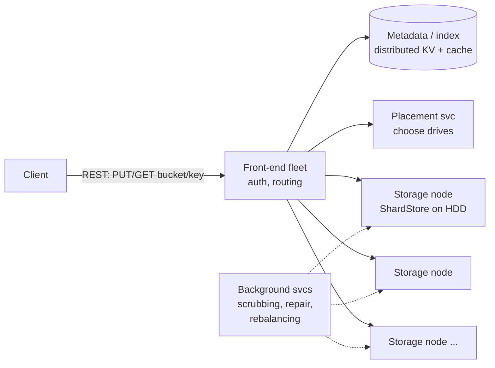

# 05 — Object Storage (Amazon S3)

*Um sistema real documentado. Como foi pesquisado e o que não foi conferido está em **Sources and provenance**, perto do fim.*

## At a glance

**Em 60 segundos.** O S3 armazena objetos imutáveis endereçados por bucket e chave. Metadados e dados são sistemas separados. Os dados são divididos em shards com erasure coding espalhados por muitos discos, e a AWS diz que os objetos são armazenados de forma redundante em pelo menos três availability zones. Como os shards se mapeiam para as zonas não é publicado, e a ideia de que a durabilidade vem de um reparo rápido (e não apenas de cópias) é leitura nossa `[INDUSTRY PATTERN]`. Desde dezembro de 2020 as leituras são fortemente consistentes, obtidas com uma 'witness' de cache coherence.

**Números principais**
- Projetado para 99,999999999% de durabilidade e 99,99% de disponibilidade `[CONFIRMED]`.
- Cerca de 120 operações aleatórias por segundo por disco, milhões de discos `[CONFIRMED]` (Warfield).
- Pelo menos 3.500 requisições de escrita e 5.500 de leitura por segundo por prefixo `[CONFIRMED]`.

**Decisões e trade-offs**

| Decisão | Por quê | Custo |
|---|---|---|
| Erasure coding em vez de 3 cópias | Menor overhead de armazenamento para durabilidade parecida | Tráfego de reparo, CPU e latência em objetos pequenos |
| Separar metadados e dados | Cada um escala de forma independente | A ordem do commit importa: metadados por último |
| Espalhar por muitos discos | Descorrelaciona hot spots | Exige maquinário de placement e rebalanceamento |

**Erros comuns**
- Citar o k e o m exatos do S3. Eles não são públicos.
- Afirmar que o S3 é eventualmente consistente (não é desde dezembro de 2020).
- Esquecer que a durabilidade depende da rapidez com que os shards perdidos são reparados.


---

## 🧒 Non-technical explanation

O S3 é um **estacionamento valet gigantesco para arquivos**. Você entrega um arquivo e um nome (`bucket/photos/cat.jpg`). O S3 garante que **praticamente nunca vai perdê-lo**, e você pode buscá-lo de qualquer lugar da internet.

Como ele consegue prometer isso usando discos rígidos baratos, lentos e sujeitos a falhas?
- Ele mantém o **livro de "onde está estacionado"** (metadados) separado das **vagas** (os bytes de fato), para que cada um cresça por conta própria.
- Em vez de fazer 3 cópias completas do seu arquivo (caro), ele **corta o arquivo em pedaços e acrescenta algumas peças "resolvedoras de quebra-cabeça"**. Mesmo que vários pedaços sejam destruídos, os que faltam podem ser **reconstruídos matematicamente**. Isso é **erasure coding**.
- Esses pedaços são **espalhados por milhares de discos** em prédios diferentes. Nenhum disco isolado fica sobrecarregado, e as leituras podem puxar de muitos discos ao mesmo tempo.

---

## TL;DR for engineers

- **Object storage:** namespace plano (`bucket` + `key`), objetos imutáveis (uma sobrescrita substitui o objeto inteiro, ou cria uma nova versão se o versioning estiver ligado), API HTTP.
- **Front end → metadados (índice) → nós de storage.** Existe um subsistema de metadados com cache (Vogels, 2021); que ele seja um key-value store distribuído é leitura nossa `[INDUSTRY PATTERN]`. Os dados ficam em nós de storage com HDD rodando o **ShardStore** (um motor key-value baseado em LSM-tree) ([SOSP '21](https://jamesbornholt.com/papers/shardstore-sosp21.pdf)).
- **Durabilidade via erasure coding** (ex.: Reed–Solomon com k shards de dados + m de paridade `[CONFIRMED]` no relato de Warfield; se os shards de um objeto são espalhados entre zonas não é dito, então trate esse placement como `[INDUSTRY PATTERN]`) ([Warfield](https://www.allthingsdistributed.com/2023/07/building-and-operating-a-pretty-big-storage-system.html)). Parâmetros típicos de RS dão ~1,x× de overhead em vez de 3× (os k/m reais do S3 não são públicos), e o S3 é projetado para 11 noves de durabilidade ([AWS docs](https://docs.aws.amazon.com/AmazonS3/latest/userguide/DataDurability.html)).
- **Performance via paralelismo.** Cada HDD é lento (~120 IOPS), mas espalhar os shards por milhões de discos transforma isso em um throughput agregado enorme e descorrelaciona hot spots ([Warfield](https://www.allthingsdistributed.com/2023/07/building-and-operating-a-pretty-big-storage-system.html)).
- **Consistência read-after-write forte** desde dez/2020 ([AWS blog](https://aws.amazon.com/blogs/aws/amazon-s3-update-strong-read-after-write-consistency/)).

---

## 1. Why object storage? (The startup story)

Os logs de analytics de uma startup crescem além de um servidor de storage, o que cria problemas de:
- **Escalabilidade:** comprar servidores cada vez maiores é caro, e o capacity planning é difícil.
- **Performance:** ajustar o storage exige uma expertise que eles não têm.

Eles migram para o S3 (100M+ requisições/s no serviço como um todo) para focar no produto.

| | Block (EBS) | File (EFS/NFS) | **Object (S3)** |
|---|---|---|---|
| Unidade | Blocos fixos | Arquivos numa hierarquia | Objetos + metadados, chaves planas |
| Acesso | Disco montado | POSIX | API HTTP |
| Mutabilidade | No lugar | No lugar | **Substituição do objeto inteiro** |
| Escala | Um único volume | Na casa dos PB | **Praticamente ilimitada** |

---

## 2. Architecture



- A **separação entre metadados e dados** permite que cada camada escale de forma independente (bilhões de pequenas entradas de metadados vs exabytes de bytes).
- Cada caixa é formada por **centenas de microsserviços** que conversam por contratos de API.
- Metadados: `bucket/key → {version, size, etag, shard locations, ...}`. Mantidos em cache por disponibilidade e velocidade.

---

## 3. Performance on cheap disks

### Hard disk physics
- O **seek time** (mover a cabeça até a trilha) + a **latência rotacional** (esperar o setor) são aproximadamente **constantes** por I/O e não melhoram há décadas.
- Os discos ficam **maiores, mas não mais rápidos**, então o **IOPS por TB só cai**. Um disco grande guarda mais dados, o que significa mais requisições competindo pela mesma cabeça.
- Um único disco pode virar um **hot spot** se os dados populares se concentrarem nele.

### The fix: parallelism + spreading
- Divida cada objeto em **shards** espalhados por **muitos discos**. Uma leitura busca os shards em paralelo, então o throughput = soma de muitos discos.
- Como os dados de cada cliente se espalham por uma frota enorme, **a rajada de um cliente é uma fração minúscula da carga de qualquer disco**. As cargas de trabalho se descorrelacionam em escala, o que a AWS chama de "**heat management**".

### ShardStore
- O motor de storage por nó: um KV store **estilo LSM-tree** que mapeia IDs de shard → dados em disco (escritas log-structured = I/O sequencial).
- Escrito em Rust (~40 mil linhas); o índice é uma LSM tree com os dados dos shards guardados fora da árvore para reduzir a write amplification. A AWS usou **lightweight formal methods** (modelos de referência executáveis, property-based testing, model checking) para validar a crash consistency. Veja o [paper do SOSP '21](https://jamesbornholt.com/papers/shardstore-sosp21.pdf).

---

## 4. 🔧 Erasure coding (the paywalled part)

**Replicação completa** (3 cópias) = **200% de overhead**, caro demais na escala de exabytes.

**Erasure coding (Reed–Solomon):** divida os dados em **k** shards de dados e calcule **m** shards de paridade. **Quaisquer k dos k+m shards reconstroem o objeto** (vale para códigos MDS como o Reed–Solomon). Warfield confirma que o S3 usa "an algorithm, such as Reed-Solomon" com k shards de identidade e m de paridade ([blog](https://www.allthingsdistributed.com/2023/07/building-and-operating-a-pretty-big-storage-system.html)); o layout 5+3 abaixo é só ilustrativo.

```
Object ──split──▶ D1 D2 D3 D4 D5          (k = 5 data shards)
                    └─ encode ─▶ P1 P2 P3   (m = 3 parity shards)
Store 8 shards on 8 drives in ≥3 AZs.
Lose ANY 3 → still recoverable.     Overhead = 8/5 = 1.6× (vs 3.0× for replication)
```

| Esquema | Overhead de storage | Falhas toleradas | Custo de reparo |
|---|---|---|---|
| Replicação 3× | 3,0× | 2 cópias | Copiar 1 objeto |
| RS(6,3) | 1,5× | 3 shards | Ler 6 shards para reconstruir 1 |
| RS(10,4) | 1,4× | 4 shards | Ler 10 shards |

**Trade-offs:** CPU para encode/decode, **repair amplification** (leituras de rede durante a reconstrução), maior latência em objetos pequenos. Os sistemas costumam replicar objetos pequenos ou quentes e aplicar erasure coding nos grandes ou frios.

### 🔧 Durability machinery
- **11 noves** (99,999999999%) de durabilidade **projetada** dos objetos ao longo de um ano ([AWS docs](https://docs.aws.amazon.com/AmazonS3/latest/userguide/DataDurability.html)).
- Dados armazenados de forma redundante em **≥3 Availability Zones** (exceto as classes One Zone), projetados para sobreviver à perda de uma AZ inteira ([AWS docs](https://docs.aws.amazon.com/AmazonS3/latest/userguide/DataDurability.html)).
- **Scrubbing contínuo:** processos em background leem shards, verificam **checksums**, detectam bit rot e discos com falha, e **re-replicam/re-codificam** rapidamente (AWS: "quickly detecting and repairing any lost redundancy" e verificando a integridade com checksums, [docs](https://docs.aws.amazon.com/AmazonS3/latest/userguide/DataDurability.html)). A durabilidade é função de *quão rápido você repara* em relação à rapidez com que os discos falham.
- **Checksums de ponta a ponta** no upload: Content-MD5 mais checksums flexíveis (CRC64NVME por padrão; também CRC32, CRC32C, SHA-1, SHA-256 e outros) ([AWS docs](https://docs.aws.amazon.com/AmazonS3/latest/userguide/checking-object-integrity.html)).

### 🔧 Consistency
- Desde **dez/2020, consistência read-after-write forte** para todos os PUTs/DELETEs e LISTs, sem custo extra ([AWS blog](https://aws.amazon.com/blogs/aws/amazon-s3-update-strong-read-after-write-consistency/), [docs](https://docs.aws.amazon.com/AmazonS3/latest/userguide/Welcome.html#ConsistencyModel)). Um protocolo de cache coherence no subsistema de metadados, com um componente "witness" atuando como barreira de leitura, torna isso possível ([Werner Vogels](https://www.allthingsdistributed.com/2021/04/s3-strong-consistency.html)).
- Antes disso, PUTs de sobrescrita, DELETEs e LISTs eram eventualmente consistentes (PUTs de objetos novos tinham read-after-write), o que forçava os hacks no estilo S3Guard de que alguns de nós se lembram.

---

## 5. 🔧 Using S3 well (practitioner notes)

| Tópico | Orientação |
|---|---|
| **Taxa de requisições** | ≥ **3.500 PUT/COPY/POST/DELETE** e **5.500 GET/HEAD** por segundo **por prefixo particionado**. Espalhe as chaves entre prefixos para obter mais ([docs](https://docs.aws.amazon.com/AmazonS3/latest/userguide/optimizing-performance.html)). |
| **Uploads grandes** | **Multipart upload** (partes de 5 MiB–5 GiB, até 10.000 partes; objeto máximo de **48,8 TiB**: o número da página de limites, que é 10.000 partes × 5 GiB. O anúncio de 2025-12-02 chama isso de um aumento de 10× para "50 TB", ante 5 TB) ([limits](https://docs.aws.amazon.com/AmazonS3/latest/userguide/qfacts.html), [announcement](https://aws.amazon.com/about-aws/whats-new/2025/12/amazon-s3-maximum-object-size-50-tb/)). Paralelo e com retry por parte. |
| **Downloads grandes** | **GETs por byte-range** em paralelo |
| **Acesso direto do cliente** | **Pre-signed URLs** (PUT/GET com prazo) para que os bytes não passem pelos seus servidores de aplicação |
| **Camadas de custo** | Standard → Intelligent-Tiering → Standard-IA / One Zone-IA → Glacier Instant/Flexible/Deep Archive, mais Express One Zone para baixa latência ([docs](https://docs.aws.amazon.com/AmazonS3/latest/userguide/Welcome.html)). **Lifecycle rules.** |
| **Integridade** | Versioning, Object Lock (WORM), replicação (CRR/SRR) |
| **Segurança** | Block Public Access, bucket policies, criptografia SSE-S3/SSE-KMS |
| **Analytics** | Athena / S3 Tables (Iceberg). O S3 Select está fechado para novos clientes ([docs](https://docs.aws.amazon.com/AmazonS3/latest/userguide/selecting-content-from-objects.html); em vigor desde 25 de julho de 2024, segundo a [AWS Insider](https://awsinsider.net/articles/2024/08/01/aws-closes-door-to-some-services.aspx)). |

---

## 6. 🔧 Designing "S3-like" storage in an interview

1. **API:** `PUT/GET/DELETE /bucket/key`, `LIST ?prefix=&continuation-token=`, multipart.
2. **Serviço de metadados:** KV com sharding (partição por `hash(bucket, key)`), com um índice ordenado por bucket, separado, para o LIST.
3. **Serviço de dados:** o placement escolhe k+m discos entre domínios de falha. Faça o encode em stream.
4. **Caminho de escrita:** front end → alocar locais dos shards → escrever os shards em paralelo → **commit dos metadados por último** (o objeto só fica visível quando seus metadados existem).
5. **Caminho de leitura:** consulta aos metadados → busca paralela dos k shards mais rápidos (ignore os retardatários) → decode.
6. **Background:** scrubber, repairer, garbage collector (shards órfãos de uploads que falharam), rebalancer.
7. **Deletes:** tombstone nos metadados, GC assíncrono dos shards.

---

## 🏛️ Architecture lens (Fundamentals of Software Architecture)

> 🔧 Extensão. Vocabulário em [neokim-post/00-fundamentals.md §4](https://github.com/allmonty/study/blob/main/architecture/neokim-post/00-fundamentals.md#architecture-thinking).

- **Características dominantes (Ch 4–5):** **durabilidade** (11 noves), que corresponde à *confiabilidade/recuperabilidade* do livro (o livro não tem uma entrada separada para durabilidade), **disponibilidade**, **escalabilidade** (centenas de exabytes, 200M+ req/s em média segundo a [página de produto do S3](https://aws.amazon.com/s3/), acima dos 100M+ do FAST '23) e **performance** via paralelismo. A **consistência dos dados** é uma característica explícita desde o read-after-write forte de 2020. O custo é uma restrição de primeira classe, e é por isso que existe erasure coding em vez de 3× réplicas.
- **Estilo (Ch 17):** internamente **microsserviços**: "hundreds of microservices" ([Warfield](https://www.allthingsdistributed.com/2023/07/building-and-operating-a-pretty-big-storage-system.html)) por trás de contratos de API, cada um dono dos seus dados (front end, índice, placement, nós ShardStore, reparo em background). A divisão metadados/dados é o **bounded context** do livro aplicado ao storage. As duas camadas não compartilham schema, então cada uma pode escalar e evoluir por conta própria.
- **Quanta (Ch 7):** o caminho da requisição (front end → índice → nós de storage) é **síncrono**, então é **um quantum** para a garantia de que "o PUT devolve 200". Scrubbing, reparo, GC e rebalanceamento rodam **de forma assíncrona**, com ritmo e modos de falha próprios, então são quanta separados. É por isso que um backlog de reparo reduz as margens de durabilidade sem prejudicar a latência das requisições.
- **Trade-off (First Law, Ch 1):** o erasure coding troca **custo de storage** (1,4–1,6× em vez de 3×) por **repair amplification, CPU e latência em objetos pequenos**. Políticas híbridas (replicar objetos pequenos ou quentes, aplicar erasure coding nos grandes ou frios) são a resposta "least worst" (Ch 4).
- **Fitness function (Ch 6):** os modelos de referência executáveis e os testes de crash property-based do ShardStore são uma **fitness function automatizada** de manual, protegendo uma característica (crash consistency) a cada mudança.
- Em linguagem simples: a garagem mantém o livro-razão e as vagas em prédios separados, então pode adicionar mais de qualquer um dos dois. A equipe da noite que reestaciona os carros danificados trabalha no seu próprio ritmo.

---

## Interview questions to practice

1. Por que o S3 faz o commit dos metadados *depois* de escrever os dados? O que aconteceria se a ordem fosse invertida?
2. Calcule a durabilidade para RS(10,4) com 2% de AFR e 6 horas de tempo de reparo (aproximadamente).
3. Como você implementaria o `LIST` com prefixos sobre um store de metadados particionado por hash?
4. Por que o erasure coding é uma escolha ruim para objetos de 1 KB?
5. Como espalhar os dados por mais discos *melhora* a latência de cauda?

## Interview practice

Estes roteiros são raciocínio nosso (`[INDUSTRY PATTERN]`), não afirmações das fontes citadas.

**Um roteiro de 45 minutos**

1. Esclarecer: tamanhos de objeto, durabilidade, consistência, padrões de acesso.
2. Estimar: objetos, bytes, taxa de requisições.
3. API: PUT, GET, DELETE, LIST, multipart.
4. Design: front end, índice de metadados, nós de storage, placement.
5. Deep dive: erasure coding, consistência forte, durabilidade.
6. Falhas e escala: perda de disco e reparo, prefixos quentes, listagem.

**Se crescer 10×**
- Prefixos quentes: espalhe as chaves entre prefixos.
- A carga de reparo cresce com o número de discos: reparo paralelo e priorizado.
- O crescimento dos metadados pede um índice particionado e com cache.

**Roteiros de resposta** (tente as perguntas acima primeiro)

<details><summary>Por que fazer o commit dos metadados depois de escrever os dados?</summary>

Um objeto só deve ficar visível quando seus dados estiverem duráveis. Se os metadados fossem escritos primeiro, um leitor poderia encontrar um objeto cujos shards ainda não existem.

</details>

<details><summary>Como funciona o LIST com prefixos sobre um índice particionado por hash?</summary>

Depende de como o índice é particionado, o que o S3 não publica nas fontes que lemos. Se as chaves são particionadas por hash, uma varredura por faixa precisa de um índice ordenado separado por bucket para a listagem. Se o índice é particionado por faixa de chaves (como sugerem os limites de requisição por prefixo e o conselho de espalhar as chaves entre prefixos), a listagem por prefixo é uma varredura de faixa, e o preço são os prefixos quentes. Diga qual você assume e por quê.

</details>

<details><summary>Por que o erasure coding é ruim para objetos de 1 KB?</summary>

O encode e o placement de muitos shards minúsculos custam mais do que economizam, então os objetos pequenos ou quentes costumam ser replicados e os grandes e frios recebem erasure coding.

</details>

## 📚 Further reading

- Andy Warfield (keynote do FAST '23, versão em blog): [Building and operating a pretty big storage system called S3](https://www.allthingsdistributed.com/2023/07/building-and-operating-a-pretty-big-storage-system.html)
- [Using lightweight formal methods to validate a key-value storage node in Amazon S3 (SOSP '21)](https://jamesbornholt.com/papers/shardstore-sosp21.pdf)
- [AWS: S3 strong read-after-write consistency](https://aws.amazon.com/blogs/aws/amazon-s3-update-strong-read-after-write-consistency/)
- [S3 performance guidelines](https://docs.aws.amazon.com/AmazonS3/latest/userguide/optimizing-performance.html)
- [How AWS S3 scales with tens of millions of hard drives (Big Data Stream)](https://bigdata.2minutestreaming.com/p/how-aws-s3-scales-with-tens-of-millions-of-hard-drives)
- [Erasure code (Wikipedia)](https://en.wikipedia.org/wiki/Erasure_code) · [LSM tree (Wikipedia)](https://en.wikipedia.org/wiki/Log-structured_merge-tree)
- Alex Xu, *System Design Interview Vol. 2*: "Design S3-like Object Storage"

## Sources and provenance

> **Kind:** real-system, mas só parcialmente público. A AWS publica as garantias (docs), o design do nó de storage (o paper do ShardStore, SOSP '21) e parte da arquitetura (a keynote de Warfield no FAST '23, Vogels sobre consistência). Os parâmetros exatos de erasure coding e o layout interno de front-end/metadados **não** são públicos, então essas partes são `[INDUSTRY PATTERN]`.
> **Basis:** atualizado a partir de [`neokim-post/07`](https://github.com/allmonty/study/blob/main/architecture/neokim-post/07-how-amazon-s3-works.md) (um resumo de [S3 Architecture](https://newsletter.systemdesign.one/p/s3-architecture), que ele próprio diz ser "based on research, may differ from real implementation"). Re-verified on 2026-10-27, veja o log.
> **Tags:** `[CONFIRMED]` afirmado por uma fonte primária da AWS · `[INDUSTRY PATTERN]` prática padrão ou ilustrativa, não afirmada pela AWS para o S3 · `[SPECULATIVE]` plausível. O marcador 🔧 vem da base: conteúdo reconstruído além da metade pública da newsletter.

---
## ✅ Verification log

*Inherited log (neokim-post/07), 2026-10-03:* Verified 19 · Corrected 5 · Softened/removed 3.

*Re-verification for this folder, 2026-10-27,* reading the primary pages directly.
- Verified in [Warfield's blog](https://www.allthingsdistributed.com/2023/07/building-and-operating-a-pretty-big-storage-system.html): S3 launched 2006-03-14; "hundreds of microservices"; ~120 random operations per second per drive; "millions" of drives, with tens of thousands of customers' buckets spread across millions of drives and a burst served by over a million disks; Reed-Solomon with k identity shards (any k of k+m suffice; no k or m values given); the heat-management and decorrelation argument; the Rust rewrite and lightweight formal verification, with the model about 1% of the system.
- Verified in the ShardStore SOSP '21 paper text: "over 40,000 lines of Rust", an LSM tree "with shard data stored outside" it, extents with sequential writes and write pointers, reference models at about 1% of the code, property-based testing for functional and crash-consistency checks.
- Verified in AWS docs: design for 99.999999999% durability and 99.99% availability; at least three AZs for most classes (One Zone-IA is one AZ); designed to survive loss of an AZ; integrity verified with checksums; strong read-after-write for PUT and DELETE (new and overwrite) plus strongly consistent LIST/metadata reads; concurrent writers resolve last-writer-wins with no object locking; bucket configuration is eventually consistent; ≥3,500 write and ≥5,500 read requests per second per prefix, with no limit on prefixes; multipart limits and 48.8 TiB maximum object size.
- Verified in Vogels (2021): the metadata cache was the main source of the old eventual consistency; a cache coherence protocol with a "witness" acting as a read barrier; goal of no performance or availability trade-off.
- Verified in the AWS announcements: strong consistency announced 2020-12-01 at no extra charge (the post names GET, PUT and LIST plus tag/ACL/metadata changes; the docs page names DELETE); max object size 50 TB announced 2025-12-02 (10× the previous 5 TB).
- Corrected: "50 TB (48.8 TiB)" now explains the difference: the limits page says 48.8 TiB, which equals 10,000 × 5 GiB, and the announcement rounds to 50 TB.
- Not re-verified (carried over): "200M+ requests/s on average" and "hundreds of exabytes" on the S3 product page, the Big Data Stream article, the checksum default CRC64NVME, S3 Select closure date, the repair-cost table and every interview-design item in section 6 (all `[INDUSTRY PATTERN]`).
- Unchanged and unconfirmed by AWS: S3's real k and m, shard placement, and the front-end/metadata layout. The newsletter's diagrams of those layers are reconstructions.
- Corrected (independent review, 2026-10-27): Warfield's post supports Reed-Solomon shards but does not mention availability zones, and AWS's durability page says objects are stored across at least three zones without saying how the shards of one object are placed; the note now keeps the two facts apart. The metadata-store line is reduced to what Vogels states.
