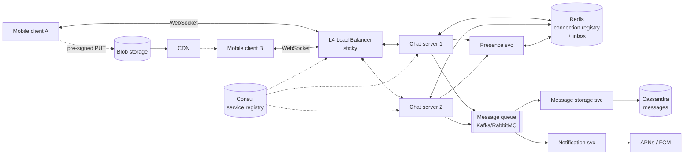
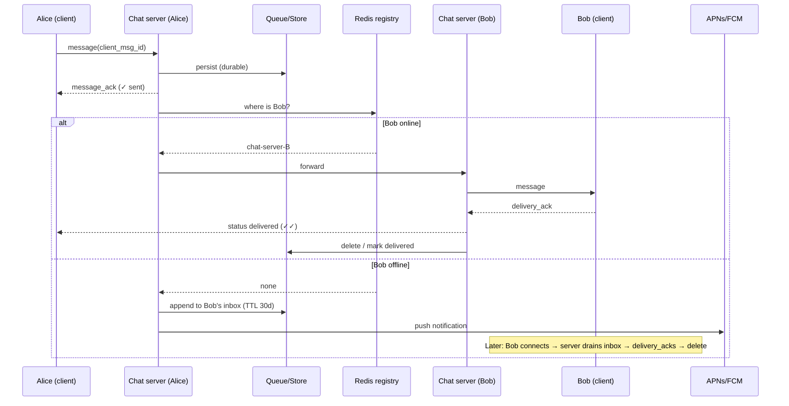

# 08 — Chat (WhatsApp)

*Um reference design construído sobre building blocks verificados. Como foi pesquisado e o que não foi conferido está em **Sources and provenance**, perto do fim.*

## At a glance

**Em 60 segundos.** Um sistema de chat mantém uma conexão persistente por dispositivo, roteia texto cifrado entre os servidores do remetente e do destinatário e guarda as mensagens não entregues até o destinatário se reconectar. Os fatos publicados do WhatsApp são o design de criptografia (protocolo Signal, fan-out no cliente por dispositivo, transporte Noise), a retenção de 30 dias das mensagens não entregues e marcos antigos de escala de conexões. Todo o resto aqui é o design padrão de entrevista.

**Números principais**
- Mensagens não entregues guardadas criptografadas por até 30 dias, apagadas após a entrega `[CONFIRMED]` (política de privacidade).
- Mais de 2 milhões de conexões TCP num único servidor FreeBSD/Erlang no início de 2012 `[CONFIRMED]`.
- Um beta multi-device de 2021 permitia até quatro dispositivos que não são o celular `[CONFIRMED]`.

**Decisões e trade-offs**

| Decisão | Por quê | Custo |
|---|---|---|
| Conexão persistente por dispositivo | Push de baixa latência | Servidores stateful e um registro de conexões |
| Inbox store-and-forward | Entrega offline sem manter o histórico | Limites de retenção e de storage |
| Fan-out no cliente para E2EE | O servidor nunca vê texto em claro | O trabalho do remetente cresce com os dispositivos e o tamanho do grupo |

**Erros comuns**
- Descrever Redis, Kafka e Cassandra como a stack real do WhatsApp: são escolhas do design de entrevista.
- Esquecer a entrega offline, que é o requisito difícil.
- Tratar uma notificação push como confirmação de entrega.


---

## 🧒 Non-technical explanation

Imagine uma **agência de correio que nunca fecha e mantém uma linha de telefone aberta com cada cliente**.

- Quando o seu app está aberto, ele mantém uma **linha permanente** com os servidores do WhatsApp, de modo que as mensagens chegam na hora em vez de o app perguntar "tem novidade?" a cada poucos segundos.
- Quando você envia uma mensagem, a agência responde na hora **"recebi"** (um tique cinza). Quando ela chega ao celular do seu amigo você recebe **dois tiques cinza**, e quando ele abre, **dois tiques azuis**.
- Se o celular do seu amigo está desligado, a agência **guarda a carta num armário** (por até 30 dias) e manda um **toque de campainha** (push notification). Depois de entregue, a carta é **retirada da agência**. O WhatsApp não é um arquivo.
- Fotos e vídeos vão para um **depósito separado**. A mensagem do chat só leva um "ticket de retirada".
- As mensagens são **envelopes lacrados** (criptografia ponta a ponta). A agência os movimenta, mas não consegue lê-los.

---

## TL;DR for engineers

- **Um WebSocket persistente por dispositivo** → chat servers stateful. Um **registro de conexões** em Redis mapeia `user/device → chat server`.
- **Confirme imediatamente, entregue de forma assíncrona:** persista numa fila/store durável e depois roteie.
- **Inbox store-and-forward** para dispositivos offline (TTL de 30 dias), apagado após o ACK de entrega, mais wake-ups por **APNs/FCM**. A política de privacidade do WhatsApp diz que ele guarda uma mensagem não entregue "in encrypted form on our servers for up to 30 days", a apaga depois disso, e que "once your messages are delivered, they are deleted from our servers" `[CONFIRMED]` ([privacy policy](https://www.whatsapp.com/legal/privacy-policy)).
- **IDs de mensagem gerados no cliente** tornam os retries idempotentes. O servidor atribui os IDs de ordenação.
- **Mídia fora de banda** via pre-signed upload URLs para o blob storage + CDN.
- **E2EE (Signal Protocol)** significa que o servidor roteia texto cifrado `[CONFIRMED]` ([whitepaper](https://www.whatsapp.com/security/WhatsApp-Security-Whitepaper.pdf)). O tráfego cliente-servidor é, além disso, envolvido num canal Noise Pipes (Curve25519, AES-GCM, SHA256) `[CONFIRMED]`. O fan-out de grupos e o multi-device são problemas de criptografia por dispositivo.

---

## 1. Requirements

**Funcionais**
- Mensagens 1:1 (texto)
- Chat em grupo, ≤ 100 participantes (fan-out limitado; um número de 1.024 na central de ajuda apareceu nos resultados de busca mas não foi lido por nós `[INDUSTRY PATTERN]`; a página de marketing do WhatsApp diz 1.000 ([help center](https://faq.whatsapp.com/iphone/chats/how-to-add-and-remove-group-participants)))
- Enfileiramento offline por 30 dias
- Anexos de mídia (imagem/vídeo/áudio)
- Status da mensagem: enviada ✓ / entregue ✓✓ / lida (✓✓ azul)
- Presença: online / visto por último

**Não funcionais**
- < 500 ms de entrega quando ambos estão online
- **Entrega garantida**: nenhuma mensagem perdida
- Bilhões de usuários, throughput alto
- **Não manter mensagens no servidor por mais tempo que o necessário**
- Resiliente a falhas de componentes

> 💡 A parte difícil é o requisito **offline**. Projetar para "todo mundo online" é fácil.

---

## 2. Back-of-the-envelope

| Métrica | Valor |
|---|---|
| Registrados / DAU | 1B / 500M |
| Pico de conexões concorrentes | 50M |
| Mensagens/dia | 500M × 20 = **10B/dia** |
| Msg/s médias | ~115k/s |
| Msg/s no pico (3–5×) | **350k–580k/s** |
| Tamanho da mensagem | ~1 KB com metadados |
| Volume bruto de escrita | 10 TB/dia (~3,6 PB/ano se mantido para sempre) |
| **Storage ativo real** | ~**400–500 TB** (a maioria das mensagens é apagada segundos após a entrega). Número do artigo: veja as Reviewer notes para saber como ele pode e não pode ser derivado |
| Banda | 50M × 10 KB/s ≈ 500 GB/s no pico |

Referência do mundo real: o próprio blog do WhatsApp (início de janeiro de 2012) relata ter levado um único servidor a mais de **2 milhões de conexões TCP** (`kern.ipc.numopensockets: 2277845`) em FreeBSD 8.2-STABLE com Erlang R14B03 e um Xeon X5675 de 24 núcleos `[CONFIRMED]` ([WhatsApp blog](https://blog.whatsapp.com/1-million-is-so-2011)). O número de "cerca de 32 engenheiros na aquisição de 2014" vem de um resumo secundário da palestra de Rick Reed ([HighScalability](http://highscalability.com/blog/2014/2/26/the-whatsapp-architecture-facebook-bought-for-19-billion.html)) e **não** foi reverificado.

---

## 3. High-level architecture



| Componente | Responsabilidade |
|---|---|
| **Client** | Conexão persistente, banco de mensagens local, retries, UI |
| **Load balancer** | Distribui as conexões WebSocket. **Sticky** (uma conexão vive em um servidor). Health checks. |
| **Chat servers** | Seguram centenas de milhares de WebSockets cada um. Roteiam mensagens, acompanham os usuários online. |
| **Message queue** | Desacopla "aceitar" de "armazenar e entregar". O remetente recebe um ACK rápido. |
| **Message storage service** | Consome a fila → banco. É dono da retenção (TTL de 30 dias) e das consultas de histórico. |
| **Message DB (Cassandra/DynamoDB)** | Muita escrita, padrão de acesso simples (por conversa + tempo). |
| **Connection cache (Redis)** | `user → {server, device, last_active}`. Consultas em µs para roteamento. |
| **Blob storage + CDN** | Bytes de mídia, enviados e baixados diretamente. |
| **Notification service** | APNs / FCM para usuários offline. |
| **Presence service** | Heartbeats → Redis → publicação para os assinantes. |

---

## 4. Why WebSockets?

| Opção | Como funciona | Problema |
|---|---|---|
| **Short polling** | "Tem mensagens?" a cada N segundos | Requisições desperdiçadas. Latência de até N segundos. |
| **Long polling** | O servidor segura a requisição até haver dados/timeout | Reconexão constante + overhead de HTTP por mensagem. Conexões ociosas ainda custam memória/threads. |
| **SSE** | Stream servidor→cliente sobre HTTP | Unidirecional. O upstream ainda precisa de requisições separadas. |
| **WebSocket** ✅ | Uma conexão TCP full-duplex persistente | Precisa de suporte do LB a conexões longas + mais memória por conexão |

**Conexões ociosas e heartbeats:** o cliente dá um ping a cada ~30 s. O servidor derruba a conexão após ~60 s de silêncio, o que recupera as **conexões zumbi** (app em segundo plano, timeout de NAT).

> ⚙️ **Nota de engenharia:** a fonte diz que os WebSockets "require L4 instead of L7" no load balancing. Na prática, proxies L7 (Envoy, NGINX, ALB) fazem proxy de WebSockets sem problema (o Slack moveu milhões de WebSockets concorrentes do HAProxy para o Envoy ([Slack Engineering](https://slack.engineering/migrating-millions-of-concurrent-websockets-to-envoy/))). As restrições reais são o **connection draining nos deploys**, a **memória por conexão** e os **idle timeouts** em cada salto (LB, NAT, operadora móvel).
>
> Segundo uma fonte secundária (não reverificada), o WhatsApp historicamente usou um XMPP customizado (começou do ejabberd, depois reescrito internamente) sobre TCP de longa duração, em vez de WebSocket ([HighScalability](http://highscalability.com/blog/2014/2/26/the-whatsapp-architecture-facebook-bought-for-19-billion.html)). Projetos de engenharia reversa chamam sua codificação binária de "FunXMPP" ([WhatsAPI](https://github.com/yuvadm/WhatsAPI)). Hoje essa conexão é envolvida em Noise Pipes ([whitepaper](https://www.whatsapp.com/security/WhatsApp-Security-Whitepaper.pdf)). O princípio de design é o mesmo.

---

## 5. Service discovery

Os chat servers são efêmeros: caem, passam por deploys e fazem autoscale. **Não fixe IPs no código.**

1. **Registrar:** ao subir, um servidor se registra com `{name: chat-server, id, ip:port, health: /health, metadata: {region, capacity}}` no **Consul** (ou AWS Cloud Map / etcd).
2. **Heartbeat:** a cada 10 s. Marcado como unhealthy após ~30 s de silêncio, ou após 3 verificações falhas.
3. **Descobrir:** o LB e os outros serviços pedem ao registro todas as instâncias saudáveis de chat server e *observam* mudanças. `[INDUSTRY PATTERN]` (uma receita genérica de service discovery; o WhatsApp não publicou como faz isso).

Trade-off: o registro é mais um cluster de alta disponibilidade para operar. A alternativa é a configuração manual, que é como as quedas acontecem.

---

## 6. Data models

| Store | Tabela | Campos principais |
|---|---|---|
| **PostgreSQL** | `users` | `user_id PK`, phone, display_name, avatar_url, created_at, last_seen |
| **Cassandra** | `messages` | **Partition key:** `conversation_id`. **Clustering:** `message_id` (ordenado por tempo, DESC). sender_id, content (ciphertext), media_ref, status, TTL |
| **PostgreSQL** | `groups`, `group_members` | group_id, name, created_by. (group_id, user_id, role, joined_at) |
| **Redis** | registro de conexões | `conn:{user_id}` → hash `{device_id → server_id}`, com TTL renovado pelo heartbeat |
| **Redis** | inbox | `inbox:{user_id}:{device_id}` → lista/sorted set de IDs de mensagens pendentes |

> ⚙️ A partition key `conversation_id` do Cassandra mantém o histórico de um chat numa partição (leituras por faixa eficientes). Cuidado com **partições enormes** em grupos muito ativos. Divida por tempo (`conversation_id + month`) se necessário.

---

## 7. Protocol (WebSocket frames + REST)

```jsonc
// 1. Auth on connect
→ {"type":"auth","payload":{"user_id":"123","auth_token":"<jwt>","device_id":"phone-abc","platform":"ios"}}
← {"type":"auth_success","payload":{"session_id":"sess_xyz","server_time":1699189200000,"unread_count":47}}

// 2. Send: client_message_id makes retries idempotent
→ {"type":"message","client_message_id":"client_abc123","payload":{"receiver_id":"456","content":"Hey","timestamp":...}}
← {"type":"message_ack","client_message_id":"client_abc123","payload":{"message_id":"20241105120000000001","status":"sent"}}

// 3. Receive + delivery ACK (drives ✓✓)
← {"type":"message","payload":{"message_id":"...0001","sender_id":"456","content":"..."}}
→ {"type":"delivery_ack","message_id":"...0001"}

// 4. Read receipts (batched → blue ✓✓)
→ {"type":"read_receipt","message_ids":["...0001","...0002"]}

// 5. Heartbeat
→ {"type":"heartbeat"}   ← {"type":"heartbeat_ack","server_time":...}
```

```http
POST /api/media/upload  {"file_type":"image/jpeg","file_size":2457600,"conversation_id":"conv_123_456"}
→ {"upload_url":"https://s3.../signed...","media_id":"media_xyz789","expires_in":3600}
```

---

## 8. 🔧 Message delivery flow (reconstructed)



**Garantias de entrega:**
- Entrega **at-least-once** pela rede (retry até o ACK) + **recebimento idempotente** (deduplicar por `message_id` no banco do cliente) = *exibição* efetivamente exactly-once.
- **Ordenação:** ordenação por conversa via IDs monotonicamente crescentes atribuídos pelo servidor (ou uma sequência por conversa). Os clientes ordenam por ela. Não confie nos relógios dos clientes.
- **ACK somente após a escrita durável.** Se o chat server cair depois de dar o ACK mas antes de persistir, a mensagem é perdida.

---

## 9. 🔧 Presence ("online" / "last seen")

- Heartbeats do cliente → presence service → `SET presence:{user} online EX 60` no Redis.
- Na desconexão ou expiração do heartbeat → grave o timestamp de `last_seen`.
- **Não transmita cada mudança de presença a todos os contatos.** Um fan-out ingênuo pode facilmente dominar o tráfego do chat. Em vez disso:
  - Publique a presença apenas para os usuários que **estão vendo** aquele chat naquele momento (assine ao abrir o chat, cancele ao fechar).
  - Faça **debounce** da oscilação (as redes móveis caem o tempo todo). Espere alguns segundos antes de anunciar "offline".
- As configurações de privacidade (ocultar visto por último) são aplicadas no servidor antes de publicar.

---

## 10. 🔧 Group messaging

- O limite de tamanho do grupo (100 neste design) **limita o fan-out**: 1 mensagem → ≤ 99 entregas.
- O servidor consulta os membros e depois roteia cada um pelo mesmo caminho online/offline.
- Com E2EE, o WhatsApp usa **Sender Keys**: o remetente criptografa uma vez com uma sender key do grupo, distribuída de forma pareada a cada dispositivo de membro, de modo que o servidor faz o fan-out de um único texto cifrado. O servidor então faz o fan-out no lado do servidor desse único ciphertext `[CONFIRMED]`. Quando um membro sai, todos os participantes apagam sua Sender Key e recomeçam `[CONFIRMED]` ([whitepaper](https://www.whatsapp.com/security/WhatsApp-Security-Whitepaper.pdf)).
- Ticks de status em grupos: ✓✓ somente quando *todos* os membros receberam, ✓✓ azul somente quando todos leram ([WhatsApp Help](https://faq.whatsapp.com/665923838265756)). Guarde o estado de entrega por membro.

---

## 11. 🔧 Multi-device sync

- Cada dispositivo tem sua própria chave de identidade `[CONFIRMED]` ([Meta Engineering](https://engineering.fb.com/2021/07/14/security/whatsapp-multi-device/)) e seu próprio **inbox** `[INDUSTRY PATTERN]`. O post de 2021 descreve um beta que permitia "up to four other nonphone devices", e diz que o celular deixou de ser a fonte da verdade. O limite atual de dispositivos não foi reverificado. Uma mensagem para o Bob é criptografada e entregue **por dispositivo** (celular, web, desktop).
- O registro mapeia `user → [devices]`. O fan-out passa a ser (destinatários × dispositivos).
- As mensagens enviadas também são distribuídas aos **outros dispositivos do remetente**, para que o histórico continue consistente (o whitepaper chama isso de **client-fanout**: "each message is encrypted for each device with the corresponding pairwise session" `[CONFIRMED]`).
- A transferência de histórico para um dispositivo recém-vinculado é **de dispositivo para dispositivo** `[CONFIRMED]` (Meta Engineering e o whitepaper): o primário envia um pacote criptografado de mensagens recentes, o companion baixa, descriptografa e armazena, e depois apaga o pacote e as chaves. Isso se encaixa no requisito de que o "servidor não guarda mensagens".
- Ref: [How WhatsApp enables multi-device capability (Meta Engineering, 2021)](https://engineering.fb.com/2021/07/14/security/whatsapp-multi-device/)

---

## 12. 🔧 Media uploads without killing your servers

1. O cliente pede um slot de upload → o servidor devolve uma **pre-signed URL** + `media_id`.
2. O cliente criptografa o arquivo localmente (uma chave AES-256 efêmera de 32 bytes e uma chave HMAC-SHA256 de 32 bytes, AES256 em modo CBC com IV aleatório, mais um HMAC do ciphertext `[CONFIRMED]`, whitepaper) e depois o envia **direto ao blob storage** (resumable/multipart para vídeos grandes).
3. O cliente envia uma mensagem de chat normal carregando `media_id` + chave de descriptografia + hash SHA-256 do blob criptografado (dentro do payload E2EE) ([whitepaper](https://www.whatsapp.com/security/WhatsApp-Security-Whitepaper.pdf)).
4. O destinatário baixa da **CDN**, verifica o hash e o MAC, descriptografa `[CONFIRMED]` (o whitepaper lista esses passos; a pre-signed URL e a CDN são `[INDUSTRY PATTERN]`).
5. Gere as miniaturas no cliente (o servidor não vê o texto em claro com E2EE).
6. Os blobs de mídia recebem uma política de TTL / lifecycle depois de entregues.

---

## 13. 🔧 End-to-end encryption (Signal Protocol)

- Acordo de chaves **X3DH** usando chaves de identidade + signed prekeys + one-time prekeys que o servidor armazena (apenas as metades públicas; uma one-time prekey é apagada depois de entregue) ([X3DH spec](https://signal.org/docs/specifications/x3dh/), [whitepaper](https://www.whatsapp.com/security/WhatsApp-Security-Whitepaper.pdf)).
- **Double Ratchet**: uma nova chave de mensagem por mensagem, dando forward secrecy e post-compromise security ("break-in recovery") ([Double Ratchet spec](https://signal.org/docs/specifications/doubleratchet/)).
- O servidor ainda vê os **metadados** de roteamento (quem, quando, mais ou menos de que tamanho), mas não o conteúdo. É também por isso que busca no servidor, varredura de spam no conteúdo e geração de miniaturas são impossíveis.
- Ref: [WhatsApp Encryption Overview (whitepaper)](https://www.whatsapp.com/security/WhatsApp-Security-Whitepaper.pdf) · [Signal protocol docs](https://signal.org/docs/)

---

## ⚠️ Reviewer notes on the source

- O intervalo de heartbeat aparece como **30 s** numa seção e **5 s** na seção da API. Escolha um conforme bateria vs velocidade de detecção. Os apps móveis costumam usar dezenas de segundos e, de resto, contam com o TCP e o canal de push do SO.
- **O storage ativo de ~400–500 TB não decorre dos outros números.** O artigo chega a ele somando "30-day retention for undelivered messages and 10% of users keeping history on servers", mas nunca diz por quanto tempo esse histórico é mantido. Um limite defensável: 10% × 10 TB/dia ≈ 1 TB/dia de histórico mantido, então 400–500 TB significam aproximadamente 13–16 meses de histórico (antes da replicação), mais um pequeno backlog de não entregues. O teto absoluto só para mensagens não entregues é 10 TB/dia × 30 dias = 300 TB, que só é atingido se *nada* for entregue. Trate 400–500 TB como um número ilustrativo. Além disso, manter o histórico no servidor contradiz o requisito de "não manter mensagens por mais tempo que o necessário", e o WhatsApp real apaga as mensagens depois de entregues ([privacy policy](https://www.whatsapp.com/legal/privacy-policy)).
- As "sticky sessions" importam menos do que o **registro**. Qualquer servidor pode aceitar uma conexão, desde que o registro saiba onde cada usuário vive.

---

## 🏛️ Architecture lens (Fundamentals of Software Architecture)

> 🔧 Extensão. Vocabulário em [neokim-post/00-fundamentals.md §4](https://github.com/allmonty/study/blob/main/architecture/neokim-post/00-fundamentals.md#architecture-thinking).

- **Características dominantes (Ch 4–5):** **confiabilidade** (nenhuma mensagem perdida), **disponibilidade**, **escalabilidade** (dezenas de milhões de sockets concorrentes), **performance** (< 500 ms de entrega), mais o par transversal **privacidade/segurança** (E2EE). A presença é o problema implícito de **elasticidade**: reconexões em massa depois de uma queda.
- **Estilo (Ch 14):** uma **event-driven broker topology**. O chat server aceita, persiste e dá o ACK, e storage, notificação e presença reagem de forma independente. A receita do livro de "preventing data loss" ([resumo do Ch 14](https://github.com/allmonty/study/blob/main/architecture/fundamentals-of-software-architecture/summaries/14-event-driven-architecture.md)) se mapeia um a um: fila persistente + envio síncrono (ACK após uma escrita durável), modo client-acknowledge (apagar do inbox só depois do `delivery_ack`) e um commit ACID antes de a mensagem sair da fila.
- **Quanta (Ch 7):** pelo menos três. (1) A camada de conexões (chat servers + registro), que precisa escalar com as *conexões*. (2) O storage de mensagens atrás da fila, que escala com as *escritas*. (3) Notificação/push, que depende da disponibilidade de APNs/FCM. A fila é o que permite que sejam diferentes. A presença poderia ser um quarto.
- **Trade-off (Ch 14, responsividade vs performance):** o tique cinza único é *responsividade* (a requisição foi aceita), não a entrega de ponta a ponta. O preço é o principal custo assíncrono do livro, o **tratamento de erros**: retries, recebimento idempotente e estado de inbox por dispositivo.
- **Esboço de ADR (Ch 19):** *"Vamos confirmar um envio apenas depois de a mensagem estar numa fila durável. Aceitamos latência de escrita extra para garantir que não haja perdas."*
- Em linguagem simples: a agência de correio só te dá o recibo quando a sua carta está segura no cofre, não quando você entra pela porta.

---

## Interview questions to practice

1. Como você garante que nenhuma mensagem se perca se um chat server cair no meio da entrega?
2. Como você ordena mensagens num grupo quando os remetentes estão em servidores diferentes?
3. Projete a presença para 50M de usuários concorrentes sem derreter o Redis.
4. Um usuário tem 4 dispositivos, e um está offline há 3 semanas. Descreva a entrega.
5. Por que Cassandra para as mensagens, mas Postgres para usuários e grupos?

## Interview practice

Estes roteiros são raciocínio nosso (`[INDUSTRY PATTERN]`), não afirmações das fontes citadas.

**Um roteiro de 45 minutos**

1. Esclarecer: 1:1 ou grupos, mídia, offline, E2EE, multi-device.
2. Estimar: conexões, mensagens/s, storage.
3. API: conectar, enviar com um ID de mensagem do cliente, ack.
4. Design: gateways, registro, fila, inbox, push.
5. Deep dive: estados de entrega, configuração de chaves E2EE, grupos.
6. Falhas e escala: queda de servidor, tempestades de reconexão, grupos grandes.

**Se crescer 10×**
- Número de conexões: mais servidores de gateway e um registro com sharding.
- Fan-out de grupos: use sender keys e tamanhos de grupo limitados.
- O tráfego de presença pode dominar: faça fan-out apenas para os contatos interessados.

**Roteiros de resposta** (tente as perguntas acima primeiro)

<details><summary>Descreva o envio a um destinatário online e depois a um offline.</summary>

O remetente criptografa por dispositivo do destinatário e envia pela sua conexão. O servidor dá o ack, consulta o servidor do destinatário no registro e encaminha. Se estiver offline, guarda o ciphertext no inbox e envia um push para acordar o dispositivo, que esvazia o inbox ao reconectar.

</details>

<details><summary>Como os grupos funcionam com criptografia ponta a ponta?</summary>

Uma sender key é distribuída por sessões pareadas, as mensagens são criptografadas uma vez com ela e o servidor faz o fan-out do ciphertext único. Quando um membro sai, os membros redefinem suas sender keys.

</details>

<details><summary>Como tornar os retries seguros?</summary>

Os clientes geram os IDs das mensagens para que o servidor possa descartar duplicatas, e os acknowledgements fazem o estado da mensagem avançar.

</details>

## 📚 Further reading

- [The WhatsApp Architecture Facebook Bought for $19 Billion (HighScalability)](http://highscalability.com/blog/2014/2/26/the-whatsapp-architecture-facebook-bought-for-19-billion.html)
- [WhatsApp Security Whitepaper](https://www.whatsapp.com/security/WhatsApp-Security-Whitepaper.pdf)
- [Meta Engineering: WhatsApp multi-device](https://engineering.fb.com/2021/07/14/security/whatsapp-multi-device/)
- [Signal: X3DH & Double Ratchet specs](https://signal.org/docs/)
- [Discord: How Discord stores trillions of messages](https://discord.com/blog/how-discord-stores-trillions-of-messages), um estudo de caso relacionado de armazenamento de chat
- Relacionado: [`neokim-post/13` Slack](https://github.com/allmonty/study/blob/main/architecture/neokim-post/13-how-slack-works.md), [09 Discord](09-discord.md)

## Sources and provenance

> **Kind:** reference design com uma camada de real-system documentada. O WhatsApp **não** publica a arquitetura de seus servidores. O que é público e verificado aqui: o design de criptografia (WhatsApp Encryption Overview, v9, 2026-02-25), o design multi-device (Meta Engineering, 2021), a retenção de mensagens (política de privacidade) e marcos antigos de escala em Erlang/FreeBSD (blog do WhatsApp, 2012). A stack Redis/Kafka/Cassandra/Consul nos diagramas abaixo é o design padrão de entrevista, **não** a stack real do WhatsApp.
> **Basis:** atualizado a partir de [`neokim-post/02`](https://github.com/allmonty/study/blob/main/architecture/neokim-post/02-how-whatsapp-works.md), um resumo de [WhatsApp System Design](https://newsletter.systemdesign.one/p/whatsapp-system-design) (autor convidado Hayk Simonyan). Re-verified on 2026-10-27, veja o log.
> **Primary sources read:** [WhatsApp Encryption Overview whitepaper](https://www.whatsapp.com/security/WhatsApp-Security-Whitepaper.pdf) (v9) · [Meta Engineering: multi-device](https://engineering.fb.com/2021/07/14/security/whatsapp-multi-device/) · [WhatsApp privacy policy](https://www.whatsapp.com/legal/privacy-policy) · [WhatsApp blog: 1 million is so 2011](https://blog.whatsapp.com/1-million-is-so-2011).
> **Tags:** `[CONFIRMED]` afirmado por uma fonte primária do WhatsApp/Meta · `[INDUSTRY PATTERN]` design padrão, não declarado para o WhatsApp · `[SPECULATIVE]` plausível. O marcador 🔧 é herdado da base: conteúdo além da metade pública da newsletter.

---
## ✅ Verification log

*Inherited log (neokim-post/02), 2026-10-03:* Verified 21 · Corrected 3 · Softened/removed 3.

*Re-verification for this folder, 2026-10-27,* reading the primary sources.
- Verified in the whitepaper v9 (2026-02-25): Signal protocol as the basis of E2EE; client-fanout per device; message keys AES256-CBC + HMAC-SHA256 (80-byte message key: 32 + 32 + 16 IV); hash ratchet plus per-round-trip DH ratchet for forward secrecy; Sender Key distribution through pairwise sessions with server-side fan-out for groups; sender keys cleared when a member leaves; server stores public identity, signed pre key and one-time pre keys; attachment steps (ephemeral AES256 + HMAC keys, blob store, SHA256 hash and pointer inside the encrypted message); Noise Pipes transport with Curve25519, AES-GCM and SHA256; history sync bundle deleted from the companion after import.
- Verified in Meta Engineering (2021): per-device identity keys, "up to four other nonphone devices" in the beta, client-side fan-out, "Messages are not stored on the server after they are delivered", device-to-device history bundle, app state stored on the server end-to-end encrypted.
- Verified in the privacy policy: up to 30 days for undelivered messages, deletion after delivery, forwarded media stored temporarily (no period given).
- Verified in WhatsApp's blog: early January 2012 (a reviewer could not confirm the exact day), over 2 million TCP connections on FreeBSD 8.2-STABLE, Erlang R14B03, 24-core Xeon.
- Corrected: the 2M-connection claim is now cited to WhatsApp's own post instead of a secondary summary.
- Softened: the "32 engineers" figure and the XMPP/ejabberd history are marked as secondary-source claims that were not re-verified.
- Scoped: the 1,024 group limit is from WhatsApp's help center per search results. A marketing page says 1,000, noted in the text.
- Not re-verified (carried over): the capacity table (assumptions, re-derived by hand: 500M × 20 = 10B messages/day ≈ 115.7k/s), the status-tick rules in groups, Slack's WebSocket-to-Envoy migration, presence heartbeat timings (design choices), the Signal X3DH/Double Ratchet specs (the whitepaper does not use those names), and every Redis/Kafka/Cassandra/Consul component, which is `[INDUSTRY PATTERN]`.
- Downgraded (independent review, 2026-10-27): the 1,024 group-size figure came from search results; WhatsApp's help-center page is script-rendered and could not be read by the reviewer or by us, so the tag is no longer CONFIRMED.
