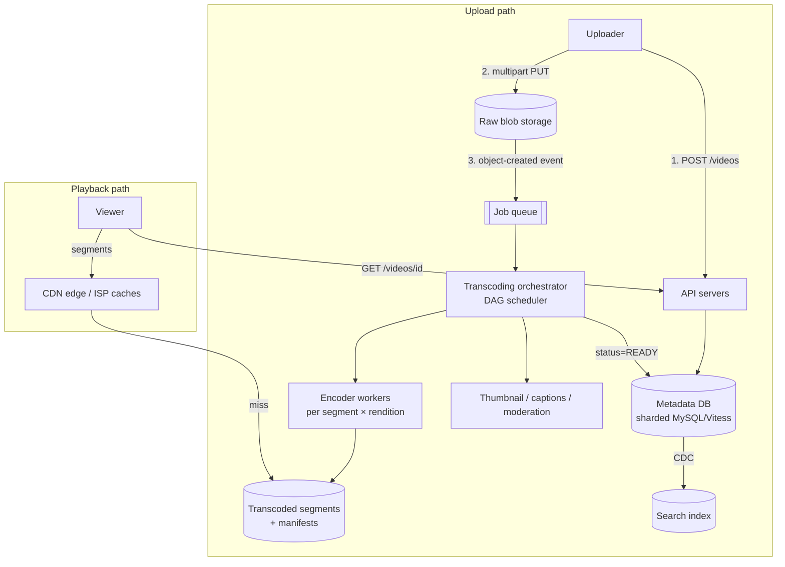

# 12 — YouTube

*Um reference design construído sobre building blocks verificados. Como foi pesquisado e o que não foi conferido está em **Sources and provenance**, perto do fim.*

## At a glance

**Em 60 segundos.** Uma plataforma de vídeo separa os bytes pesados dos metadados. Os uploads vão direto para o blob storage em partes retomáveis, uma fila dispara um DAG de transcoding assíncrono que produz muitas renditions e segmentos HLS ou DASH, e os espectadores puxam segmentos imutáveis de uma CDN com adaptive bitrate. Os fatos reais documentados são os limites e o protocolo de upload, o chip de transcoding e a origem do Vitess.

**Números principais**
- Limite de upload: 256 GB ou 12 horas, o que for menor `[CONFIRMED]`.
- Chip de transcoding customizado: melhoria de eficiência de computação de até 20–33× `[CONFIRMED]`.
- O Vitess foi criado no YouTube em 2010 `[CONFIRMED]`.

**Decisões e trade-offs**

| Decisão | Por quê | Custo |
|---|---|---|
| Upload direto e retomável | Os servidores de aplicação ficam fora do caminho dos dados | Gestão de sessões e limpeza de uploads abandonados |
| Transcoding assíncrono em chunks | O tempo total acompanha o chunk mais lento | Um workflow engine e tasks idempotentes |
| Segmentos imutáveis | Amigáveis à CDN | Muitos arquivos por vídeo |

**Erros comuns**
- Apresentar o tamanho de chunk ou a bitrate ladder da base como se fossem do YouTube.
- Atualizar uma linha de contador de views a cada visualização.
- Esquecer que vídeos novos só ficam eventualmente consistentes na busca.


## Verified facts about the real YouTube

| Afirmação | Fonte |
|---|---|
| "The maximum file size you can upload is **256 GB or 12 hours, whichever is less**." A duração padrão de upload é de 15 minutos, maior para contas verificadas. O YouTube recomenda H.264 | `[CONFIRMED]` [YouTube Help](https://support.google.com/youtube/answer/71673) |
| **Upload retomável:** um `POST` inicia uma sessão e devolve uma session URI no header `Location`, depois faz-se `PUT` dos bytes do arquivo nela. Após uma interrupção, um `PUT` vazio com `Content-Range: bytes */CONTENT_LENGTH` devolve `308 Resume Incomplete` com um `Range` do que o servidor já tem. Os tamanhos de chunk precisam ser múltiplos de 256 KB (exceto o último chunk), e o chunking é desaconselhado salvo em redes muito instáveis. Use exponential backoff em 500/502/503/504 | `[CONFIRMED]` [YouTube API docs](https://developers.google.com/youtube/v3/guides/using_resumable_upload_protocol) |
| O YouTube construiu um chip customizado, o **Video (trans)Coding Unit (VCU)**, mais software para coordenar os chips, relatando "up to **20-33x** improvements in compute efficiency compared to our previous optimized system". O próximo chip acrescenta suporte a AV1. Post datado de 2021-04-21 | `[CONFIRMED]` [YouTube blog](https://blog.youtube/inside-youtube/new-era-video-infrastructure/) |
| O **Vitess** "was created in 2010 to solve the MySQL scalability challenges that the team at YouTube faced". Ele tirou a lógica de roteamento de shards do código da aplicação e a pôs num proxy. Aceito pela CNCF como incubating em fevereiro de 2018, graduado em novembro de 2019 | `[CONFIRMED]` [Vitess history](https://vitess.io/docs/overview/history/) |
| O HLS usa uma **master playlist** listando variant streams (`EXT-X-STREAM-INF`) e **media playlists** com segmentos, cujo `EXT-X-TARGETDURATION` limita o tamanho dos segmentos | `[CONFIRMED]` [RFC 8216](https://datatracker.ietf.org/doc/html/rfc8216) |

---

## 🧒 Non-technical explanation

Quando você envia um vídeo, o YouTube não apenas guarda o seu arquivo. É mais como uma **gráfica** que pega o seu original e faz muitas cópias: uma minúscula para celulares lentos, uma média, uma nítida em 4K. Ele também **corta cada cópia em clipes curtos de 2–6 segundos**.

Quando você aperta play, seu celular baixa os clipes **um de cada vez** de um **depósito próximo** (a CDN) em vez da sede do YouTube. Se o seu Wi-Fi ficar lento, o próximo clipe que ele pega é uma versão de qualidade menor, então o vídeo fica borrado em vez de travar. Isso é **adaptive streaming**.

Processar um upload leva minutos, e tudo bem: a plataforma diz "processando…" e publica quando estiver pronto.

---

## TL;DR for engineers

- **Muita leitura (100:1)** → otimize a reprodução: CDN + cache de segmentos + adaptive bitrate (HLS/DASH).
- **Os uploads contornam os servidores de aplicação** via uploads pre-signed, retomáveis e multipart para o blob storage.
- **DAG de transcoding assíncrono** (split → encode de N renditions em paralelo → package → thumbnail → publish) conduzido por uma fila. **Eventual consistency** é aceitável para uploads novos.
- **Metadados** num banco relacional com sharding (o YouTube construiu o **Vitess** em 2010 exatamente para isso ([Vitess history](https://vitess.io/docs/overview/history/))). **Busca** num índice invertido. **Progresso de reprodução / contagem de views** num store de muita escrita com consistência relaxada.

---

## 1. Clarifying questions (and why they matter)

| Pergunta | Resposta | O que ela determina |
|---|---|---|
| Escala? | 1M de uploads/dia, 100M de DAU | Sharding, caching, capacidade |
| Leitura:escrita? | ~100 views por upload | Otimizado para leitura: CDN, streaming |
| Tamanho máximo de arquivo? | 256 GB (bate com o limite real do YouTube: 256 GB ou 12 h, o que for menor. Contas não verificadas são limitadas a 15 minutos por padrão `[CONFIRMED]` ([YouTube Help](https://support.google.com/youtube/answer/71673))) | Uploads multipart, em chunks e retomáveis |
| Formatos/resoluções? | MP4/AVI/MOV, 240p → 4K | Pipeline de transcoding com muitas renditions |
| Latência de streaming? | Primeiro frame < 500 ms | CDN + ABR + segmentos iniciais pequenos |
| Tempo de processamento? | 10–30 min está OK | Processamento assíncrono |
| Eventual consistency é OK para uploads? | Sim | Caminho de metadados com inclinação AP |
| Uptime? | 99,9% (~8,8 h/ano de indisponibilidade) | Redundância, failover |
| Livestreaming? | Fora do escopo | Controle de escopo |

---

## 2. Requirements

**Funcionais:** upload (web/mobile, ≤256 GB, retomável), stream (adaptativo, primeiro frame <500 ms), busca (títulos/descrições, paginada).

**Não funcionais:** disponibilidade acima da imediaticidade · 1M de uploads/dia · 100M de DAU · uploads em chunks retomáveis · mínimo de buffering · eficiente em banda para regiões em desenvolvimento.

### 🔧 Back-of-the-envelope (extension)

| Métrica | Estimativa |
|---|---|
| Taxa de upload | 1M/dia ÷ 86.400 s ≈ **12 uploads/s** |
| Upload bruto médio | suponha 500 MB → **500 TB/dia brutos** |
| Renditions | ~6 resoluções × codecs → saída transcodificada ≈ 1–2× o tamanho bruto (suposição aproximada; depende do bitrate de origem) |
| Views | 100M de DAU × ~5 vídeos ≈ 500M de views/dia ≈ **~6k inícios/s** em média |
| Egress | 500M × ~5 min × ~2,5 Mbps (assumido) ≈ 500M × ~94 MB ≈ ~**47 PB/dia** (~4,3 Tbps em média). É por isso que o cache de CDN/ISP é tudo. |

---

## 3. API design (REST)

Filosofia: **os servidores de aplicação cuidam de metadados leves. Os bytes pesados vão direto ao blob storage e à CDN.**

```http
# 1. Initiate upload: reserve ID + get pre-signed (multipart) URL(s)
POST /v1/videos
{ "title": "...", "description": "...", "file_size": 2147483648, "content_type": "video/mp4" }
→ 201 { "video_id": "v_123", "upload_id": "...", "part_urls": ["https://s3.../part1?sig=..", ...], "expires_in": 3600 }

# (client PUTs chunks straight to object storage, retrying individual parts)
POST /v1/videos/v_123/complete   { "upload_id": "...", "parts": [{ "n":1, "etag":"..." }, ...] }

# 2. Watch: metadata + manifest URL
GET /v1/videos/v_123
→ { "title": "...", "status": "READY", "manifest_url": "https://cdn.../v_123/master.m3u8", "thumbnails": {...} }

# 3. Watch progress: fire-and-forget, high write volume
POST /v1/progress/v_123   { "position_sec": 754 }   → 202 Accepted

# 4. Search: cursor pagination
GET /v1/search?q=system+design&limit=20&cursor=eyJzIjoxMjM0fQ
→ { "results": [...], "next_cursor": "eyJzIjoxMjU0fQ" }
```

- **Pre-signed URLs:** o upload nunca toca os servidores de aplicação, então você não precisa de corpos de requisição de 256 GB na sua frota de API.
- A **paginação por cursor** evita o problema do "pular 10M de linhas" do `OFFSET`.
- As escritas de **progresso de reprodução** são enormes em volume e de baixo valor por escrita. Aceite-as de forma assíncrona (202), agrupe-as em lote, guarde-as em DynamoDB/Bigtable/Cassandra e aceite last-write-wins.

---

## 4. 🔧 High-level architecture



### 🔧 Transcoding pipeline (the heart of the system)

1. **Validar e sondar** (container, codec, duração, verificações de malware/política).
2. **Dividir** a origem em chunks alinhados a GOP (ex.: ~10 s; o tamanho do chunk é uma escolha ilustrativa de ajuste) → encoding **paralelo** em muitos workers, de modo que o tempo total é limitado pelo chunk mais lento e não pela duração do vídeo inteiro.
3. **Codificar** cada chunk numa **bitrate ladder**: 240p/360p/480p/720p/1080p/1440p/2160p × codecs (H.264 por compatibilidade, VP9/AV1 por eficiência) ([YouTube blog](https://blog.youtube/inside-youtube/new-era-video-infrastructure/)). Os degraus são ilustrativos: o YouTube também serve 144p e 4320p.
4. **Empacotar** em segmentos HLS/DASH (2–6 s; a especificação de autoria HLS da Apple diz que as target durations DEVERIAM ser de 6 s ([Apple](https://developer.apple.com/documentation/http-live-streaming/hls-authoring-specification-for-apple-devices))) + **manifests** (master playlist listando as renditions, [RFC 8216](https://datatracker.ietf.org/doc/html/rfc8216)).
5. **Saídas laterais:** thumbnails, preview sprites, legendas automáticas (ASR), content ID / moderação.
6. **Publicar:** marcar como `READY` e aquecer os PoPs de CDN mais populares.

**Orquestração por DAG** (pense em estilo Airflow/Temporal): as tasks são idempotentes e repetíveis por chunk, e um chunk que falhou é recodificado sem refazer o vídeo inteiro.

**Otimizações de custo usadas na indústria:** encoding por título / por plano (escolher a ladder pela complexidade do conteúdo, [Netflix, dez 2015](https://netflixtechblog.com/per-title-encode-optimization-7e99442b62a2)), encoding preguiçoso de vídeos da cauda longa (observadores externos relatam que o YouTube serve principalmente H.264 para vídeos de poucas views e reserva o AV1 para os muito populares, embora o YouTube não tenha publicado a política ([Streaming Learning Center](https://streaminglearningcenter.com/codecs/which-codecs-does-youtube-use.html))) e hardware customizado (as placas **VCU** (video transcoding unit) do YouTube, anunciadas em 2021 com até 20–33× de eficiência de computação frente a software em servidores tradicionais ([YouTube blog](https://blog.youtube/inside-youtube/new-era-video-infrastructure/), [DCD](https://www.datacenterdynamics.com/en/news/google-develops-custom-argos-video-transcoding-chips-for-youtube-processing))).

### 🔧 Adaptive bitrate streaming (ABR)

```
master.m3u8
 ├── 240p/index.m3u8  → seg_0001.ts, seg_0002.ts, ...
 ├── 720p/index.m3u8  → ...
 └── 1080p/index.m3u8 → ...
```
- O player busca o manifest e começa numa **rendition baixa com segmentos curtos** para atingir <500 ms de primeiro frame, e depois sobe a ladder.
- Cada requisição de segmento escolhe uma rendition a partir do throughput medido e do nível de buffer (BOLA, um algoritmo baseado em buffer usado no player de referência dash.js ([paper](https://arxiv.org/abs/1601.06748)), ou algoritmos baseados em throughput).
- Os segmentos são **arquivos estáticos imutáveis e cacheáveis**, o que é ideal para CDNs.

### 🔧 CDN strategy

- **Distribuição de cauda longa:** as contagens de views são muito assimétricas, então uma pequena parcela dos vídeos recebe a maior parte das views. Faça push ou pre-warm dos vídeos quentes nas bordas. Os vídeos de cauda longa são servidos por camadas regionais/de origem num miss.
- **Caches embutidos nos ISPs:** o Google Global Cache ([Google](https://support.google.com/interconnect/answer/9058809)) e o Netflix Open Connect ([Netflix](https://openconnect.netflix.com/en/)) põem caixas dentro dos ISPs, reduzindo o trânsito de backbone.
- O **request coalescing** na borda evita uma debandada de cache-miss em uploads virais.

### 🔧 Storage

| Dados | Store | Por quê |
|---|---|---|
| Uploads brutos | Object storage (frio após o transcode) | Barato, durável. Mantenha para recodificar com codecs futuros. |
| Segmentos + manifests | Object storage + CDN | Imutáveis, altamente cacheáveis |
| Metadados de vídeo, canais | MySQL com sharding (**Vitess**, que nasceu no YouTube ([history](https://vitess.io/docs/overview/history/))) | Relacional + escalável horizontalmente |
| Progresso de reprodução, contadores de views | Bigtable/Cassandra/DynamoDB | Muita escrita, consistência relaxada |
| Busca | Índice invertido estilo Elasticsearch | Full-text, ranking, filtros |
| Recomendações | Feature stores + ML serving | Fora do escopo aqui |

### 🔧 View counts

Não faça `UPDATE videos SET views = views+1` a cada view. Em vez disso, emita eventos de view para um stream (Kafka), **agregue em janelas** e descarregue as contagens periodicamente. Use sharded counters para os vídeos quentes. As contagens exatas podem atrasar, e a filtragem de fraude acontece no stream.

---

## 5. Trade-offs to discuss

| Decisão | Trade-off |
|---|---|
| Transcoding assíncrono | O upload não fica instantaneamente assistível (aceito conforme os requisitos) |
| Muitas renditions | Custo de storage ×N vs reprodução fluida em todas as redes |
| Segmentos pequenos | Início/adaptação mais rápidos vs mais requisições + overhead de manifest |
| Eventual consistency para metadados/busca | Um vídeo novo pode levar segundos para aparecer na busca |
| Manter os originais brutos | Custo de storage vs capacidade de recodificar com AV1/codecs de próxima geração |

---

## 🏛️ Architecture lens (Fundamentals of Software Architecture)

> 🔧 Extensão. Vocabulário em [neokim-post/00-fundamentals.md §4](https://github.com/allmonty/study/blob/main/architecture/neokim-post/00-fundamentals.md#architecture-thinking).

- **Características dominantes (Ch 4–5):** **escalabilidade** (leituras 100:1), **elasticidade** (um vídeo viral, rajadas de upload na frota de encoders), **performance** (primeiro frame < 500 ms), **disponibilidade** (99,9%) e custo/**viabilidade**. Deliberadamente *não* dominante: consistência imediata para uploads novos.
- **Estilos (Ch 11, 14):** o caminho de transcoding é um **pipeline** (pipes and filters): probe/validate (*tester*) → split → encode (*transformers*) → package → publish (*consumer*). Como o DAG de cada vídeo precisa reiniciar a partir do chunk que falhou, o orquestrador é um **event-driven mediator** (o comportamento "persist state, restart at step 3" do livro), não uma cadeia de broker.
- **Quanta (Ch 7):** três, separados por fronteiras assíncronas: (1) API de upload/metadados + Vitess, (2) workers de transcoding atrás da fila de jobs, com elasticidade muito diferente, (3) reprodução pela CDN, que são arquivos estáticos e imutáveis. A busca é alimentada por CDC, então é um quarto quantum com frescor relaxado.
- **Trade-off (Ch 14):** o **mediator** compra controle de workflow, tratamento de erros e capacidade de reinício, e custa escalabilidade, performance, tolerância a falhas e mais acoplamento entre processadores (tabela de trade-offs do mediator do livro). Uma cadeia de broker escalaria com mais liberdade, mas ninguém saberia quando um vídeo está "pronto".
- **Esboço de ADR (Ch 19):** *"Vamos orquestrar o transcoding com um DAG mediator sobre uma fila de jobs. Aceitamos um scheduler central para obter retries por chunk e um único sinal READY."*
- Em linguagem simples: o upload desce por uma linha de montagem com um capataz que sabe em que estação cada vídeo está, e reinicia só a estação que travou.

---

## Interview questions to practice

1. Um upload de 256 GB falha em 93%. O que acontece, e como o cliente retoma?
2. Como você faria o primeiro frame ficar < 500 ms para um espectador num país sem PoP próximo?
3. Como evitar trabalho de transcoding para vídeos que ninguém vai assistir?
4. Um vídeo viraliza 1 minuto após o upload. O que quebra primeiro?
5. Como contar views com precisão suficiente para monetização?

## Interview practice

Estes roteiros são raciocínio nosso (`[INDUSTRY PATTERN]`), não afirmações das fontes citadas.

**Um roteiro de 45 minutos**

1. Esclarecer: limites de tamanho, formatos, latência até publicar, ao vivo ou não.
2. Estimar: uploads/dia, storage, egress.
3. API: iniciar upload retomável, concluir, manifest de reprodução.
4. Design: blob store, fila, DAG de transcoding, CDN.
5. Deep dive: ABR, renditions, protocolo de upload retomável.
6. Falhas e escala: retry de chunk com falha, vídeo viral, contagem de views.

**Se crescer 10×**
- O egress domina: caches de ISP e de borda.
- Custo de encoding: aceleração por hardware e encoding por título.
- Contagem de views: agregação em janelas a partir de um stream.

**Roteiros de resposta** (tente as perguntas acima primeiro)

<details><summary>Por que os uploads contornam os servidores de aplicação?</summary>

Bytes grandes consumiriam a capacidade da aplicação. Uma session URI ou uma pre-signed URL deixa o cliente escrever direto no storage e retomar após quedas.

</details>

<details><summary>Como funciona o adaptive bitrate?</summary>

O player busca um manifest que lista as renditions, começa baixo e escolhe a rendition do próximo segmento a partir do throughput medido e do buffer.

</details>

<details><summary>Como contar views em escala?</summary>

Emita eventos para um stream, agregue em janelas e descarregue periodicamente. Use sharded counters para os vídeos quentes e filtre fraude no stream.

</details>

## 📚 Further reading

- [Vitess history: born at YouTube](https://vitess.io/docs/overview/history/)
- [YouTube resumable upload protocol](https://developers.google.com/youtube/v3/guides/using_resumable_upload_protocol)
- [Netflix: Per-Title Encode Optimization](https://netflixtechblog.com/per-title-encode-optimization-7e99442b62a2)
- [Netflix Open Connect](https://openconnect.netflix.com/en/)
- [Apple HLS spec (RFC 8216)](https://datatracker.ietf.org/doc/html/rfc8216) · [MPEG-DASH overview](https://dashif.org/)
- [AWS S3 multipart upload](https://docs.aws.amazon.com/AmazonS3/latest/userguide/mpuoverview.html)
- Relacionado nesta pasta: [14 Spotify](14-spotify.md), [05 Object storage](05-object-storage-s3.md), [13 Netflix](13-netflix.md)

## Sources and provenance

> **Kind:** reference design com alguns fatos de real-system documentados. O YouTube não publica sua arquitetura de ponta a ponta. O que verificamos em fontes primárias: os limites de upload (YouTube Help), o protocolo de upload retomável (YouTube API docs), o chip de transcoding customizado (YouTube blog, 2021), a origem do Vitess no YouTube (Vitess docs) e o formato de playlist do HLS (RFC 8216). Todo o resto, incluindo as etapas do pipeline, as escolhas de store e a estratégia de CDN, é o design padrão de entrevista `[INDUSTRY PATTERN]`.
> **Basis:** atualizado a partir de [`neokim-post/03`](https://github.com/allmonty/study/blob/main/architecture/neokim-post/03-how-youtube-works.md), um resumo de [YouTube System Design](https://newsletter.systemdesign.one/p/youtube-system-design) cujos deep dives pagos foram reconstruídos a partir de fontes públicas. Re-verified on 2026-10-27, veja o log.
> **Tags:** `[CONFIRMED]` afirmado por uma fonte primária · `[INDUSTRY PATTERN]` prática padrão, não declarada para o YouTube · `[SPECULATIVE]` plausível. O marcador 🔧 é herdado da base (conteúdo além da metade pública da newsletter).

---
## ✅ Verification log

*Inherited log (neokim-post/03), 2026-10-03:* Verified 16 · Corrected 2 · Softened/removed 4.

*Re-verification for this folder, 2026-10-27.*
- Verified in YouTube Help: 256 GB or 12 hours, whichever is less; 15-minute default, longer for verified accounts; H.264 recommendation.
- Verified in YouTube API docs: the resumable protocol steps, 308 behaviour, 256 KB chunk multiple, exponential backoff on 5xx.
- Verified in YouTube's blog (2021-04-21): VCU described as "Video (trans)Coding Unit", up to 20-33x compute-efficiency improvement, AV1 in the next generation. The name "Argos" does not appear in the article text, so it is not used in this note (the baseline's log used it from another source).
- Verified in Vitess docs: created in 2010 at YouTube; moved shard-routing out of app code; CNCF incubating in 2018-02 and graduated 2019-11. The page does **not** mention connection pooling or query rewriting, so we do not claim them.
- Verified in RFC 8216: master and media playlists, `EXT-X-STREAM-INF`, `EXT-X-TARGETDURATION`.
- Added: the 15-minute default upload limit for unverified accounts, which the baseline's requirement row omitted.
- Not re-verified (carried over): Apple's 6-second target-duration guidance (our fetch of Apple's page returned no usable text), Netflix's per-title encoding post (Dec 2015; netflixtechblog.com blocks scripted fetches), the BOLA paper, Google Global Cache and Open Connect pages, the codec-policy observation from Streaming Learning Center, the storage table and view-count design (`[INDUSTRY PATTERN]`), and the newsletter's scale assumptions (1M uploads/day, 100M DAU, 100:1), whose arithmetic was re-derived by hand: 1M/86,400 ≈ 11.6/s, 500M views/day ≈ 5.8k/s.
- Not claimed: any actual YouTube pipeline stage, chunk length, bitrate ladder or CDN policy. The baseline already labels these illustrative.
- Corrected (independent review, 2026-10-27): the body text still named the Argos chip, which the YouTube article does not (only image file names contain it), contradicting the line above; the name is removed. The DCD article could not be fetched by script and is secondary.
