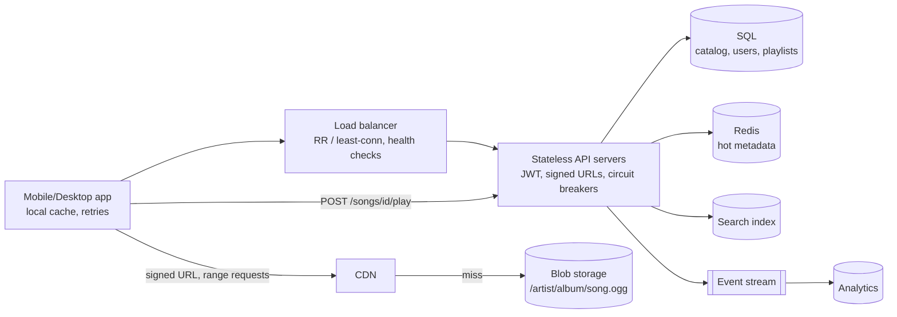
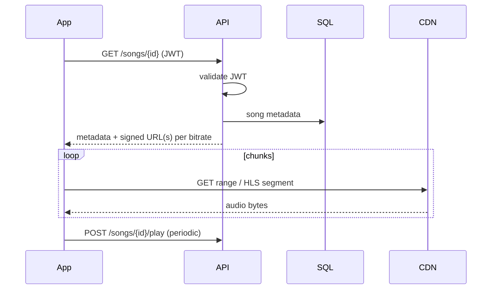
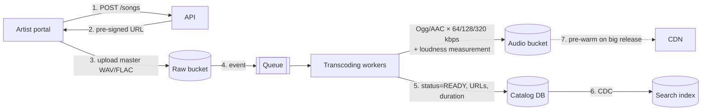

# 14 — Spotify (Music Streaming)

*Um reference design construído sobre building blocks verificados. Como foi pesquisado e o que não foi conferido está em **Sources and provenance**, perto do fim.*

## At a glance

**Em 60 segundos.** O áudio domina o storage e o egress enquanto os metadados são minúsculos, então o design padrão serve o áudio por signed URLs e uma CDN a partir do blob storage e mantém uma API stateless na frente de um catálogo de leitura predominante. O paper do Spotify de 2010 é uma evidência documentada de que apenas 8,8% dos dados reproduzidos vinham dos servidores do Spotify na época, o resto dos caches dos clientes e de peers, e suas páginas de suporte documentam as faixas de qualidade de áudio e a normalização de volume no momento da reprodução.

**Números principais**
- 2010: apenas 8,8% dos dados vinham dos servidores, latência mediana de reprodução de 265 ms `[CONFIRMED]`.
- Cerca de 39% das reproduções eram de acesso aleatório `[CONFIRMED]` (2010).
- Normalização de volume: -14 dB LUFS por padrão, aplicada na reprodução; ouvintes Premium podem escolher Loud (-11) ou Quiet (-19); não aplicada no player web nem em dispositivos de terceiros como TVs e caixas de som `[CONFIRMED]`.

**Decisões e trade-offs**

| Decisão | Por quê | Custo |
|---|---|---|
| Signed URLs de uma API stateless | Os bytes de áudio pulam a API | Tokens de curta duração para gerenciar |
| Várias faixas de qualidade | Atende a redes e planos diferentes | O storage se multiplica |
| Prefetch da próxima faixa | Reprodução sem pausas (gapless) | Bytes desperdiçados nos skips |

**Erros comuns**
- Apresentar o design P2P de 2010 como a arquitetura atual.
- Ler o Ogg Vorbis do paper de 2010 como a história toda de hoje: a página atual de qualidade de áudio não nomeia nenhum codec, enquanto a página de loudness do Spotify para artistas nomeia Ogg/Vorbis e AAC como os formatos com perdas.
- Esquecer que um stream só conta depois de pelo menos 30 segundos.


## Verified facts about the real Spotify

| Afirmação | Fonte |
|---|---|
| Em 2010, **8,8% dos dados de música reproduzidos vinham dos servidores do Spotify**, o resto do cache do cliente e da rede P2P. **Latência mediana de reprodução de 265 ms** (incluindo faixas em cache). Biblioteca de mais de 8 milhões de faixas. Serviço lançado em outubro de 2008 | `[CONFIRMED]` paper de P2P |
| O áudio era **Ogg Vorbis**, qualidade padrão **q5** (bitrate variável com média de aproximadamente **160 kbps**). Usuários Premium podiam escolher **q9** (aproximadamente **320 kbps**). Os peers não recodificam, então um peer q9 não consegue atender uma requisição q5 | `[CONFIRMED]` paper de P2P |
| **~39% das reproduções são de acesso aleatório** (não a próxima faixa). Num cache miss, o cliente pede ao servidor cerca de **15 segundos** de música pela conexão TCP que já está aberta, enquanto busca na rede P2P | `[CONFIRMED]` paper de P2P |
| O **cache** do cliente é criptografado e guarda faixas parciais. O máximo padrão é 10% do espaço livre em disco, com piso de 50 MB e teto de 10 GB. O descarte é LRU, e o paper constatou que a política de descarte importa pouco porque os caches são grandes | `[CONFIRMED]` paper de P2P |
| Qualidades do app hoje: Low ≈24 kbit/s, Normal ≈96, High ≈160, Very high (Premium) ≈320, Lossless (Premium) até FLAC de 24 bits/44,1 kHz. Player web: AAC 128 kbit/s (Free) ou 256 kbit/s (Premium) | `[CONFIRMED]` Spotify Support (páginas atuais) |
| Um stream conta quando "a listener plays your song for at least 30 seconds" | `[CONFIRMED]` Spotify Support |
| A **normalização de volume** tem como alvo **-14 dB LUFS** (ITU 1770) e "is applied during playback". As faixas são medidas no upload, os arquivos ficam intocados | `[CONFIRMED]` Spotify Support |

---

## 🧒 Non-technical explanation

O Spotify é uma **biblioteca com um serviço de entrega muito rápido**.

- O **catálogo** (títulos de músicas, artistas, capas de álbum, playlists) é como o fichário da biblioteca. É pequeno e é consultado o tempo todo.
- As **músicas em si** são arquivos de áudio grandes guardados num **depósito** (cloud storage), com cópias em **depósitos locais** perto de você (CDN).
- Quando você aperta play, o app primeiro pergunta ao Spotify "posso tocar isto, e onde está?" O Spotify responde com um **passe temporário** (signed URL), e seu celular então baixa a música **direto do depósito mais próximo**, alguns segundos de cada vez.
- Numa conexão fraca, o app troca para uma **versão mais leve** da música (bitrate menor) para continuar tocando.

---

## TL;DR for engineers

- **O áudio domina o storage e o egress.** Os metadados são minúsculos. Projete de acordo: **blob storage + CDN** para o áudio, **SQL** para catálogo/usuários/playlists.
- **Camada de API stateless** (autenticação JWT, geração de signed URLs, circuit breakers, connection pooling) atrás de um load balancer.
- **Os clientes fazem streaming direto** da CDN/blob storage usando **HTTP range requests / HLS/DASH** em vários bitrates (Ogg/AAC a 64/128/320 kbps no design do artigo. As faixas reais do Spotify são diferentes: veja a tabela verificada acima e as Reviewer notes).
- 🔧 **Uploads:** artista → upload pre-signed → **transcoding + medição de loudness** assíncronos (o Spotify mede o loudness no upload e aplica o ganho na reprodução, com alvo de -14 LUFS ([source](https://support.spotify.com/us/artists/article/loudness-normalization/))) → publicar no catálogo + índice de busca.

---

## 1. Requirements & assumptions

- ~**500 mil usuários**, **30M de músicas** (a entrevista começa pequena e depois você escala)
- Artistas enviam músicas. Usuários buscam, tocam, criam e gerenciam playlists, mantêm perfis.
- Observabilidade básica (health checks, rastreamento de erros, métricas de performance).
- Formatos: **Ogg Vorbis / AAC** em vários bitrates para adaptive streaming:
  - 64 kbps (economia de dados), 128 kbps (padrão), 320 kbps (premium)
- Música média em qualidade padrão ≈ **3 MB**.
- Restrições: **início de reprodução rápido**, **rebuffering mínimo** (troca adaptativa de qualidade), operação simples.

---

## 2. Capacity planning

| Item | Cálculo | Resultado |
|---|---|---|
| Storage de áudio | 3 MB × 30M | **~90 TB** brutos para um bitrate. O **×2–3** do artigo cobre réplicas regionais e versões de reenvio. 🔧 Guardar a ladder completa de 64+128+320 kbps é ~4× o tamanho de 128 kbps (512/128), então **~360 TB** antes das réplicas |
| Metadados de músicas | ~100 B × 30M | **~3 GB** |
| Metadados de usuários | ~1 KB × 500k | **~0,5 GB** |
| Por stream | 3,5 min × 128–160 kbps | ~3–4 MB |
| Egress diário | 500k × 10–15 músicas × 3,5 MB | **~17–26 TB/dia** → custo significativo de CDN/egress |

> 💡 **Insight principal:** o áudio domina o storage *e* a banda. Os metadados cabem com folga num único banco SQL bem indexado com réplicas. Não faça over-engineering do catálogo.

---

## 3. High-level architecture



| Componente | Notas |
|---|---|
| **Client** | REST para metadados. Faz streaming do áudio direto da CDN por signed URLs. Mantém em cache as músicas tocadas recentemente. Retries com backoff. Pausa com elegância na perda de rede. |
| **Load balancer** | Round-robin / least-connections. Health checks a cada 30 s. Absorve picos de lançamento de álbum. Deploys sem downtime. |
| **API layer** | **Stateless**. Validação de JWT, consultas de metadados, geração de **signed URLs**, eventos de analytics. **Circuit breakers** nas chamadas ao banco, **connection pooling**, **respostas de fallback** para funcionalidades não críticas. |
| **Blob storage** | S3/GCS, `/artist/album/song.ogg`. As signed URLs expiram em horas. Replicação multi-região. (A alternativa HDFS é menos gerenciada.) |

---

## 4. Read workflow (playing a song)



- **Range requests / segmentos HLS/DASH** permitem início rápido, seek e troca de bitrate.
- O **rastreamento de reproduções** é periódico e assíncrono. O Spotify conta um stream após pelo menos 30 s de reprodução ([source](https://support.spotify.com/us/artists/article/how-we-count-streams/)), e os streams contados são a unidade sobre a qual os royalties são alocados. Desde 2024, uma faixa também precisa de pelo menos 1.000 streams nos 12 meses anteriores para receber royalties de gravação ([source](https://artists.spotify.com/en/blog/modernizing-our-royalty-system)).

---

## 5. 🔧 Write workflow (artist upload): reconstructed



- **Loudness:** meça o loudness integrado na ingestão e guarde-o como metadado. O cliente aplica o ganho na reprodução, então os arquivos codificados não são alterados ([source](https://support.spotify.com/us/artists/article/loudness-normalization/)).
- **Validação:** formato, duração, audio fingerprinting (detecção de copyright / duplicatas), verificações de metadados (códigos ISRC).
- **Agendamento de lançamento:** o conteúdo é ingerido com antecedência e fica visível no timestamp de lançamento (comum para lançamentos de álbum à meia-noite local).
- **Processamento idempotente** por música + bitrate. Repita jobs que falharam. Uma DLQ captura arquivos venenosos.

---

## 6. 🔧 Data model (reconstructed)

```sql
artists(id PK, name, bio, image_url)
albums(id PK, artist_id FK, title, release_date, cover_url)
songs(id PK, album_id FK, title, duration_ms, track_no, status, audio_key_prefix, release_at)
song_artists(song_id, artist_id, role)                 -- features/collabs
users(id PK, email, plan, country, created_at)
playlists(id PK, owner_id FK, name, is_public, is_collaborative, version)
playlist_tracks(playlist_id, position, song_id, added_by, added_at,
                PRIMARY KEY (playlist_id, position))
plays(user_id, song_id, played_at, ms_played)          -- → event stream / warehouse, not OLTP
```

- **Playlists:** listas ordenadas com edições concorrentes (colaborativas). Use **optimistic concurrency** (coluna `version`), ou guarde a ordenação com ranks fracionários/lexicográficos para evitar renumerar as posições.
- Os **eventos de reprodução** vão para um pipeline de eventos (Kafka → warehouse), não para o banco OLTP.

---

## 7. 🔧 Scaling beyond 500k users

| Pressão | Resposta |
|---|---|
| QPS de leitura no catálogo | Redis cache-aside para músicas/álbuns/artistas quentes. Réplicas de leitura. JSON de metadados em cache na CDN. |
| Busca | Elasticsearch/OpenSearch dedicado com fuzzy matching e analyzers por locale |
| Picos de lançamento de álbum | Pre-warm da CDN. Autoscale da API. Cache das páginas de "novos lançamentos". |
| Custo de egress | Multi-CDN, peering com ISPs, caching agressivo no cliente, downloads offline (criptografados, DRM) |
| Usuários globais | API multi-região + réplicas de leitura. O catálogo é de leitura predominante, então o lag de replicação é aceitável. |
| Recomendações / Home | Pipelines de ML offline separados (batch + feature store) alimentando linhas pré-calculadas |

### 🔧 How real Spotify evolved (context)
- O Spotify inicial usava uma rede **peer-to-peer híbrida** (clientes desktop serviam chunks em cache uns aos outros) para reduzir a banda dos servidores. Em 2010, apenas ~8,8% dos dados de música reproduzidos vinham dos servidores do Spotify, com latência mediana de reprodução de 265 ms `[CONFIRMED]` ([Kreitz & Niemelä, IEEE P2P'10](https://people.cs.umass.edu/~phillipa/CSE390/spotify-p2p10.pdf)). Em abril de 2014 o TechCrunch relatou a retirada do P2P, citando o TorrentFreak, porque o Spotify já tinha servidores suficientes (um relato secundário, não um anúncio do Spotify). Os clientes mobile e web nunca usaram P2P ([TechCrunch](https://techcrunch.com/2014/04/17/spotify-removes-peer-to-peer-technology-from-its-desktop-client/)).
- Migrou de seus próprios data centers para o **Google Cloud**: a exploração começou em 2015, a migração foi anunciada em 2016 ([Google Cloud blog](https://cloud.google.com/blog/products/gcp/spotify-chooses-google-cloud-platform-to-power-data-infrastructure)), o tráfego estava totalmente no GCP em maio de 2017 e os últimos data centers on-prem foram desativados em 2018 ([Spotify Engineering](https://engineering.atspotify.com/2019/12/views-from-the-cloud-a-history-of-spotifys-journey-to-the-cloud-part-1-2)).
- Construiu o **Backstage**, seu portal interno de desenvolvedores (criado em 2016, aberto como código aberto em março de 2020, CNCF Sandbox em setembro de 2020 ([Spotify Engineering](https://engineering.atspotify.com/2020/9/cloud-native-computing-foundation-accepts-backstage-as-a-sandbox-project)), CNCF Incubating em março de 2022 ([CNCF](https://www.cncf.io/blog/2022/03/15/backstage-project-joins-the-cncf-incubator/))), para manter gerenciável um parque grande e crescente de microsserviços.

---

## ⚠️ Reviewer notes on the source

- **As faixas de bitrate são uma premissa de design, não a ladder real do Spotify.** O exemplo de 64/128/320 kbps do artigo serve para o design de entrevista. As configurações reais do app do Spotify são Low ≈24 kbps, Normal ≈96 kbps, High ≈160 kbps e (Premium) Very high ≈320 kbps. O player web faz streaming de AAC a 128 kbps (Free) ou 256 kbps (Premium) ([Spotify Support: Audio quality](https://support.spotify.com/us/article/audio-quality/)). O Lossless (até FLAC de 24 bits/44,1 kHz) começou a ser liberado para o Premium em setembro de 2025 ([Spotify Newsroom](https://newsroom.spotify.com/2025-09-10/lossless-listening-arrives-on-spotify-premium-with-a-richer-more-detailed-listening-experience/)). As codificações com perdas são Ogg/Vorbis e AAC ([Spotify for Artists: Loudness normalization](https://support.spotify.com/us/artists/article/loudness-normalization/)).
- **O número de 90 TB de storage cobre apenas um bitrate.** O multiplicador ×2–3 do artigo é para réplicas e versões de reenvio. Uma ladder de três degraus (64+128+320 kbps) sozinha é ~4× o tamanho de 128 kbps, então a estimativa é ~360 TB antes da replicação.

---

## 🏛️ Architecture lens (Fundamentals of Software Architecture)

> 🔧 Extensão. Vocabulário em [neokim-post/00-fundamentals.md §4](https://github.com/allmonty/study/blob/main/architecture/neokim-post/00-fundamentals.md#architecture-thinking).

- **Características dominantes (Ch 4–5):** **performance** (tempo até o primeiro áudio), **disponibilidade**, **escalabilidade** e **elasticidade** (os lançamentos de álbum à meia-noite são o padrão "concert tickets" do livro), mais custo/**viabilidade** (egress). Licenciamento e DRM são características transversais **legais** (Ch 4).
- **Estilo para o design de 500k usuários (Ch 13, 11):** uma **service-based architecture** (ou até um modular monolith): uma camada de API stateless sobre **um único banco SQL** é o padrão pragmático do livro quando os dados cabem num store só ("don't over-engineer the catalog"). A ingestão de uploads é um **pipeline** (validar → transcode → normalizar → publicar).
- **Quanta (Ch 7):** (1) API + banco do catálogo (banco compartilhado, então um quantum), (2) o pipeline assíncrono de ingestão atrás da fila, (3) analytics atrás do stream de eventos e (4) o caminho CDN/blob, que só compartilha com a API as chaves das signed URLs.
- **Trade-off (Ch 18, "shifting fashion" e fatores organizacionais):** o Spotify real roda **microsserviços** por causa da **lei de Conway** (Ch 8): muitas squads autônomas precisam de deployability independente. Isso compra evolutividade e deployability (★★★★–★★★★★) e custa em custo e simplicidade (★). Copiar essa topologia para um produto de 500k usuários seria o "Ferrari at 50 km/h" do livro (Ch 13).
- **Esboço de ADR (Ch 19):** *"Vamos começar service-based com um Postgres compartilhado, particionado logicamente por domínio (catálogo, usuários, playlists), para podermos dividir depois."*
- Em linguagem simples: uma lojinha de discos pequena não precisa do organograma de uma gravadora global. Um estoque e alguns balcões bastam até as filas ficarem longas.

---

## Interview questions to practice

1. Por que assinar URLs em vez de tornar o áudio público? Que expiração você escolheria e por quê?
2. Como trocar de bitrate no meio da música sem um glitch audível?
3. Projete playlists colaborativas com reordenações concorrentes.
4. Como contar streams para royalties com precisão e resistência a fraudes?
5. Como os downloads offline funcionariam com restrições de licenciamento?

## Interview practice

Estes roteiros são raciocínio nosso (`[INDUSTRY PATTERN]`), não afirmações das fontes citadas.

**Um roteiro de 45 minutos**

1. Esclarecer: tamanho do catálogo, offline, faixas de qualidade.
2. Estimar: faixas, reproduções/s, egress.
3. API: obter a faixa devolve uma signed URL.
4. Design: API, catálogo, blob storage, CDN.
5. Deep dive: prefetching, range requests, loudness.
6. Falhas e escala: CDN miss, lançamentos populares, uploads.

**Se crescer 10×**
- Picos de dia de lançamento: pre-warm da CDN.
- Crescimento do catálogo: replique e coloque em cache o banco de leitura predominante.
- Uploads: transcoding e análise assíncronos.

**Roteiros de resposta** (tente as perguntas acima primeiro)

<details><summary>Por que servir o áudio por uma CDN em vez da API?</summary>

O áudio é grande e cacheável. A API apenas autoriza e devolve uma signed URL, o que a mantém pequena e stateless.

</details>

<details><summary>Como a reprodução começa em menos de um segundo?</summary>

Dados em cache ou pré-buscados tocam imediatamente. Caso contrário, o cliente pede os primeiros ~15 segundos por uma conexão aberta.

</details>

<details><summary>Como você aplicaria a normalização de volume?</summary>

Meça no upload, guarde o valor de ganho e aplique-o na reprodução, de modo que os arquivos de áudio fiquem intocados.

</details>

## 📚 Further reading

- [Spotify Engineering blog](https://engineering.atspotify.com/)
- [Backstage (open-sourced by Spotify)](https://backstage.io/)
- [Spotify: Loudness normalization](https://support.spotify.com/us/artists/article/loudness-normalization/)
- [MDN: HTTP range requests](https://developer.mozilla.org/en-US/docs/Web/HTTP/Guides/Range_requests)
- [Hayk Simonyan (YouTube)](https://youtube.com/@hayk.simonyan)
- Relacionado nesta pasta: [12 YouTube](12-youtube.md) (o mesmo padrão blob + CDN + ABR para vídeo), [13 Netflix](13-netflix.md)

## Sources and provenance

> **Kind:** reference design mais um histórico documentado. O Spotify publicou seu **design de streaming peer-to-peer híbrido de 2010** num paper acadêmico, além de páginas de suporte sobre qualidade de áudio, loudness e contagem de streams. Sua arquitetura atual do lado do servidor **não** é publicada de ponta a ponta, então o design blob storage + CDN + API stateless abaixo é o design padrão de entrevista `[INDUSTRY PATTERN]`.
> **Basis:** atualizado a partir de [`neokim-post/09`](https://github.com/allmonty/study/blob/main/architecture/neokim-post/09-how-spotify-works.md), um resumo de [Spotify System Design](https://newsletter.systemdesign.one/p/spotify-system-design) (autor convidado Hayk Simonyan) cujas metades pagas foram reconstruídas. Re-verified on 2026-10-27, veja o log.
> **Primary sources read:** Kreitz & Niemelä, [*Spotify – Large Scale, Low Latency, P2P Music-on-Demand Streaming*, IEEE P2P 2010](https://people.cs.umass.edu/~phillipa/CSE390/spotify-p2p10.pdf) (texto extraído localmente) · Spotify Support: [Audio quality](https://support.spotify.com/us/article/audio-quality/), [How we count streams](https://support.spotify.com/us/artists/article/how-we-count-streams/), [Loudness normalization](https://support.spotify.com/us/artists/article/loudness-normalization/).
> **Dated material:** o paper descreve o Spotify em 2010 (mais de 8 milhões de faixas). O cliente desde então abandonou o P2P, então não apresente o paper como a arquitetura atual.
> **Tags:** `[CONFIRMED]` afirmado por uma fonte primária do Spotify · `[INDUSTRY PATTERN]` design padrão · `[SPECULATIVE]` plausível. O marcador 🔧 é herdado da base (conteúdo além da metade pública da newsletter).

---
## ✅ Verification log

*Inherited log (neokim-post/09), 2026-10-03:* Verified 14 · Corrected 5 · Softened/removed 2.

*Re-verification for this folder, 2026-10-27.*
- Verified in the P2P paper (text extracted locally and read): 8.8% from servers, 265 ms median latency, over 8 million tracks, October 2008 launch, Ogg Vorbis q5 ≈160 kbps default and q9 ≈320 kbps for Premium, no peer re-encoding, ~39% random-access playbacks, ~15-second initial request over the open TCP connection, encrypted partial-track cache with the 10% / 50 MB / 10 GB bounds, LRU.
- Verified in Spotify Support: the Low/Normal/High/Very high/Lossless equivalents, web-player AAC 128 and 256 kbit/s, separate streaming and download settings on mobile; "at least 30 seconds" for a stream; -14 dB LUFS per ITU 1770 applied at playback.
- Corrected: our codec statement. The current audio-quality page names no codec for the desktop and mobile levels and does not mention Ogg Vorbis, so Ogg Vorbis is attributed to the **2010 paper only**.
- Not re-verified (carried over): the 1,000-streams royalty threshold (the page we fetched did not include it), the lossless launch date (September 2025, Spotify Newsroom), the TechCrunch report of the April 2014 P2P phase-out, Google Cloud migration dates and Backstage/CNCF dates, and the newsletter's capacity table (the ×2–3 and ~360 TB arithmetic was re-derived by hand in the earlier log).
- Not claimed: anything about Spotify's current backend (databases, services, CDN vendors).
- Corrected (independent review, 2026-10-27): the loudness line now includes the Premium levels and the web-player and third-party-device exception from the same page, and the common-mistakes line no longer says that no current Spotify page names Ogg Vorbis (the loudness page for artists does).
