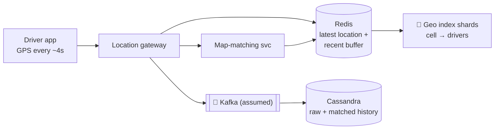
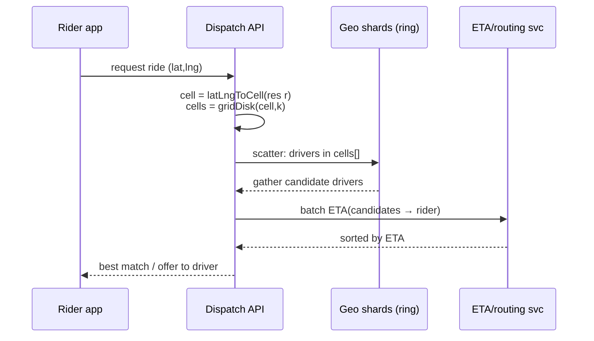

# 15 — Uber (Proximity + Dispatch)

*Um reference design construído sobre building blocks verificados. Como foi pesquisado e o que não foi conferido está em **Sources and provenance**, perto do fim.*

## At a glance

**Em 60 segundos.** A busca pelo motorista mais próximo é transformada em consultas por chave indexando as localizações em células hexagonais (H3). A célula do passageiro mais o anel de vizinhas cobre a área de busca, um índice em memória com sharding por célula guarda os motoristas mais recentes, e os candidatos são ranqueados pelo tempo de chegada. A descrição pública de matching da Uber agrupa as requisições em lote ao longo de alguns segundos para reduzir a espera média, em vez de pegar imediatamente o motorista mais próximo.

**Números principais**
- O H3 tem 16 resoluções; as células da resolução 9 têm em média 0,105 km², as da resolução 8, 0,737 km² `[CONFIRMED]`.
- Toda resolução tem exatamente 12 pentágonos; cada resolução mais fina tem um sétimo da área `[CONFIRMED]`.
- Cerca de 4.357.449 km² de área média por célula na resolução 0 `[CONFIRMED]`.

**Decisões e trade-offs**

| Decisão | Por quê | Custo |
|---|---|---|
| Grade hexagonal | Uma única distância até cada vizinha, crescimento uniforme da busca | Pentágonos e contenção pai/filho aproximada |
| Sharding do índice por célula | Localidade para consultas de vizinhança | Células quentes em áreas densas |
| Matching em lote | Menor espera média | Alguns segundos de latência a mais |

**Erros comuns**
- Usar consultas por faixa de lat/lng numa B-tree: elas não se reduzem a uma única consulta por chave.
- Presumir que um k-ring tem 19 células num pentágono.
- Casar o motorista mais próximo instantaneamente e chamar isso de ótimo.


## Verified facts

| Afirmação | Fonte |
|---|---|
| O H3 tem **16 resoluções** (0–15). A **resolução 0 tem 122 células** (110 hexágonos + 12 pentágonos), e toda resolução tem exatamente 12 pentágonos. Área média das células: res 0 ≈ 4.357.449 km², res 7 ≈ 5,16 km², res 8 ≈ 0,737 km², **res 9 ≈ 0,105 km²**, res 10 ≈ 0,0150 km², res 15 ≈ 0,895 m². Os comprimentos de aresta foram calculados exatamente para as res 0–6 e extrapolados para as mais finas | `[CONFIRMED]` tabela da documentação do H3 |
| Os hexágonos têm uma **única** distância entre o centro de uma célula e suas vizinhas (os quadrados têm duas, os triângulos três). A Uber construiu o H3 para "efficiently optimizing ride pricing and dispatch" e visualização. O surge é calculado "by measuring supply and demand in hexagons in each city". Cada resolução mais fina tem células com **um sétimo da área**, então os filhos só estão aproximadamente contidos nos pais. Doze pentágonos ficam nos vértices do icosaedro | `[CONFIRMED]` blog H3 da Uber |
| A Uber do início casava um passageiro "immediately ... with the closest available driver". Ela aprendeu que "closest doesn't always mean quickest". Hoje avalia "nearby drivers and riders in one batch" nos segundos após uma requisição, com o objetivo de "to reduce the average wait time for everyone, not just the closest pair". Pode modificar pareamentos por razões de segurança | `[CONFIRMED]` página de matching da Uber |

---

## 🧒 Non-technical explanation

Imagine cobrir o planeta inteiro com **ladrilhos de favo de mel**, cada um com um número. A cada poucos segundos o celular de cada motorista informa "estou no ladrilho nº 8872…".

Quando você pede uma corrida, a Uber não mede a distância até todos os motoristas da cidade. Ela pergunta: **"Quais motoristas estão no meu ladrilho e nos que encostam nele?"** Depois ranqueia essa lista curta pelo tempo que cada um levaria para chegar até você pelas ruas de verdade.

Por que hexágonos? Num hexágono, **todo ladrilho vizinho está à mesma distância**. Numa grade quadrada, as vizinhas das diagonais ficam mais longe que as dos lados, o que torna o "perto" desequilibrado.

---

## TL;DR for engineers

- A **indexação geoespacial** transforma uma consulta 2-D de vizinho mais próximo em **consultas por chave**: `latLngToCell(lat, lng, res)` → ID de célula de 64 bits. Perto = `gridDisk(cell, k)` (o antigo `kRing`) ([H3 v4 migration](https://h3geo.org/docs/library/migration-3.x/functions)).
- **H3:** grade hexagonal hierárquica, 16 resoluções (média de ~4,36M km² na res 0 até ~0,9 m² na res 15) ([H3 cell stats](https://h3geo.org/docs/core-library/restable/)). Pai/filho por truncamento de bits (O(1)) ([Uber H3 blog](https://www.uber.com/blog/h3/)).
- **Escritas:** os motoristas enviam GPS a cada cerca de 4 s (do resumo do HighScalability da palestra da Uber de 2015, que não conferimos contra a palestra; a newsletter da qual esta nota partiu diz apenas a cada poucos segundos) ([HighScalability](https://highscalability.com/how-uber-scales-their-real-time-market-platform/)) → o **map matching** encaixa o GPS ruidoso em segmentos de rua → **Redis** (última localização + buffer) → **Cassandra** (histórico durável).
- **Sharding por ID de célula**. Os candidatos são ranqueados por **ETA**, não por distância em linha reta.
- 🔧 **Escala:** um índice geo em memória com sharding por célula em um anel de nós (o **Ringpop** da Uber: consistent hashing + gossip SWIM), com scatter-gather pelo k-ring. Na descrição de 2015 a shard key era uma célula de nível 12 do Google **S2**, não do H3 ([HighScalability](https://highscalability.com/how-uber-scales-their-real-time-market-platform/)).

---

## 1. Why naive lat/lng queries don't work

`SELECT * FROM drivers WHERE distance(lat,lng,:me) < 2km` exige um full scan ou um índice 2-D, e os dados mudam a cada poucos segundos para milhões de motoristas. Você precisa de:
- Uma **chave discreta** por área (para poder fazer hash, cache e sharding).
- **Consulta barata de vizinhas.**
- **Multirresolução** (centro denso vs interior esparso).

### Options compared

| Índice | Forma | Pontos fortes | Pontos fracos |
|---|---|---|---|
| **Geohash** | Retângulos, prefixos de string em base32 | Simples, prefixo = contenção, funciona com qualquer KV/banco | Efeitos de borda (vizinhas podem ter prefixos bem diferentes), tamanhos de célula desiguais conforme a latitude |
| **Quadtree** | Quadrados adaptativos | Se adapta à densidade | Árvore em memória, mais difícil de fazer sharding, rebalanceamento |
| **Google S2** | Quadrados num cubo projetado numa esfera, curva de Hilbert | Excelente cobertura de regiões, boa localidade | As distâncias até vizinhas variam nas células quadradas |
| **Uber H3** ✅ | **Hexágonos** num icosaedro | Distância uniforme até vizinhas, ótimo para movimento/fluxos, suavização | Contenção pai-filho imperfeita (os filhos giram) |
| PostGIS / R-tree | Geometria arbitrária | Consultas exatas | Não foi projetado para milhões de atualizações/s |

---

## 2. H3 deep dive

### Hierarchical index
- **122 células base** (110 hexágonos + **12 pentágonos**, porque não dá para ladrilhar uma esfera só com hexágonos). O H3 trata um pentágono como um hexágono com uma peça faltando: a "deleted subsequence" do subdígito 1 ([H3 cell index](https://h3geo.org/docs/library/index/cell), [H3 overview](https://h3geo.org/docs/core-library/overview)).
- Cada célula se subdivide em **7 filhas** (aperture 7), ligeiramente rotacionadas. A contenção é aproximada, com erro conhecido ([Uber H3 blog](https://www.uber.com/blog/h3/)).
- **16 resoluções** (0–15), até ~1 m² (0,895 m² em média na res 15) ([H3 cell stats](https://h3geo.org/docs/core-library/restable/)).
- O ID da célula é um **inteiro de 64 bits**. Subir para o **pai = truncamento de bits**, que é O(1) ([H3 index layout](https://h3geo.org/docs/core-library/h3Indexing)).
- **Compressão:** represente regiões esparsas com poucas células grossas e regiões densas com muitas células finas (`compactCells`) ([H3 v4 migration](https://h3geo.org/docs/library/migration-3.x/functions)).

### Hexagonal grid

| Grade | Vizinhas | Distância até as vizinhas |
|---|---|---|
| Triângulo | 12 (aresta + vértice) | 3 distâncias diferentes |
| Quadrado | 8 (aresta + vértice) | 2 distâncias diferentes |
| **Hexágono** | **6, todas compartilhando aresta** | **1 distância** ✅ |

O post H3 da Uber declara as contagens de uma / duas / três distâncias para hexágonos / quadrados / triângulos ([Uber H3 blog](https://www.uber.com/blog/h3/)).

### Algorithms
```python
import h3
cell = h3.latlng_to_cell(41.0082, 28.9784, 9)      # Istanbul, ~0.1 km² cells
nearby = h3.grid_disk(cell, 2)                      # cell + 2 rings = 19 cells
parent = h3.cell_to_parent(cell, 7)                 # coarser area, O(1)
```

Os nomes das funções seguem a API h3-py v4 ([h3-py quick reference](https://uber.github.io/h3-py/api_quick.html)). A res 9 tem em média ~0,105 km² ([H3 cell stats](https://h3geo.org/docs/core-library/restable/)). As 19 células supõem uma origem hexagonal; um disco k=2 em torno de um pentágono tem menos.

---

## 3. Location ingestion & storage



- **Map matching:** o GPS é ruidoso (cânions urbanos, túneis), então o serviço encaixa uma *sequência* de pontos no caminho de ruas mais provável (estilo HMM / Viterbi, como em [Newson & Krumm 2009](https://www.microsoft.com/en-us/research/publication/hidden-markov-map-matching-noise-sparseness/)). Ele precisa de um **buffer** de pontos recentes, e é por isso que o Redis os guarda.
- O **Cassandra** cuida do histórico durável, com muita escrita (bruto e com map matching em schemas separados).
- O **Redis** tira leituras do Cassandra e guarda o estado quente.
- Chave de sharding = **ID de célula H3**.

---

## 4. 🔧 Scalability (reconstructed: the paywalled part)

### Sharding the geo index
- O índice de oferta (`cell → set of available drivers`) vive **em memória** num cluster.
- O serviço de dispatch da Uber (**DISCO**; o resumo do HighScalability da palestra expande o nome como "dispatch optimization", mas não achamos nenhuma expansão nos materiais da própria Uber) historicamente usou o **Ringpop**: uma biblioteca da camada de aplicação que dá **consistent hashing** + membership por **gossip SWIM**, de modo que todo nó sabe qual nó é dono de qual chave (célula) e as requisições são encaminhadas ao dono ([HighScalability, Matt Ranney 2015](https://highscalability.com/how-uber-scales-their-real-time-market-platform/)). Nessa palestra a célula era uma célula de nível 12 do Google **S2** (3,31–6,38 km²), usada como shard key; o H3 foi aberto como código aberto depois, em 2018 ([Uber H3 blog](https://www.uber.com/blog/h3/)). O repositório ringpop-node está arquivado desde 2019 ([GitHub](https://github.com/uber-node/ringpop-node)).
- A cada atualização de motorista, calcule a célula e envie a atualização ao nó dono. Se o motorista mudou de célula, remova-o da célula antiga.

### Query flow


- **k / resolução adaptativos:** comece com um anel pequeno numa resolução fina. Se não houver candidatos suficientes, aumente o k ou desça para uma resolução mais grossa.
- **Ranqueie por ETA** no grafo de ruas, não por distância euclidiana (um rio pode deixar o motorista mais próximo a 15 minutos).
- **Células quentes** (estádio depois de um jogo, aeroporto): divida por uma resolução mais fina ou replique cópias somente leitura. Limite as atualizações de motoristas parados.
- O **matching** não é um greedy-nearest em produção. O matching em lote otimiza globalmente numa janela curta de alguns segundos ([Uber: matching](https://www.uber.com/us/en/marketplace/matching/)). Enquadrá-lo como atribuição bipartida é interpretação nossa.
- Números: a manchete do artigo cita **1M de requisições/s**. Ele não separa esse número em leituras e escritas.

### Why in-memory + ephemeral?
A localização do motorista é um estado **efêmero**. Se um nó morre, o índice se reconstrói em segundos a partir da próxima rodada de pings dos motoristas. Você não precisa de durabilidade forte para o índice, só para o histórico (Cassandra).

---

## 5. Trade-offs

| Decisão | Trade-off |
|---|---|
| Resolução fina | Precisa, mas mais células para consultar e mais churn no índice conforme os motoristas se movem |
| Resolução grossa | Menos consultas, mas conjuntos maiores de candidatos para ranquear |
| Índice em memória | Velocidade vs durabilidade (tudo bem, porque se reconstrói a partir dos pings) |
| Frequência de atualização | Frescor vs bateria + banda + carga de escrita |
| Anel com gossip vs registro central | Sem SPOF vs convergência eventual da membership |

---

## 🏛️ Architecture lens (Fundamentals of Software Architecture)

> 🔧 Extensão. Vocabulário em [neokim-post/00-fundamentals.md §4](https://github.com/allmonty/study/blob/main/architecture/neokim-post/00-fundamentals.md#architecture-thinking).

- **Características dominantes (Ch 4–5):** **performance** (match em milissegundos), **escalabilidade** (~1M req/s segundo a manchete do artigo), **elasticidade** (picos de estádio e aeroporto), **disponibilidade** e **tolerância a falhas**. A durabilidade do índice ao vivo deliberadamente *não* é dominante.
- **Estilo (Ch 15):** fortemente isomórfico à **space-based architecture**. O índice de oferta ao vivo fica em unidades de processamento em memória, então o banco fica fora do caminho síncrono. O histórico flui de forma **assíncrona** (um caminho Kafka → Cassandra presumido seria o *data pump → data writer* do livro), e o índice se reconstrói a partir dos pares ou de novos pings, nunca do banco. Uma diferença: o Ringpop faz **sharding** da grade por célula (um dono por chave) em vez de **replicá-la**. Se toda unidade atualizasse as mesmas células, esbarraria no problema de *data collision* do livro (`N × UR² / (S × RL)`) na taxa de atualização (UR) da Uber.
- **Quanta (Ch 7):** o caminho de dispatch (requisição do passageiro → geo shards → serviço de ETA) é chamado **de forma síncrona**, então é **um quantum** e precisa compartilhar metas de performance e elasticidade. Se o map matching e o histórico são desacoplados por uma fila como o Kafka (presumido, não declarado na fonte), são quanta separados.
- **Trade-off (Ch 15):** trocar durabilidade e *simplicidade* (★) e *testabilidade* (★) por elasticidade e performance (★★★★★). Dados efêmeros tornam a troca barata aqui.
- **Esboço de ADR (Ch 19):** *"Vamos manter o índice de motoristas apenas em memória, com sharding por célula H3. Aceitamos perder o estado de um shard num crash porque o próximo ping de 4 segundos o reconstrói."*
- Em linguagem simples: cada despachante mantém um quadro branco dos carros no seu pedaço da cidade. Se um quadro é apagado, o próximo check-in dos motoristas o redesenha em segundos.

---

## Interview questions to practice

1. Projete "achar os 10 motoristas mais próximos" para 5M de motoristas online atualizando a cada 4 s. Quantas escritas/s?
2. Geohash vs H3: dê um caso concreto em que o geohash falha numa fronteira.
3. Como você trata um motorista cruzando a fronteira de uma célula entre dois shards?
4. Como você projetaria o surge pricing por área usando H3?
5. A célula do seu estádio tem 3.000 passageiros e 50 motoristas. O que quebra?

## Interview practice

Estes roteiros são raciocínio nosso (`[INDUSTRY PATTERN]`), não afirmações das fontes citadas.

**Um roteiro de 45 minutos**

1. Esclarecer: escala, regras de matching, ETAs.
2. Estimar: motoristas, taxa de atualização, consultas/s.
3. API: atualização de localização, pedir corrida, oferta.
4. Design: ingestão, índice de células, matching, ETA.
5. Deep dive: H3, busca por k-ring, batching.
6. Falhas e escala: células quentes, localizações obsoletas, perda de shard.

**Se crescer 10×**
- Cidades densas: use células mais finas e divida os shards quentes.
- Volume de pings: coalesça as atualizações e mantenha a última em memória.
- Latência do matching: use janelas de lote menores em zonas movimentadas.

**Roteiros de resposta** (tente as perguntas acima primeiro)

<details><summary>Por que não guardar lat/lng e consultar uma faixa?</summary>

Uma consulta por faixa em duas coordenadas varre muitas linhas. Um ID de célula transforma 'perto' em poucas consultas por chave sobre uma célula e suas vizinhas.

</details>

<details><summary>Como você acha motoristas perto de um passageiro?</summary>

Converta o ponto de embarque em uma célula, pegue a célula mais um anel de vizinhas, leia os motoristas nessas células, filtre e ranqueie por ETA.

</details>

<details><summary>Por que fazer batching por alguns segundos?</summary>

O motorista mais próximo nem sempre é o mais rápido, e parear vários passageiros e motoristas juntos pode reduzir a espera média.

</details>

## 📚 Further reading

- [Uber Engineering: H3, Uber's Hexagonal Hierarchical Spatial Index](https://www.uber.com/blog/h3/)
- [H3 documentation](https://h3geo.org/) · [H3 GitHub](https://github.com/uber/h3)
- [Ringpop (GitHub, archived)](https://github.com/uber-node/ringpop-node) · [SWIM paper](https://www.cs.cornell.edu/projects/Quicksilver/public_pdfs/SWIM.pdf)
- [How Uber Scales Their Real-Time Market Platform (HighScalability)](https://highscalability.com/how-uber-scales-their-real-time-market-platform/)
- [Neo Kim: How Uber computes ETA](https://newsletter.systemdesign.one/p/uber-eta)
- [Google S2 geometry](https://s2geometry.io/) · [Geohash (Wikipedia)](https://en.wikipedia.org/wiki/Geohash)
- Alex Xu, *System Design Interview Vol. 2*: capítulos "Proximity Service" e "Nearby Friends"

## Sources and provenance

> **Kind:** reference design com partes reais documentadas. A Uber publica o design do **H3** (seu índice espacial hexagonal, código aberto) e uma descrição pública de como funciona o **matching em lote**. Ela não publica sua arquitetura atual de dispatch e de armazenamento de localização, então as seções de ingestão, storage e sharding são o design padrão mais uma descrição da era de 2015 vinda de um resumo secundário `[INDUSTRY PATTERN]`.
> **Basis:** atualizado a partir de [`neokim-post/06`](https://github.com/allmonty/study/blob/main/architecture/neokim-post/06-how-uber-finds-nearby-drivers.md), um resumo de [How Does Uber Find Nearby Drivers at 1 Million Requests per Second](https://newsletter.systemdesign.one/p/how-does-uber-find-nearby-drivers) (metade paga reconstruída). Re-verified on 2026-10-27, veja o log.
> **Primary sources read:** [tabela de resoluções do H3](https://h3geo.org/docs/core-library/restable/) · [Uber Engineering: H3](https://www.uber.com/blog/h3/) (2018-06-27) · [Uber: how matching works](https://www.uber.com/us/en/marketplace/matching/).
> **Tags:** `[CONFIRMED]` afirmado por uma fonte primária da Uber ou do H3 · `[INDUSTRY PATTERN]` design padrão ou afirmação de fonte secundária · `[SPECULATIVE]` plausível. O marcador 🔧 é herdado da base (conteúdo além da metade pública da newsletter).

---
## ✅ Verification log

*Inherited log (neokim-post/06), 2026-10-03:* Verified 22 · Corrected 3 · Softened/removed 4.

*Re-verification for this folder, 2026-10-27.*
- Verified in the H3 resolution table: cell counts, average areas and edge lengths for resolutions 0–15 (res 0 = 122 cells, res 9 ≈ 0.105 km², res 15 ≈ 0.895 m²), 12 pentagons at every resolution, areas from a spherical model with the WGS84 authalic radius.
- Verified in Uber's H3 blog (2018-06-27): one centre-to-neighbour distance for hexagons, the purpose (pricing, dispatch, visualisation), surge computed per hexagon, one-seventh area per finer resolution with approximate containment, twelve pentagons, sixteen resolutions, 122 base cells.
- Verified in Uber's matching page: batching over a few seconds, the move from nearest-driver to batched matching, "closest doesn't always mean quickest", safety-based pairing changes.
- Corrected/clarified: the baseline's "bipartite assignment" wording was already marked as our interpretation. The matching page does **not** use that term or "global optimisation", so it remains our interpretation.
- Not stated by the sources: the page does not mention ETA computation, so ETA ranking is `[INDUSTRY PATTERN]`.
- Not re-verified (carried over): the HighScalability summary of Uber's 2015 talk (S2 level-12 shard keys, GPS every ~4 s, Ringpop/SWIM), the Newson & Krumm map-matching paper, Redis/Cassandra/Kafka roles, the `h3-py` function names and the `grid_disk` 19-cell count, Google S2 and geohash comparisons.
- Not claimed: anything about Uber's current dispatch or location-storage stack.
- Checked (2026-10-27): the expansion of DISCO rests on HighScalability's summary of the talk, a secondary source. Uber's InfoQ presentation page and the QCon slides give the name without an expansion, so the note says where the expansion comes from.
