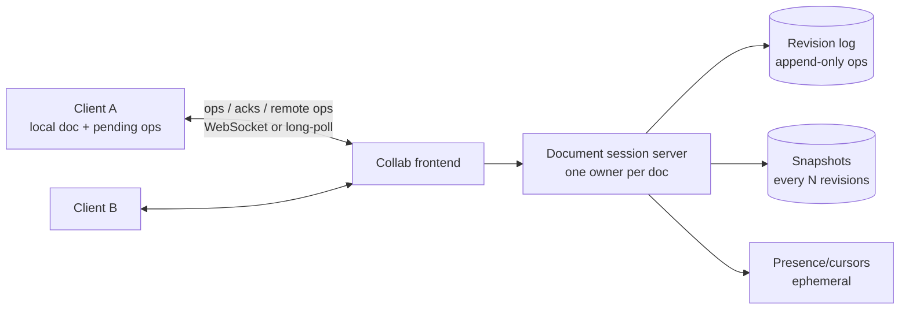
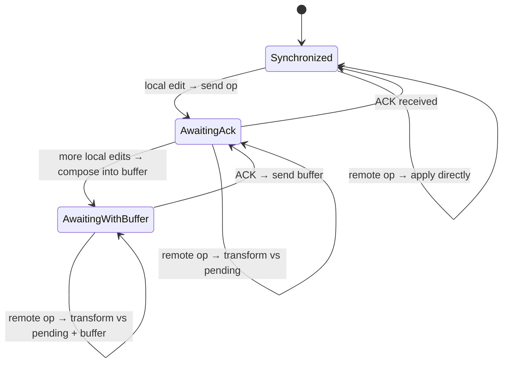

# 18 — Google Docs (Real-Time Collaboration)

*Um reference design construído sobre building blocks verificados. Como foi pesquisado e o que não foi conferido está em **Sources and provenance**, perto do fim.*

## At a glance

**Em 60 segundos.** A edição colaborativa em tempo real precisa de convergência, preservação de intenção e baixa latência. A resposta clássica cliente-servidor é a operational transformation: uma autoridade por documento dá às operações uma ordem total, transforma as concorrentes umas contra as outras e transmite o resultado, enquanto cada cliente mantém uma operação em andamento mais um buffer. Os CRDTs chegam à convergência sem um servidor central, ao custo de metadados e de algumas anomalias.

**Números principais**
- A differential sync de Fraser é um loop simétrico de diff-and-patch com fuzzy patching `[CONFIRMED]`.
- O Figma escolheu um design com autoridade no servidor inspirado em CRDTs, não em OT `[CONFIRMED]` (2019).
- Alguns algoritmos publicados apresentam anomalias de interleaving `[CONFIRMED]` (Kleppmann et al.).

**Decisões e trade-offs**

| Decisão | Por quê | Custo |
|---|---|---|
| Autoridade central por documento | Ordem total e transformação simples | Um ponto único por documento e uma ida e volta ao servidor |
| Uma op em andamento mais um buffer | Máquina de estados simples no cliente | Latência sob rajadas |
| OT vs CRDT | OT é comprovada para texto com servidor, CRDTs permitem peer-to-peer e offline | Metadados de CRDT e cuidado com anomalias |

**Erros comuns**
- Chamar a differential sync de manual: o patching dela é automático, mas best effort.
- Afirmar que o Google Docs usa um CRDT específico: as fontes descrevem OT cliente-servidor.
- Esquecer a presença e a transformação de cursores.

## Verified facts

| Afirmação | Fonte |
|---|---|
| A **differential synchronization** é "a symmetrical algorithm employing an unending cycle of background difference (diff) and patch operations". "The enabling feature is that the patch algorithm is fuzzy, meaning patches may be applied even if the document has changed." Quando um patch falha, as edições que falharam "will automatically show up negatively in the following diff and will be patched out of the Client Text", ou seja, a edição é perdida, não mesclada à mão. As edições ficam numa pilha e são "retransmitted to the remote party on every sync" até serem confirmadas | `[CONFIRMED]` Fraser |
| A página de Fraser diz "Algorithms based on Operation Transformation are currently popular for implementing edit-based collaborative systems". Ela **não** chama a OT de complexa. Sua crítica de complexidade mira a sincronização por *event passing* em geral ("all user actions must be captured") | `[CONFIRMED]` Fraser |
| Figma: "OTs were unnecessarily complex for our problem space", "Figma isn't a text editor", então sua tecnologia é "inspired by something called CRDTs" mas "Figma isn't using true CRDTs though". "Our server is the central authority", conflitos na mesma propriedade do mesmo objeto se resolvem como "a last-writer-wins register", os clientes são páginas web falando com um cluster de servidores por WebSockets, com "a separate process for each multiplayer document" | `[CONFIRMED]` Figma (2019) |
| "Interleaving anomalies" em editores de texto colaborativos: o texto inserido de forma concorrente, com ordem bem definida, "may be randomly interleaved". A página diz que "several published algorithms" apresentam a anomalia mas **não os nomeia**. Os autores do paper depois apontaram duas falhas sérias na própria correção proposta (a definição de não-interleaving "cannot be guaranteed by any algorithm", e o algoritmo da Seção 3.1 "does not guarantee convergence") e indicam o paper do Fugue | `[CONFIRMED]` página de Kleppmann et al. |

---

## 🧒 Non-technical explanation

Três pessoas estão editando a mesma frase no mesmo momento, de três países diferentes. As mensagens entre elas levam uma fração de segundo, então cada pessoa vê as mudanças das outras um pouco atrasadas.

O Google Docs dá a **cada um a sua própria cópia** para que digitar pareça instantâneo. Nos bastidores, cada tecla é enviada como uma **pequena instrução** ("insira 'a' na posição 5"), não como o documento inteiro.

O truque: se a Alice inseriu 3 letras no início enquanto o Bob apagou a 10ª letra, a instrução do Bob agora acertaria o **lugar errado** na cópia da Alice. Um servidor central age como **árbitro**. Ele conhece a ordem verdadeira de todas as instruções e **ajusta ("transforma")** as instruções atrasadas para que continuem significando o que o autor pretendia. Todo mundo termina com o **mesmo documento exato**, sem ninguém bloqueado e sem o trabalho de ninguém perdido.

---

## TL;DR for engineers

- Requisitos: **convergência**, **preservação de intenção**, **tempo real**, **edições offline**.
- Rejeitados: **locking pessimista** (um escritor), **last-write-wins** (perde dados), **differential sync** (os diffs não têm intenção; seu fuzzy patching é automático mas best-effort, então uma edição cujo contexto desapareceu é descartada em silêncio ([Fraser](https://neil.fraser.name/writing/sync/))).
- Escolhida: **Operational Transformation (OT)** com um **servidor central** que atribui uma ordem total (um número de revisão) às operações. Documento = **replay do log de revisões** ([Google, 2010](https://drive.googleblog.com/2010/09/whats-different-about-new-google-docs_22.html)); 🔧 snapshots para encurtar o replay são uma otimização presumida.
- Protocolo do cliente: **uma operação em andamento + buffer local**. Transforme as ops do servidor que chegam contra as ops locais pendentes ([Google, 2010](https://drive.googleblog.com/2010/09/whats-different-about-new-google-docs.html)).
- Alternativa: **CRDTs** (Yjs, Automerge). São amigáveis a peer-to-peer e não exigem um servidor central para a convergência ([Yjs docs](https://docs.yjs.dev/), [Automerge](https://automerge.org/)).

---

## 1. Why this is hard

1. Mudanças concorrentes precisam **convergir** para o mesmo estado.
2. Mudanças concorrentes precisam **evitar conflitos** e preservar a intenção de cada usuário.
3. As mudanças precisam aparecer **em tempo real** para todos.
4. Os usuários podem editar **offline**.
5. Física: uma ida e volta pelo planeta ≈ **200 ms**, então você não pode esperar o servidor a cada tecla.

---

## 2. Approaches that don't work

| Abordagem | Como | Por que foi rejeitada |
|---|---|---|
| **Locking pessimista** | Um escritor segura um lock. Os outros só leem. | Sem co-edição em tempo real. Sem offline. Coordenador central em toda edição. |
| **Latency hiding + Last-Write-Wins** | Cópias locais, a escrita mais nova sobrescreve | **Perda silenciosa de dados** sob concorrência + alta latência |
| **Differential synchronisation** | Cópias locais. Troca de diffs (algoritmo de Neil Fraser). | Overhead de diff a cada mudança. Os diffs não carregam **intenção**. Os conflitos são resolvidos **automaticamente** por fuzzy patching best-effort, não manualmente, mas um patch cujo contexto mudou demais falha e essa edição é descartada, ou seja, perdida ([Fraser, 2009](https://neil.fraser.name/writing/sync/)). |
| **Operational Transformation** ✅ | Troca de *operações*. Transforma as ops concorrentes umas contra as outras. | Complexa de implementar corretamente, mas automática, sem locks e preservando intenção |

---

## 3. Operational Transformation in one example

Documento: `"abc"`. A Alice e o Bob começam na revisão 0.

- Alice: `ins(3,"d")` → `"abcd"`
- Bob: `del(0)` (apaga `"a"`) → `"bc"`

Se o Bob aplicar ingenuamente a op da Alice: `ins(3,"d")` em `"bc"` → o índice 3 está fora dos limites ❌.
**Transformação:** como o delete do Bob na posição 0 aconteceu *antes* do índice 3, desloque a op da Alice: `T(ins(3,"d"), del(0)) = ins(2,"d")` → `"bcd"` ✅.
A Alice aplica a op do Bob transformada contra a dela: `T(del(0), ins(3,"d")) = del(0)` → `"bcd"` ✅. **Convergiu.**

A propriedade central (TP1): `apply(apply(S, a), T(b, a)) == apply(apply(S, b), T(a, b))` ([Wikipedia: OT](https://en.wikipedia.org/wiki/Operational_transformation)).

A OT trata as edições como **eventos num log de revisões**. O documento é o resultado de **reproduzir o log desde o início**, o que é basicamente event sourcing ([Google, 2010](https://drive.googleblog.com/2010/09/whats-different-about-new-google-docs_22.html)).

---

## 4. 🔧 How Google Docs works (reconstructed architecture)

O Google Docs usa um modelo de OT **cliente-servidor** ([Google, 2010](https://drive.googleblog.com/2010/09/whats-different-about-new-google-docs.html)) do tipo introduzido pelo sistema **Jupiter** (Nichols, Curtis, Dixon & Lamping, UIST 1995, [doi](https://doi.org/10.1145/215585.215706)), no qual a OT do Google Wave também se baseou ([Wave OT whitepaper](https://svn.apache.org/repos/asf/incubator/wave/whitepapers/operational-transform/operational-transform.html)). O Google não publicou uma linhagem direta Wave → Docs, então trate-os como irmãos. O servidor é a única fonte da verdade para a ordenação. Como toda op é transformada contra um único histórico linear do servidor, as funções de transformação só precisam de TP1 e a propriedade TP2 que a OT peer-to-peer exige não é necessária ([Wikipedia: OT, linha do Jupiter](https://en.wikipedia.org/wiki/Operational_transformation)). Isso evita os problemas de correção da OT peer-to-peer, bem mais difíceis.

### Server responsibilities
- **Uma sessão autoritativa por documento** (roteada pelo ID do doc, ex.: com consistent hashing), mantendo a revisão atual em memória. A descrição do Google de 2010 diz que o servidor mantém uma fila de mudanças recebidas mas ainda não processadas, o log de revisões e o estado atual do documento ([Google, 2010](https://drive.googleblog.com/2010/09/whats-different-about-new-google-docs.html)).
- Receba uma `op` marcada com a **revisão base** do cliente. Se o servidor está à frente, **transforme** a op contra toda op desde essa revisão base. Depois **aplique**, atribua `rev = n+1`, **anexe ao log**, dê **ACK** ao remetente e **transmita** aos outros clientes.
- **Snapshots/checkpoints** a cada N ops, de modo que carregar um documento = último snapshot + cauda do log (não um replay desde o início dos tempos). Esta é uma otimização presumida: o post do Google de 2010 só diz que ele reproduz o log desde o início.
- O histórico de revisões ("Ver histórico de versões") sai de graça do log.

### Client protocol (the "one outstanding op" rule)

- Os estados e as transições coincidem com o ot.js (`Synchronized`, `AwaitingConfirm`, `AwaitingWithBuffer`) ([ot.js client](https://github.com/Operational-Transformation/ot.js/blob/master/lib/client.js)).
- As edições locais são aplicadas **imediatamente** (latency hiding).
- Apenas **uma op em andamento** por vez: o Google diz "we never send more than one pending change at a time" ([Google, 2010](https://drive.googleblog.com/2010/09/whats-different-about-new-google-docs.html)). As edições seguintes são **compostas** num buffer, o que reduz o número de ops para transformar e enviar, e permite que o servidor mantenha um único espaço de estados (seu histórico) em vez de um por cliente ([Wave OT whitepaper](https://svn.apache.org/repos/asf/incubator/wave/whitepapers/operational-transform/operational-transform.html)).
- As ops remotas que chegam são **transformadas** contra as ops locais pendentes + em buffer antes de serem aplicadas.

### Offline
- Enfileire as ops localmente (ex.: no IndexedDB) contra a última revisão conhecida. Na reconexão, envie-as, e o servidor as transforma contra tudo o que aconteceu nesse meio-tempo. Longos períodos offline significam uma transformação grande, mas ainda assim automática.

### Presence (cursors, selections, avatars)
- Efêmero, de alta frequência, com perdas. Envie pelo mesmo canal mas **não persista**. As posições de cursor são elas mesmas **transformadas** pelas ops que chegam para se manterem no lugar (cf. `transformSelection` no [ot.js](https://github.com/Operational-Transformation/ot.js/blob/master/lib/client.js)).

### Rich text
- O post do Google de 2010 nomeia três tipos básicos de mudança: inserir texto, apagar texto e aplicar estilos a um trecho de texto ([Google, 2010](https://drive.googleblog.com/2010/09/whats-different-about-new-google-docs_22.html)). Então o modelo é uma sequência linear com **spans de formatação**. Bibliotecas como ot.js/Quill expressam a mesma ideia como **retain com atributos**. Um editor real acrescenta mais (tabelas, comentários ancorados em faixas). Cada novo tipo de op precisa de funções de transformação contra todos os outros tipos, e é aí que a complexidade da OT explode.

---

## 5. OT vs CRDT

| | **OT** (Google Docs) | **CRDT** (Yjs, Automerge; o Figma é *inspirado* em CRDT com um servidor central ([Figma, 2019](https://www.figma.com/blog/how-figmas-multiplayer-technology-works/))) |
|---|---|---|
| Ordenação | O servidor central ordena as ops | Sem necessidade de ordenação central. Comutativo por construção. |
| Topologia | Cliente-servidor | P2P, local-first, servidor opcional |
| Metadados | Ops pequenas | IDs únicos por caractere/elemento (tombstones). Mais memória, embora as implementações modernas tenham reduzido muito o overhead ([Kleppmann, 2020](https://www.youtube.com/watch?v=x7drE24geUw)). |
| Correção | As funções de transformação são notoriamente traiçoeiras | A convergência (strong eventual consistency) é provada para o tipo de dado por design ([Shapiro et al., 2011](https://inria.hal.science/inria-00609399)) |
| Preservação de intenção | Boa com um servidor central | Anomalias de interleaving são possíveis em alguns algoritmos publicados de edição colaborativa de texto: Kleppmann et al. mostram que os CRDTs Logoot e LSEQ podem intercalar aleatoriamente, caractere por caractere, texto inserido de forma concorrente. Eles provaram que o RGA não tem essa anomalia mas pode apresentar uma variante menor, e conjecturam que Treedoc e WOOT são livres de ambas. O paper não discute algoritmos de OT ([Kleppmann et al., 2019](https://martin.kleppmann.com/papers/interleaving-papoc19.pdf)) `[CONFIRMED]` |
| Offline/divergência longa | OK | Excelente |

**Regra prática:** um servidor central mais um produto centrado em texto fazem da OT uma escolha comprovada. Produtos local-first, com muito uso offline ou P2P favorecem CRDTs.

---

## ⚠️ Reviewer notes on the source

- **A differential synchronisation não é manual.** O artigo diz que a "conflict resolution might be difficult" da diff sync, seguido de "resolving conflicts manually affects the user experience", o que sugere que a diff sync precisa de merges manuais. O algoritmo de Neil Fraser resolve os conflitos **automaticamente** com fuzzy patching best-effort. Sua fraqueza real é outra: quando o contexto de um patch mudou demais, o patch falha e essa edição é descartada do texto do cliente, sendo perdida em silêncio ([Fraser, 2009](https://neil.fraser.name/writing/sync/)).

---

## 🏛️ Architecture lens (Fundamentals of Software Architecture)

> 🔧 Extensão. Vocabulário em [neokim-post/00-fundamentals.md §4](https://github.com/allmonty/study/blob/main/architecture/neokim-post/00-fundamentals.md#architecture-thinking).

- **Características dominantes (Ch 4–5):** **performance** (eco local, visibilidade remota < 200 ms), **consistência dos dados** (convergência: toda réplica termina idêntica), **disponibilidade** (incluindo offline), **escalabilidade** (milhões de docs abertos) e **recuperabilidade** (histórico, restart a partir de snapshot + log).
- **Estilo (Ch 15):** o servidor de sessão por documento funciona como uma **unidade de processamento space-based**: estado quente em memória, requisições roteadas ao dono e um log por trás. A diferença-chave é **um dono por documento** em vez de um grid replicado. A análise de **data collision** do livro (Ch 15) explica por quê: um documento é um "cache" minúsculo (S pequeno) com taxa de atualização (UR) muito alta. A replicação active/active colidiria o tempo todo, então um único escritor serializa as edições.
- **Quanta (Ch 7):** servidor de sessão + log de revisões + snapshots são **um quantum** (append síncrono antes do ACK). Presença e cursores são efêmeros e com perdas, com necessidades de confiabilidade diferentes, então são uma preocupação separada que poderia ser um quantum separado. Indexação de busca e exports são quanta assíncronos.
- **Trade-off (First Law, Ch 1):** o dono único compra **consistência e simplicidade** (sem TP2) e custa a **disponibilidade desse documento** durante o failover, além de um teto de escalabilidade por documento. Os CRDTs invertem a troca: disponibilidade e offline-first, pagos em metadados e anomalias de intenção.
- **Esboço de ADR (Ch 19):** *"Vamos usar OT cliente-servidor com um único dono de sessão por documento, porque nosso produto é centrado em texto e sempre conectado. Vamos reavaliar os CRDTs se a edição offline virar um caso de uso primário."*
- Em linguagem simples: cada documento tem exatamente um árbitro por vez. Isso mantém o jogo justo e simples, mas se o árbitro desmaia, o jogo pausa até um substituto entrar em campo.

---

## Interview questions to practice

1. Por que a OT cliente-servidor evita a propriedade TP2 que a OT peer-to-peer exige?
2. Descreva um cliente que envia a op A, depois digita B e C antes de o ACK de A chegar, enquanto uma op remota R chega.
3. Como escalar para 1M de docs abertos concorrentemente? Onde vive a sessão de um doc, e o que acontece quando esse servidor morre?
4. Como os comentários permanecem ancorados ao texto certo à medida que ele é editado?
5. Quando você escolheria um CRDT no lugar?

## Interview practice

Estes roteiros são raciocínio nosso (`[INDUSTRY PATTERN]`), não afirmações das fontes citadas.

**Um roteiro de 45 minutos**

1. Esclarecer: só texto ou rich text, offline, escala por doc.
2. Estimar: editores concorrentes por documento.
3. API: WebSocket com operações e revisões.
4. Design: gateway, servidor de documento, log de revisões, presença.
5. Deep dive: transformação, estados do cliente, OT vs CRDT.
6. Falhas e escala: reconexões, documentos grandes, edições offline.

**Se crescer 10×**
- Documentos grandes: snapshots para encurtar o replay do log.
- Muitos espectadores: fan-out de broadcast a partir de uma camada de pub/sub.
- Merges offline: enfileire operações e faça rebase na reconexão.

**Roteiros de resposta** (tente as perguntas acima primeiro)

Duas pessoas inserem na mesma posição. Mostre como convergem.

O servidor ordena uma primeiro, depois transforma a segunda contra ela para que o seu insert se desloque, e transmite a operação transformada. Cada cliente transforma contra as próprias edições pendentes.

Por que uma operação em andamento por cliente?

Mantém o protocolo cliente-servidor simples: o cliente só precisa transformar as operações que chegam contra uma op pendente e um buffer.

Quando você escolheria um CRDT?

Quando precisa de edição offline ou peer-to-peer sem uma autoridade central, aceitando o overhead de metadados.

## 📚 Further reading

- Blog do Google Drive, John Day-Richter (set 2010), série em três partes: [Working together, even apart](https://drive.googleblog.com/2010/09/whats-different-about-new-google-docs_21.html) · [Conflict resolution](https://drive.googleblog.com/2010/09/whats-different-about-new-google-docs_22.html) · [Making collaboration fast](https://drive.googleblog.com/2010/09/whats-different-about-new-google-docs.html)
- [Google Wave Operational Transformation whitepaper](https://svn.apache.org/repos/asf/incubator/wave/whitepapers/operational-transform/operational-transform.html)
- [Operational Transformation (Wikipedia)](https://en.wikipedia.org/wiki/Operational_transformation)
- Daniel Spiewak, [Understanding and Applying Operational Transformation](http://www.codecommit.com/blog/java/understanding-and-applying-operational-transformation)
- [Neil Fraser: Differential Synchronization](https://neil.fraser.name/writing/sync/)
- Martin Kleppmann, [CRDTs: The hard parts (talk)](https://www.youtube.com/watch?v=x7drE24geUw)
- [Yjs](https://yjs.dev/) · [Automerge](https://automerge.org/)
- Figma, [How Figma's multiplayer technology works](https://www.figma.com/blog/how-figmas-multiplayer-technology-works/)

## Sources and provenance

> **Kind:** reference design com partes reais documentadas. O Google publicou uma série curta em 2010 sobre como o novo editor do Docs sincroniza as edições (operational transformation com um servidor central), mas não uma arquitetura completa. O protocolo cliente/servidor abaixo segue a conhecida **OT cliente-servidor no estilo Jupiter**, como implementada no `ot.js` de código aberto, e é uma explicação de design, não um documento dos internals do Google.
> **Basis:** atualizado a partir de [`neokim-post/11`](https://github.com/allmonty/study/blob/main/architecture/neokim-post/11-how-google-docs-works.md), um resumo de [How Does Google Docs Work](https://newsletter.systemdesign.one/p/how-does-google-docs-work) com seções reconstruídas. Re-verified on 2026-10-27, veja o log.
> **Primary sources read in this session:** Neil Fraser, [*Differential Synchronization*](https://neil.fraser.name/writing/sync/) · Figma, [*How Figma's multiplayer technology works*](https://www.figma.com/blog/how-figmas-multiplayer-technology-works/) (2019-10-16) · Kleppmann et al., [*Interleaving anomalies in collaborative text editors*](https://martin.kleppmann.com/2019/03/25/papoc-interleaving-anomalies.html) (página do PaPoC 2019).
> **Re-read on 2026-10-27:** os três posts do Google de setembro de 2010 (por cópias do Internet Archive) e o texto completo de Kleppmann et al. (2019). **Ainda não relidos:** o whitepaper da Wave OT, Ellis & Gibbs e Nichols et al. (Jupiter), e o paper de CRDT (o HAL devolveu uma página de acesso negado). As afirmações que dependem deles permanecem da passada anterior (veja o log herdado) e estão marcadas de acordo.
> **Tags:** `[CONFIRMED]` afirmado por uma fonte primária que lemos agora · `[EARLIER PASS]` verificado na checagem de fatos do neokim-post mas não relido agora · `[INDUSTRY PATTERN]` design padrão · `[SPECULATIVE]` plausível. O marcador 🔧 é herdado da base.

---
## ✅ Verification log

*Inherited log (neokim-post/11), 2026-10-03:* Verified 17 · Corrected 7 · Softened/removed 4.

*Re-verification for this folder, 2026-10-27.*
- Verified in Fraser's page: the symmetric diff-and-patch cycle, fuzzy patching, failed patches patched out of the client text, the retransmission stack, and that the page describes OT as popular without calling it complex.
- Verified in Figma's post: date (2019-10-16), OT "unnecessarily complex for our problem space", "inspired by ... CRDTs" but not true CRDTs, server as central authority, last-writer-wins per property, WebSockets, one process per document.
- Verified in the full text of Kleppmann et al. (PaPoC 2019): the venue, the anomaly definition, that Logoot and LSEQ suffer from it, that RGA does not (proved in the authors' earlier work) but can show a lesser variant, and the conjecture for Treedoc and WOOT.
- **Corrected (2026-10-27):** the baseline (neokim-post/11) said interleaving anomalies also hit "some OT algorithms (SOCT2)" citing Kleppmann et al. The full text of that paper does not mention SOCT2 or operational transformation at all, so that claim is removed here as unsupported.
- Verified in Google's 2010 posts (Internet Archive copies, read 2026-10-27): edits boil down to three change types (inserting text, deleting text, applying styles to a range of text); the document is saved as a revision log and displayed by replaying the log from the beginning; "we never send more than one pending change at a time"; the client tracks the latest server revision, unsent local changes, sent-but-unacknowledged changes and the current document state; the server holds the list of received-but-unprocessed changes, the revision log and the current document state; and the new editor computes versions by playing forward the history of changes rather than diffing versions.
- Not re-read now (carried over, `[EARLIER PASS]`): the Wave OT whitepaper, the Jupiter paper (Nichols et al., 1995), Ellis & Gibbs (1989), Shapiro et al. on CRDTs and strong eventual consistency, ot.js client behaviour, Yjs and Automerge docs. HAL returned an access-denied page.
- Not claimed: how Google Docs is implemented today. The 2010 posts predate the current product by many years.
- Corrected (independent review, 2026-10-27): the TP2 sentence said the control algorithm guarantees TP2; the supported point is that a single linear server history makes TP2 unnecessary. The source is a secondary page (Wikipedia, Jupiter row) and the Jupiter paper was not re-read.
