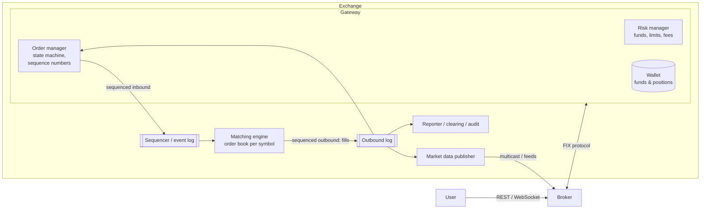
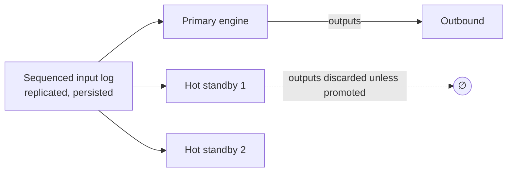

# 19 — Stock Exchange (Order Matching)

*Um reference design construído sobre building blocks verificados. Como foi pesquisado e o que não foi conferido está em **Sources and provenance**, perto do fim.*

## At a glance

**Em 60 segundos.** Uma bolsa carimba cada ordem, cancelamento e execução de entrada com um número de sequência global e os alimenta num matching engine determinístico, single-threaded e em memória, com prioridade de preço e tempo. Isso torna simples a justiça, o replay e o failover: as réplicas consomem a mesma entrada sequenciada. A LMAX publicou esse design, e as bolsas publicam protocolos de market data por multicast como o MoldUDP64, com recuperação de lacunas por número de sequência.

**Números principais**
- LMAX: 6 milhões de ordens/s numa única thread (benchmark de 2011) `[CONFIRMED]`.
- Restart completo incluindo o replay dos journals de um dia em menos de um minuto `[CONFIRMED]`.
- Disruptor: latência 3 ordens de grandeza menor, ~8× de throughput frente a filas `[CONFIRMED]`.

**Decisões e trade-offs**

| Decisão | Por quê | Custo |
|---|---|---|
| Engine single-threaded por shard | Sem locks, replay determinístico | Um símbolo quente não pode ser dividido |
| Sequenciar tudo o que entra | Justiça e replay | Uma ordem total por shard |
| Market data por multicast com números de sequência | Todos veem o mesmo stream | Recuperação de lacunas por servidores de re-request |

**Erros comuns**
- Dar a novas ordens e a cancelamentos sequências de entrada independentes: o engine então não tem ordem definida.
- Usar leituras do relógio de parede ou iteração sem ordem no caminho de matching.
- Dizer que 25M de mensagens/s era single-threaded: o paper não diz isso.


## Verified facts

| Afirmação | Fonte |
|---|---|
| O **Business Logic Processor da LMAX "can handle 6 million orders per second on a single thread"** (benchmark num servidor Nehalem dual-socket quad-core de 3 GHz com 32 GB de RAM). Ele "operates entirely in-memory, there is no database or other persistent store". O time acabou "doing all the business logic for their platform" numa só thread depois de tentar primeiro um design concorrente | `[CONFIRMED]` Fowler (2011) |
| Arquitetura: um **input disruptor**, o **business logic processor** e **output disruptors**. O estágio de entrada faz **unmarshalling, replicação e journaling** em paralelo ("they can [be] done in any order") | `[CONFIRMED]` Fowler |
| **Event sourcing para recuperação:** o estado do processador é reconstruído a partir de seus eventos de entrada, snapshots aceleram a recuperação, e um restart completo incluindo o restart da JVM e o replay dos journals de um dia "takes less than a minute". As réplicas deixam a LMAX "switch between processors in a matter of micro-seconds" | `[CONFIRMED]` Fowler |
| O paper do Disruptor relata, para um pipeline de três estágios, latência média "3 orders of magnitude lower" e "approximately 8 times more throughput" que a alternativa baseada em filas. Seu núcleo é "a pre-allocated bounded data structure in the form of a ring-buffer", com a regra de que "any data should be owned by only one thread for write access" (single writer). Ele afirma "over 25 million messages per second" e **não** diz que esse número é single-threaded | `[CONFIRMED]` paper do Disruptor |
| **MoldUDP64:** os pacotes downstream são enviados por **UDP multicast**, carregam uma **sessão** e o **número de sequência da primeira mensagem**, mais uma contagem de mensagens. As mensagens seguintes são numeradas implicitamente em sequência. Os clientes podem enviar mensagens **Request** para pedir a retransmissão de quaisquer pacotes, respondidas por unicast. Um ou mais **servidores de re-request** podem atender esses pedidos | `[CONFIRMED]` especificação do MoldUDP64 |

---

## 🧒 Non-technical explanation

Uma bolsa de valores é uma **feira livre com um árbitro muito rígido**.

- Para cada ação há uma **barraca**. Os vendedores gritam "vendo 100 a $98!" e os compradores gritam "compro 50 a $96!"
- O árbitro mantém duas filas: **compradores ordenados pelo maior preço** (quem paga mais vai primeiro) e **vendedores ordenados pelo menor preço**. Entre quem oferece o mesmo preço, **quem chegou primeiro vai primeiro**.
- Quando o preço do melhor comprador **iguala ou supera** o do melhor vendedor, o árbitro **aperta a mão dos dois**: isso é uma negociação.
- Tudo precisa ser **perfeitamente justo e repetível**. O árbitro carimba cada ordem com um **número de senha**, de modo que, se o mercado precisasse ser reproduzido desde a manhã, exatamente as mesmas negociações aconteceriam exatamente na mesma ordem.

---

## TL;DR for engineers

- **Arquitetura assíncrona e event-sourced.** Todo evento de entrada recebe um **número de sequência global**, e o matching engine é uma **máquina de estados determinística** sobre essa sequência. Isso dá justiça, replay, recuperação e semântica exactly-once.
- **Broker → Gateway (checagem de risco, wallet, order manager, sequenciamento) → Matching engine (order book em memória por símbolo) → Market data + relatórios de execução.**
- **Order book:** dois lados × níveis de preço, cada um uma **lista duplamente encadeada FIFO**, mais um hash map `order_id → node` para cancelamento O(1). Melhor bid/ask acompanhados.
- **Prioridade de preço e tempo. Faça match enquanto best_bid ≥ best_ask.**
- 🔧 **Baixa latência:** matching single-threaded por shard de símbolo (sem locks), ring buffers (LMAX Disruptor), kernel bypass, co-location, market data por multicast. A LMAX roda *toda* a sua lógica de negócio numa única thread a ~6M ordens/s ([Fowler](https://martinfowler.com/articles/lmax.html)).
- 🔧 **HA:** replique o log de entrada sequenciado para hot standbys que rodam o mesmo engine determinístico e façam failover rápido. A LMAX relata a troca entre réplicas "in a matter of micro-seconds" ([Fowler](https://martinfowler.com/articles/lmax.html)).

---

## 1. Market primer

| Termo | Significado |
|---|---|
| **Broker** | App/site (Robinhood, Schwab) que envia ordens à bolsa pelos usuários |
| **Order book** | Todas as ordens abertas de compra e venda de um símbolo |
| **Market order** | Executa agora ao melhor preço disponível (precisa de liquidez). Prioridade, mas sem proteção de preço. A execução é garantida, o preço não ([investor.gov](https://www.investor.gov/introduction-investing/investing-basics/how-stock-markets-work/types-orders)); veja as Reviewer notes sobre "prioridade". |
| **Limit order** | Executa só ao preço limite ou melhor (compra ≤ $100, venda ≥ $100). Fica no book se não casar ([investor.gov](https://www.investor.gov/introduction-investing/investing-basics/how-stock-markets-work/types-orders)). |
| **Bid / Ask** | Melhor preço de compra / melhor preço de venda |
| **Spread** | best ask − best bid |
| **Fill** | Uma execução (parcial) de uma ordem |

Mistura de mensagens nas bolsas reais: ~**50% de novas ordens, ~40% de cancelamentos, ~2% de execuções** (números do artigo; as bolsas reais pendem ainda mais para cancelamentos, veja as Reviewer notes). **Os cancelamentos precisam ser tão rápidos quanto as inserções.**

---

## 2. Requirements

- Só ações. Ordens **limit** de BUY/SELL (market orders como extensão). **Cancelar** a qualquer momento.
- Matching em tempo real.
- **Limites de risco** (ex.: máximo de ações por usuário por dia).
- Publicação de **market data** em tempo real.
- 🔧 NFRs: **determinístico**, **justo** (FIFO em cada preço), **latência de microssegundos a poucos milissegundos**, **nenhuma ordem perdida ou duplicada**, 99,99%+ de disponibilidade durante o pregão, **trilha de auditoria** completa.

---

## 3. Architecture



### 3.1 Broker
- Envia ordens, recebe status, consome market data (ao vivo + histórico).
- Usuários ↔ broker: REST + WebSocket. **Broker ↔ bolsa: FIX** (Financial Information eXchange), um protocolo de sessão com **números de sequência por mensagem** (`MsgSeqNum(34)`), checksums (`CheckSum(10)`) e tamanho do corpo (`BodyLength(9)`) para integridade, e `ResendRequest(35=2)` para lacunas ([FIX Session Layer](https://www.fixtrading.org/standards/fix-session-layer/)).

### 3.2 Gateway
Converte o FIX para o formato binário interno e devolve os relatórios de execução. Pode ser **co-localizado** no datacenter da bolsa para latência mínima.

| Parte | Papel |
|---|---|
| **Risk manager** | Há fundos/ações suficientes? Atividade incomum? Limites diários. Cálculo de taxas. |
| **Wallet** | Guarda os fundos e as posições do usuário. **Reserva** fundos quando uma ordem é aceita. |
| **Order manager** | Lista leve de **todas** as ordens (abertas, canceladas, rejeitadas). Atualiza o estado. Trata cancelamentos. **Atribui um número de sequência globalmente crescente** a toda ordem, cancelamento e execução. |

**Os números de sequência garantem:**
- **Ordenação:** justiça, pontualidade, exatidão
- **Recuperação rápida + replay determinístico**
- **Exactly-once** (duplicatas detectadas pela sequência)
- **Detecção de lacunas** nos streams de entrada e de saída

**Os eventos de entrada (novas ordens e cancelamentos) precisam compartilhar uma ordem total por shard do matching engine.** Um cancelamento e uma execução da mesma ordem precisam de uma ordem relativa definida, senão o replay não consegue reproduzir o mesmo matching e a justiça se perde. Apenas os **streams de saída ou derivados** (relatórios de execução, market data, drop copies) podem ser divididos em topics com seus próprios números de sequência, já que são produzidos a partir da entrada já ordenada (correção do revisor, 2026-10-27: o texto anterior sugeria sequências de entrada independentes).

### 3.3 Matching engine
- Verifica os números de sequência, faz o **match**, emite **trades** → market data.
- **Determinismo:** a mesma sequência de entrada precisa produzir a mesma sequência de saída. Sem leituras do relógio de parede, sem aleatoriedade, sem iteração sobre hash maps sem ordem no caminho de matching.

---

## 4. Order book data structure

```
           BUY (bids, desc)                     SELL (asks, asc)
  $97  → [o12:100] ⇄ [o17:50]          $98  → [o3:200] ⇄ [o9:20]   ← best ask
  $96  → [o4:300]                       $99  → [o5:100]
  ↑ best bid                            $101 → [o21:500]

  index: order_id → *node   (O(1) cancel)
```

| Operação | Complexidade | Como |
|---|---|---|
| Adicionar ordem num nível existente | **O(1)** | Acrescentar ao final da lista FIFO desse nível |
| Cancelar | **O(1)** | Consulta no hash → desencadear o nó (duplamente encadeada) |
| Melhor bid/ask | Leitura **O(1)** | Ponteiro em cache. Quando o melhor nível esvazia, achar o próximo é O(log P) numa árvore, ou uma varredura até o próximo tick não vazio num array |
| Novo nível de preço | O(log P) ou O(1) | Mapa ordenado (árvore red-black) de níveis, ou um **array indexado por tick** (os preços são discretos) |
| Match | O(fills) | Percorrer a partir do melhor nível oposto |

As ordens encerradas saem do book e vão para o histórico de transações.

### 🔧 Matching algorithm (price-time priority)

```python
def on_new_limit_order(o):                      # o.side in {BUY, SELL}
    book_opp = book.asks if o.side == BUY else book.bids
    crosses = (lambda p: o.price >= p) if o.side == BUY else (lambda p: o.price <= p)
    while o.qty > 0 and book_opp.best() and crosses(book_opp.best().price):
        level = book_opp.best()
        resting = level.head                    # oldest at best price (FIFO)
        q = min(o.qty, resting.qty)
        emit_trade(price=resting.price, qty=q,  # trade at the RESTING order's price
                   buy=..., sell=..., seq=next_seq())
        o.qty -= q; resting.qty -= q
        if resting.qty == 0: level.pop_head(); index.pop(resting.id)
        if level.empty(): book_opp.remove(level)
    if o.qty > 0:                               # remainder rests on the book
        book_same_side(o).level(o.price).append(o); index[o.id] = o
```

Tipos de ordem além de limit/market: IOC, FOK, stop, iceberg, post-only. Os leilões (cruzamento de abertura/fechamento) usam um algoritmo diferente de preço uniforme: o Nasdaq Closing Cross "crosses orders at a single price" ([Nasdaq](https://www.nasdaq.com/products/north-american-markets/nasdaq-stock-market/closing-cross)).

---

## 5. 🔧 Market data

- Toda mudança no book (add/cancel/execute) produz um evento → **L1** (topo do book), **L2** (profundidade agregada por nível), **L3** (cada ordem, também chamado market-by-order; a nomenclatura dos níveis varia por fornecedor).
- Publicado por **UDP multicast** com números de sequência (os receptores detectam lacunas → pedem retransmissão ou snapshot), ex.: o **Nasdaq TotalView-ITCH** (saída, market data em nível de ordem) sobre **MoldUDP64**, cujos listeners detectam lacunas de sequência e enviam um pacote de request a um servidor de re-request ([especificação do MoldUDP64](https://www.nasdaqtrader.com/content/technicalsupport/specifications/dataproducts/moldudp64.pdf)). Os snapshots do estado do book vêm do serviço separado **GLIMPSE**, que informa o número de sequência do ITCH a partir do qual retomar ([especificação do GLIMPSE 5.0](https://www.nasdaqtrader.com/content/technicalsupport/specifications/dataproducts/NQGlimpseSpecification_5.0.pdf)). A entrada de ordens usa o **OUCH** (a "Order Entry Specification" binária do Nasdaq, [OUCH 5.0](https://www.nasdaqtrader.com/content/technicalsupport/specifications/TradingProducts/Ouch5.0.pdf)) ou FIX.
- Os gráficos de candlestick (OHLCV) são construídos downstream a partir do stream de trades.
- **Justiça:** todos os participantes devem receber os dados ao mesmo tempo (multicast, e co-location cujos termos, segundo a SEC, "must not be unfairly discriminatory" ([SEC concept release 34-61358](https://www.sec.gov/rules/concept/2010/34-61358.pdf)); as bolsas também tentam equalizar a latência física, como o comprimento dos cabos).

---

## 6. 🔧 Low-latency engineering

| Técnica | Por quê |
|---|---|
| **Matching single-threaded por símbolo (ou shard de símbolo)** | Sem locks, amigável ao cache. Throughput via **sharding por símbolo**. |
| **Ring buffers do LMAX Disruptor** | Filas lock-free, pré-alocadas e com mechanical sympathy entre os estágios ([paper do Disruptor](https://lmax-exchange.github.io/disruptor/disruptor.html)) |
| **Tudo em memória** | O book fica residente em RAM. A durabilidade vem do **log de entrada**, não de escritas em banco. |
| **Kernel bypass** (DPDK, Solarflare/OpenOnload), busy-spin, CPU pinning, sem pausas de GC (ou C++/Rust) | Caudas de microssegundos |
| **Pré-alocação / object pools** | Sem alocação no caminho quente |
| **Co-location** | Brokers/HFTs põem servidores no mesmo DC |
| **Preços em ponto fixo** (ticks inteiros) | Sem erros de ponto flutuante, comparações rápidas |

---

## 7. 🔧 Fault tolerance through event sourcing


- **Estado = f(entradas ordenadas).** Persista e replique o **log de entrada** (sequencer). Os standbys consomem o mesmo log e mantêm um **book idêntico**.
- Na falha do primário, promova um standby (um consenso como o Raft pode escolher o líder e replicar o log). O novo primário retoma a partir do próximo número de sequência. Os clientes reconciliam pelos números de sequência.
- **Snapshots** do book + offset do log tornam os restarts rápidos (sem replay desde a abertura do mercado). A LMAX faz snapshot toda noite e mantém réplicas quentes porque um restart de snapshot mais replay (menos de um minuto) ainda é lento demais no meio da sessão; ela roda dois processadores no DC principal e um terceiro num site de DR ([Fowler](https://martinfowler.com/articles/lmax.html)).
- **Disaster recovery:** um DC remoto reproduz o log (async), então uma pequena lacuna de RPO é aceitável ali.
- Esta é a **mesma ideia do log de metadados do Kafka** (KRaft, [KIP-500](https://cwiki.apache.org/confluence/display/KAFKA/KIP-500%3A+Replace+ZooKeeper+with+a+Self-Managed+Metadata+Quorum)): um replay determinístico de um log ordenado de eventos. Brian Nigito, da Jane Street, descreve o mesmo núcleo de state-machine replication para uma bolsa ([talk](https://www.janestreet.com/tech-talks/building-an-exchange/)).

---

## ⚠️ Reviewer notes on the source

- **"Market order … receives priority in the order book."** Uma market order nunca fica no order book. Ela é executável na chegada e consome liquidez das ordens em repouso. A prioridade de preço e tempo ranqueia ordens *em repouso*, então não se aplica a ela. A SEC define uma market order apenas como aquela que "guarantees that the order will be executed, but does not guarantee the execution price" ([investor.gov](https://www.investor.gov/introduction-investing/investing-basics/how-stock-markets-work/types-orders)). Uma leitura mais precisa: ela tem precedência em *certeza de execução*, não em posição na fila.
- **Mistura de mensagens "~50% new orders, ~40% cancels, ~2% executions."** Isso subestima os cancelamentos. Os dados MIDAS da SEC mostram uma **razão entre volume de trades e de ordens para ações dos EUA de cerca de 2,5–4,2%** (médias trimestrais de 3,2–3,7%, 4T 2012–2T 2013), e **cerca de 0,2% para ETPs**. Então aproximadamente 96% ou mais do volume de ordens exibidas é cancelado (ou expira) em vez de executado ([SEC, Trade-to-Order Volume Ratios](https://www.sec.gov/data-research/data-visualizations/trade-order-volume-ratios)). A SEC também publica uma razão diária de cancelamento para trade ([SEC MIDAS](https://www.sec.gov/marketstructure/datavis/ma_etp_canceltotrade.html)). Nessas bolsas, as mensagens de cancelamento chegam perto de igualar as de novas ordens uma a uma, o que reforça ainda mais o ponto de que "cancelamentos precisam ser rápidos". Ressalva: a razão da SEC é baseada em volume de ações, não em contagem de mensagens.

## 🏛️ Architecture lens (Fundamentals of Software Architecture)

> 🔧 Extensão. Vocabulário em [neokim-post/00-fundamentals.md §4](https://github.com/allmonty/study/blob/main/architecture/neokim-post/00-fundamentals.md#architecture-thinking).

- **Características dominantes (Ch 4–5):** **performance** (latência de µs; "low latency in high-frequency trading" é o próprio exemplo do livro de uma característica *implícita*, Ch 4), **confiabilidade** (nenhuma ordem perdida ou duplicada), **tolerância a falhas/recuperabilidade** (hot standbys, replay), **disponibilidade** no horário de pregão e **auditabilidade**. A justiça é domínio, mas força uma escolha estrutural: um único sequencer.
- **Estilos (Ch 11, 14):** o caminho quente é um **pipeline** com pipes ponto a ponto e unidirecionais: gateway → sequencer → matching engine → log de saída. O Disruptor da LMAX é pipes-and-filters dentro de um processo. Downstream, o market data usa a **capacidade de broadcast** do livro (Ch 14 §6, cujo exemplo é literalmente um stock ticker): publique uma vez, nunca saiba quem escuta.
- **Quanta (Ch 7):** (1) gateway/risk/wallet, (2) sequencer + matching engine + standbys, que precisam compartilhar características idênticas porque os standbys reproduzem o mesmo log, (3) publicadores de market data e (4) clearing/relatórios, ambos desacoplados pelo log de saída.
- **Trade-off (Ch 14, workflow event pattern):** o exemplo de trading do livro alerta que mensagens reparadas e reenviadas chegam **fora de ordem**, então as negociações da mesma conta precisam esperar atrás de uma que falhou. Aqui isso é resolvido por construção: nada contorna o sequencer. A troca é **escalabilidade por símbolo** (uma thread por book) por **determinismo e performance**. Você escala fazendo sharding dos símbolos.
- **Esboço de ADR (Ch 19):** *"Vamos rodar um matching engine single-threaded por shard de símbolo sobre um log de entrada replicado. Aceitamos que um símbolo quente não possa ser dividido, em troca de um matching sem locks e reproduzível."*
- Em linguagem simples: um árbitro por barraca, com cada grito escrito num caderno numerado. Um árbitro substituto com uma cópia do caderno pode assumir no meio do jogo e tomar exatamente as mesmas decisões.

---

## Interview questions to practice

1. Por que o matching engine precisa ser determinístico, e quais padrões comuns de código quebram o determinismo?
2. Projete o order book de modo que o cancelamento, a operação mais comum, seja O(1).
3. Como escalar para 10 mil símbolos? E para um único símbolo que recebe 30% do volume?
4. Um assinante de market data perde os pacotes 1.000.123–1.000.130. Como ele se recupera?
5. Compare o sequenciamento por um sequencer central com as partições do Kafka. Onde cada um falha?

## Interview practice

Estes roteiros são raciocínio nosso (`[INDUSTRY PATTERN]`), não afirmações das fontes citadas.

**Um roteiro de 45 minutos**

1. Esclarecer: tipos de ordem, símbolos, meta de latência.
2. Estimar: ordens/s e tamanho do book.
3. API: nova, cancelamento, relatório de execução, market data.
4. Design: gateway, risco, sequencer, engine, journal, publicador.
5. Deep dive: matching, determinismo, event sourcing.
6. Falhas e escala: failover, recuperação de lacunas, símbolos quentes.

**Se crescer 10×**
- Mais símbolos: sharding por símbolo.
- Market-data fan-out: multicast mais um serviço de snapshot.
- Auditoria: mantenha o journal como fonte da verdade.

**Roteiros de resposta** (tente as perguntas acima primeiro)

<details><summary>Por que um único sequencer e um engine single-threaded?</summary>

Uma ordem total torna o matching determinístico e justo, e uma única thread elimina os locks. As réplicas reproduzem a mesma entrada para permanecerem idênticas.

</details>

<details><summary>Como funciona o failover?</summary>

Um hot standby consome a mesma entrada sequenciada, então seu estado é idêntico, e o tráfego muda para ele. Os restarts reproduzem o journal a partir de um snapshot.

</details>

<details><summary>Como um assinante recupera um pacote multicast perdido?</summary>

Detecta a lacuna pelos números de sequência e envia um request a um servidor de re-request, que reenvia por unicast.

</details>

## 📚 Further reading

- Martin Fowler, [The LMAX Architecture](https://martinfowler.com/articles/lmax.html) · [LMAX Disruptor](https://lmax-exchange.github.io/disruptor/)
- Jane Street (Brian Nigito), [How to Build an Exchange (talk)](https://www.janestreet.com/tech-talks/building-an-exchange/)
- [FIX protocol overview (OnixS)](https://www.onixs.biz/fix-protocol.html)
- [Nasdaq TotalView-ITCH spec](https://www.nasdaqtrader.com/Trader.aspx?id=Totalview2)
- [Co-location strategies (QuestDB glossary)](https://questdb.com/glossary/exchange-co-location-strategies/)
- Alex Xu, *System Design Interview Vol. 2*: capítulo "Stock Exchange"
- Relacionado nesta pasta: [04 Message queue / log](04-message-queue-kafka.md)

## Sources and provenance

> **Kind:** reference design com partes reais documentadas. As bolsas reais publicam **especificações de protocolo** (Nasdaq ITCH, OUCH, MoldUDP64, FIX) e regras de estrutura de mercado, e o time da LMAX publicou sua **arquitetura** em detalhe. Elas não publicam um design interno completo do matching engine de uma bolsa em produção, então o diagrama abaixo combina o design padrão com a abordagem documentada da LMAX `[INDUSTRY PATTERN]`.
> **Basis:** atualizado a partir de [`neokim-post/14`](https://github.com/allmonty/study/blob/main/architecture/neokim-post/14-how-stock-exchange-works.md), um resumo de [Stock Exchange System Design](https://newsletter.systemdesign.one/p/stock-exchange-system-design) com seções reconstruídas. Re-verified on 2026-10-27, veja o log.
> **Primary sources read in this session:** Martin Fowler, [*The LMAX Architecture*](https://martinfowler.com/articles/lmax.html) (2011-07-12) · Thompson et al., [*Disruptor: High performance alternative to bounded queues*](https://lmax-exchange.github.io/disruptor/disruptor.html) · Nasdaq, [MoldUDP64 Protocol Specification V1.00](https://www.nasdaqtrader.com/content/technicalsupport/specifications/dataproducts/moldudp64.pdf) (texto do PDF extraído localmente).
> **Dated material:** os números da LMAX vêm de um benchmark de 2011 em hardware da era Nehalem, então trate-os como evidência de design, não como performance atual.
> **Tags:** `[CONFIRMED]` afirmado por uma fonte primária que lemos agora · `[EARLIER PASS]` verificado na checagem de fatos do neokim-post mas não relido agora · `[INDUSTRY PATTERN]` design padrão · `[SPECULATIVE]` plausível. O marcador 🔧 é herdado da base.

---
## ✅ Verification log

*Inherited log (neokim-post/14), 2026-10-03:* Verified 19 · Corrected 3 · Softened/removed 2.

*Re-verification for this folder, 2026-10-27.*
- Verified in Fowler's article (2011-07-12): 6 million orders per second on a single thread with the stated hardware, all in memory with no database, input disruptor doing unmarshalling, replication and journaling in parallel, event-sourced recovery under a minute, failover in "a matter of micro-seconds".
- Verified in the Disruptor paper: 3 orders of magnitude lower mean latency and about 8× throughput for a three-stage pipeline, ring-buffer core, single-writer principle, "over 25 million messages per second". The 25M figure is **not** attributed to one thread, since the source does not say so. (The page's header says May 2011 and its footer says a 2025 update date, so we cite no date.)
- Verified in the MoldUDP64 spec (text extracted locally): UDP multicast downstream, session and first-message sequence number, message count with implicit sequential numbering, Request messages answered by unicast retransmission, re-request servers.
- Not re-read now (carried over, `[EARLIER PASS]`): Nasdaq ITCH, OUCH and GLIMPSE specs, FIX session-layer details (`MsgSeqNum`, `ResendRequest`), SEC co-location and MIDAS trade-to-order ratios, Nasdaq closing cross, the matching pseudocode, the Jane Street talk. The data-structure complexity table was re-derived in the earlier pass.
- Not claimed: how any particular exchange (Nasdaq, NYSE, CME) is internally built beyond what their published protocols imply.
