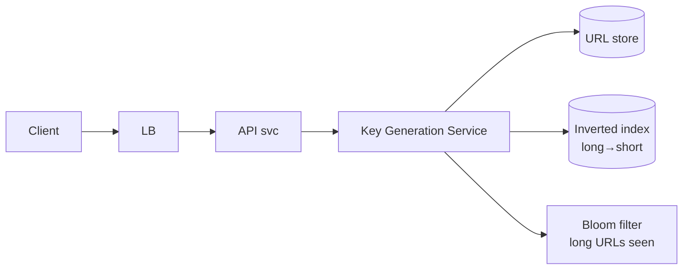
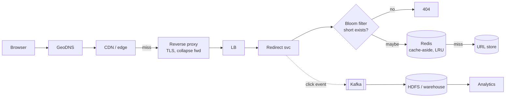

# 01 — URL Shortener (TinyURL / Bitly)

> **Kind:** reference design. Bitly, TinyURL and others do not publish their internals, so the architecture below is the standard interview design, not a claim about how any company builds it. What *is* sourced to primary documents: HTTP redirect semantics (RFC 9110/9111), the Snowflake ID layout, and Bitly's observed redirect headers.
> **Basis:** upgraded from [`neokim-post/05`](../../neokim-post/05-how-url-shortener-works.md), itself a paraphrase of [systemdesign.one](https://systemdesign.one/url-shortening-system-design/) (CC BY-NC-ND 4.0). Re-verified on 2026-10-27 (see the log at the end).
> **Tags:** `[CONFIRMED]` stated by a primary source · `[INDUSTRY PATTERN]` standard practice, no single authority · `[SPECULATIVE]` plausible design choice. Untagged arithmetic can be checked by hand.

---

## 🧒 Non-technical explanation

A URL shortener is a **coat check**. You hand over your long, bulky coat (a long web address) and get a **small ticket** (`sho.rt/xy725ab`). Anyone who shows that ticket gets sent to your coat.

The hard parts:
- **Never give two coats the same ticket number**, even when 100 coat-check clerks are working at once.
- **Make ticket numbers hard to guess**, so nobody can walk through other people's coats.
- **Hand coats back really fast**, because people redeem tickets 100× more often than they check coats. Keep the popular coats right next to the counter (cache).

---

## TL;DR for engineers

- **Read-heavy (100:1)**: optimise redirects with CDN/edge + Redis cache + Bloom filters.
- **Key generation is the core problem.** Recommended: **token ranges** (pre-allocated, non-overlapping counter ranges per KGS instance, coordinated by ZooKeeper/DynamoDB) + **base62** encoding (7 chars ≈ 3.5 trillion IDs).
- **NoSQL KV** for `short → long`, plus an **inverted index** `long → short` if 1:1 mapping is required.
- **301 vs 302** is a product decision: SEO and cacheability vs per-click analytics.

---

## 1. Requirements

**Clarifying Q&A:** 100M DAU (writes) · 5-year retention · 100:1 read:write · most links accessed once after creation · general public · max 9 chars.

**Functional:**
- Shorten a long URL → short URL. Redirect short → long.
- **Same long URL → same short URL** (1:1). This is optional in many real products.
- Short URLs must be readable, collision-free, **non-predictable**. Custom aliases allowed. Optional expiry.
- Non-real-time analytics (click counts, referrers, geo).

**Non-functional:** highly available, low latency, scalable, durable, fault tolerant.

**Out of scope:** registration, visibility settings.

---

## 2. API

```http
PUT /url                       # PUT because the operation is idempotent (1:1 mapping); RFC 9110 §9.2.2
Authorization: Bearer <JWT>
{ "long-url": "https://en.wikipedia.org/wiki/URL_shortening",
  "tags": ["productivity"], "expires": "2030-01-01T00:00:00Z", "custom": "my-alias" }

→ 200 OK
{ "long-url": "...", "short-url": "xy725ab", "created-at": "...", "is-active": true }
→ 401 Unauthorized | 403 Forbidden
```

```http
GET /:short-url
→ 301 Moved Permanently   Location: <long-url>
→ 404 Not Found
```

| Status | Meaning | Use when |
|---|---|---|
| **301** | Permanent. Heuristically cacheable, so browsers keep it unless `Cache-Control` says otherwise ([RFC 9110 §15.4.2](https://www.rfc-editor.org/rfc/rfc9110.html#name-301-moved-permanently)). Google treats the target as canonical ([Google](https://developers.google.com/search/docs/crawling-indexing/301-redirects)). | SEO matters. Fewer server hits. |
| **302** | Temporary (a POST may become GET). Not heuristically cacheable: cached only with explicit freshness headers ([RFC 9110 §15.4.3](https://www.rfc-editor.org/rfc/rfc9110.html#name-302-found)). | You want **every click to hit your servers** for analytics. |
| **307** | Temporary, **preserves method and body** ([RFC 9110 §15.4.8](https://www.rfc-editor.org/rfc/rfc9110.html#name-307-temporary-redirect)) | Redirecting non-GET requests |
| **308** | Permanent + preserves method. Heuristically cacheable like 301. | Rare for shorteners |

**Public API → REST** (loose coupling, debuggable). **Internal service-to-service → RPC (gRPC)** once stable, for performance.

---

## 3. Data model & store choice

```
URL table (NoSQL KV, e.g. DynamoDB / Cassandra)
  short_url (PK) | long_url | user_id | created_at | expires_at | last_visited | hits

Users table (SQL, e.g. Postgres)
  user_id (PK) | email | name | api_key | created_at
```

- **URL table → NoSQL:** no joins, flexible schema, TB–PB scale, very high IOPS, easy horizontal scaling.
- **Users table → SQL:** strict schema, relational, ACID.
- "Who owns this short URL?" → join at the **application level**.

---

## 4. Capacity planning

| Metric | Value |
|---|---|
| Write QPS | 100M/day ÷ 86,400 s ≈ 1,157/s, rounded via ÷10⁵ to **~1k/s** |
| Read QPS | ×100 ≈ **~100k/s** |
| Record size | ~2.5 KB (long URL up to 2 KB + metadata) |
| Storage (5 yrs) | 100M × 365 × 5 = 1.8×10¹¹ records × 2.5 KB ≈ **~456 TB** (× RF 3 ≈ 1.4 PB) |
| Cache | 80/20 rule → cache ~20% of daily hot redirects, TTL ≈ 1 day |

Tips: 1M req/day ≈ 12 req/s. Round aggressively and **write units down**.

---

## 5. Encoding

**Base62** (`[0-9a-zA-Z]`). Base58 drops ambiguous `0 O I l`.

| Length | Base62 combinations |
|---|---|
| 6 | 56.8 B |
| **7** | **3.52 T** (3.52×10¹² ÷ 1k/s ≈ 111 years) |
| 8 | 218 T |

Total = base^length. Each base62 character carries log₂62 ≈ 5.95 bits, so 7 characters ≈ 41.7 bits ("42 bits" in round numbers). Base conversion is O(k), effectively O(1) for fixed k.

---

## 6. Write path: three ways to generate keys



| Approach | How | Verdict |
|---|---|---|
| **Random ID / UUID** | Random 42-bit value → base62 | ❌ Collisions need a DB check per write. Breaks 1:1. Needs coordination. |
| **Snowflake ID** | 64-bit: 1 unused + 41-bit ms timestamp + 10-bit machine id (5 DC + 5 worker) + 12-bit sequence `[CONFIRMED]` ([README](https://github.com/twitter-archive/snowflake/blob/snowflake-2010/README.mkd) gives 41/10/12 bits. The 5+5 datacenter/worker split of the 10 bits is in [IdWorker.scala](https://github.com/twitter-archive/snowflake/blob/snowflake-2010/src/main/scala/com/twitter/service/snowflake/IdWorker.scala)) | ❌ 11 base62 chars (too long; today's ~61-bit IDs exceed 62¹⁰). Predictable. Needs clock sync (NTP). |
| **Hash (MD5/SHA-256) + truncate** `[INDUSTRY PATTERN]` | hash(long) → base62 (MD5's 128 bits → 22 chars) → take first 7 | ❌ Truncation → collisions. Predictable. Needs a collision check + rehash/salt. |
| **Token range** ✅ `[INDUSTRY PATTERN]` | Each KGS instance leases a non-overlapping counter range (e.g., 1M ids) from a **token range service** (ZooKeeper / strongly consistent DynamoDB). Serves from memory. | ✅ Collision-free, O(1), horizontally scalable |

**Token range details:**
- A new KGS instance leases a range, and leases a new one when it's exhausted. Losing an in-memory range on crash only **wastes IDs**. With 3.5T keys that is usually acceptable, and the article suggests moving ranges to an external cache to reduce it.
- Counters are **predictable** → append random bits, or hand out **shuffled/randomised ranges**, or (🔧) apply a reversible bijective scramble (e.g., Feistel cipher over the integer).
- Keep ranges in an external cache (Redis) if you need more resilience.
- Encode inside the token server to avoid an extra network hop.

**Enforcing 1:1 (same long → same short):**
- A Bloom filter over long URLs answers "definitely never seen" cheaply: it has false positives but no false negatives ([Bloom filter](https://en.wikipedia.org/wiki/Bloom_filter)). On "maybe", check the **inverted index** (`long_url → short_url`, KV partitioned by long URL).
- **Concurrent identical requests:** acquire a **distributed lock on the long URL** (Redis/Chubby/ZK), check, create, release. Give the lock a TTL to avoid starvation.

```
check bloom(long) → lock(long) → shorten → write url + inverted index → add to bloom → unlock
```

---

## 7. Read path (redirects)



- **Cache-aside + LRU**, TTL ~1 day. Partition the cache by short URL, with leader-follower replicas for reads.
- **Bloom filter on short URLs** returns 404 for non-existent keys without touching cache or DB (protects against enumeration/scan traffic). 🔧 A standard Bloom filter can't delete, so expired links still answer "maybe" and fall through to the lookup.
- **Avoid cache thrashing** from "accessed only once" links: only cache on the **second** access (track the first access with a Bloom filter). Akamai does the same for "one-hit wonders" ([Bloom filter § examples](https://en.wikipedia.org/wiki/Bloom_filter#Examples)).
- **Collapsed forwarding / request coalescing** at the proxy/cache: 10k simultaneous cache misses on a viral link → 1 origin request `[CONFIRMED]` that Squid supports it (a reviewer found Squid's docs say the directive is unavailable in Squid v8 and off by default, so check your version) ([Squid `collapsed_forwarding`](https://www.squid-cache.org/Doc/config/collapsed_forwarding/)).
- **Separate read and write paths** (different services/fleets) so redirect traffic never starves shortening.

---

## 8. Deep dive checklist

| Area | Approach |
|---|---|
| **Availability** | Active-active LBs and KGS. Daily backups to S3. Multi-AZ. |
| **Rate limiting** | By API key (JWT/header), cookie (anonymous), IP. Protects against abuse/DDoS. |
| **Scalability** | Benchmark → profile → fix bottleneck, repeat. Stateless + partition + replicate. |
| **Fault tolerance** | Microservices fail independently. Kafka between redirect and analytics. Back-pressure, exponential backoff, Raft/Paxos leader election, checkpoint the Bloom filters. |
| **Partitioning** | URL store by short URL (consistent hashing). Inverted index by long URL. Cache by short URL. |
| **Concurrency** | Atomic structure/mutex in KGS. Distributed lock for 1:1 and custom aliases. Concurrent BitSet / striped Bloom filter. |
| **Analytics** | Redirect → emit event (headers: User-Agent, Referer, IP→geo) → Kafka → batch to HDFS/warehouse (Redshift/Snowflake). |
| **Cleanup** | **Lazy removal** on access + a **dedicated off-peak cleanup job** (pauses under load). |
| **Archive** | `last_visited` older than 3 years → compress → object storage. |
| **Monitoring** | Agents/sidecars → central metrics. OS, cache hit ratio, QPS, latency, error rate, business KPIs. |
| **Security** | JWT auth, rate limiting, encryption, XSS sanitisation, parameterised queries, least privilege, 🔧 **malicious-URL scanning** (e.g., Google Safe Browsing). |

---

## Failure modes worth naming in an interview

All `[INDUSTRY PATTERN]`.

| Failure | Effect | Mitigation |
|---|---|---|
| KGS instance crashes holding a leased range | The unused part of the range is lost | Accept the waste (3.5T keys), or checkpoint the range cursor |
| Token-range service unavailable | New KGS instances can't lease, but running ones keep serving until their range is exhausted | Lease large ranges, alert on remaining headroom |
| Cache node loss | Misses go to the URL store | Replicas for the cache, request coalescing, a warm-up path |
| Viral link | One hot key on one cache/DB partition | CDN or edge caching plus coalescing. Replicate the hot key |
| Enumeration scan | Attackers walk the key space | Non-sequential keys, Bloom filter for 404s, rate limiting |
| Clock skew (Snowflake only) | The generator refuses to issue IDs until the clock catches up `[CONFIRMED]` (README) | Run NTP so it doesn't step backwards |

---

## ⚠️ Reviewer notes on the source

1. **"SHA-256 has a higher collision probability because its output is 256 bits"**: incorrect. A longer digest *reduces* collision probability. Collisions come from **truncating** to 7 characters (42 bits), whatever hash you use. By the birthday bound, 50% collision odds arrive after ≈1.18·√(62⁷) ≈ 2.2M URLs (roughly 2^21).
2. **"cache-control: public prevents caching on the client"**: not quite. `public` explicitly marks the response cacheable by shared caches (CDN) **and** browsers ([RFC 9111 §5.2.2.9](https://www.rfc-editor.org/rfc/rfc9111.html#name-public)); a 301 is already cacheable without it. `private` only keeps it out of shared caches ([§5.2.2.7](https://www.rfc-editor.org/rfc/rfc9111.html#name-private)). To force every click through your servers for analytics, use `302` without freshness headers, or `301` with `Cache-Control: no-store` ([§5.2.2.5](https://www.rfc-editor.org/rfc/rfc9111.html#name-no-store)). `private, max-age=0` / `no-cache` lets the browser store it but forces revalidation on each use. `[CONFIRMED]` by direct observation, not by a Bitly publication: on 2026-10-27 `curl -sI https://bit.ly/github` returned `301` with `cache-control: private, max-age=90`. That header means a browser may reuse the redirect for 90 s without contacting Bitly, so repeat clicks inside that window are not seen by the server. Why Bitly chose it is `[SPECULATIVE]`.
3. **Using a PUT on `/url` without the key in the path** is unusual. Many real APIs use `POST /links` with an **Idempotency-Key** header. Both are defensible if you explain the semantics.
4. 🔧 Most production shorteners **don't enforce 1:1** (each user gets their own link for per-campaign analytics). Ask the interviewer, because dropping 1:1 removes the inverted index *and* the distributed lock.
5. **"Status codes 301 and 302 automatically convert the HTTP requests to HTTP GET"**: overstated. RFC 9110 says a user agent *MAY* change **POST** to GET on 301/302 for historical reasons ([RFC 9110 §15.4.2–15.4.3](https://www.rfc-editor.org/rfc/rfc9110.html#name-301-moved-permanently)). Browsers do this only for POST ([Fetch spec, HTTP-redirect fetch](https://fetch.spec.whatwg.org/#http-redirect-fetch)), so a PUT is resent as PUT. The safe rule still holds: use 307/308 when the method must be preserved.
6. **"Each base62 character consumes 6 bits"**: slightly off. It carries log₂62 ≈ 5.95 bits, so 7 characters ≈ 41.7 bits. The derived answers (≈42 bits, 11 chars for a 64-bit Snowflake ID, 22 chars for 128-bit MD5) still hold.
7. **Snowflake "probability of collision is higher due to the overlapping bits"**: Snowflake IDs are unique by construction as long as machine IDs are unique and the clock doesn't go backwards, which the generator guards against ([Snowflake README](https://github.com/twitter-archive/snowflake/tree/snowflake-2010)). The real objections are length, predictability and clock dependency.

---

## 🏛️ Architecture lens (Fundamentals of Software Architecture)

> 🔧 Extension. Vocabulary in [neokim-post/00-fundamentals.md §4](../../neokim-post/00-fundamentals.md#architecture-thinking).

- **Driving characteristics (Ch 4–5):** **performance** (redirect latency), **availability**, **scalability** (100k reads/s) and **elasticity** (a celebrity tweets a link). Write-side **reliability** means collision-free keys. Security (unguessable keys, malicious-URL scanning) is mostly *design* hygiene, not structure.
- **Style (Ch 13):** a **service-based architecture**: a handful of coarse services (shorten, redirect, KGS, analytics) that the article calls microservices. It fits the book's 4–12 domain-service profile, and the redirect and write services share one URL store.
- **Quanta (Ch 7):** **two**, despite the separate read and write fleets. Shorten, redirect and KGS share the URL store and call each other synchronously, so they form **one quantum**: they can scale separately but can't have a different *availability* from the store they share. Analytics sits behind Kafka with its own warehouse, so it's a **second quantum** that can lag or fail without hurting redirects.
- **Trade-off (First Law, Ch 1):** 301 vs 302 is a pure trade-off between **performance/cost** (browsers cache the redirect) and **analytics fidelity** (every click hits you). Neither answer is "right", only right for the business driver.
- **ADR sketch (Ch 19):** *"We will issue 301s with `Cache-Control: private, max-age=90`. We accept undercounting repeat clicks within 90 s in exchange for fewer origin hits."* (Mirrors the headers observed on bit.ly, see Reviewer note 2. This is our ADR, not a Bitly statement.)
- Plain English: the coat check and the ticket printer share one rack of coats, so they're really one shop. The clerk tallying tickets in the back office can take a break without anyone noticing.

---

## Interview questions to practice

1. Why is token-range better than hashing? What happens when a KGS node dies mid-range?
2. How do you prevent enumeration of all short links?
3. A celebrity tweets a short link. Walk through the first second of traffic.
4. How would you support custom aliases without races?
5. How would analytics change if you needed real-time click counts?

## 📚 Further reading

- [Knowledge test: URL shortening (systemdesign.one)](https://systemdesign.one/knowledge-test-url-shortening-system-design/)
- [Bitly: Lessons learned building a distributed system that handles 6 billion clicks a month](https://highscalability.com/bitly-lessons-learned-building-a-distributed-system-that-han/) (2014 talk summary about distributed-systems lessons, **not** Bitly's URL-generation design. Source of the "6 billion clicks a month" figure.)
- [Twitter: Announcing Snowflake](https://blog.twitter.com/engineering/en_us/a/2010/announcing-snowflake) · [Snowflake source (2010 README with bit layout)](https://github.com/twitter-archive/snowflake/tree/snowflake-2010)
- [Consistent hashing explained](https://systemdesign.one/consistent-hashing-explained/) · [Bloom filters explained](https://systemdesign.one/bloom-filters-explained/)
- [MDN: HTTP redirections](https://developer.mozilla.org/en-US/docs/Web/HTTP/Guides/Redirections) · [MDN: Cache-Control](https://developer.mozilla.org/en-US/docs/Web/HTTP/Reference/Headers/Cache-Control)
- [System Design Primer: Pastebin/Bit.ly](https://github.com/donnemartin/system-design-primer/tree/master/solutions/system_design/pastebin)

---
## ✅ Verification log
*Inherited log (neokim-post/05), 2026-10-03:* Verified 24 · Corrected 6 · Softened/removed 2.

*Re-verification for this folder, 2026-10-27:* Verified 6 · Corrected 2 · Softened 2. Checked against primary text: RFC 9110 §15.4.2/15.4.3/15.4.8/15.4.9 (POST→GET note; 301 heuristically cacheable; 307 MUST NOT change method), RFC 9111 §5.2.2 (`no-store`, `private`, `public`, `no-cache`), Snowflake README and `IdWorker.scala` (2010 tag), live headers from bit.ly.
- Corrected: Snowflake citation. The README only states 41/10/12 bits. The 5+5 datacenter/worker split comes from `IdWorker.scala`, now cited separately.
- Corrected: the Highscalability link was presented as Bitly design material. The fetched article says it is not about Bitly's architecture, so it is labelled as a talk summary.
- Softened: "Bitly uses 301s … accepting some unseen clicks" now separates the observed header (`[CONFIRMED]`) from the motive (`[SPECULATIVE]`).
- Softened: the "Bitly's actual choice" ADR line now says it mirrors the observed header.
- Not re-verified here (carried over from the earlier log): Fetch spec POST→GET behaviour, Squid `collapsed_forwarding`, Google 301 guidance, Akamai one-hit-wonder claim, birthday-bound arithmetic. The arithmetic was rechecked by hand (1.18·√(62⁷) ≈ 2.2M).
- Corrected: Status table: 301/308 "cached" → "heuristically cacheable" and 302 "method may change" → "a POST may become GET" (RFC 9110 §15.4).
- Corrected: Reviewer note 2: `public` is an explicit cacheable marker, not the thing that enables browser caching; `private, max-age=0` forces revalidation, so `no-store` is the stronger option (RFC 9111 §5.2.2).
- Corrected: Reviewer note 1: birthday-bound threshold made precise (≈2.2M, not exactly 2^21).
- Corrected: Encoding: base62 is ≈5.95 bits/char (7 chars ≈ 41.7 bits); "~100 years" made explicit as ≈111 years at 1k/s.
- Corrected: Capacity: shows the exact 1,157/s and ≈456 TB alongside the rounded figures.
- Corrected: Links: MDN and highscalability URLs updated to their current canonical locations; Snowflake repo added as primary source.
- Softened/removed: "losing a range is acceptable" → "usually acceptable" (the article treats it as a downside and suggests an external cache).
- Softened/removed: Feistel scramble, Safe Browsing and "most shorteners don't enforce 1:1" marked 🔧 (not in the original article).
- Added: Reviewer notes 5–7 (301/302 → GET only for POST; 6 vs 5.95 bits; Snowflake collision claim).
