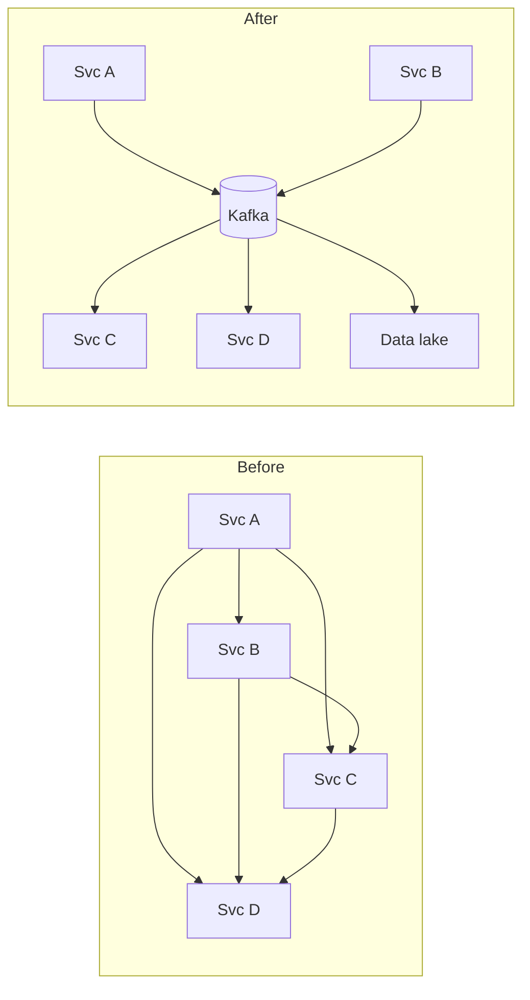
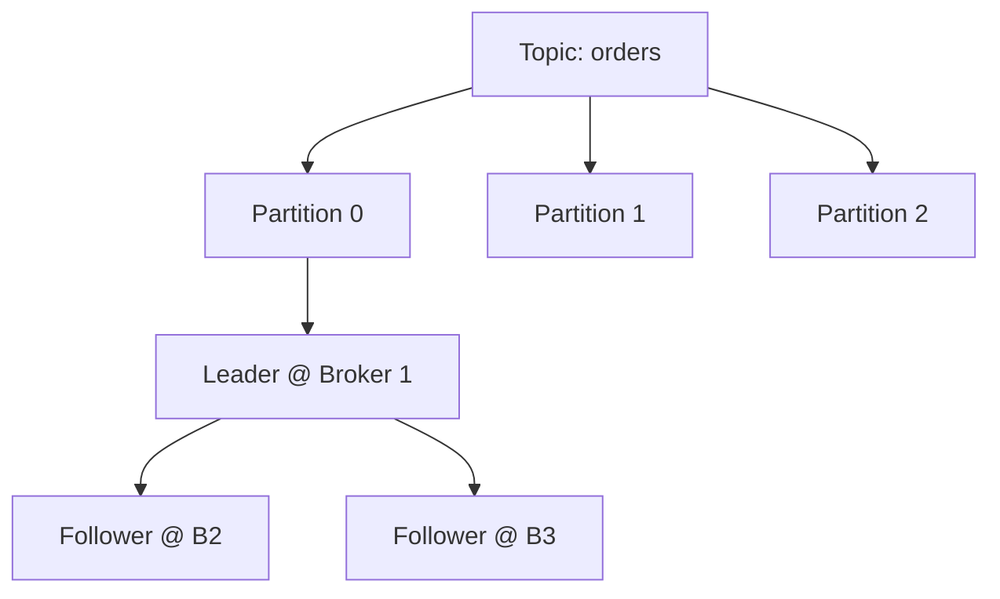
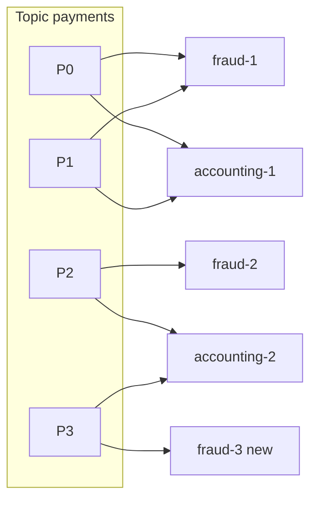

# 04 — Message Queue / Log (Apache Kafka)

*A documented real system. How it was sourced and what was not checked is under **Sources and provenance** near the end.*

## At a glance

**In 60 seconds.** Kafka is a partitioned, replicated, append-only log. Producers append, consumers pull at their own pace, and retention is by time or size rather than consumption, so data can be replayed. Durability comes from replicating each partition and acknowledging only after the in-sync replicas have it. A Raft quorum (KRaft) manages cluster metadata.

**Key numbers**
- Defaults: `acks=all`, `min.insync.replicas=1`, `unclean.leader.election.enable=false`, `default.replication.factor=1` `[CONFIRMED]`.
- Broker session timeout 9 s, heartbeat 2 s `[CONFIRMED]`.
- Kafka 4.0 (2025-03-18) is the first release without ZooKeeper `[CONFIRMED]`.

**Decisions and trade-offs**

| Decision | Why | Cost |
|---|---|---|
| Partition as the unit of order | Parallelism and per-key ordering | No global order, and repartitioning breaks key ordering |
| `acks=all` + `min.insync.replicas` | Acknowledged writes survive a broker loss | Higher latency, and writes rejected when the ISR shrinks |
| Tiered storage | Cheap long retention | Remote reads are slower |

**Common mistakes**
- Assuming the default replication factor is 3 (the broker default is 1).
- Expecting global ordering across partitions.
- Claiming exactly-once for external side effects: it holds for Kafka-to-Kafka processing only.

---

## 🧒 Non-technical explanation

Kafka is like a **company-wide newspaper archive**.

- Departments **publish** articles (events) into themed sections called **topics**: "orders", "payments", "clicks".
- Anyone interested **subscribes** and reads at their own pace. Reading an article **doesn't remove it**. Ten departments can read the same one, and someone can go back and re-read last week's paper.
- The archive is huge, so each section is split into several **binders** (partitions) spread across many shelves (servers), and every binder has **three photocopies** in different buildings in case one burns down.
- Before Kafka, every department ran its own courier to every other department, which meant hundreds of fragile routes. Kafka replaced them with one central place everyone writes to and reads from.

---

## TL;DR for engineers

- Kafka is a **partitioned, replicated, append-only log**. A partition is the unit of ordering and parallelism `[CONFIRMED]` (Kafka design docs).
- **Durability knobs:** `acks=all` (the default) waits for the in-sync replicas. `min.insync.replicas` (default 1) sets how many must acknowledge. `unclean.leader.election.enable=false` (default) prefers consistency over availability `[CONFIRMED]`.
- **Consumers pull.** A consumer group assigns each partition to exactly one member, so scale reads with partitions and groups `[CONFIRMED]`.
- **Metadata** lives in a KRaft (Raft) controller quorum. Kafka 4.0 removed ZooKeeper `[CONFIRMED]`.
- **Retention is by time/size, not consumption**, so replay is possible. Tiered storage (KIP-405) offloads old segments to object storage `[CONFIRMED]`.
- **Exactly-once** holds for Kafka-to-Kafka processing (idempotent producer + transactions). External side effects still need idempotency `[CONFIRMED]` (design docs) plus `[INDUSTRY PATTERN]` for the outbox/idempotent-consumer advice.

---

## The one-sentence definition, decoded

> *"Kafka is an **open-source**, **distributed**, **durable**, very **scalable**, **fault-tolerant** **pub/sub messaging system** with rich **integration** and **stream processing** capabilities."*

| Word | Mechanism |
|---|---|
| 💡 open-source | Built at LinkedIn, then donated to Apache (the newsletter says 2010 and 2011. We could not re-verify the years against a primary source) |
| 💡 pub/sub | Producers write once, many independent consumer groups read |
| 💡 distributed | Cluster of brokers, ≥3 in normal deployments |
| 💡 scalable | Partitioned append-only logs. Add brokers → more throughput. |
| 💡 durable | Replication factor (usually 3) across availability zones |
| 💡 fault-tolerant | Single-leader per partition. Controller re-elects leaders when a broker dies. |
| 💡 stream processing | Kafka Streams (exactly-once with transactions) |
| 💡 rich integration | Kafka Connect + hundreds of connectors |

---

## 1. Why Kafka exists: the O(N²) integration problem

LinkedIn had N systems that all needed each other's data, which means N² point-to-point pipelines. Kafka turns that into **N writers + M readers against one log**:

Writers and readers are decoupled. Data is retained for a time (e.g., 7 days) and **read fan-out is expected**, so read throughput is often a multiple of write throughput.

---

## 2. The core abstraction: the log

- **Append-only**, ordered, immutable. Each record gets a monotonically increasing **offset**.
- **O(1) lock-free appends.** Reads are sequential, which is ideal for HDDs *and* the OS page cache.
- **Record** = `byte[] key` (optional) + `byte[] value` + timestamp + headers. **Kafka has no types.** Serialisation (Avro/Protobuf/JSON) is the client's job.

### Topics → Partitions → Replicas

- **Topic** = category (like a table).
- **Partition** = shard. Each one is an independent log, and it's the **unit of parallelism and ordering**.
- **Ordering is guaranteed only within a partition.** Same key → same partition (default partitioner: murmur2(key) mod N) → per-key ordering, as long as the partition count doesn't change.

### Clients
- Kafka speaks its **own binary TCP protocol** (not HTTP). Use official/community client libs.
- `producer.send(new ProducerRecord<>(topic, key, value))`: the record can name a partition explicitly, otherwise the partitioner picks one (by key hash when a key is set).
- `KafkaConsumer.subscribe(topics)` then `poll()` loop.

---

## 3. Kafka as a distributed system

### Brokers, replication, leaders
- **Broker** = Kafka server node. **Cluster** = all brokers.
- **Replication factor** (typically 3; the broker default `default.replication.factor` is actually 1, see Reviewer notes): one **leader** replica accepts writes, and **followers** fetch from the leader (hot standbys). Spread across AZs.
- When a broker dies, other brokers take over leadership of its partitions.

> ⚙️🔧 **Engineer notes (extension)**
> - **ISR (In-Sync Replicas):** followers that are caught up. With `acks=all`, the leader acknowledges a write only once **every current ISR member** has it. `min.insync.replicas=2` makes the leader **reject** writes if the ISR shrinks below 2, so an acknowledged write is always on ≥2 replicas. That pair is the durability knob ([producer `acks`](https://kafka.apache.org/40/configuration/producer-configs/), [broker `min.insync.replicas`](https://kafka.apache.org/40/configuration/broker-configs/); note `min.insync.replicas` defaults to 1 and `acks` defaults to `all` in current clients).
> - **High watermark:** consumers only see records replicated to all ISR (and meeting `min.insync.replicas`), so they never read data that could vanish on a clean failover ([broker configs](https://kafka.apache.org/40/configuration/broker-configs/)).
> - `acks=0/1/all` trades latency for durability. `unclean.leader.election.enable=false` (the default since 0.11.0) prefers unavailability over data loss (CP behaviour) ([design: replication](https://kafka.apache.org/40/design/design/#replication)).

### Metadata log, controllers & KRaft
- All cluster metadata (topics, partition leaders, configs) is stored as events in a single-partition internal topic **`__cluster_metadata`**. Replaying it deterministically rebuilds cluster state (event sourcing, see stream–table duality).
- **Controllers** (usually 3) form a **Raft quorum** (KRaft). The Raft leader = **active controller**, which:
  - writes metadata decisions (new topics, partition leader elections)
  - tracks **broker liveness** via heartbeats, **fencing** a broker after ~6 s of silence and moving its leaderships (the source's figure; the configured default `broker.session.timeout.ms` is 9 s, see Reviewer notes).
- Two-level leader election:
  1. Controllers elect the active controller via **KRaft** (Raft variant).
  2. The active controller elects partition leaders for regular topics.
- History: previously **ZooKeeper** (Zab consensus) + one controller broker. KRaft replaced it ([KIP-500](https://cwiki.apache.org/confluence/display/KAFKA/KIP-500%3A+Replace+ZooKeeper+with+a+Self-Managed+Metadata+Quorum)), and Kafka 4.0 (March 18, 2025) removed ZooKeeper entirely ([4.0 release announcement](https://kafka.apache.org/blog/2025/03/18/apache-kafka-4.0.0-release-announcement/)).
- Contrast: **Redpanda** runs a Raft group *per partition* (C++, thread-per-core via Seastar) ([Redpanda architecture](https://docs.redpanda.com/current/get-started/architecture/)).

---

## 4. Features that set Kafka apart

### Retention & replay
- Messages are deleted by **time/size policy**, *not* on consumption. That enables **replay**: fix a consumer bug, rewind offsets, reprocess.
- Also **log compaction** (keep the latest value per key), which turns a topic into a changelog/table.

### Tiered storage ([KIP-405](https://cwiki.apache.org/confluence/display/KAFKA/KIP-405%3A+Kafka+Tiered+Storage))
- Problem: 1 GiB/s × 604,800 s (7 days) × RF3 = 1,814,400 GiB ≈ **1,772 TiB** on broker disks. That makes the cluster inelastic (rebalancing moves TBs) and expensive (the author estimates self-hosted, replicated disk storage costs ~10× S3).
- Solution: **hot tier** on broker disks (hours), **cold tier** offloaded asynchronously to S3/GCS/Azure Blob. Reads of old data are transparently served from object storage.
- Result (author's figures): >10× cheaper long retention, faster scaling, and SSDs become affordable for the hot set.
- Status: KIP-405 has been marked production-ready since Kafka 3.9 ([KIP-405](https://cwiki.apache.org/confluence/display/KAFKA/KIP-405%3A+Kafka+Tiered+Storage)).

### Consumer groups (read parallelism)
- A **consumer group** shares work: **each partition is consumed by exactly one member** of the group, which preserves order without locks.
- Scale reads by **adding members** (up to #partitions) or **adding groups** (independent apps re-reading the same data).

- Coordination is **centralised via a Group Coordinator broker**. Consumers heartbeat to it and receive partition assignments. Consumers never talk to each other.
- Progress is stored as `{group, topic, partition} → offset` in the internal topic **`__consumer_offsets`**. Its partitions are spread across brokers, so coordination load is spread too.
- The group protocol is generic enough that **Kafka Streams and Kafka Connect** reuse it for their own membership and leader election.

> ⚙️🔧 **Rebalancing** pauses consumption ("stop-the-world") in the classic protocol. Cooperative/incremental rebalancing and the new consumer protocol ([KIP-848](https://cwiki.apache.org/confluence/display/KAFKA/KIP-848%3A+The+Next+Generation+of+the+Consumer+Rebalance+Protocol)) reduce this. KIP-848 went GA in Kafka 4.0 as an opt-in (`group.protocol=consumer`) ([4.0 release announcement](https://kafka.apache.org/blog/2025/03/18/apache-kafka-4.0.0-release-announcement/)).

### Transactions & exactly-once
- **Idempotent producer:** producer ID + per-partition sequence numbers mean a retry after a network blip doesn't duplicate. Enabled by default in current clients ([`enable.idempotence`](https://kafka.apache.org/40/configuration/producer-configs/)).
- **Producer epochs** (per `transactional.id`) fence "zombie" producer instances after a restart.
- **Transactions:** atomically write to many partitions/topics. Uses **two-phase commit** via a **Transaction Coordinator**. Consumers with `isolation.level=read_committed` skip aborted records.
- **Exactly-once processing** holds only when **both input and output are Kafka** (consume-transform-produce). With external side effects (HTTP, DB), you still need idempotency at the edges.

### Kafka Streams
Client-side Java library for stateful stream processing (map/filter/join/windowed aggregation) from input topics to output topics. Scales like consumer groups (plus threads). Exactly-once via transactions. State stores are backed by compacted changelog topics.

### Schema Registry
Kafka is schemaless (the author considers this a mistake). Convention: an external **schema registry** (Confluent SR, Karapace, Apicurio, AWS Glue). The producer registers a schema, embeds the **schema ID** in each message, and consumers fetch and cache the schema to deserialise. Enforce **compatibility rules** (backward/forward) to evolve safely.

### Kafka Connect
No/low-code integration runtime. **Source connectors** (DB/CDC → Kafka) and **sink connectors** (Kafka → Snowflake/ES/S3). Workers form a cluster coordinated by the group protocol. Debezium CDC is the classic source.

---

## 5. ⚙️🔧 Why Kafka is fast (extension)

| Technique | Effect |
|---|---|
| Sequential I/O on append-only segments | Disk throughput close to the hardware maximum |
| Relies on the **OS page cache** (not a JVM heap cache) | Recent data is served from memory, and the cache stays warm across broker restarts ([design](https://kafka.apache.org/40/design/design/)) |
| **Zero-copy** (`sendfile`) from page cache to socket | No user-space copies for consumer reads ([design](https://kafka.apache.org/40/design/design/)). Not with TLS: the SSL transport reads into a buffer to encrypt ([`SslTransportLayer`](https://github.com/apache/kafka/blob/trunk/clients/src/main/java/org/apache/kafka/common/network/SslTransportLayer.java)) |
| **Batching + compression** (lz4/zstd) end-to-end | Fewer syscalls and network round trips |
| Partitioning | Horizontal parallelism |
| Pull-based consumers | Consumers control their own rate (natural back-pressure) |

---

## 6. What's next for Kafka

- **Queues / Share Groups** ([KIP-932](https://cwiki.apache.org/confluence/display/KAFKA/KIP-932%3A+Queues+for+Kafka)): multiple consumers per partition with per-record acks (queue semantics, no ordering guarantee). Early access in Kafka 4.0, production-ready in Kafka 4.2 ([4.2 release announcement](https://kafka.apache.org/blog/2026/02/17/apache-kafka-4.2.0-release-announcement/)).
- **Diskless topics** ([KIP-1150](https://cwiki.apache.org/confluence/display/KAFKA/KIP-1150%3A+Diskless+Topics)): a new topic type with its own ingestion engine that writes through to object storage and keeps local disks only as a cache. The KIP page lists its state as **Accepted** (page last updated 2026-03-02) and defers the implementation to follow-up KIPs 1163 and 1164. It names the cost driver (cross-AZ replication traffic, e.g. AWS $0.02/GiB) but quantifies no saving. The newsletter's "90%+ cloud cost reduction" is the author's claim. Whether it has shipped in a release was not re-checked (the baseline said not as of 4.3, citing [Aiven](https://aiven.io/blog/kip-1150-accepted-and-the-road-ahead)).
- **Iceberg topics:** Kafka data exposed as an open table format (Iceberg) for the lakehouse. Today these are vendor features (e.g., [Redpanda Iceberg Topics](https://docs.redpanda.com/current/manage/iceberg/about-iceberg-topics/), Confluent Tableflow, Aiven), not an Apache Kafka feature, and only some implementations are truly zero-copy.
- **Protocol-compatible alternatives:** Confluent Kora, AWS MSK, Redpanda, WarpStream, Bufstream, Aiven Inkless, AutoMQ (MSK is managed Apache Kafka rather than a reimplementation, see Reviewer notes).

---

## 7. When to use Kafka vs a queue

| Need | Kafka | SQS / RabbitMQ |
|---|---|---|
| Multiple independent consumers of the same data | ✅ | ❌ (needs fan-out exchange/SNS) |
| Replay / reprocess history | ✅ | ❌ (classic queues; [RabbitMQ Streams](https://www.rabbitmq.com/docs/streams) do allow re-reading) |
| Strict per-key ordering at scale | ✅ (per partition) | Limited (FIFO queues) |
| Per-message ack, delays, priority, DLQ out of the box | Limited (KIP-932 helping) | ✅ |
| Very low ops overhead at small scale | ❌ | ✅ |

---

## ⚠️ Reviewer notes on the source

- **"Fenced after 6 seconds" of missed heartbeats:** in KRaft the timeout is the broker lease `broker.session.timeout.ms`, whose default is **9 s** (heartbeats every 2 s via `broker.heartbeat.interval.ms`). Treat "6 s" as illustrative. ([Kafka broker configs](https://kafka.apache.org/40/configuration/broker-configs/))
- **Diskless topics "cut cloud costs by 90%+":** that's the author's estimate. The [KIP-1150](https://cwiki.apache.org/confluence/display/KAFKA/KIP-1150%3A+Diskless+Topics) text names the cost driver (cross-AZ replication and client traffic, citing per-GiB cloud prices) but doesn't quantify savings, and vendors quote different figures (Aiven markets "up to 80%" for its implementation, [aiven.io/diskless](https://aiven.io/diskless)). The KIP page lists it as Accepted (last updated 2026-03-02). We did not re-verify release status, and the earlier note that it had not shipped as of 4.3 comes from a third-party article.
- **"The default and most common [replication factor] is three":** most common, yes, but the broker default `default.replication.factor` is **1** (only internal topics such as `__consumer_offsets` default to 3). Set RF explicitly. ([Kafka broker configs](https://kafka.apache.org/40/configuration/broker-configs/))
- **AWS MSK in the list of alternatives that "implement [the protocol] differently":** MSK "runs open-source versions of Apache Kafka" as a managed service; it isn't a reimplementation like Redpanda or WarpStream. ([MSK developer guide](https://docs.aws.amazon.com/msk/latest/developerguide/what-is-msk.html))
- **Units in the storage example:** the body says "1 GB/s" and "1,772 TB", but the footnote's arithmetic (and the 1,772 figure) is in GiB/s and TiB. The notes use the footnote's units.

---

## 🏛️ Architecture lens (Fundamentals of Software Architecture)

> 🔧 Extension. Maps this case study onto Richards & Ford's vocabulary (see [neokim-post/00-fundamentals.md §4](../../neokim-post/00-fundamentals.md#architecture-thinking)).

- **Driving characteristics (Ch 4–5):** **scalability** (partitions), **fault tolerance** and **availability** (replication, leader failover), **reliability/recoverability** (durable log, replay), **performance** (throughput), and **evolvability** (new consumers without touching producers).
- **Style it enables (Ch 14):** Kafka is the **broker** in an *event-driven broker topology*: processors react to topics and "advertise what they did", with no central workflow owner. Retention + replay is the book's extensibility hook ("always advertise, even if no one listens") made durable. For a *mediator* topology you put a workflow engine on top; Kafka itself doesn't orchestrate.
- **Quanta (Ch 7):** asynchronous topics let a producer and its consumers be **separate quanta** with different characteristics (a 500 ms-per-message payment consumer can't time out a fast producer). The caveat from Ch 14: consumers that share a database with the producer, or wait on a request-reply, are still the **same quantum**.
- **Trade-off (Ch 2, "topics vs queues"):** a topic gives **extensibility and decoupling**. It costs **data-access control** (anyone can subscribe), forces **one shared contract** for all consumers, and makes per-consumer monitoring harder. That's exactly the Kafka vs SQS/RabbitMQ table above.
- **ADR sketch (Ch 19):** *"We will use Kafka topics between Orders and downstream services because we need replay and independent consumer groups. We accept a shared schema contract, enforced by a schema registry in CI as the fitness function."*
- Plain English: Kafka is the company noticeboard. Anyone can pin a notice or read one without asking anyone else, but that also means anyone can read every notice.

---

## Interview questions to practice

1. You need per-customer ordering but one customer produces 50% of traffic. What happens and how do you fix it?
2. Walk through what happens when a partition leader's broker loses power.
3. Explain why exactly-once breaks when your consumer writes to Postgres. How do you get "effectively once"?
4. How many partitions should a topic have? What does over-partitioning cost?
5. Compare the transactional outbox + CDC (Debezium) with dual writes to DB and Kafka.

## Interview practice

These outlines are our own reasoning (`[INDUSTRY PATTERN]`), not statements from the cited sources.

**A 45-minute walkthrough**

1. Clarify: ordering needs, retention, throughput, consumers.
2. Estimate: bytes per second × retention × replication.
3. API: produce with key, consume in a group.
4. Design: topics, partitions, replicas, controller quorum.
5. Deep dive: ISR, acks, consumer groups, idempotent producer.
6. Failure and scale: leader loss, rebalancing, tiered storage.

**If it grows 10×**
- Storage cost grows with retention: use tiered storage.
- Rebalances pause consumers: use the newer consumer protocol.
- Hot partitions: change the partitioning key or add sub-keys.

**Answer outlines** (try the questions above first)

Per-customer ordering but one customer is 50% of traffic?

Ordering holds only within a partition, so that customer's traffic lands on one partition and becomes a hot spot. Options: accept it, split by a finer key if order is only needed per entity, or shard that customer across partitions and give up a single order.

A partition leader's broker loses power?

The controller notices missed heartbeats, fences the broker and elects a new leader from the ISR. Producers retry, and the idempotent producer's sequence numbers prevent duplicates.

Why does exactly-once break when the consumer writes to Postgres?

Kafka's transactions cover Kafka reads and writes only. The database write is an external side effect, so use an idempotent write or an outbox to get effectively-once.

## 📚 Further reading

- Jay Kreps, [The Log: What every software engineer should know about real-time data's unifying abstraction](https://engineering.linkedin.com/distributed-systems/log-what-every-software-engineer-should-know-about-real-time-datas-unifying)
- [Kafka documentation: Design](https://kafka.apache.org/documentation/#design)
- [Why was Apache Kafka created? (Stanislav Kozlovski)](https://bigdatastream.substack.com/p/why-was-apache-kafka-created)
- [2 Minute Streaming newsletter](https://blog.2minutestreaming.com/) · [Big Data Stream](https://bigdata.2minutestreaming.com/)
- [Raft consensus visualised](https://raft.github.io/)
- [Martin Fowler: Event Sourcing](https://martinfowler.com/eaaDev/EventSourcing.html)
- Related in this folder: [19 Stock exchange](19-stock-exchange.md) (sequenced logs, deterministic replay)

## Sources and provenance

> **Kind:** real-system (open source, so the behaviour is documented).
> **Basis:** upgraded from [`neokim-post/04`](../../neokim-post/04-how-apache-kafka-works.md), a summary of [How Kafka Works](https://newsletter.systemdesign.one/p/how-kafka-works) (guest author Stanislav Kozlovski). Re-verified on 2026-10-27 against the Apache Kafka docs and release announcements listed in the log at the end.
> **Tags:** `[CONFIRMED]` stated by a primary source · `[INDUSTRY PATTERN]` standard practice · `[SPECULATIVE]` plausible choice. Claims about defaults and release status are `[CONFIRMED]` against the linked Kafka page unless marked otherwise. The "author's figure" notes mean the claim comes from the newsletter article and was not independently checked.

---
## ✅ Verification log

*Inherited log (neokim-post/04), 2026-10-03:* Verified 24 · Corrected 6 · Softened/removed 5.

*Re-verification for this folder, 2026-10-27,* against Kafka 4.0 broker and producer config pages, the Kafka 4.0 design page, the 4.0 and 4.2 release announcements, the KIP-405 page and the KIP-1150 page.
- Verified: `default.replication.factor` = 1; `min.insync.replicas` = 1; `unclean.leader.election.enable` = false; `broker.session.timeout.ms` = 9000; `broker.heartbeat.interval.ms` = 2000; `offsets.topic.replication.factor` = 3; producer `acks` = `all`; `enable.idempotence` = true.
- Verified: ISR and "committed" definitions; unclean-election trade-off and the 0.11.0.0 default; page cache and `sendfile` statements; pull model; transactions across partitions; log compaction and tombstones; "exactly one consumer within each subscribing consumer group".
- Verified: Kafka 4.0 released 2025-03-18, first major release without ZooKeeper, KIP-848 GA with opt-in `group.protocol=consumer`, KIP-932 early access in 4.0; Kafka 4.2 released 2026-02-17 with Queues/Share Groups declared production-ready; KIP-405 marked production-ready since 3.9 and its hot/cold design.
- Corrected: the baseline described KIP-1150 as "leaderless, write directly to object storage". The KIP page does not use "leaderless" and describes write-through to object storage with local disks as a cache. Reworded.
- Corrected: "accepted in March 2026" now reads as "Accepted, page last updated 2026-03-02", since the page gives no acceptance date.
- Softened: LinkedIn origin years (2010/2011) could not be re-verified: the LinkedIn engineering "The Log" page returned 404 to our fetch.
- Not re-verified in this pass (carried over): murmur2 as the default partitioner (not named on the design page), the `__consumer_offsets` key layout, `SslTransportLayer` and zero-copy-with-TLS, the Redpanda, RabbitMQ Streams and MSK comparisons, the storage arithmetic (re-derived by hand: 1 GiB/s × 604,800 s × 3 = 1,814,400 GiB ≈ 1,772 TiB), and the newsletter's cost multiples.
