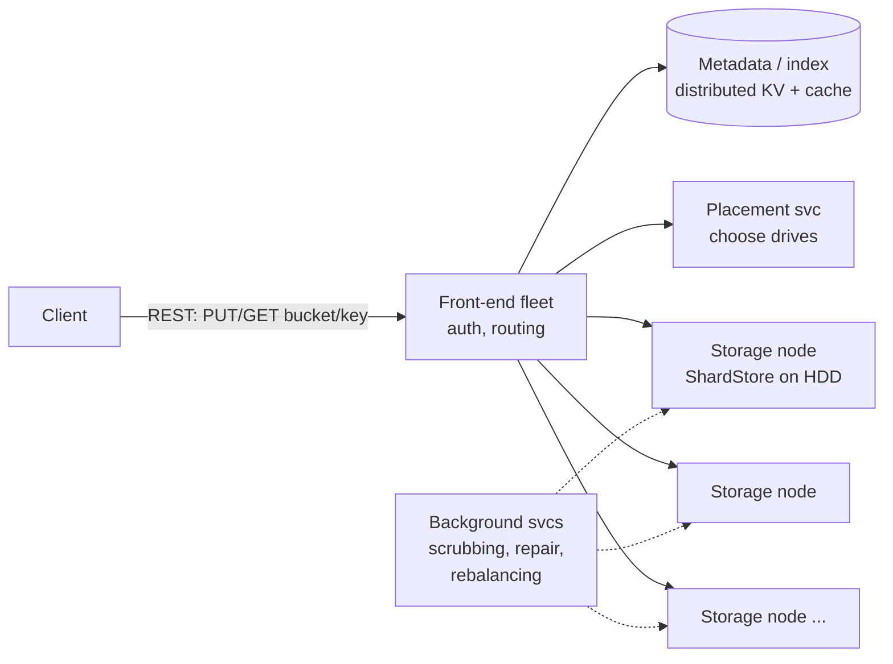

# 05 — Object Storage (Amazon S3)

*A documented real system. How it was sourced and what was not checked is under **Sources and provenance** near the end.*

## At a glance

**In 60 seconds.** S3 stores immutable objects addressed by bucket and key. Metadata and data are separate systems. Data is split into erasure-coded shards across many drives and at least three availability zones, so durability comes from repair speed, not just copies. Since December 2020 reads are strongly consistent, achieved with a cache-coherence 'witness'.

**Key numbers**
- Designed for 99.999999999% durability and 99.99% availability `[CONFIRMED]`.
- About 120 random operations per second per drive, millions of drives `[CONFIRMED]` (Warfield).
- At least 3,500 write and 5,500 read requests/s per prefix `[CONFIRMED]`.

**Decisions and trade-offs**

| Decision | Why | Cost |
|---|---|---|
| Erasure coding instead of 3 copies | Lower storage overhead for similar durability | Repair traffic, CPU and small-object latency |
| Separate metadata and data | Each scales independently | Commit ordering matters: metadata last |
| Spread across many drives | Decorrelates hot spots | Needs placement and rebalancing machinery |

**Common mistakes**
- Quoting S3's exact k and m. They are not public.
- Claiming S3 is eventually consistent (it has not been since December 2020).
- Forgetting that durability depends on how fast lost shards are repaired.


---

## 🧒 Non-technical explanation

S3 is a **gigantic valet parking garage for files**. You hand over a file and a name (`bucket/photos/cat.jpg`). S3 gives you a guarantee it will **essentially never lose it**, and you can get it back from anywhere on the internet.

How can it promise that while using cheap, slow, failure-prone hard drives?
- It keeps the **"where is it parked" ledger** (metadata) separate from the **parking spots** (the actual bytes), so each can grow on its own.
- Instead of making 3 full copies of your file (expensive), it **cuts the file into pieces and adds a few "puzzle-solver" pieces**. Even if several pieces are destroyed, the missing ones can be **mathematically rebuilt**. That's **erasure coding**.
- Those pieces are **scattered across thousands of drives** in different buildings. No single drive gets overloaded, and reads can pull from many drives at once.

---

## TL;DR for engineers

- **Object storage:** flat namespace (`bucket` + `key`), immutable objects (an overwrite replaces the whole object, or adds a new version if versioning is on), HTTP API.
- **Front end → metadata (index) → storage nodes.** Metadata is in a distributed KV store and cached. Data is on HDD storage nodes running **ShardStore** (an LSM-tree-based key-value engine) ([SOSP '21](https://jamesbornholt.com/papers/shardstore-sosp21.pdf)).
- **Durability via erasure coding** (e.g., Reed–Solomon k data + m parity shards across AZs) ([Warfield](https://www.allthingsdistributed.com/2023/07/building-and-operating-a-pretty-big-storage-system.html)). Typical RS parameters give ~1.x× overhead instead of 3× (S3's actual k/m are not public), and S3 is designed for 11 nines of durability ([AWS docs](https://docs.aws.amazon.com/AmazonS3/latest/userguide/DataDurability.html)).
- **Performance via parallelism.** Each HDD is slow (~120 IOPS), but spreading shards across millions of drives turns that into massive aggregate throughput and decorrelates hot spots ([Warfield](https://www.allthingsdistributed.com/2023/07/building-and-operating-a-pretty-big-storage-system.html)).
- **Strong read-after-write consistency** since Dec 2020 ([AWS blog](https://aws.amazon.com/blogs/aws/amazon-s3-update-strong-read-after-write-consistency/)).

---

## 1. Why object storage? (The startup story)

A startup's analytics logs outgrow one storage server, which creates problems with:
- **Scalability:** buying ever-bigger servers is expensive, and capacity planning is hard.
- **Performance:** tuning storage needs expertise they don't have.

They move to S3 (100M+ requests/s across the service) to focus on product.

| | Block (EBS) | File (EFS/NFS) | **Object (S3)** |
|---|---|---|---|
| Unit | Fixed blocks | Files in a hierarchy | Objects + metadata, flat keys |
| Access | Mounted disk | POSIX | HTTP API |
| Mutability | In-place | In-place | **Whole-object replace** |
| Scale | Single volume | PB-ish | **Effectively unlimited** |

---

## 2. Architecture



- **Separation of metadata and data** lets each tier scale independently (billions of small metadata entries vs exabytes of bytes).
- Every box is **hundreds of microservices** talking via API contracts.
- Metadata: `bucket/key → {version, size, etag, shard locations, ...}`. Cached for availability and speed.

---

## 3. Performance on cheap disks

### Hard disk physics
- **Seek time** (move the head to the track) + **rotational latency** (wait for the sector) are roughly **constant** per I/O and haven't improved in decades.
- Drives keep getting **bigger but not faster**, so **IOPS per TB keeps falling**. A big disk holds more data, which means more requests compete for the same head.
- A single disk can become a **hot spot** if popular data concentrates on it.

### The fix: parallelism + spreading
- Split each object into **shards** spread across **many drives**. A read fetches shards in parallel, so throughput = sum of many drives.
- Because each customer's data is spread across a huge fleet, **one customer's burst is a tiny % of any one drive's load**. Workloads decorrelate at scale, which AWS calls "**heat management**".

### ShardStore
- The per-node storage engine: an **LSM-tree-style** KV store mapping shard IDs → data on disk (log-structured writes = sequential I/O).
- Written in Rust (~40k lines); the index is an LSM tree with shard data stored outside the tree to cut write amplification. AWS used **lightweight formal methods** (executable reference models, property-based testing, model checking) to validate crash consistency. See the [SOSP '21 paper](https://jamesbornholt.com/papers/shardstore-sosp21.pdf).

---

## 4. 🔧 Erasure coding (the paywalled part)

**Full replication** (3 copies) = **200% overhead**, which is too expensive at exabyte scale.

**Erasure coding (Reed–Solomon):** split the data into **k** data shards, compute **m** parity shards. **Any k of the k+m shards reconstruct the object** (true for MDS codes such as Reed–Solomon). Warfield confirms S3 uses "an algorithm, such as Reed-Solomon" with k identity and m parity shards ([blog](https://www.allthingsdistributed.com/2023/07/building-and-operating-a-pretty-big-storage-system.html)); the 5+3 layout below is illustrative only.

```
Object ──split──▶ D1 D2 D3 D4 D5          (k = 5 data shards)
                    └─ encode ─▶ P1 P2 P3   (m = 3 parity shards)
Store 8 shards on 8 drives in ≥3 AZs.
Lose ANY 3 → still recoverable.     Overhead = 8/5 = 1.6× (vs 3.0× for replication)
```

| Scheme | Storage overhead | Failures tolerated | Repair cost |
|---|---|---|---|
| 3× replication | 3.0× | 2 copies | Copy 1 object |
| RS(6,3) | 1.5× | 3 shards | Read 6 shards to rebuild 1 |
| RS(10,4) | 1.4× | 4 shards | Read 10 shards |

**Trade-offs:** CPU for encode/decode, **repair amplification** (network reads during rebuild), higher latency for small objects. Systems often replicate small or hot objects and erasure-code large or cold ones.

### 🔧 Durability machinery
- **11 nines** (99.999999999%) **designed** durability of objects over a given year ([AWS docs](https://docs.aws.amazon.com/AmazonS3/latest/userguide/DataDurability.html)).
- Data stored redundantly across **≥3 Availability Zones** (except One Zone classes), designed to survive the loss of a whole AZ ([AWS docs](https://docs.aws.amazon.com/AmazonS3/latest/userguide/DataDurability.html)).
- **Continuous scrubbing:** background processes read shards, verify **checksums**, detect bit rot and failed drives, and **re-replicate/re-encode** quickly (AWS: "quickly detecting and repairing any lost redundancy" and verifying integrity with checksums, [docs](https://docs.aws.amazon.com/AmazonS3/latest/userguide/DataDurability.html)). Durability is a function of *how fast you repair* relative to how fast drives fail.
- **End-to-end checksums** on upload: Content-MD5 plus flexible checksums (CRC64NVME by default; also CRC32, CRC32C, SHA-1, SHA-256 and others) ([AWS docs](https://docs.aws.amazon.com/AmazonS3/latest/userguide/checking-object-integrity.html)).

### 🔧 Consistency
- Since **Dec 2020, strong read-after-write consistency** for all PUTs/DELETEs and LISTs, at no extra cost ([AWS blog](https://aws.amazon.com/blogs/aws/amazon-s3-update-strong-read-after-write-consistency/), [docs](https://docs.aws.amazon.com/AmazonS3/latest/userguide/Welcome.html#ConsistencyModel)). A cache coherence protocol in the metadata subsystem, with a "witness" component acting as a read barrier, makes this possible ([Werner Vogels](https://www.allthingsdistributed.com/2021/04/s3-strong-consistency.html)).
- Before that, overwrite PUTs, DELETEs and LISTs were eventually consistent (new-object PUTs had read-after-write), which forced the S3Guard-style hacks some of us remember.

---

## 5. 🔧 Using S3 well (practitioner notes)

| Topic | Guidance |
|---|---|
| **Request rates** | ≥ **3,500 PUT/COPY/POST/DELETE** and **5,500 GET/HEAD** per second **per partitioned prefix**. Spread keys across prefixes for more ([docs](https://docs.aws.amazon.com/AmazonS3/latest/userguide/optimizing-performance.html)). |
| **Large uploads** | **Multipart upload** (parts 5 MiB–5 GiB, up to 10,000 parts; max object **48.8 TiB**: the limits page's figure, which is 10,000 parts × 5 GiB. The 2025-12-02 announcement calls this a 10× increase to "50 TB" from 5 TB) ([limits](https://docs.aws.amazon.com/AmazonS3/latest/userguide/qfacts.html), [announcement](https://aws.amazon.com/about-aws/whats-new/2025/12/amazon-s3-maximum-object-size-50-tb/)). Parallel and retryable per part. |
| **Large downloads** | **Byte-range GETs** in parallel |
| **Direct client access** | **Pre-signed URLs** (time-limited PUT/GET) so bytes skip your app servers |
| **Cost tiers** | Standard → Intelligent-Tiering → Standard-IA / One Zone-IA → Glacier Instant/Flexible/Deep Archive, plus Express One Zone for low latency ([docs](https://docs.aws.amazon.com/AmazonS3/latest/userguide/Welcome.html)). **Lifecycle rules.** |
| **Integrity** | Versioning, Object Lock (WORM), replication (CRR/SRR) |
| **Security** | Block Public Access, bucket policies, SSE-S3/SSE-KMS encryption |
| **Analytics** | Athena / S3 Tables (Iceberg). S3 Select is closed to new customers ([docs](https://docs.aws.amazon.com/AmazonS3/latest/userguide/selecting-content-from-objects.html); effective July 25, 2024 per [AWS Insider](https://awsinsider.net/articles/2024/08/01/aws-closes-door-to-some-services.aspx)). |

---

## 6. 🔧 Designing "S3-like" storage in an interview

1. **API:** `PUT/GET/DELETE /bucket/key`, `LIST ?prefix=&continuation-token=`, multipart.
2. **Metadata service:** sharded KV (partition by `hash(bucket, key)`), with a separate per-bucket ordered index for LIST.
3. **Data service:** placement picks k+m drives across failure domains. Stream-encode.
4. **Write path:** front end → allocate shard locations → write shards in parallel → **commit metadata last** (the object becomes visible only when its metadata exists).
5. **Read path:** metadata lookup → parallel fetch of the k fastest shards (ignore stragglers) → decode.
6. **Background:** scrubber, repairer, garbage collector (orphaned shards from failed uploads), rebalancer.
7. **Deletes:** tombstone in metadata, async GC of shards.

---

## 🏛️ Architecture lens (Fundamentals of Software Architecture)

> 🔧 Extension. Vocabulary in [neokim-post/00-fundamentals.md §4](../../neokim-post/00-fundamentals.md#architecture-thinking).

- **Driving characteristics (Ch 4–5):** **durability** (11 nines), which maps onto the book's *reliability/recoverability* (the book has no separate durability entry), **availability**, **scalability** (hundreds of exabytes, 200M+ req/s on average per the [S3 product page](https://aws.amazon.com/s3/), up from 100M+ at FAST '23) and **performance** via parallelism. **Data consistency** has been an explicit characteristic since 2020's strong read-after-write. Cost is a first-class constraint, which is why there's erasure coding instead of 3× replicas.
- **Style (Ch 17):** internally **microservices**: "hundreds of microservices" ([Warfield](https://www.allthingsdistributed.com/2023/07/building-and-operating-a-pretty-big-storage-system.html)) behind API contracts, each owning its data (front end, index, placement, ShardStore nodes, background repair). The metadata/data split is the book's **bounded context** applied to storage. The two tiers share no schema, so each can scale and evolve on its own.
- **Quanta (Ch 7):** the request path (front end → index → storage nodes) is **synchronous**, so it's **one quantum** for the "PUT returns 200" guarantee. Scrubbing, repair, GC and rebalancing run **asynchronously** with their own pace and failure modes, so they're separate quanta. That's why a repair backlog lowers durability margins without hurting request latency.
- **Trade-off (First Law, Ch 1):** erasure coding trades **storage cost** (1.4–1.6× instead of 3×) against **repair amplification, CPU and small-object latency**. Hybrid policies (replicate small or hot objects, erasure-code large or cold ones) are the "least worst" answer (Ch 4).
- **Fitness function (Ch 6):** ShardStore's executable reference models and property-based crash tests are a textbook **automated fitness function** protecting a characteristic (crash consistency) on every change.
- Plain English: the garage keeps the ledger and the parking spots in separate buildings, so it can add more of either. The night crew that re-parks damaged cars works on its own schedule.

---

## Interview questions to practice

1. Why does S3 commit metadata *after* writing data? What happens if the order were reversed?
2. Compute durability for RS(10,4) with a 2% AFR and a 6-hour repair time (roughly).
3. How would you implement `LIST` with prefixes over a hash-partitioned metadata store?
4. Why is erasure coding a bad fit for 1 KB objects?
5. How does spreading data across more drives *improve* tail latency?

## Interview practice

These outlines are our own reasoning (`[INDUSTRY PATTERN]`), not statements from the cited sources.

**A 45-minute walkthrough**

1. Clarify: object sizes, durability, consistency, access patterns.
2. Estimate: objects, bytes, request rate.
3. API: PUT, GET, DELETE, LIST, multipart.
4. Design: front end, metadata index, storage nodes, placement.
5. Deep dive: erasure coding, strong consistency, durability.
6. Failure and scale: drive loss and repair, hot prefixes, listing.

**If it grows 10×**
- Hot prefixes: spread keys across prefixes.
- Repair load grows with drive count: parallel and prioritised repair.
- Metadata growth needs a partitioned, cached index.

**Answer outlines** (try the questions above first)

<details><summary>Why commit metadata after writing data?</summary>

An object should become visible only when its data is durable. If metadata were written first, a reader could find an object whose shards do not exist yet.

</details>

<details><summary>How does LIST with prefixes work over a hash-partitioned index?</summary>

A hash-partitioned key-value store cannot range-scan, so keep a separate ordered index per bucket for listing.

</details>

<details><summary>Why is erasure coding bad for 1 KB objects?</summary>

Encoding and the placement of many tiny shards cost more than they save, so small or hot objects are usually replicated and large cold ones erasure coded.

</details>

## 📚 Further reading

- Andy Warfield (FAST '23 keynote, blog version): [Building and operating a pretty big storage system called S3](https://www.allthingsdistributed.com/2023/07/building-and-operating-a-pretty-big-storage-system.html)
- [Using lightweight formal methods to validate a key-value storage node in Amazon S3 (SOSP '21)](https://jamesbornholt.com/papers/shardstore-sosp21.pdf)
- [AWS: S3 strong read-after-write consistency](https://aws.amazon.com/blogs/aws/amazon-s3-update-strong-read-after-write-consistency/)
- [S3 performance guidelines](https://docs.aws.amazon.com/AmazonS3/latest/userguide/optimizing-performance.html)
- [How AWS S3 scales with tens of millions of hard drives (Big Data Stream)](https://bigdata.2minutestreaming.com/p/how-aws-s3-scales-with-tens-of-millions-of-hard-drives)
- [Erasure code (Wikipedia)](https://en.wikipedia.org/wiki/Erasure_code) · [LSM tree (Wikipedia)](https://en.wikipedia.org/wiki/Log-structured_merge-tree)
- Alex Xu, *System Design Interview Vol. 2*: "Design S3-like Object Storage"

## Sources and provenance

> **Kind:** real-system, but only partly public. AWS publishes the guarantees (docs), the storage-node design (the ShardStore SOSP '21 paper) and some architecture (Warfield's FAST '23 keynote, Vogels on consistency). The exact erasure-coding parameters and the internal front-end/metadata layout are **not** public, so those parts are `[INDUSTRY PATTERN]`.
> **Basis:** upgraded from [`neokim-post/07`](../../neokim-post/07-how-amazon-s3-works.md) (a summary of [S3 Architecture](https://newsletter.systemdesign.one/p/s3-architecture), which itself says it is "based on research, may differ from real implementation"). Re-verified on 2026-10-27, see the log.
> **Tags:** `[CONFIRMED]` stated by an AWS primary source · `[INDUSTRY PATTERN]` standard practice or illustrative, not stated by AWS for S3 · `[SPECULATIVE]` plausible. The 🔧 marker carries over from the baseline: content reconstructed beyond the newsletter's public half.

---
## ✅ Verification log

*Inherited log (neokim-post/07), 2026-10-03:* Verified 19 · Corrected 5 · Softened/removed 3.

*Re-verification for this folder, 2026-10-27,* reading the primary pages directly.
- Verified in [Warfield's blog](https://www.allthingsdistributed.com/2023/07/building-and-operating-a-pretty-big-storage-system.html): S3 launched 2006-03-14; "hundreds of microservices"; ~120 random operations per second per drive; "millions" of drives, with tens of thousands of customers' buckets spread across millions of drives and a burst served by over a million disks; Reed-Solomon with k identity shards (any k of k+m suffice; no k or m values given); the heat-management and decorrelation argument; the Rust rewrite and lightweight formal verification, with the model about 1% of the system.
- Verified in the ShardStore SOSP '21 paper text: "over 40,000 lines of Rust", an LSM tree "with shard data stored outside" it, extents with sequential writes and write pointers, reference models at about 1% of the code, property-based testing for functional and crash-consistency checks.
- Verified in AWS docs: design for 99.999999999% durability and 99.99% availability; at least three AZs for most classes (One Zone-IA is one AZ); designed to survive loss of an AZ; integrity verified with checksums; strong read-after-write for PUT and DELETE (new and overwrite) plus strongly consistent LIST/metadata reads; concurrent writers resolve last-writer-wins with no object locking; bucket configuration is eventually consistent; ≥3,500 write and ≥5,500 read requests per second per prefix, with no limit on prefixes; multipart limits and 48.8 TiB maximum object size.
- Verified in Vogels (2021): the metadata cache was the main source of the old eventual consistency; a cache coherence protocol with a "witness" acting as a read barrier; goal of no performance or availability trade-off.
- Verified in the AWS announcements: strong consistency announced 2020-12-01 at no extra charge (the post names GET, PUT and LIST plus tag/ACL/metadata changes; the docs page names DELETE); max object size 50 TB announced 2025-12-02 (10× the previous 5 TB).
- Corrected: "50 TB (48.8 TiB)" now explains the difference: the limits page says 48.8 TiB, which equals 10,000 × 5 GiB, and the announcement rounds to 50 TB.
- Not re-verified (carried over): "200M+ requests/s on average" and "hundreds of exabytes" on the S3 product page, the Big Data Stream article, the checksum default CRC64NVME, S3 Select closure date, the repair-cost table and every interview-design item in section 6 (all `[INDUSTRY PATTERN]`).
- Unchanged and unconfirmed by AWS: S3's real k and m, shard placement, and the front-end/metadata layout. The newsletter's diagrams of those layers are reconstructions.
