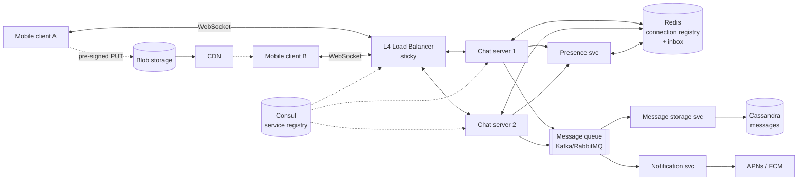
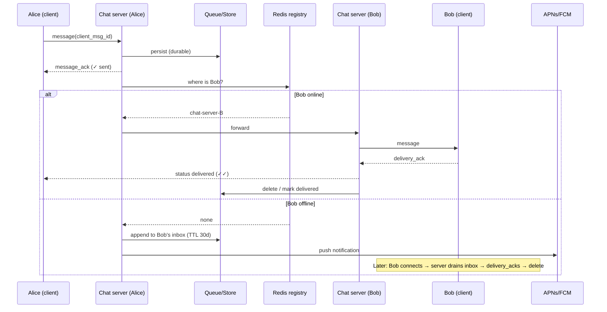

# 08 — Chat (WhatsApp)

*A reference design built on verified building blocks. How it was sourced and what was not checked is under **Sources and provenance** near the end.*

## At a glance

**In 60 seconds.** A chat system keeps one persistent connection per device, routes ciphertext between the sender's and recipient's servers, and stores undelivered messages until the recipient reconnects. WhatsApp's published facts are the encryption design (Signal protocol, per-device client fan-out, Noise transport), the 30-day retention of undelivered messages and old connection-scaling milestones. Everything else here is the standard interview design.

**Key numbers**
- Undelivered messages kept encrypted for up to 30 days, deleted after delivery `[CONFIRMED]` (privacy policy).
- Over 2 million TCP connections on one FreeBSD/Erlang server in early 2012 `[CONFIRMED]`.
- A 2021 multi-device beta allowed up to four non-phone devices `[CONFIRMED]`.

**Decisions and trade-offs**

| Decision | Why | Cost |
|---|---|---|
| Persistent connection per device | Low-latency push | Stateful servers and a connection registry |
| Store-and-forward inbox | Offline delivery without keeping history | Retention and storage limits |
| Client-side fan-out for E2EE | The server never sees plaintext | Sender work grows with devices and group size |

**Common mistakes**
- Describing Redis, Kafka and Cassandra as WhatsApp's actual stack: they are interview-design choices.
- Forgetting offline delivery, which is the hard requirement.
- Treating a push notification as a delivery receipt.


---

## 🧒 Non-technical explanation

Picture a **post office that never closes and keeps a phone line open to every customer**.

- When your app is open, it keeps a **permanent line** to WhatsApp's servers, so messages arrive instantly instead of the app asking "anything new?" every few seconds.
- When you send a message, the post office immediately says **"got it"** (one grey tick). When it reaches your friend's phone you get **two grey ticks**, and when they open it, **two blue ticks**.
- If your friend's phone is off, the post office **keeps the letter in a locker** (up to 30 days) and sends a **doorbell ring** (push notification). Once delivered, the letter is **removed from the post office**. WhatsApp isn't an archive.
- Photos and videos go into a **separate warehouse**. The chat message only carries a "pickup ticket" for it.
- Messages are **sealed envelopes** (end-to-end encryption). The post office moves them but can't read them.

---

## TL;DR for engineers

- **Persistent WebSocket per device** → stateful chat servers. A Redis **connection registry** maps `user/device → chat server`.
- **Ack immediately, deliver asynchronously:** persist to a durable queue/store, then route.
- **Store-and-forward inbox** for offline devices (TTL 30 days), deleted after delivery ACK, plus **APNs/FCM** wake-ups. WhatsApp's privacy policy says it keeps an undelivered message "in encrypted form on our servers for up to 30 days", deletes it after that, and that "once your messages are delivered, they are deleted from our servers" `[CONFIRMED]` ([privacy policy](https://www.whatsapp.com/legal/privacy-policy)).
- **Client-generated message IDs** make retries idempotent. Server assigns ordering IDs.
- **Media out-of-band** via pre-signed upload URLs to blob storage + CDN.
- **E2EE (Signal Protocol)** means the server routes ciphertext `[CONFIRMED]` ([whitepaper](https://www.whatsapp.com/security/WhatsApp-Security-Whitepaper.pdf)). Client-to-server traffic is additionally wrapped in a Noise Pipes channel (Curve25519, AES-GCM, SHA256) `[CONFIRMED]`. Group fan-out and multi-device are per-device encryption problems.

---

## 1. Requirements

**Functional**
- 1:1 messaging (text)
- Group chat, ≤ 100 participants (bounded fan-out; WhatsApp's help center says 1,024 `[CONFIRMED]`, though its marketing page says 1,000 ([help center](https://faq.whatsapp.com/iphone/chats/how-to-add-and-remove-group-participants)))
- Offline queueing for 30 days
- Media attachments (image/video/audio)
- Message status: sent ✓ / delivered ✓✓ / read (blue ✓✓)
- Presence: online / last seen

**Non-functional**
- < 500 ms delivery when both online
- **Guaranteed delivery**: no message loss
- Billions of users, high throughput
- **Don't keep messages server-side longer than necessary**
- Resilient to component failure

> 💡 The hard part is the **offline** requirement. Designing for "everyone online" is easy.

---

## 2. Back-of-the-envelope

| Metric | Value |
|---|---|
| Registered / DAU | 1B / 500M |
| Peak concurrent connections | 50M |
| Messages/day | 500M × 20 = **10B/day** |
| Avg msg/s | ~115k/s |
| Peak msg/s (3–5×) | **350k–580k/s** |
| Message size | ~1 KB with metadata |
| Raw write volume | 10 TB/day (~3.6 PB/yr if kept forever) |
| **Actual active storage** | ~**400–500 TB** (most messages are deleted seconds after delivery). Article's figure: see Reviewer notes for how it can and can't be derived |
| Bandwidth | 50M × 10 KB/s ≈ 500 GB/s peak |

Real-world reference: WhatsApp's own blog (early January 2012) reports pushing a single server past **2 million TCP connections** (`kern.ipc.numopensockets: 2277845`) on FreeBSD 8.2-STABLE with Erlang R14B03 and a 24-core Xeon X5675 `[CONFIRMED]` ([WhatsApp blog](https://blog.whatsapp.com/1-million-is-so-2011)). The "about 32 engineers at the 2014 acquisition" figure comes from a secondary summary of Rick Reed's talk ([HighScalability](http://highscalability.com/blog/2014/2/26/the-whatsapp-architecture-facebook-bought-for-19-billion.html)) and was **not** re-verified.

---

## 3. High-level architecture



| Component | Responsibility |
|---|---|
| **Client** | Persistent connection, local message DB, retries, UI |
| **Load balancer** | Distributes WebSocket connections. **Sticky** (a connection lives on one server). Health checks. |
| **Chat servers** | Hold 100ks of WebSockets each. Route messages, track online users. |
| **Message queue** | Decouples "accept" from "store & deliver". Sender gets an ACK fast. |
| **Message storage service** | Consumes queue → DB. Owns retention (30-day TTL) and history queries. |
| **Message DB (Cassandra/DynamoDB)** | Write-heavy, simple access pattern (by conversation + time). |
| **Connection cache (Redis)** | `user → {server, device, last_active}`. µs lookups for routing. |
| **Blob storage + CDN** | Media bytes, uploaded and downloaded directly. |
| **Notification service** | APNs / FCM for offline users. |
| **Presence service** | Heartbeats → Redis → publish to subscribers. |

---

## 4. Why WebSockets?

| Option | How it works | Problem |
|---|---|---|
| **Short polling** | "Any messages?" every N seconds | Wasted requests. Latency up to N seconds. |
| **Long polling** | Server holds request until data/timeout | Constant reconnect + HTTP overhead per message. Idle connections still cost memory/threads. |
| **SSE** | Server→client stream over HTTP | One-directional. Upstream still needs separate requests. |
| **WebSocket** ✅ | One persistent full-duplex TCP connection | Needs LB support for long-lived connections + more memory per connection |

**Idle connections & heartbeats:** the client pings every ~30 s. The server drops the connection after ~60 s of silence, which reclaims **zombie connections** (app backgrounded, NAT timeout).

> ⚙️ **Engineer note:** the source says WebSockets "require L4 instead of L7" load balancing. In practice, L7 proxies (Envoy, NGINX, ALB) proxy WebSockets fine (Slack moved millions of concurrent WebSockets from HAProxy to Envoy ([Slack Engineering](https://slack.engineering/migrating-millions-of-concurrent-websockets-to-envoy/))). The real constraints are **connection draining on deploys**, **per-connection memory**, and **idle timeouts** on every hop (LB, NAT, mobile carrier).
>
> Per a secondary source (not re-verified), WhatsApp historically used a customised XMPP (started from ejabberd, later rewritten in-house) over long-lived TCP rather than WebSocket ([HighScalability](http://highscalability.com/blog/2014/2/26/the-whatsapp-architecture-facebook-bought-for-19-billion.html)). Reverse-engineering projects call its binary encoding "FunXMPP" ([WhatsAPI](https://github.com/yuvadm/WhatsAPI)). Today that connection is wrapped in Noise Pipes ([whitepaper](https://www.whatsapp.com/security/WhatsApp-Security-Whitepaper.pdf)). The design principle is the same.

---

## 5. Service discovery

Chat servers are ephemeral: they crash, deploy, and autoscale. **Don't hardcode IPs.**

1. **Register:** on boot, a server registers `{name: chat-server, id, ip:port, health: /health, metadata: {region, capacity}}` with **Consul** (or AWS Cloud Map / etcd).
2. **Heartbeat:** every 10 s. Marked unhealthy after ~30 s of silence, or after 3 failed checks.
3. **Discover:** the LB and other services ask the registry for all healthy chat-server instances and *watch* for changes. `[INDUSTRY PATTERN]` (a generic service-discovery recipe; WhatsApp has not published how it does this).

Trade-off: the registry is another highly-available cluster to run. The alternative is manual config, which is how outages happen.

---

## 6. Data models

| Store | Table | Key fields |
|---|---|---|
| **PostgreSQL** | `users` | `user_id PK`, phone, display_name, avatar_url, created_at, last_seen |
| **Cassandra** | `messages` | **Partition key:** `conversation_id`. **Clustering:** `message_id` (time-ordered, DESC). sender_id, content (ciphertext), media_ref, status, TTL |
| **PostgreSQL** | `groups`, `group_members` | group_id, name, created_by. (group_id, user_id, role, joined_at) |
| **Redis** | connection registry | `conn:{user_id}` → hash `{device_id → server_id}`, with TTL refreshed by heartbeat |
| **Redis** | inbox | `inbox:{user_id}:{device_id}` → list/sorted set of pending message IDs |

> ⚙️ The Cassandra partition key `conversation_id` keeps a chat's history in one partition (efficient range reads). Watch for **huge partitions** in very active groups. Bucket by time (`conversation_id + month`) if needed.

---

## 7. Protocol (WebSocket frames + REST)

```jsonc
// 1. Auth on connect
→ {"type":"auth","payload":{"user_id":"123","auth_token":"<jwt>","device_id":"phone-abc","platform":"ios"}}
← {"type":"auth_success","payload":{"session_id":"sess_xyz","server_time":1699189200000,"unread_count":47}}

// 2. Send: client_message_id makes retries idempotent
→ {"type":"message","client_message_id":"client_abc123","payload":{"receiver_id":"456","content":"Hey","timestamp":...}}
← {"type":"message_ack","client_message_id":"client_abc123","payload":{"message_id":"20241105120000000001","status":"sent"}}

// 3. Receive + delivery ACK (drives ✓✓)
← {"type":"message","payload":{"message_id":"...0001","sender_id":"456","content":"..."}}
→ {"type":"delivery_ack","message_id":"...0001"}

// 4. Read receipts (batched → blue ✓✓)
→ {"type":"read_receipt","message_ids":["...0001","...0002"]}

// 5. Heartbeat
→ {"type":"heartbeat"}   ← {"type":"heartbeat_ack","server_time":...}
```

```http
POST /api/media/upload  {"file_type":"image/jpeg","file_size":2457600,"conversation_id":"conv_123_456"}
→ {"upload_url":"https://s3.../signed...","media_id":"media_xyz789","expires_in":3600}
```

---

## 8. 🔧 Message delivery flow (reconstructed)



**Delivery guarantees:**
- **At-least-once** delivery over the wire (retry until ACK) + **idempotent receive** (dedupe on `message_id` in the client DB) = effectively exactly-once *display*.
- **Ordering:** per-conversation ordering via server-assigned monotonically increasing IDs (or a per-conversation sequence). Clients sort by it. Don't trust client clocks.
- **ACK only after durable write.** If the chat server crashes after ACKing but before persisting, the message is lost.

---

## 9. 🔧 Presence ("online" / "last seen")

- Client heartbeats → presence service → `SET presence:{user} online EX 60` in Redis.
- On disconnect or heartbeat expiry → write `last_seen` timestamp.
- **Don't broadcast every presence change to every contact.** Naive fan-out can easily dominate chat traffic. Instead:
  - Publish presence only to users **currently viewing** that chat (subscribe on chat open, unsubscribe on close).
  - **Debounce** flapping (mobile networks drop constantly). Wait a few seconds before announcing "offline".
- Privacy settings (hide last seen) are enforced server-side before publishing.

---

## 10. 🔧 Group messaging

- Group size cap (100 in this design) **bounds fan-out**: 1 message → ≤ 99 deliveries.
- Server looks up members, then routes each one through the same online/offline path.
- With E2EE, WhatsApp uses **Sender Keys**: the sender encrypts once with a group sender key, distributed pairwise to each member device, so the server fans out one ciphertext. The server then does server-side fan-out of that single ciphertext `[CONFIRMED]`. When a member leaves, all participants clear their Sender Key and start over `[CONFIRMED]` ([whitepaper](https://www.whatsapp.com/security/WhatsApp-Security-Whitepaper.pdf)).
- Status ticks in groups: ✓✓ only when *all* members have received it, blue ✓✓ only when all have read it ([WhatsApp Help](https://faq.whatsapp.com/665923838265756)). Store per-member delivery state.

---

## 11. 🔧 Multi-device sync

- Each device has its own identity key `[CONFIRMED]` ([Meta Engineering](https://engineering.fb.com/2021/07/14/security/whatsapp-multi-device/)) and its own **inbox** `[INDUSTRY PATTERN]`. The 2021 post describes a beta allowing "up to four other nonphone devices", and says the phone is no longer the source of truth. The current device limit was not re-checked. A message to Bob is encrypted and delivered **per device** (phone, web, desktop).
- The registry maps `user → [devices]`. Fan-out becomes (recipients × devices).
- Sent messages are also fanned out to the **sender's other devices**, so the history stays consistent (the whitepaper calls this **client-fanout**: "each message is encrypted for each device with the corresponding pairwise session" `[CONFIRMED]`).
- History transfer to a newly linked device is **device-to-device** `[CONFIRMED]` (Meta Engineering and the whitepaper): the primary sends an encrypted bundle of recent messages, the companion downloads, decrypts and stores it, then deletes the bundle and keys. That fits the "server doesn't keep messages" requirement.
- Ref: [How WhatsApp enables multi-device capability (Meta Engineering, 2021)](https://engineering.fb.com/2021/07/14/security/whatsapp-multi-device/)

---

## 12. 🔧 Media uploads without killing your servers

1. Client asks for an upload slot → server returns a **pre-signed URL** + `media_id`.
2. Client encrypts the file locally (an ephemeral 32-byte AES-256 key and a 32-byte HMAC-SHA256 key, AES256 in CBC mode with a random IV, plus an HMAC of the ciphertext `[CONFIRMED]`, whitepaper), then uploads it **directly to blob storage** (resumable/multipart for large videos).
3. Client sends a normal chat message carrying `media_id` + decryption key + SHA-256 hash of the encrypted blob (inside the E2EE payload) ([whitepaper](https://www.whatsapp.com/security/WhatsApp-Security-Whitepaper.pdf)).
4. Recipient downloads from the **CDN**, verifies the hash and MAC, decrypts `[CONFIRMED]` (the whitepaper lists these steps; the pre-signed URL and CDN are `[INDUSTRY PATTERN]`).
5. Generate thumbnails client-side (the server can't see plaintext with E2EE).
6. Media blobs get a TTL / lifecycle policy once delivered.

---

## 13. 🔧 End-to-end encryption (Signal Protocol)

- **X3DH** key agreement using identity keys + signed prekeys + one-time prekeys that the server stores (public halves only; a one-time prekey is deleted once handed out) ([X3DH spec](https://signal.org/docs/specifications/x3dh/), [whitepaper](https://www.whatsapp.com/security/WhatsApp-Security-Whitepaper.pdf)).
- **Double Ratchet**: a new message key per message, giving forward secrecy and post-compromise security ("break-in recovery") ([Double Ratchet spec](https://signal.org/docs/specifications/doubleratchet/)).
- The server still sees routing **metadata** (who, when, roughly how big) but not content. That's also why server-side search, spam scanning of content, and thumbnailing are impossible.
- Ref: [WhatsApp Encryption Overview (whitepaper)](https://www.whatsapp.com/security/WhatsApp-Security-Whitepaper.pdf) · [Signal protocol docs](https://signal.org/docs/)

---

## ⚠️ Reviewer notes on the source

- Heartbeat interval appears as **30 s** in one section and **5 s** in the API section. Pick one based on battery vs detection speed. Mobile apps usually use tens of seconds and rely on TCP and the OS push channel otherwise.
- **Active storage of ~400–500 TB doesn't follow from the other numbers.** The article reaches it by adding "30-day retention for undelivered messages and 10% of users keeping history on servers", but it never says how long that history is kept. A defensible bound: 10% × 10 TB/day ≈ 1 TB/day of kept history, so 400–500 TB means roughly 13–16 months of history (before replication), plus a small undelivered backlog. The absolute ceiling for undelivered messages alone is 10 TB/day × 30 days = 300 TB, which is only reached if *nothing* is ever delivered. Treat 400–500 TB as an illustrative figure. Also, keeping history server-side contradicts the "don't keep messages longer than necessary" requirement, and real WhatsApp deletes messages once delivered ([privacy policy](https://www.whatsapp.com/legal/privacy-policy)).
- "Sticky sessions" matter less than the **registry**. Any server can accept a connection, as long as the registry knows where each user lives.

---

## 🏛️ Architecture lens (Fundamentals of Software Architecture)

> 🔧 Extension. Vocabulary in [neokim-post/00-fundamentals.md §4](https://github.com/allmonty/study/blob/main/architecture/neokim-post/00-fundamentals.md#architecture-thinking).

- **Driving characteristics (Ch 4–5):** **reliability** (no message loss), **availability**, **scalability** (tens of millions of concurrent sockets), **performance** (< 500 ms delivery), plus the cross-cutting **privacy/security** pair (E2EE). Presence is the implicit **elasticity** problem: mass reconnects after an outage.
- **Style (Ch 14):** an **event-driven broker topology**. The chat server accepts, persists and ACKs, and storage, notification and presence react independently. The book's "preventing data loss" recipe ([Ch 14 summary](https://github.com/allmonty/study/blob/main/architecture/fundamentals-of-software-architecture/summaries/14-event-driven-architecture.md)) maps one-to-one: persistent queue + synchronous send (ACK after a durable write), client-acknowledge mode (delete from the inbox only after `delivery_ack`), and an ACID commit before the message leaves the queue.
- **Quanta (Ch 7):** at least three. (1) The connection tier (chat servers + registry), which must scale with *connections*. (2) Message storage behind the queue, which scales with *writes*. (3) Notification/push, which depends on APNs/FCM availability. The queue is what lets them differ. Presence could be a fourth.
- **Trade-off (Ch 14, responsiveness vs performance):** the single grey tick is *responsiveness* (the request was accepted), not end-to-end delivery. The price is the book's main async cost, **error handling**: retries, idempotent receive and per-device inbox state.
- **ADR sketch (Ch 19):** *"We will acknowledge a send only after the message is in a durable queue. We accept extra write latency to guarantee no loss."*
- Plain English: the post office gives you a receipt only once your letter is safely in its vault, not when you walk in the door.

---

## Interview questions to practice

1. How do you guarantee no message loss if a chat server crashes mid-delivery?
2. How do you order messages in a group when senders are on different servers?
3. Design presence for 50M concurrent users without melting Redis.
4. A user has 4 devices, and one is offline for 3 weeks. Walk through delivery.
5. Why Cassandra for messages but Postgres for users and groups?

## Interview practice

These outlines are our own reasoning (`[INDUSTRY PATTERN]`), not statements from the cited sources.

**A 45-minute walkthrough**

1. Clarify: 1:1 or groups, media, offline, E2EE, multi-device.
2. Estimate: connections, messages/s, storage.
3. API: connect, send with a client message ID, ack.
4. Design: gateways, registry, queue, inbox, push.
5. Deep dive: delivery states, E2EE key setup, groups.
6. Failure and scale: server crash, reconnect storms, large groups.

**If it grows 10×**
- Connection count: more gateway servers and a sharded registry.
- Group fan-out: use sender keys and bounded group sizes.
- Presence traffic can dominate: fan out only to interested contacts.

**Answer outlines** (try the questions above first)

<details><summary>Walk through sending to an online and then an offline recipient.</summary>

The sender encrypts per recipient device and sends over its connection. The server acks, looks up the recipient's server in the registry and forwards. If offline it stores the ciphertext in the inbox and sends a push to wake the device, which drains the inbox on reconnect.

</details>

<details><summary>How do groups work with end-to-end encryption?</summary>

A sender key is distributed through pairwise sessions, messages are encrypted once with it, and the server fans out the single ciphertext. When a member leaves, members reset their sender keys.

</details>

<details><summary>How do you make retries safe?</summary>

Clients generate message IDs so the server can drop duplicates, and acknowledgements move the message state forward.

</details>

## 📚 Further reading

- [The WhatsApp Architecture Facebook Bought for $19 Billion (HighScalability)](http://highscalability.com/blog/2014/2/26/the-whatsapp-architecture-facebook-bought-for-19-billion.html)
- [WhatsApp Security Whitepaper](https://www.whatsapp.com/security/WhatsApp-Security-Whitepaper.pdf)
- [Meta Engineering: WhatsApp multi-device](https://engineering.fb.com/2021/07/14/security/whatsapp-multi-device/)
- [Signal: X3DH & Double Ratchet specs](https://signal.org/docs/)
- [Discord: How Discord stores trillions of messages](https://discord.com/blog/how-discord-stores-trillions-of-messages), a related chat-storage case study
- Related: [`neokim-post/13` Slack](https://github.com/allmonty/study/blob/main/architecture/neokim-post/13-how-slack-works.md), [09 Discord](09-discord.md)

## Sources and provenance

> **Kind:** reference design with a documented real-system layer. WhatsApp does **not** publish its server architecture. What is public and verified here: the encryption design (WhatsApp Encryption Overview, v9, 2026-02-25), the multi-device design (Meta Engineering, 2021), message retention (privacy policy) and old Erlang/FreeBSD scaling milestones (WhatsApp blog, 2012). The Redis/Kafka/Cassandra/Consul stack in the diagrams below is the standard interview design, **not** WhatsApp's actual stack.
> **Basis:** upgraded from [`neokim-post/02`](https://github.com/allmonty/study/blob/main/architecture/neokim-post/02-how-whatsapp-works.md), a summary of [WhatsApp System Design](https://newsletter.systemdesign.one/p/whatsapp-system-design) (guest author Hayk Simonyan). Re-verified on 2026-10-27, see the log.
> **Primary sources read:** [WhatsApp Encryption Overview whitepaper](https://www.whatsapp.com/security/WhatsApp-Security-Whitepaper.pdf) (v9) · [Meta Engineering: multi-device](https://engineering.fb.com/2021/07/14/security/whatsapp-multi-device/) · [WhatsApp privacy policy](https://www.whatsapp.com/legal/privacy-policy) · [WhatsApp blog: 1 million is so 2011](https://blog.whatsapp.com/1-million-is-so-2011).
> **Tags:** `[CONFIRMED]` stated by a WhatsApp/Meta primary source · `[INDUSTRY PATTERN]` standard design, not stated for WhatsApp · `[SPECULATIVE]` plausible. The 🔧 marker is inherited from the baseline: content beyond the newsletter's public half.

---
## ✅ Verification log

*Inherited log (neokim-post/02), 2026-10-03:* Verified 21 · Corrected 3 · Softened/removed 3.

*Re-verification for this folder, 2026-10-27,* reading the primary sources.
- Verified in the whitepaper v9 (2026-02-25): Signal protocol as the basis of E2EE; client-fanout per device; message keys AES256-CBC + HMAC-SHA256 (80-byte message key: 32 + 32 + 16 IV); hash ratchet plus per-round-trip DH ratchet for forward secrecy; Sender Key distribution through pairwise sessions with server-side fan-out for groups; sender keys cleared when a member leaves; server stores public identity, signed pre key and one-time pre keys; attachment steps (ephemeral AES256 + HMAC keys, blob store, SHA256 hash and pointer inside the encrypted message); Noise Pipes transport with Curve25519, AES-GCM and SHA256; history sync bundle deleted from the companion after import.
- Verified in Meta Engineering (2021): per-device identity keys, "up to four other nonphone devices" in the beta, client-side fan-out, "Messages are not stored on the server after they are delivered", device-to-device history bundle, app state stored on the server end-to-end encrypted.
- Verified in the privacy policy: up to 30 days for undelivered messages, deletion after delivery, forwarded media stored temporarily (no period given).
- Verified in WhatsApp's blog: early January 2012 (a reviewer could not confirm the exact day), over 2 million TCP connections on FreeBSD 8.2-STABLE, Erlang R14B03, 24-core Xeon.
- Corrected: the 2M-connection claim is now cited to WhatsApp's own post instead of a secondary summary.
- Softened: the "32 engineers" figure and the XMPP/ejabberd history are marked as secondary-source claims that were not re-verified.
- Scoped: the 1,024 group limit is from WhatsApp's help center per search results. A marketing page says 1,000, noted in the text.
- Not re-verified (carried over): the capacity table (assumptions, re-derived by hand: 500M × 20 = 10B messages/day ≈ 115.7k/s), the status-tick rules in groups, Slack's WebSocket-to-Envoy migration, presence heartbeat timings (design choices), the Signal X3DH/Double Ratchet specs (the whitepaper does not use those names), and every Redis/Kafka/Cassandra/Consul component, which is `[INDUSTRY PATTERN]`.
