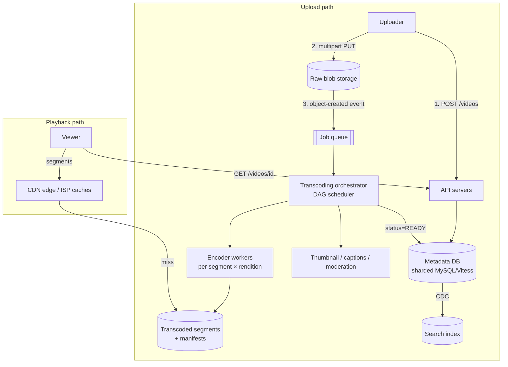

# 12 — YouTube

*A reference design built on verified building blocks. How it was sourced and what was not checked is under **Sources and provenance** near the end.*

## At a glance

**In 60 seconds.** A video platform separates heavy bytes from metadata. Uploads go straight to blob storage in resumable parts, a queue triggers an asynchronous transcoding DAG that produces many renditions and HLS or DASH segments, and viewers pull immutable segments from a CDN with adaptive bitrate. The documented real facts are the upload limits and protocol, the transcoding chip and Vitess's origin.

**Key numbers**
- Upload limit: 256 GB or 12 hours, whichever is less `[CONFIRMED]`.
- Custom transcoding chip: up to 20–33× compute-efficiency improvement `[CONFIRMED]`.
- Vitess was created at YouTube in 2010 `[CONFIRMED]`.

**Decisions and trade-offs**

| Decision | Why | Cost |
|---|---|---|
| Resumable direct upload | App servers stay out of the data path | Session handling and cleanup of abandoned uploads |
| Async chunked transcoding | Wall-clock time follows the slowest chunk | A workflow engine and idempotent tasks |
| Immutable segments | CDN-friendly | Many files per video |

**Common mistakes**
- Presenting the baseline's chunk length or bitrate ladder as YouTube's.
- Updating a view counter row on every view.
- Forgetting that new videos are only eventually consistent in search.


## Verified facts about the real YouTube

| Claim | Source |
|---|---|
| "The maximum file size you can upload is **256 GB or 12 hours, whichever is less**." Default upload length is 15 minutes, longer for verified accounts. YouTube recommends H.264 | `[CONFIRMED]` [YouTube Help](https://support.google.com/youtube/answer/71673) |
| **Resumable upload:** `POST` starts a session and returns a session URI in the `Location` header, then `PUT` the file bytes to it. After an interruption, an empty `PUT` with `Content-Range: bytes */CONTENT_LENGTH` returns `308 Resume Incomplete` with a `Range` of what the server has. Chunk sizes must be multiples of 256 KB (last chunk excepted), and chunking is discouraged except on very unstable networks. Use exponential backoff on 500/502/503/504 | `[CONFIRMED]` [YouTube API docs](https://developers.google.com/youtube/v3/guides/using_resumable_upload_protocol) |
| YouTube built a custom **Video (trans)Coding Unit (VCU)** chip plus software to coordinate the chips, reporting "up to **20-33x** improvements in compute efficiency compared to our previous optimized system". The next chip adds AV1 support. Post dated 2021-04-21 | `[CONFIRMED]` [YouTube blog](https://blog.youtube/inside-youtube/new-era-video-infrastructure/) |
| **Vitess** "was created in 2010 to solve the MySQL scalability challenges that the team at YouTube faced". It moved shard-routing logic out of application code into a proxy. Accepted by CNCF as incubating in February 2018, graduated November 2019 | `[CONFIRMED]` [Vitess history](https://vitess.io/docs/overview/history/) |
| HLS uses a **master playlist** listing variant streams (`EXT-X-STREAM-INF`) and **media playlists** with segments, whose `EXT-X-TARGETDURATION` bounds segment length | `[CONFIRMED]` [RFC 8216](https://datatracker.ietf.org/doc/html/rfc8216) |

---

## 🧒 Non-technical explanation

When you upload a video, YouTube doesn't just store your file. It's more like a **print shop** that takes your original and makes many copies: a tiny one for slow phones, a medium one, a crisp 4K one. It also **cuts each copy into short 2–6 second clips**.

When you press play, your phone downloads clips **one at a time** from a **nearby warehouse** (CDN) instead of from YouTube's headquarters. If your Wi-Fi gets slow, the next clip it grabs is a lower-quality version, so the video gets blurry instead of freezing. That's **adaptive streaming**.

Uploading takes minutes to process, and that's fine: the platform says "processing…" and publishes when ready.

---

## TL;DR for engineers

- **Read-heavy (100:1)** → optimise playback: CDN + segment caching + adaptive bitrate (HLS/DASH).
- **Uploads bypass app servers** via pre-signed, resumable, multipart uploads to blob storage.
- **Async transcoding DAG** (split → encode N renditions in parallel → package → thumbnail → publish) driven by a queue. **Eventual consistency** is fine for new uploads.
- **Metadata** in a sharded relational DB (YouTube built **Vitess** in 2010 for exactly this ([Vitess history](https://vitess.io/docs/overview/history/))). **Search** in an inverted index. **Watch progress / view counts** in a high-write store with relaxed consistency.

---

## 1. Clarifying questions (and why they matter)

| Question | Answer | What it drives |
|---|---|---|
| Scale? | 1M uploads/day, 100M DAU | Sharding, caching, capacity |
| Read:write? | ~100 views per upload | Read-optimised: CDN, streaming |
| Max file size? | 256 GB (matches YouTube's real limit: 256 GB or 12 h, whichever is less. Unverified accounts are limited to 15 minutes by default `[CONFIRMED]` ([YouTube Help](https://support.google.com/youtube/answer/71673))) | Multipart, chunked, resumable uploads |
| Formats/resolutions? | MP4/AVI/MOV, 240p → 4K | Transcoding pipeline with many renditions |
| Streaming latency? | First frame < 500 ms | CDN + ABR + small initial segments |
| Processing time? | 10–30 min OK | Async processing |
| Eventual consistency OK for uploads? | Yes | AP-leaning metadata path |
| Uptime? | 99.9% (~8.8 h/yr downtime) | Redundancy, failover |
| Livestreaming? | Out of scope | Scope control |

---

## 2. Requirements

**Functional:** upload (web/mobile, ≤256 GB, resumable), stream (adaptive, <500 ms first frame), search (titles/descriptions, paginated).

**Non-functional:** availability over immediacy · 1M uploads/day · 100M DAU · resumable chunked uploads · minimal buffering · bandwidth-efficient for developing regions.

### 🔧 Back-of-the-envelope (extension)

| Metric | Estimate |
|---|---|
| Upload rate | 1M/day ÷ 86,400 s ≈ **12 uploads/s** |
| Avg raw upload | assume 500 MB → **500 TB/day raw** |
| Renditions | ~6 resolutions × codecs → transcoded output ≈ 1–2× raw size (rough assumption; depends on source bitrate) |
| Views | 100M DAU × ~5 videos ≈ 500M views/day ≈ **~6k starts/s** average |
| Egress | 500M × ~5 min × ~2.5 Mbps (assumed) ≈ 500M × ~94 MB ≈ ~**47 PB/day** (~4.3 Tbps average). This is why CDN/ISP caching is everything. |

---

## 3. API design (REST)

Philosophy: **app servers handle lightweight metadata. Heavy bytes go directly to blob storage and the CDN.**

```http
# 1. Initiate upload: reserve ID + get pre-signed (multipart) URL(s)
POST /v1/videos
{ "title": "...", "description": "...", "file_size": 2147483648, "content_type": "video/mp4" }
→ 201 { "video_id": "v_123", "upload_id": "...", "part_urls": ["https://s3.../part1?sig=..", ...], "expires_in": 3600 }

# (client PUTs chunks straight to object storage, retrying individual parts)
POST /v1/videos/v_123/complete   { "upload_id": "...", "parts": [{ "n":1, "etag":"..." }, ...] }

# 2. Watch: metadata + manifest URL
GET /v1/videos/v_123
→ { "title": "...", "status": "READY", "manifest_url": "https://cdn.../v_123/master.m3u8", "thumbnails": {...} }

# 3. Watch progress: fire-and-forget, high write volume
POST /v1/progress/v_123   { "position_sec": 754 }   → 202 Accepted

# 4. Search: cursor pagination
GET /v1/search?q=system+design&limit=20&cursor=eyJzIjoxMjM0fQ
→ { "results": [...], "next_cursor": "eyJzIjoxMjU0fQ" }
```

- **Pre-signed URLs:** the upload never touches app servers, so you don't need 256 GB request bodies on your API fleet.
- **Cursor pagination** avoids the "skip 10M rows" problem of `OFFSET`.
- **Watch progress** writes are huge in volume and low in value per write. Accept them async (202), batch them, store them in DynamoDB/Bigtable/Cassandra, and accept last-write-wins.

---

## 4. 🔧 High-level architecture



### 🔧 Transcoding pipeline (the heart of the system)

1. **Validate & probe** (container, codec, duration, malware/policy checks).
2. **Split** the source into GOP-aligned chunks (e.g., ~10 s; chunk length is an illustrative tuning choice) → **parallel** encoding across many workers, so wall-clock time is bounded by the slowest chunk rather than the full video length.
3. **Encode** each chunk into a **bitrate ladder**: 240p/360p/480p/720p/1080p/1440p/2160p × codecs (H.264 for compatibility, VP9/AV1 for efficiency) ([YouTube blog](https://blog.youtube/inside-youtube/new-era-video-infrastructure/)). The rungs are illustrative: YouTube also serves 144p and 4320p.
4. **Package** into HLS/DASH segments (2–6 s; Apple's HLS authoring spec says target durations SHOULD be 6 s ([Apple](https://developer.apple.com/documentation/http-live-streaming/hls-authoring-specification-for-apple-devices))) + **manifests** (master playlist listing renditions, [RFC 8216](https://datatracker.ietf.org/doc/html/rfc8216)).
5. **Side outputs:** thumbnails, preview sprites, auto-captions (ASR), content ID / moderation.
6. **Publish:** mark `READY` and warm popular CDN PoPs.

**DAG orchestration** (think Airflow/Temporal-style): tasks are idempotent and retryable per chunk, and a failed chunk is re-encoded without redoing the whole video.

**Cost optimisations used in industry:** per-title / per-shot encoding (pick the ladder per content complexity, [Netflix, Dec 2015](https://netflixtechblog.com/per-title-encode-optimization-7e99442b62a2)), encoding long-tail videos lazily (outside observers report YouTube serving mostly H.264 for low-view videos and reserving AV1 for very popular ones, though YouTube has not published the policy ([Streaming Learning Center](https://streaminglearningcenter.com/codecs/which-codecs-does-youtube-use.html))), and custom hardware (YouTube's **VCU** cards built on the **Argos** ASIC, announced 2021 with up to 20–33× compute efficiency vs. software on traditional servers ([YouTube blog](https://blog.youtube/inside-youtube/new-era-video-infrastructure/), [DCD](https://www.datacenterdynamics.com/en/news/google-develops-custom-argos-video-transcoding-chips-for-youtube-processing))).

### 🔧 Adaptive bitrate streaming (ABR)

```
master.m3u8
 ├── 240p/index.m3u8  → seg_0001.ts, seg_0002.ts, ...
 ├── 720p/index.m3u8  → ...
 └── 1080p/index.m3u8 → ...
```
- The player fetches the manifest and starts on a **low rendition with short segments** to hit <500 ms first frame, then climbs the ladder.
- Each segment request picks a rendition from measured throughput and buffer level (BOLA, a buffer-based algorithm used in the dash.js reference player ([paper](https://arxiv.org/abs/1601.06748)), or throughput-based algorithms).
- Segments are **immutable, cacheable static files**, which is ideal for CDNs.

### 🔧 CDN strategy

- **Long-tail distribution:** view counts are heavily skewed, so a small share of videos gets most views. Push or pre-warm hot videos to edges. Long-tail videos are served from regional/origin tiers on a miss.
- **ISP-embedded caches:** Google Global Cache ([Google](https://support.google.com/interconnect/answer/9058809)) and Netflix Open Connect ([Netflix](https://openconnect.netflix.com/en/)) put boxes inside ISPs, cutting backbone transit.
- **Request coalescing** at the edge prevents a cache-miss stampede on viral uploads.

### 🔧 Storage

| Data | Store | Why |
|---|---|---|
| Raw uploads | Object storage (cold after transcode) | Cheap, durable. Keep for re-encoding with future codecs. |
| Segments + manifests | Object storage + CDN | Immutable, highly cacheable |
| Video metadata, channels | Sharded MySQL (**Vitess**, which was born at YouTube ([history](https://vitess.io/docs/overview/history/))) | Relational + horizontally scalable |
| Watch progress, view counters | Bigtable/Cassandra/DynamoDB | Write-heavy, relaxed consistency |
| Search | Elasticsearch-style inverted index | Full-text, ranking, filters |
| Recommendations | Feature stores + ML serving | Out of scope here |

### 🔧 View counts

Don't `UPDATE videos SET views = views+1` per view. Instead, emit view events to a stream (Kafka), **aggregate in windows**, and periodically flush counts. Use sharded counters for hot videos. Exact counts can lag, and fraud filtering happens in the stream.

---

## 5. Trade-offs to discuss

| Decision | Trade-off |
|---|---|
| Async transcoding | Upload isn't instantly watchable (accepted per requirements) |
| Many renditions | Storage cost ×N vs smooth playback on all networks |
| Small segments | Faster start/adaptation vs more requests + manifest overhead |
| Eventual consistency for metadata/search | New video may take seconds to appear in search |
| Keep raw originals | Storage cost vs ability to re-encode with AV1/next-gen codecs |

---

## 🏛️ Architecture lens (Fundamentals of Software Architecture)

> 🔧 Extension. Vocabulary in [neokim-post/00-fundamentals.md §4](../../neokim-post/00-fundamentals.md#architecture-thinking).

- **Driving characteristics (Ch 4–5):** **scalability** (100:1 reads), **elasticity** (a viral video, upload bursts into the encoder fleet), **performance** (first frame < 500 ms), **availability** (99.9%) and cost/**feasibility**. Deliberately *not* driving: immediate consistency for new uploads.
- **Styles (Ch 11, 14):** the transcoding path is a **pipeline** (pipes and filters): probe/validate (*tester*) → split → encode (*transformers*) → package → publish (*consumer*). Because each video's DAG needs restart-from-failed-chunk, the orchestrator is an **event-driven mediator** (the book's "persist state, restart at step 3" behaviour), not a broker chain.
- **Quanta (Ch 7):** three, separated by asynchronous boundaries: (1) upload/metadata API + Vitess, (2) transcoding workers behind the job queue, with very different elasticity, (3) playback through the CDN, which is static, immutable files. Search is fed by CDC, so it's a fourth quantum with relaxed freshness.
- **Trade-off (Ch 14):** the **mediator** buys workflow control, error handling and restartability, and costs scalability, performance, fault tolerance and more coupling between processors (book's mediator trade-off table). A broker chain would scale more freely, but nobody would know when a video is "done".
- **ADR sketch (Ch 19):** *"We will orchestrate transcoding with a DAG mediator over a job queue. We accept a central scheduler to get per-chunk retries and a single READY signal."*
- Plain English: the upload goes down an assembly line with a foreman who knows which station each video is at, and restarts only the station that jammed.

---

## Interview questions to practice

1. A 256 GB upload fails at 93%. What happens, and how does the client resume?
2. How would you make first frame < 500 ms for a viewer in a country with no nearby PoP?
3. How do you avoid transcoding work for videos nobody will watch?
4. A video goes viral 1 minute after upload. What breaks first?
5. How do you count views accurately enough for monetisation?

## Interview practice

These outlines are our own reasoning (`[INDUSTRY PATTERN]`), not statements from the cited sources.

**A 45-minute walkthrough**

1. Clarify: size limits, formats, latency to publish, live or not.
2. Estimate: uploads/day, storage, egress.
3. API: start resumable upload, complete, playback manifest.
4. Design: blob store, queue, transcoding DAG, CDN.
5. Deep dive: ABR, renditions, resumable upload protocol.
6. Failure and scale: failed chunk retry, viral video, view counts.

**If it grows 10×**
- Egress dominates: ISP and edge caches.
- Encoding cost: hardware acceleration and per-title encoding.
- View counts: windowed aggregation from a stream.

**Answer outlines** (try the questions above first)

<details><summary>Why do uploads bypass the application servers?</summary>

Large bytes would consume app capacity. A session URI or pre-signed URL lets the client write straight to storage and resume after drops.

</details>

<details><summary>How does adaptive bitrate work?</summary>

The player fetches a manifest listing renditions, starts low, and picks the next segment's rendition from measured throughput and buffer.

</details>

<details><summary>How do you count views at scale?</summary>

Emit events to a stream, aggregate in windows and flush periodically. Use sharded counters for hot videos and filter fraud in the stream.

</details>

## 📚 Further reading

- [Vitess history: born at YouTube](https://vitess.io/docs/overview/history/)
- [YouTube resumable upload protocol](https://developers.google.com/youtube/v3/guides/using_resumable_upload_protocol)
- [Netflix: Per-Title Encode Optimization](https://netflixtechblog.com/per-title-encode-optimization-7e99442b62a2)
- [Netflix Open Connect](https://openconnect.netflix.com/en/)
- [Apple HLS spec (RFC 8216)](https://datatracker.ietf.org/doc/html/rfc8216) · [MPEG-DASH overview](https://dashif.org/)
- [AWS S3 multipart upload](https://docs.aws.amazon.com/AmazonS3/latest/userguide/mpuoverview.html)
- Related in this folder: [14 Spotify](14-spotify.md), [05 Object storage](05-object-storage-s3.md), [13 Netflix](13-netflix.md)

## Sources and provenance

> **Kind:** reference design with a few documented real-system facts. YouTube does not publish its architecture end to end. What we verified in primary sources: the upload limits (YouTube Help), the resumable-upload protocol (YouTube API docs), the custom transcoding chip (YouTube blog, 2021), Vitess's origin at YouTube (Vitess docs) and the HLS playlist format (RFC 8216). Everything else, including the pipeline stages, store choices and CDN strategy, is the standard interview design `[INDUSTRY PATTERN]`.
> **Basis:** upgraded from [`neokim-post/03`](../../neokim-post/03-how-youtube-works.md), a summary of [YouTube System Design](https://newsletter.systemdesign.one/p/youtube-system-design) whose paywalled deep dives were reconstructed from public sources. Re-verified on 2026-10-27, see the log.
> **Tags:** `[CONFIRMED]` stated by a primary source · `[INDUSTRY PATTERN]` standard practice, not stated for YouTube · `[SPECULATIVE]` plausible. The 🔧 marker is inherited from the baseline (content beyond the newsletter's public half).

---
## ✅ Verification log

*Inherited log (neokim-post/03), 2026-10-03:* Verified 16 · Corrected 2 · Softened/removed 4.

*Re-verification for this folder, 2026-10-27.*
- Verified in YouTube Help: 256 GB or 12 hours, whichever is less; 15-minute default, longer for verified accounts; H.264 recommendation.
- Verified in YouTube API docs: the resumable protocol steps, 308 behaviour, 256 KB chunk multiple, exponential backoff on 5xx.
- Verified in YouTube's blog (2021-04-21): VCU described as "Video (trans)Coding Unit", up to 20-33x compute-efficiency improvement, AV1 in the next generation. The name "Argos" does not appear in the article text, so it is not used in this note (the baseline's log used it from another source).
- Verified in Vitess docs: created in 2010 at YouTube; moved shard-routing out of app code; CNCF incubating in 2018-02 and graduated 2019-11. The page does **not** mention connection pooling or query rewriting, so we do not claim them.
- Verified in RFC 8216: master and media playlists, `EXT-X-STREAM-INF`, `EXT-X-TARGETDURATION`.
- Added: the 15-minute default upload limit for unverified accounts, which the baseline's requirement row omitted.
- Not re-verified (carried over): Apple's 6-second target-duration guidance (our fetch of Apple's page returned no usable text), Netflix's per-title encoding post (Dec 2015; netflixtechblog.com blocks scripted fetches), the BOLA paper, Google Global Cache and Open Connect pages, the codec-policy observation from Streaming Learning Center, the storage table and view-count design (`[INDUSTRY PATTERN]`), and the newsletter's scale assumptions (1M uploads/day, 100M DAU, 100:1), whose arithmetic was re-derived by hand: 1M/86,400 ≈ 11.6/s, 500M views/day ≈ 5.8k/s.
- Not claimed: any actual YouTube pipeline stage, chunk length, bitrate ladder or CDN policy. The baseline already labels these illustrative.
