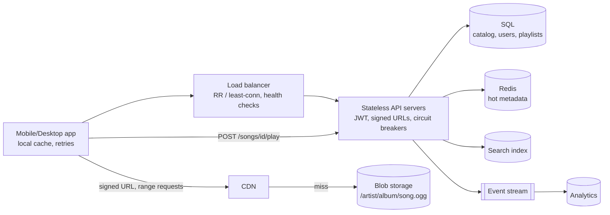
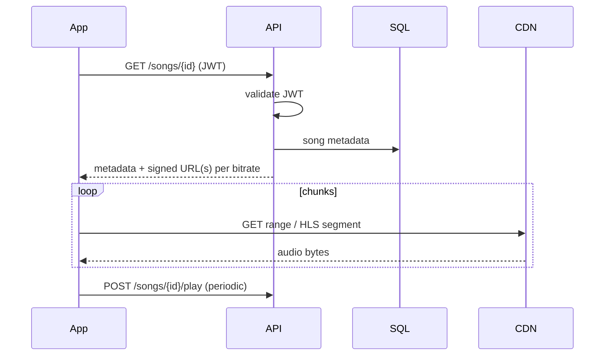
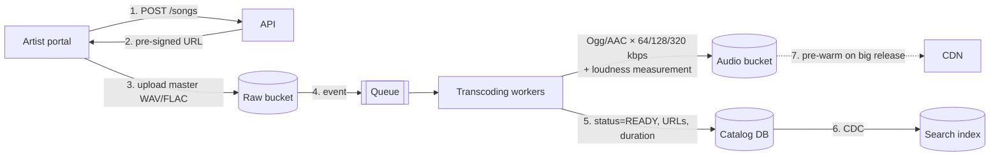

# 14 — Spotify (Music Streaming)

*A reference design built on verified building blocks. How it was sourced and what was not checked is under **Sources and provenance** near the end.*

## At a glance

**In 60 seconds.** Audio dominates storage and egress while metadata is tiny, so the standard design serves audio through signed URLs and a CDN from blob storage and keeps a stateless API in front of a read-mostly catalogue. Spotify's 2010 paper is documented evidence that only 8.8% of played data came from Spotify's servers then, the rest from clients' caches and peers, and its support pages document audio tiers and playback-time loudness normalisation.

**Key numbers**
- 2010: only 8.8% of data from servers, median playback latency 265 ms `[CONFIRMED]`.
- About 39% of playbacks were random access `[CONFIRMED]` (2010).
- Loudness normalisation target -14 dB LUFS applied at playback `[CONFIRMED]`.

**Decisions and trade-offs**

| Decision | Why | Cost |
|---|---|---|
| Signed URLs from a stateless API | Audio bytes skip the API | Short-lived tokens to manage |
| Several quality tiers | Fits different networks and plans | Storage multiplies |
| Prefetch the next track | Gapless playback | Wasted bytes on skips |

**Common mistakes**
- Presenting the 2010 P2P design as the current architecture.
- Attributing Ogg Vorbis to today's apps: the current support page names no codec.
- Forgetting that a stream counts only after at least 30 seconds.


## Verified facts about the real Spotify

| Claim | Source |
|---|---|
| In 2010, **8.8% of music data played came from Spotify's servers**, the rest from the client cache and the P2P network. **Median playback latency 265 ms** (including cached tracks). Library of over 8 million tracks. Service launched October 2008 | `[CONFIRMED]` P2P paper |
| Audio was **Ogg Vorbis**, default quality **q5** (variable bitrate averaging roughly **160 kbps**). Premium users could choose **q9** (roughly **320 kbps**). Peers do no re-encoding, so a q9 peer cannot serve a q5 request | `[CONFIRMED]` P2P paper |
| **~39% of playbacks are random access** (not the next track). On a cache miss the client asks the server for about **15 seconds** of music over its already open TCP connection while searching the P2P network | `[CONFIRMED]` P2P paper |
| The client **cache** is encrypted and holds partial tracks. Default maximum is 10% of free disk space, with a floor of 50 MB and a cap of 10 GB. Eviction is LRU, and the paper found eviction policy matters little because caches are large | `[CONFIRMED]` P2P paper |
| Today's app qualities: Low ≈24 kbit/s, Normal ≈96, High ≈160, Very high (Premium) ≈320, Lossless (Premium) up to 24-bit/44.1 kHz FLAC. Web player: AAC 128 kbit/s (Free) or 256 kbit/s (Premium) | `[CONFIRMED]` Spotify Support (current pages) |
| A stream counts when "a listener plays your song for at least 30 seconds" | `[CONFIRMED]` Spotify Support |
| **Loudness normalisation** targets **-14 dB LUFS** (ITU 1770) and "is applied during playback". Tracks are measured at upload, files are left untouched | `[CONFIRMED]` Spotify Support |

---

## 🧒 Non-technical explanation

Spotify is a **library with a very fast delivery service**.

- The **catalog** (song titles, artists, album art, playlists) is like the library's card index. It's small and gets looked up constantly.
- The **songs themselves** are big audio files kept in a **warehouse** (cloud storage), with copies in **local depots** near you (CDN).
- When you press play, the app first asks Spotify "may I play this, and where is it?" Spotify replies with a **temporary pass** (signed URL), and your phone then downloads the music **directly from the nearest depot**, a few seconds at a time.
- On a weak connection, the app switches to a **lighter version** of the song (lower bitrate) so it keeps playing.

---

## TL;DR for engineers

- **Audio dominates storage and egress.** Metadata is tiny. Design accordingly: **blob storage + CDN** for audio, **SQL** for catalog/users/playlists.
- **Stateless API tier** (JWT auth, signed URL generation, circuit breakers, connection pooling) behind a load balancer.
- **Clients stream directly** from CDN/blob storage using **HTTP range requests / HLS/DASH** at multiple bitrates (Ogg/AAC at 64/128/320 kbps in the article's design. Spotify's real tiers differ: see the verified table above and Reviewer notes).
- 🔧 **Uploads:** artist → pre-signed upload → async **transcoding + loudness measurement** (Spotify measures loudness at upload and applies gain at playback, targeting -14 LUFS ([source](https://support.spotify.com/us/artists/article/loudness-normalization/))) → publish to catalog + search index.

---

## 1. Requirements & assumptions

- ~**500k users**, **30M songs** (the interview starts small, then you scale it)
- Artists upload songs. Users search, play, create and manage playlists, maintain profiles.
- Basic observability (health checks, error tracking, performance metrics).
- Formats: **Ogg Vorbis / AAC** at multiple bitrates for adaptive streaming:
  - 64 kbps (data saver), 128 kbps (standard), 320 kbps (premium)
- Avg song at standard quality ≈ **3 MB**.
- Constraints: **fast playback start**, **minimal rebuffering** (adaptive quality switching), simple operations.

---

## 2. Capacity planning

| Item | Calculation | Result |
|---|---|---|
| Audio storage | 3 MB × 30M | **~90 TB** raw for one bitrate. The article's **×2–3** covers regional replicas and re-upload versions. 🔧 Storing the full 64+128+320 kbps ladder is ~4× the 128 kbps size (512/128), so **~360 TB** before replicas |
| Song metadata | ~100 B × 30M | **~3 GB** |
| User metadata | ~1 KB × 500k | **~0.5 GB** |
| Per stream | 3.5 min × 128–160 kbps | ~3–4 MB |
| Daily egress | 500k × 10–15 songs × 3.5 MB | **~17–26 TB/day** → significant CDN/egress cost |

> 💡 **Key insight:** audio dominates storage *and* bandwidth. Metadata comfortably fits in a single well-indexed SQL database with replicas. Don't over-engineer the catalog.

---

## 3. High-level architecture



| Component | Notes |
|---|---|
| **Client** | REST for metadata. Streams audio directly from CDN via signed URLs. Caches recently played songs. Retries with backoff. Pauses gracefully on network loss. |
| **Load balancer** | Round-robin / least-connections. Health checks every 30 s. Absorbs album-release spikes. Zero-downtime deploys. |
| **API layer** | **Stateless**. JWT validation, metadata queries, **signed URL** generation, analytics events. **Circuit breakers** on DB calls, **connection pooling**, **fallback responses** for non-critical features. |
| **Blob storage** | S3/GCS, `/artist/album/song.ogg`. Signed URLs expire in hours. Multi-region replication. (The HDFS alternative is less managed.) |

---

## 4. Read workflow (playing a song)



- **Range requests / HLS/DASH segments** allow quick start, seeking and bitrate switching.
- **Play tracking** is periodic and async. Spotify counts a stream after at least 30 s of play ([source](https://support.spotify.com/us/artists/article/how-we-count-streams/)), and counted streams are the unit royalties are allocated on. Since 2024 a track also needs at least 1,000 streams in the previous 12 months to earn recorded royalties ([source](https://artists.spotify.com/en/blog/modernizing-our-royalty-system)).

---

## 5. 🔧 Write workflow (artist upload): reconstructed



- **Loudness:** measure integrated loudness at ingest and store it as metadata. The client applies the gain at playback, so the encoded files are not altered ([source](https://support.spotify.com/us/artists/article/loudness-normalization/)).
- **Validation:** format, duration, audio fingerprinting (copyright / duplicate detection), metadata checks (ISRC codes).
- **Release scheduling:** content is ingested ahead of time and becomes visible at the release timestamp (common for album drops at midnight local time).
- **Idempotent processing** per song + bitrate. Retry failed jobs. A DLQ catches poison files.

---

## 6. 🔧 Data model (reconstructed)

```sql
artists(id PK, name, bio, image_url)
albums(id PK, artist_id FK, title, release_date, cover_url)
songs(id PK, album_id FK, title, duration_ms, track_no, status, audio_key_prefix, release_at)
song_artists(song_id, artist_id, role)                 -- features/collabs
users(id PK, email, plan, country, created_at)
playlists(id PK, owner_id FK, name, is_public, is_collaborative, version)
playlist_tracks(playlist_id, position, song_id, added_by, added_at,
                PRIMARY KEY (playlist_id, position))
plays(user_id, song_id, played_at, ms_played)          -- → event stream / warehouse, not OLTP
```

- **Playlists:** ordered lists with concurrent edits (collaborative). Use **optimistic concurrency** (`version` column), or store ordering with fractional/lexicographic ranks to avoid renumbering positions.
- **Play events** go to an event pipeline (Kafka → warehouse), not to the OLTP DB.

---

## 7. 🔧 Scaling beyond 500k users

| Pressure | Response |
|---|---|
| Read QPS on catalog | Redis cache-aside for hot songs/albums/artists. Read replicas. CDN-cached metadata JSON. |
| Search | Dedicated Elasticsearch/OpenSearch with fuzzy matching and per-locale analyzers |
| Album release spikes | Pre-warm CDN. Autoscale API. Cache "new release" pages. |
| Egress cost | Multi-CDN, ISP peering, aggressive client caching, offline downloads (encrypted, DRM) |
| Global users | Multi-region API + read replicas. Catalog is read-mostly, so replication lag is acceptable. |
| Recommendations / Home | Separate offline ML pipelines (batch + feature store) feeding precomputed rows |

### 🔧 How real Spotify evolved (context)
- Early Spotify used a **hybrid peer-to-peer** network (desktop clients served cached chunks to each other) to reduce server bandwidth. In 2010 only ~8.8% of played music data came from Spotify's servers, with a median playback latency of 265 ms `[CONFIRMED]` ([Kreitz & Niemelä, IEEE P2P'10](https://people.cs.umass.edu/~phillipa/CSE390/spotify-p2p10.pdf)). In April 2014 TechCrunch reported the P2P phase-out, citing TorrentFreak, because Spotify had enough servers (a secondary report, not a Spotify announcement). The mobile and web clients never used P2P ([TechCrunch](https://techcrunch.com/2014/04/17/spotify-removes-peer-to-peer-technology-from-its-desktop-client/)).
- Moved from its own data centres to **Google Cloud**: exploration began in 2015, the move was announced in 2016 ([Google Cloud blog](https://cloud.google.com/blog/products/gcp/spotify-chooses-google-cloud-platform-to-power-data-infrastructure)), traffic was fully on GCP by May 2017, and the last on-prem data centres were retired in 2018 ([Spotify Engineering](https://engineering.atspotify.com/2019/12/views-from-the-cloud-a-history-of-spotifys-journey-to-the-cloud-part-1-2)).
- Built **Backstage**, its internal developer portal (created 2016, open-sourced March 2020, CNCF Sandbox September 2020 ([Spotify Engineering](https://engineering.atspotify.com/2020/9/cloud-native-computing-foundation-accepts-backstage-as-a-sandbox-project)), CNCF Incubating March 2022 ([CNCF](https://www.cncf.io/blog/2022/03/15/backstage-project-joins-the-cncf-incubator/))), to keep a large and growing microservice estate manageable.

---

## ⚠️ Reviewer notes on the source

- **Bitrate tiers are a design assumption, not Spotify's real ladder.** The article's 64/128/320 kbps example is fine for the interview design. Spotify's actual app settings are Low ≈24 kbps, Normal ≈96 kbps, High ≈160 kbps and (Premium) Very high ≈320 kbps. The web player streams AAC at 128 kbps (Free) or 256 kbps (Premium) ([Spotify Support: Audio quality](https://support.spotify.com/us/article/audio-quality/)). Lossless (up to 24-bit/44.1 kHz FLAC) began rolling out to Premium in September 2025 ([Spotify Newsroom](https://newsroom.spotify.com/2025-09-10/lossless-listening-arrives-on-spotify-premium-with-a-richer-more-detailed-listening-experience/)). The lossy encodings are Ogg/Vorbis and AAC ([Spotify for Artists: Loudness normalization](https://support.spotify.com/us/artists/article/loudness-normalization/)).
- **The 90 TB storage figure covers one bitrate only.** The article's ×2–3 multiplier is for replicas and re-upload versions. A three-rung ladder (64+128+320 kbps) alone is ~4× the 128 kbps size, so the estimate is ~360 TB before replication.

---

## 🏛️ Architecture lens (Fundamentals of Software Architecture)

> 🔧 Extension. Vocabulary in [neokim-post/00-fundamentals.md §4](https://github.com/allmonty/study/blob/main/architecture/neokim-post/00-fundamentals.md#architecture-thinking).

- **Driving characteristics (Ch 4–5):** **performance** (time to first audio), **availability**, **scalability** and **elasticity** (midnight album drops are the book's "concert tickets" pattern), plus cost/**feasibility** (egress). Licensing and DRM are **legal** cross-cutting characteristics (Ch 4).
- **Style for the 500k-user design (Ch 13, 11):** a **service-based architecture** (or even a modular monolith): a stateless API tier over **one SQL database** is the book's pragmatic default when the data fits one store ("don't over-engineer the catalog"). Upload ingest is a **pipeline** (validate → transcode → normalise → publish).
- **Quanta (Ch 7):** (1) API + catalog DB (shared DB, so one quantum), (2) the async ingest pipeline behind the queue, (3) analytics behind the event stream, and (4) the CDN/blob path, which only shares signed-URL keys with the API.
- **Trade-off (Ch 18, "shifting fashion" and org factors):** real Spotify runs **microservices** because of **Conway's law** (Ch 8): many autonomous squads need independent deployability. That buys evolvability and deployability (★★★★–★★★★★) and pays with cost and simplicity (★). Copying that topology for a 500k-user product would be the book's "Ferrari at 50 km/h" (Ch 13).
- **ADR sketch (Ch 19):** *"We will start service-based with a shared Postgres, logically partitioned by domain (catalog, users, playlists), so we can split later."*
- Plain English: a small record shop doesn't need the org chart of a global label. One stockroom and a few counters will do until the queues get long.

---

## Interview questions to practice

1. Why sign URLs instead of making audio public? What expiry would you choose and why?
2. How do you switch bitrate mid-song without an audible glitch?
3. Design collaborative playlists with concurrent reorders.
4. How do you count streams for royalties accurately and resistant to fraud?
5. How would offline downloads work with licensing restrictions?

## Interview practice

These outlines are our own reasoning (`[INDUSTRY PATTERN]`), not statements from the cited sources.

**A 45-minute walkthrough**

1. Clarify: catalogue size, offline, quality tiers.
2. Estimate: tracks, plays/s, egress.
3. API: get track returns a signed URL.
4. Design: API, catalogue, blob storage, CDN.
5. Deep dive: prefetching, range requests, loudness.
6. Failure and scale: CDN miss, popular releases, uploads.

**If it grows 10×**
- Release-day spikes: pre-warm the CDN.
- Catalogue growth: replicate and cache the read-mostly database.
- Uploads: asynchronous transcoding and analysis.

**Answer outlines** (try the questions above first)

<details><summary>Why serve audio through a CDN instead of the API?</summary>

Audio is large and cacheable. The API only authorises and returns a signed URL, which keeps it small and stateless.

</details>

<details><summary>How does playback start in under a second?</summary>

A cache or prefetched data plays immediately. Otherwise the client asks for the first ~15 seconds over an open connection.

</details>

<details><summary>How would you apply loudness normalisation?</summary>

Measure at upload, store the gain value, and apply it at playback so the audio files stay untouched.

</details>

## 📚 Further reading

- [Spotify Engineering blog](https://engineering.atspotify.com/)
- [Backstage (open-sourced by Spotify)](https://backstage.io/)
- [Spotify: Loudness normalization](https://support.spotify.com/us/artists/article/loudness-normalization/)
- [MDN: HTTP range requests](https://developer.mozilla.org/en-US/docs/Web/HTTP/Guides/Range_requests)
- [Hayk Simonyan (YouTube)](https://youtube.com/@hayk.simonyan)
- Related in this folder: [12 YouTube](12-youtube.md) (same blob + CDN + ABR pattern for video), [13 Netflix](13-netflix.md)

## Sources and provenance

> **Kind:** reference design plus a documented history. Spotify has published its **2010 hybrid peer-to-peer streaming design** in an academic paper, plus support pages on audio quality, loudness and stream counting. Its current server-side architecture is **not** published end to end, so the blob-storage + CDN + stateless-API design below is the standard interview design `[INDUSTRY PATTERN]`.
> **Basis:** upgraded from [`neokim-post/09`](https://github.com/allmonty/study/blob/main/architecture/neokim-post/09-how-spotify-works.md), a summary of [Spotify System Design](https://newsletter.systemdesign.one/p/spotify-system-design) (guest author Hayk Simonyan) whose paywalled halves were reconstructed. Re-verified on 2026-10-27, see the log.
> **Primary sources read:** Kreitz & Niemelä, [*Spotify – Large Scale, Low Latency, P2P Music-on-Demand Streaming*, IEEE P2P 2010](https://people.cs.umass.edu/~phillipa/CSE390/spotify-p2p10.pdf) (text extracted locally) · Spotify Support: [Audio quality](https://support.spotify.com/us/article/audio-quality/), [How we count streams](https://support.spotify.com/us/artists/article/how-we-count-streams/), [Loudness normalization](https://support.spotify.com/us/artists/article/loudness-normalization/).
> **Dated material:** the paper describes Spotify in 2010 (over 8 million tracks). The client has since dropped P2P, so do not present the paper as the current architecture.
> **Tags:** `[CONFIRMED]` stated by a Spotify primary source · `[INDUSTRY PATTERN]` standard design · `[SPECULATIVE]` plausible. The 🔧 marker is inherited from the baseline (content beyond the newsletter's public half).

---
## ✅ Verification log

*Inherited log (neokim-post/09), 2026-10-03:* Verified 14 · Corrected 5 · Softened/removed 2.

*Re-verification for this folder, 2026-10-27.*
- Verified in the P2P paper (text extracted locally and read): 8.8% from servers, 265 ms median latency, over 8 million tracks, October 2008 launch, Ogg Vorbis q5 ≈160 kbps default and q9 ≈320 kbps for Premium, no peer re-encoding, ~39% random-access playbacks, ~15-second initial request over the open TCP connection, encrypted partial-track cache with the 10% / 50 MB / 10 GB bounds, LRU.
- Verified in Spotify Support: the Low/Normal/High/Very high/Lossless equivalents, web-player AAC 128 and 256 kbit/s, separate streaming and download settings on mobile; "at least 30 seconds" for a stream; -14 dB LUFS per ITU 1770 applied at playback.
- Corrected: our codec statement. The current audio-quality page names no codec for the desktop and mobile levels and does not mention Ogg Vorbis, so Ogg Vorbis is attributed to the **2010 paper only**.
- Not re-verified (carried over): the 1,000-streams royalty threshold (the page we fetched did not include it), the lossless launch date (September 2025, Spotify Newsroom), the TechCrunch report of the April 2014 P2P phase-out, Google Cloud migration dates and Backstage/CNCF dates, and the newsletter's capacity table (the ×2–3 and ~360 TB arithmetic was re-derived by hand in the earlier log).
- Not claimed: anything about Spotify's current backend (databases, services, CDN vendors).
