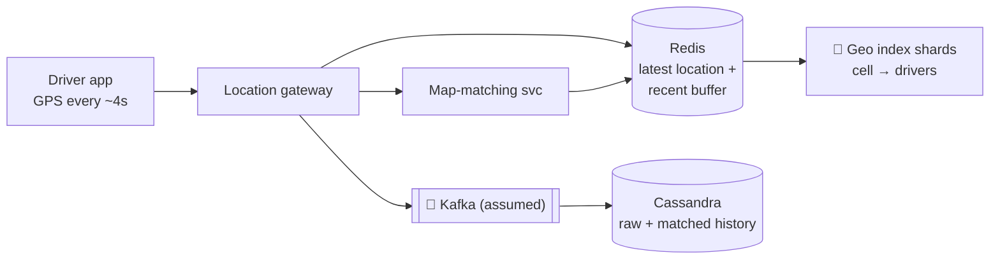
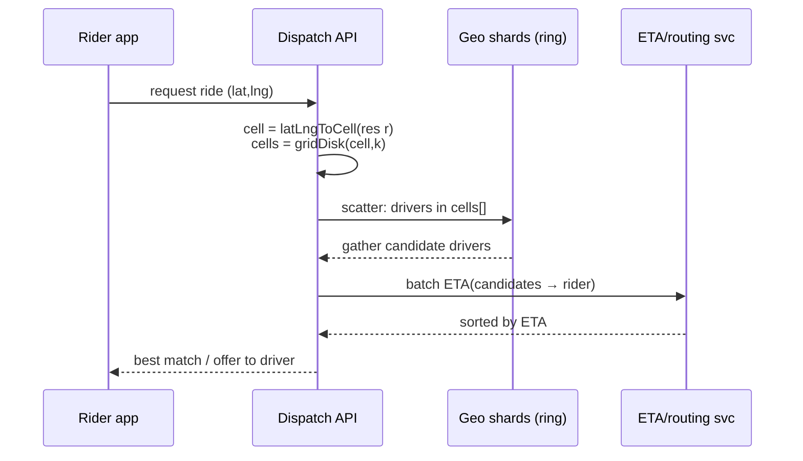

# 15 — Uber (Proximity + Dispatch)

*A reference design built on verified building blocks. How it was sourced and what was not checked is under **Sources and provenance** near the end.*

## At a glance

**In 60 seconds.** Nearest-driver search is turned into key lookups by indexing locations into hexagonal cells (H3). A rider's cell plus its neighbouring ring covers the search area, an in-memory index sharded by cell holds the latest drivers, and candidates are ranked by arrival time. Uber's public matching description batches requests over a few seconds to reduce average wait instead of taking the closest driver immediately.

**Key numbers**
- H3 has 16 resolutions; resolution 9 cells average 0.105 km², resolution 8 0.737 km² `[CONFIRMED]`.
- Every resolution has exactly 12 pentagons; each finer resolution has one-seventh the area `[CONFIRMED]`.
- About 4,357,449 km² average cell area at resolution 0 `[CONFIRMED]`.

**Decisions and trade-offs**

| Decision | Why | Cost |
|---|---|---|
| Hexagonal grid | One distance to every neighbour, even search growth | Pentagons and approximate parent/child containment |
| Shard the index by cell | Locality for neighbour queries | Hot cells in dense areas |
| Batch matching | Lower average wait | A few seconds of added latency |

**Common mistakes**
- Using lat/lng range queries on a B-tree: they do not map to a single key lookup.
- Assuming a k-ring has 19 cells at a pentagon.
- Matching the closest driver instantly and calling it optimal.


## Verified facts

| Claim | Source |
|---|---|
| H3 has **16 resolutions** (0–15). **Resolution 0 has 122 cells** (110 hexagons + 12 pentagons), and every resolution has exactly 12 pentagons. Average cell area: res 0 ≈ 4,357,449 km², res 7 ≈ 5.16 km², res 8 ≈ 0.737 km², **res 9 ≈ 0.105 km²**, res 10 ≈ 0.0150 km², res 15 ≈ 0.895 m². Edge lengths were computed exactly for res 0–6 and extrapolated for finer ones | `[CONFIRMED]` H3 docs table |
| Hexagons have a **single** distance between a cell centre and its neighbours (squares have two, triangles three). Uber built H3 for "efficiently optimizing ride pricing and dispatch" and visualisation. Surge is calculated "by measuring supply and demand in hexagons in each city". Each finer resolution has cells with **one seventh the area**, so children are only approximately contained in parents. Twelve pentagons sit at the icosahedron vertices | `[CONFIRMED]` Uber H3 blog |
| Early Uber matched a rider "immediately ... with the closest available driver". It learned "closest doesn't always mean quickest". It now evaluates "nearby drivers and riders in one batch" in the seconds after a request, aiming "to reduce the average wait time for everyone, not just the closest pair". It may modify pairings for safety reasons | `[CONFIRMED]` Uber matching page |

---

## 🧒 Non-technical explanation

Imagine covering the whole planet with **honeycomb tiles**, each with a number. Every few seconds each driver's phone reports "I'm on tile #8872…".

When you request a ride, Uber doesn't measure the distance to every driver in the city. It asks: **"Which drivers are on my tile and the tiles touching it?"** Then it ranks that short list by how long each would take to reach you on actual roads.

Why hexagons? On a hexagon, **every neighbouring tile is the same distance away**. On a square grid, the diagonal neighbours are farther than the side neighbours, which makes "nearby" lopsided.

---

## TL;DR for engineers

- **Geospatial indexing** turns a 2-D nearest-neighbour query into **key lookups**: `latLngToCell(lat, lng, res)` → 64-bit cell ID. Nearby = `gridDisk(cell, k)` (the old `kRing`) ([H3 v4 migration](https://h3geo.org/docs/library/migration-3.x/functions)).
- **H3:** hierarchical hexagonal grid, 16 resolutions (average ~4.36M km² at res 0 down to ~0.9 m² at res 15) ([H3 cell stats](https://h3geo.org/docs/core-library/restable/)). Parent/child via bit truncation (O(1)) ([Uber H3 blog](https://www.uber.com/blog/h3/)).
- **Writes:** drivers send GPS about every 4 s (from HighScalability's summary of Uber's 2015 talk, which we did not re-check against the talk; the newsletter this note started from says only every few seconds) ([HighScalability](https://highscalability.com/how-uber-scales-their-real-time-market-platform/)) → **map matching** snaps noisy GPS to road segments → **Redis** (latest location + buffer) → **Cassandra** (durable history).
- **Shard by cell ID**. Candidates are ranked by **ETA**, not straight-line distance.
- 🔧 **Scale:** an in-memory geo index sharded by cell across a ring of nodes (Uber's **Ringpop**: consistent hashing + SWIM gossip), scatter-gather across the k-ring. In the 2015 description the shard key was a Google **S2** level-12 cell, not H3 ([HighScalability](https://highscalability.com/how-uber-scales-their-real-time-market-platform/)).

---

## 1. Why naive lat/lng queries don't work

`SELECT * FROM drivers WHERE distance(lat,lng,:me) < 2km` requires a full scan or a 2-D index, and the data changes every few seconds for millions of drivers. You need:
- A **discrete key** per area (so you can hash, cache and shard).
- **Cheap neighbour lookup.**
- **Multi-resolution** (dense downtown vs sparse countryside).

### Options compared

| Index | Shape | Strengths | Weaknesses |
|---|---|---|---|
| **Geohash** | Rectangles, base32 string prefixes | Simple, prefix = containment, works with any KV/DB | Edge effects (neighbours can have very different prefixes), uneven cell sizes by latitude |
| **Quadtree** | Adaptive squares | Adapts to density | In-memory tree, harder to shard, rebalancing |
| **Google S2** | Squares on a cube projected onto a sphere, Hilbert curve | Excellent region covering, good locality | Square-cell neighbour distances vary |
| **Uber H3** ✅ | **Hexagons** on an icosahedron | Uniform neighbour distance, great for movement/flows, smoothing | Imperfect parent-child containment (children rotate) |
| PostGIS / R-tree | Arbitrary geometry | Exact queries | Not designed for millions of updates/s |

---

## 2. H3 deep dive

### Hierarchical index
- **122 base cells** (110 hexagons + **12 pentagons**, because you can't tile a sphere with hexagons alone). H3 treats a pentagon as a hexagon with one missing piece: the sub-digit-1 "deleted subsequence" ([H3 cell index](https://h3geo.org/docs/library/index/cell), [H3 overview](https://h3geo.org/docs/core-library/overview)).
- Each cell subdivides into **7 children** (aperture 7), rotated slightly. Containment is approximate with a known error ([Uber H3 blog](https://www.uber.com/blog/h3/)).
- **16 resolutions** (0–15), down to ~1 m² (0.895 m² average at res 15) ([H3 cell stats](https://h3geo.org/docs/core-library/restable/)).
- The cell ID is a **64-bit integer**. Moving to the **parent = bit truncation**, which is O(1) ([H3 index layout](https://h3geo.org/docs/core-library/h3Indexing)).
- **Compression:** represent sparse regions with a few coarse cells and dense regions with many fine cells (`compactCells`) ([H3 v4 migration](https://h3geo.org/docs/library/migration-3.x/functions)).

### Hexagonal grid

| Grid | Neighbours | Distance to neighbours |
|---|---|---|
| Triangle | 12 (edge + vertex) | 3 different distances |
| Square | 8 (edge + vertex) | 2 different distances |
| **Hexagon** | **6, all edge-sharing** | **1 distance** ✅ |

Uber's H3 post states the one / two / three distance counts for hexagons / squares / triangles ([Uber H3 blog](https://www.uber.com/blog/h3/)).

### Algorithms
```python
import h3
cell = h3.latlng_to_cell(41.0082, 28.9784, 9)      # Istanbul, ~0.1 km² cells
nearby = h3.grid_disk(cell, 2)                      # cell + 2 rings = 19 cells
parent = h3.cell_to_parent(cell, 7)                 # coarser area, O(1)
```

Function names match the h3-py v4 API ([h3-py quick reference](https://uber.github.io/h3-py/api_quick.html)). Res 9 averages ~0.105 km² ([H3 cell stats](https://h3geo.org/docs/core-library/restable/)). 19 cells assumes a hexagon origin; a k=2 disk around a pentagon has fewer.

---

## 3. Location ingestion & storage



- **Map matching:** GPS is noisy (urban canyons, tunnels), so the service snaps a *sequence* of points to the most likely road path (HMM / Viterbi style, as in [Newson & Krumm 2009](https://www.microsoft.com/en-us/research/publication/hidden-markov-map-matching-noise-sparseness/)). It needs a **buffer** of recent points, which is why Redis holds them.
- **Cassandra** handles durable, write-heavy history (raw and map-matched in separate schemas).
- **Redis** sheds reads off Cassandra and holds the hot state.
- Sharding key = **H3 cell ID**.

---

## 4. 🔧 Scalability (reconstructed: the paywalled part)

### Sharding the geo index
- The supply index (`cell → set of available drivers`) lives **in memory** across a cluster.
- Uber's dispatch service (**DISCO**; HighScalability's summary of the talk expands the name as "dispatch optimization", but we found no expansion in Uber's own materials) historically used **Ringpop**: an application-layer library giving **consistent hashing** + **SWIM gossip membership**, so every node knows which node owns which key (cell) and requests are forwarded to the owner ([HighScalability, Matt Ranney 2015](https://highscalability.com/how-uber-scales-their-real-time-market-platform/)). In that talk the cell was a Google **S2** level-12 cell (3.31–6.38 km²), used as the shard key; H3 was open-sourced later, in 2018 ([Uber H3 blog](https://www.uber.com/blog/h3/)). The ringpop-node repo has been archived since 2019 ([GitHub](https://github.com/uber-node/ringpop-node)).
- On each driver update, compute the cell and send the update to the owner node. If the driver changed cells, remove them from the old cell.

### Query flow


- **Adaptive k / resolution:** start with a small ring at fine resolution. If there aren't enough candidates, expand k or drop to a coarser resolution.
- **Rank by ETA** on the road graph, not by Euclidean distance (a river can make the closest driver 15 minutes away).
- **Hot cells** (stadium after a game, airport): split by finer resolution or replicate read-only copies. Rate-limit updates from stationary drivers.
- **Matching** isn't greedy-nearest in production. Batched matching optimises globally over a short window of a few seconds ([Uber: matching](https://www.uber.com/us/en/marketplace/matching/)). Framing it as bipartite assignment is our interpretation.
- Figures: the article's headline cites **1M requests/s**. It doesn't break that figure down into reads and writes.

### Why in-memory + ephemeral?
Driver location is **ephemeral** state. If a node dies, the index rebuilds within seconds from the next round of driver pings. You don't need strong durability for the index, only for the history (Cassandra).

---

## 5. Trade-offs

| Decision | Trade-off |
|---|---|
| Fine resolution | Precise, but more cells to query and more index churn as drivers move |
| Coarse resolution | Fewer lookups, but larger candidate sets to rank |
| In-memory index | Speed vs durability (fine, because it rebuilds from pings) |
| Update frequency | Freshness vs battery + bandwidth + write load |
| Gossip ring vs central registry | No SPOF vs eventual membership convergence |

---

## 🏛️ Architecture lens (Fundamentals of Software Architecture)

> 🔧 Extension. Vocabulary in [neokim-post/00-fundamentals.md §4](https://github.com/allmonty/study/blob/main/architecture/neokim-post/00-fundamentals.md#architecture-thinking).

- **Driving characteristics (Ch 4–5):** **performance** (match in milliseconds), **scalability** (~1M req/s per the article's headline), **elasticity** (stadium and airport surges), **availability** and **fault tolerance**. Durability of the live index is deliberately *not* driving.
- **Style (Ch 15):** strongly isomorphic to **space-based architecture**. The live supply index sits in in-memory processing units, so the database is off the synchronous path. History flows **asynchronously** (an assumed Kafka → Cassandra path would be the book's *data pump → data writer*), and the index rebuilds from peers or fresh pings, never from the DB. One difference: Ringpop **shards** the grid by cell (one owner per key) instead of **replicating** it. Every unit updating the same cells would hit the book's *data collision* problem (`N × UR² / (S × RL)`) at Uber's update rate (UR).
- **Quanta (Ch 7):** the dispatch path (rider request → geo shards → ETA service) is called **synchronously**, so it's **one quantum** and must share performance and elasticity targets. If map matching and history are decoupled by a queue such as Kafka (assumed, not stated in the source), they're separate quanta.
- **Trade-off (Ch 15):** trading durability and *simplicity* (★) and *testability* (★) for elasticity and performance (★★★★★). Ephemeral data makes the trade cheap here.
- **ADR sketch (Ch 19):** *"We will keep the driver index only in memory, sharded by H3 cell. We accept losing a shard's state on crash because the next 4-second ping rebuilds it."*
- Plain English: every dispatcher keeps a whiteboard of the cars in their own patch of town. If a whiteboard gets wiped, the drivers' next check-in redraws it within seconds.

---

## Interview questions to practice

1. Design "find the 10 nearest drivers" for 5M online drivers updating every 4 s. How many writes/s?
2. Geohash vs H3: give a concrete case where geohash fails at a boundary.
3. How do you handle a driver crossing a cell boundary between two shards?
4. How would you design surge pricing per area using H3?
5. Your stadium cell has 3,000 riders and 50 drivers. What breaks?

## Interview practice

These outlines are our own reasoning (`[INDUSTRY PATTERN]`), not statements from the cited sources.

**A 45-minute walkthrough**

1. Clarify: scale, matching rules, ETAs.
2. Estimate: drivers, update rate, queries/s.
3. API: location update, request ride, offer.
4. Design: ingestion, cell index, matching, ETA.
5. Deep dive: H3, k-ring search, batching.
6. Failure and scale: hot cells, stale locations, shard loss.

**If it grows 10×**
- Dense cities: use finer cells and split hot shards.
- Ping volume: coalesce updates and keep the latest in memory.
- Matching latency: batch smaller windows in busy zones.

**Answer outlines** (try the questions above first)

<details><summary>Why not store lat/lng and query a range?</summary>

A range query on two coordinates scans many rows. A cell ID turns 'nearby' into a few key lookups over a cell and its neighbours.

</details>

<details><summary>How do you find drivers near a rider?</summary>

Convert the pickup to a cell, take the cell plus a ring of neighbours, read the drivers in those cells, filter and rank by ETA.

</details>

<details><summary>Why batch for a few seconds?</summary>

The closest driver is not always the quickest, and pairing several riders and drivers together can lower the average wait.

</details>

## 📚 Further reading

- [Uber Engineering: H3, Uber's Hexagonal Hierarchical Spatial Index](https://www.uber.com/blog/h3/)
- [H3 documentation](https://h3geo.org/) · [H3 GitHub](https://github.com/uber/h3)
- [Ringpop (GitHub, archived)](https://github.com/uber-node/ringpop-node) · [SWIM paper](https://www.cs.cornell.edu/projects/Quicksilver/public_pdfs/SWIM.pdf)
- [How Uber Scales Their Real-Time Market Platform (HighScalability)](https://highscalability.com/how-uber-scales-their-real-time-market-platform/)
- [Neo Kim: How Uber computes ETA](https://newsletter.systemdesign.one/p/uber-eta)
- [Google S2 geometry](https://s2geometry.io/) · [Geohash (Wikipedia)](https://en.wikipedia.org/wiki/Geohash)
- Alex Xu, *System Design Interview Vol. 2*: "Proximity Service" and "Nearby Friends" chapters

## Sources and provenance

> **Kind:** reference design with documented real parts. Uber publishes the design of **H3** (its hexagonal spatial index, open source) and a public description of how **batched matching** works. It does not publish its current dispatch and location-storage architecture, so the ingestion, storage and sharding sections are the standard design plus a 2015-era description from a secondary summary `[INDUSTRY PATTERN]`.
> **Basis:** upgraded from [`neokim-post/06`](https://github.com/allmonty/study/blob/main/architecture/neokim-post/06-how-uber-finds-nearby-drivers.md), a summary of [How Does Uber Find Nearby Drivers at 1 Million Requests per Second](https://newsletter.systemdesign.one/p/how-does-uber-find-nearby-drivers) (paywalled half reconstructed). Re-verified on 2026-10-27, see the log.
> **Primary sources read:** [H3 resolution table](https://h3geo.org/docs/core-library/restable/) · [Uber Engineering: H3](https://www.uber.com/blog/h3/) (2018-06-27) · [Uber: how matching works](https://www.uber.com/us/en/marketplace/matching/).
> **Tags:** `[CONFIRMED]` stated by an Uber or H3 primary source · `[INDUSTRY PATTERN]` standard design or secondary-source claim · `[SPECULATIVE]` plausible. The 🔧 marker is inherited from the baseline (content beyond the newsletter's public half).

---
## ✅ Verification log

*Inherited log (neokim-post/06), 2026-10-03:* Verified 22 · Corrected 3 · Softened/removed 4.

*Re-verification for this folder, 2026-10-27.*
- Verified in the H3 resolution table: cell counts, average areas and edge lengths for resolutions 0–15 (res 0 = 122 cells, res 9 ≈ 0.105 km², res 15 ≈ 0.895 m²), 12 pentagons at every resolution, areas from a spherical model with the WGS84 authalic radius.
- Verified in Uber's H3 blog (2018-06-27): one centre-to-neighbour distance for hexagons, the purpose (pricing, dispatch, visualisation), surge computed per hexagon, one-seventh area per finer resolution with approximate containment, twelve pentagons, sixteen resolutions, 122 base cells.
- Verified in Uber's matching page: batching over a few seconds, the move from nearest-driver to batched matching, "closest doesn't always mean quickest", safety-based pairing changes.
- Corrected/clarified: the baseline's "bipartite assignment" wording was already marked as our interpretation. The matching page does **not** use that term or "global optimisation", so it remains our interpretation.
- Not stated by the sources: the page does not mention ETA computation, so ETA ranking is `[INDUSTRY PATTERN]`.
- Not re-verified (carried over): the HighScalability summary of Uber's 2015 talk (S2 level-12 shard keys, GPS every ~4 s, Ringpop/SWIM), the Newson & Krumm map-matching paper, Redis/Cassandra/Kafka roles, the `h3-py` function names and the `grid_disk` 19-cell count, Google S2 and geohash comparisons.
- Not claimed: anything about Uber's current dispatch or location-storage stack.
- Checked (2026-10-27): the expansion of DISCO rests on HighScalability's summary of the talk, a secondary source. Uber's InfoQ presentation page and the QCon slides give the name without an expansion, so the note says where the expansion comes from.
