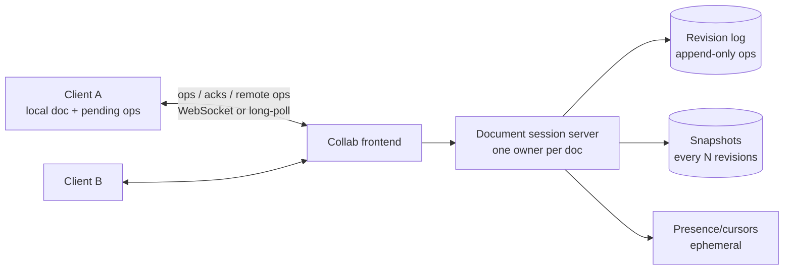
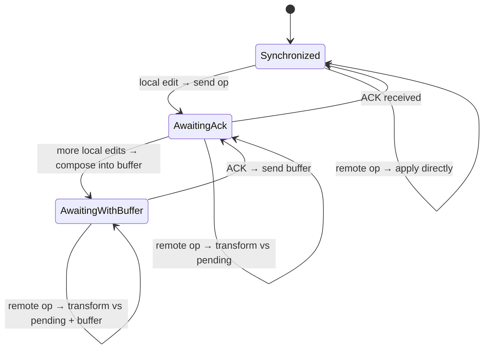

# 18 — Google Docs (Real-Time Collaboration)

*A reference design built on verified building blocks. How it was sourced and what was not checked is under **Sources and provenance** near the end.*

## At a glance

**In 60 seconds.** Real-time collaborative editing needs convergence, intention preservation and low latency. The classic client-server answer is operational transformation: one authority per document gives operations a total order, transforms concurrent ones against each other and broadcasts the result, while each client keeps one operation in flight plus a buffer. CRDTs reach convergence without a central server, at the cost of metadata and some anomalies.

**Key numbers**
- Fraser's differential sync is a symmetric diff-and-patch loop with fuzzy patching `[CONFIRMED]`.
- Figma chose a server-authority design inspired by CRDTs, not OT `[CONFIRMED]` (2019).
- Some published algorithms show interleaving anomalies `[CONFIRMED]` (Kleppmann et al.).

**Decisions and trade-offs**

| Decision | Why | Cost |
|---|---|---|
| Central authority per document | Simple total order and transformation | A single point per document and a server round trip |
| One in-flight op plus a buffer | Simple client state machine | Latency under bursts |
| OT vs CRDT | OT is proven for text with a server, CRDTs allow peer-to-peer and offline | CRDT metadata and anomaly care |

**Common mistakes**
- Calling differential sync manual: its patching is automatic but best effort.
- Claiming Google Docs uses a specific CRDT: the sources describe client-server OT.
- Forgetting presence and cursor transformation.

## Verified facts

| Claim | Source |
|---|---|
| **Differential synchronization** is "a symmetrical algorithm employing an unending cycle of background difference (diff) and patch operations". "The enabling feature is that the patch algorithm is fuzzy, meaning patches may be applied even if the document has changed." When a patch fails, the failed edits "will automatically show up negatively in the following diff and will be patched out of the Client Text", i.e. the edit is lost, not merged by hand. Edits queue in a stack and are "retransmitted to the remote party on every sync" until acknowledged | `[CONFIRMED]` Fraser |
| Fraser's page says "Algorithms based on Operation Transformation are currently popular for implementing edit-based collaborative systems". It does **not** call OT complex. Its complexity criticism targets *event passing* synchronization in general ("all user actions must be captured") | `[CONFIRMED]` Fraser |
| Figma: "OTs were unnecessarily complex for our problem space", "Figma isn't a text editor", so its tech is "inspired by something called CRDTs" but "Figma isn't using true CRDTs though". "Our server is the central authority", conflicts on the same property of the same object resolve like "a last-writer-wins register", clients are web pages talking to a server cluster over WebSockets, with "a separate process for each multiplayer document" | `[CONFIRMED]` Figma (2019) |
| "Interleaving anomalies" in collaborative text editors: concurrently inserted text with a well-defined order "may be randomly interleaved". The page says "several published algorithms" show the anomaly but **does not name them**. The paper's authors later flagged two serious flaws in their own proposed fix (the non-interleaving definition "cannot be guaranteed by any algorithm", and the Section 3.1 algorithm "does not guarantee convergence") and point to the Fugue paper | `[CONFIRMED]` Kleppmann et al. page |

---

## 🧒 Non-technical explanation

Three people are editing the same sentence at the same moment from three different countries. Messages between them take a fraction of a second, so each person sees the others' changes slightly late.

Google Docs gives **everyone their own copy** so typing feels instant. Behind the scenes, every keystroke is sent as a **small instruction** ("insert 'a' at position 5"), not as the whole document.

The trick: if Alice inserted 3 letters at the start while Bob deleted the 10th letter, Bob's instruction would now hit the **wrong spot** on Alice's copy. A central server acts as a **referee**. It knows the true order of all instructions and **adjusts ("transforms")** late instructions so they still mean what their author intended. Everyone ends up with the **exact same document**, with nobody locked out and nobody's work lost.

---

## TL;DR for engineers

- Requirements: **convergence**, **intention preservation**, **real-time**, **offline edits**.
- Rejected: **pessimistic locking** (one writer), **last-write-wins** (loses data), **differential sync** (diffs lack intent; its fuzzy patching is automatic but best-effort, so an edit whose context vanished is silently dropped ([Fraser](https://neil.fraser.name/writing/sync/))).
- Chosen: **Operational Transformation (OT)** with a **central server** that assigns a total order (a revision number) to operations. Document = **replay of the revision log** ([Google, 2010](https://drive.googleblog.com/2010/09/whats-different-about-new-google-docs_22.html)); 🔧 snapshots to shorten the replay are an assumed optimisation.
- Client protocol: **one in-flight operation + local buffer**. Transform incoming server ops against pending local ops ([Google, 2010](https://drive.googleblog.com/2010/09/whats-different-about-new-google-docs.html)).
- Alternative: **CRDTs** (Yjs, Automerge). These are peer-to-peer friendly and don't require a central server for convergence ([Yjs docs](https://docs.yjs.dev/), [Automerge](https://automerge.org/)).

---

## 1. Why this is hard

1. Concurrent changes must **converge** to the same state.
2. Concurrent changes must **avoid conflicts** and preserve each user's intent.
3. Changes must appear **in real time** for everyone.
4. Users can edit **offline**.
5. Physics: a round trip across the planet ≈ **200 ms**, so you can't wait for the server on every keystroke.

---

## 2. Approaches that don't work

| Approach | How | Why rejected |
|---|---|---|
| **Pessimistic locking** | One writer holds a lock. Others read-only. | No real-time co-editing. No offline. Central coordinator on every edit. |
| **Latency hiding + Last-Write-Wins** | Local copies, the newest write overwrites | **Silent data loss** under concurrency + high latency |
| **Differential synchronisation** | Local copies. Exchange diffs (Neil Fraser's algorithm). | Diffing overhead on every change. Diffs carry no **intent**. Conflicts are resolved **automatically** by best-effort fuzzy patching, not manually, but a patch whose context has changed too much fails and that edit is patched out, i.e. lost ([Fraser, 2009](https://neil.fraser.name/writing/sync/)). |
| **Operational Transformation** ✅ | Exchange *operations*. Transform concurrent ops against each other. | Complex to implement correctly, but automatic, lock-free and intent-preserving |

---

## 3. Operational Transformation in one example

Document: `"abc"`. Alice and Bob both start at revision 0.

- Alice: `ins(3,"d")` → `"abcd"`
- Bob: `del(0)` (delete `"a"`) → `"bc"`

If Bob naïvely applies Alice's op: `ins(3,"d")` on `"bc"` → index 3 is out of bounds ❌.
**Transform:** because Bob's delete at position 0 happened *before* index 3, shift Alice's op: `T(ins(3,"d"), del(0)) = ins(2,"d")` → `"bcd"` ✅.
Alice applies Bob's op transformed against hers: `T(del(0), ins(3,"d")) = del(0)` → `"bcd"` ✅. **Converged.**

The core property (TP1): `apply(apply(S, a), T(b, a)) == apply(apply(S, b), T(a, b))` ([Wikipedia: OT](https://en.wikipedia.org/wiki/Operational_transformation)).

OT treats edits as **events in a revision log**. The document is the result of **replaying the log from the start**, which is basically event sourcing ([Google, 2010](https://drive.googleblog.com/2010/09/whats-different-about-new-google-docs_22.html)).

---

## 4. 🔧 How Google Docs works (reconstructed architecture)

Google Docs uses a **client-server** OT model ([Google, 2010](https://drive.googleblog.com/2010/09/whats-different-about-new-google-docs.html)) of the kind introduced by the **Jupiter** system (Nichols, Curtis, Dixon & Lamping, UIST 1995, [doi](https://doi.org/10.1145/215585.215706)), which Google Wave's OT also built on ([Wave OT whitepaper](https://svn.apache.org/repos/asf/incubator/wave/whitepapers/operational-transform/operational-transform.html)). Google hasn't published a direct Wave → Docs lineage, so treat them as siblings. The server is the single source of truth for ordering. Because every op is transformed against one linear server history, the control algorithm itself guarantees TP2, and transform functions only need TP1 ([Wikipedia: OT, Jupiter row](https://en.wikipedia.org/wiki/Operational_transformation)). That avoids the much harder peer-to-peer OT correctness problems.

### Server responsibilities
- **One authoritative session per document** (route by doc ID, e.g., consistent hashing), holding the current revision in memory. Google's 2010 description has the server keep a queue of received-but-unprocessed changes, the revision log and the current document state ([Google, 2010](https://drive.googleblog.com/2010/09/whats-different-about-new-google-docs.html)).
- Receive `op` tagged with the client's **base revision**. If the server is ahead, **transform** the op against every op since that base revision. Then **apply**, assign `rev = n+1`, **append to the log**, **ACK** the sender and **broadcast** to the other clients.
- **Snapshots/checkpoints** every N ops, so loading a document = latest snapshot + tail of the log (not a replay from the beginning of time). This is an assumed optimisation: Google's 2010 post only says it replays the log from the beginning.
- Revision history ("See version history") falls out of the log for free.

### Client protocol (the "one outstanding op" rule)

- States and transitions match ot.js (`Synchronized`, `AwaitingConfirm`, `AwaitingWithBuffer`) ([ot.js client](https://github.com/Operational-Transformation/ot.js/blob/master/lib/client.js)).
- Local edits apply **immediately** (latency hiding).
- Only **one op in flight** at a time: Google "never send[s] more than one pending change at a time" ([Google, 2010](https://drive.googleblog.com/2010/09/whats-different-about-new-google-docs.html)). Later edits are **composed** into a buffer, which reduces the number of ops to transform and send, and lets the server keep a single state space (its history) instead of one per client ([Wave OT whitepaper](https://svn.apache.org/repos/asf/incubator/wave/whitepapers/operational-transform/operational-transform.html)).
- Incoming remote ops are **transformed** against pending + buffered local ops before being applied.

### Offline
- Queue ops locally (e.g., in IndexedDB) against the last known revision. On reconnect, send them, and the server transforms them against everything that happened meanwhile. Long offline periods mean a large transform, but it's still automatic.

### Presence (cursors, selections, avatars)
- Ephemeral, high-frequency, lossy. Send it over the same channel but **don't persist it**. Cursor positions are themselves **transformed** by incoming ops so they stay in place (cf. `transformSelection` in [ot.js](https://github.com/Operational-Transformation/ot.js/blob/master/lib/client.js)).

### Rich text
- Google's 2010 post names three basic change types: insert text, delete text, and apply styles to a range of text ([Google, 2010](https://drive.googleblog.com/2010/09/whats-different-about-new-google-docs_22.html)). So the model is a linear sequence with **formatting spans**. Libraries such as ot.js/Quill express the same idea as **retain with attributes**. A real editor adds more (tables, comments anchored to ranges). Each new op type needs transform functions against every other type, and that's where OT complexity explodes.

---

## 5. OT vs CRDT

| | **OT** (Google Docs) | **CRDT** (Yjs, Automerge; Figma is CRDT-*inspired* with a central server ([Figma, 2019](https://www.figma.com/blog/how-figmas-multiplayer-technology-works/))) |
|---|---|---|
| Ordering | Central server orders ops | No central ordering needed. Commutative by construction. |
| Topology | Client-server | P2P, local-first, server optional |
| Metadata | Small ops | Unique IDs per character/element (tombstones). More memory, though modern implementations have cut the overhead a lot ([Kleppmann, 2020](https://www.youtube.com/watch?v=x7drE24geUw)). |
| Correctness | Transform functions are notoriously tricky | Convergence (strong eventual consistency) is proven for the data type by design ([Shapiro et al., 2011](https://inria.hal.science/inria-00609399)) |
| Intent preservation | Good with a central server | Interleaving anomalies are possible in some published algorithms, so concurrent inserts at the same spot can be mixed up character by character. The authors' page does not name which ones. The baseline's claim about Logoot, LSEQ and SOCT2 comes from the paper's body, which we did not re-read ([Kleppmann et al., 2019](https://martin.kleppmann.com/2019/03/25/papoc-interleaving-anomalies.html)) `[EARLIER PASS]` |
| Offline/long divergence | OK | Excellent |

**Rule of thumb:** a central server plus a text-heavy product makes OT a proven fit. Local-first, offline-heavy or P2P products favour CRDTs.

---

## ⚠️ Reviewer notes on the source

- **Differential synchronisation is not manual.** The article says diff sync's "conflict resolution might be difficult", followed by "resolving conflicts manually affects the user experience", which suggests diff sync needs manual merges. Neil Fraser's algorithm resolves conflicts **automatically** with best-effort fuzzy patching. Its real weakness is different: when a patch's context has changed too much, the patch fails and that edit is patched out of the client text, so it is silently lost ([Fraser, 2009](https://neil.fraser.name/writing/sync/)).

---

## 🏛️ Architecture lens (Fundamentals of Software Architecture)

> 🔧 Extension. Vocabulary in [neokim-post/00-fundamentals.md §4](../../neokim-post/00-fundamentals.md#architecture-thinking).

- **Driving characteristics (Ch 4–5):** **performance** (local echo, < 200 ms remote visibility), **data consistency** (convergence: every replica ends identical), **availability** (including offline), **scalability** (millions of open docs) and **recoverability** (history, restart from snapshot + log).
- **Style (Ch 15):** the per-document session server works like a **space-based processing unit**: hot state in memory, requests routed to the owner, and a log behind it. The key departure is **one owner per document** instead of a replicated grid. The book's **data collision** analysis (Ch 15) explains why: a document is a tiny "cache" (small S) with a very high update rate (UR). Active/active replication would collide constantly, so a single writer serialises edits.
- **Quanta (Ch 7):** session server + revision log + snapshots are **one quantum** (synchronous append before ACK). Presence and cursors are ephemeral and lossy, with different reliability needs, so they're a separate concern that could be a separate quantum. Search indexing and exports are async quanta.
- **Trade-off (First Law, Ch 1):** the single owner buys **consistency and simplicity** (no TP2) and costs **availability of that one document** during failover, plus a scalability ceiling per document. CRDTs flip the trade: availability and offline-first, paid for in metadata and intent anomalies.
- **ADR sketch (Ch 19):** *"We will use client-server OT with a single session owner per document, because our product is text-heavy and always-connected. We will revisit CRDTs if offline editing becomes a primary use case."*
- Plain English: each document has exactly one referee at a time. That keeps the game fair and simple, but if the referee faints, play pauses until a substitute walks on.

---

## Interview questions to practice

1. Why does client-server OT avoid the TP2 property that peer-to-peer OT needs?
2. Walk through a client that sends op A, then types B and C before A's ACK arrives, while a remote op R arrives.
3. How do you scale to 1M concurrently open docs? Where does a doc's session live, and what happens when that server dies?
4. How do comments stay attached to the right text as it's edited?
5. When would you pick a CRDT instead?

## Interview practice

These outlines are our own reasoning (`[INDUSTRY PATTERN]`), not statements from the cited sources.

**A 45-minute walkthrough**

1. Clarify: text only or rich, offline, scale per doc.
2. Estimate: concurrent editors per document.
3. API: WebSocket with operations and revisions.
4. Design: gateway, document server, revision log, presence.
5. Deep dive: transform, client states, OT vs CRDT.
6. Failure and scale: reconnects, large documents, offline edits.

**If it grows 10×**
- Large documents: snapshots to shorten log replay.
- Many viewers: broadcast fan-out from a pub/sub layer.
- Offline merges: queue operations and rebase on reconnect.

**Answer outlines** (try the questions above first)

Two people insert at the same position. Show how they converge.

The server orders one first, then transforms the second against it so its insert shifts, and broadcasts the transformed operation. Each client transforms against its own pending edits.

Why one in-flight operation per client?

It keeps the client-server protocol simple: the client only ever has to transform incoming operations against one outstanding op and a buffer.

When would you choose a CRDT?

When you need offline or peer-to-peer editing without a central authority, accepting metadata overhead.

## 📚 Further reading

- Google Drive blog, John Day-Richter (Sept 2010), three-part series: [Working together, even apart](https://drive.googleblog.com/2010/09/whats-different-about-new-google-docs_21.html) · [Conflict resolution](https://drive.googleblog.com/2010/09/whats-different-about-new-google-docs_22.html) · [Making collaboration fast](https://drive.googleblog.com/2010/09/whats-different-about-new-google-docs.html)
- [Google Wave Operational Transformation whitepaper](https://svn.apache.org/repos/asf/incubator/wave/whitepapers/operational-transform/operational-transform.html)
- [Operational Transformation (Wikipedia)](https://en.wikipedia.org/wiki/Operational_transformation)
- Daniel Spiewak, [Understanding and Applying Operational Transformation](http://www.codecommit.com/blog/java/understanding-and-applying-operational-transformation)
- [Neil Fraser: Differential Synchronization](https://neil.fraser.name/writing/sync/)
- Martin Kleppmann, [CRDTs: The hard parts (talk)](https://www.youtube.com/watch?v=x7drE24geUw)
- [Yjs](https://yjs.dev/) · [Automerge](https://automerge.org/)
- Figma, [How Figma's multiplayer technology works](https://www.figma.com/blog/how-figmas-multiplayer-technology-works/)

## Sources and provenance

> **Kind:** reference design with documented real parts. Google published a short 2010 series on how the new Docs editor syncs edits (operational transformation with a central server) but not a full architecture. The client/server protocol below follows the well-known **Jupiter-style client-server OT** as implemented in open-source `ot.js`, and is a design explanation, not a Google internals document.
> **Basis:** upgraded from [`neokim-post/11`](../../neokim-post/11-how-google-docs-works.md), a summary of [How Does Google Docs Work](https://newsletter.systemdesign.one/p/how-does-google-docs-work) with reconstructed sections. Re-verified on 2026-10-27, see the log.
> **Primary sources read in this session:** Neil Fraser, [*Differential Synchronization*](https://neil.fraser.name/writing/sync/) · Figma, [*How Figma's multiplayer technology works*](https://www.figma.com/blog/how-figmas-multiplayer-technology-works/) (2019-10-16) · Kleppmann et al., [*Interleaving anomalies in collaborative text editors*](https://martin.kleppmann.com/2019/03/25/papoc-interleaving-anomalies.html) (PaPoC 2019 page).
> **Not re-read in this session:** Google's three September 2010 posts (their article bodies did not load in our fetches), the Wave OT whitepaper, Ellis & Gibbs and Nichols et al. (Jupiter), and the CRDT paper (HAL returned an access-denied page). Claims that depend on those were verified in the earlier pass (see the inherited log) and are marked accordingly.
> **Tags:** `[CONFIRMED]` stated by a primary source we read now · `[EARLIER PASS]` verified in the neokim-post fact-check but not re-read now · `[INDUSTRY PATTERN]` standard design · `[SPECULATIVE]` plausible. The 🔧 marker is inherited from the baseline.

---
## ✅ Verification log

*Inherited log (neokim-post/11), 2026-10-03:* Verified 17 · Corrected 7 · Softened/removed 4.

*Re-verification for this folder, 2026-10-27.*
- Verified in Fraser's page: the symmetric diff-and-patch cycle, fuzzy patching, failed patches patched out of the client text, the retransmission stack, and that the page describes OT as popular without calling it complex.
- Verified in Figma's post: date (2019-10-16), OT "unnecessarily complex for our problem space", "inspired by ... CRDTs" but not true CRDTs, server as central authority, last-writer-wins per property, WebSockets, one process per document.
- Verified on Kleppmann et al.'s page: venue (PaPoC, Dresden, March 2019), definition of the anomaly, and the later errata. The page does **not** name Logoot, LSEQ or SOCT2.
- Corrected: the baseline's naming of Logoot, LSEQ and SOCT2 is now flagged as from the paper's body, not re-read now. The page we read says only "several published algorithms".
- Not re-read now (carried over, `[EARLIER PASS]`): Google's 2010 posts (log replay from the start, client-server transformation), the Wave OT whitepaper, the Jupiter paper (Nichols et al., 1995), Ellis & Gibbs (1989), Shapiro et al. on CRDTs and strong eventual consistency, ot.js client behaviour, Yjs and Automerge docs. Our fetches of Google's article bodies returned only page chrome, and HAL returned an access-denied page.
- Not claimed: how Google Docs is implemented today. The 2010 posts predate the current product by many years.
