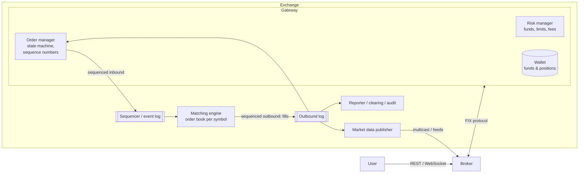
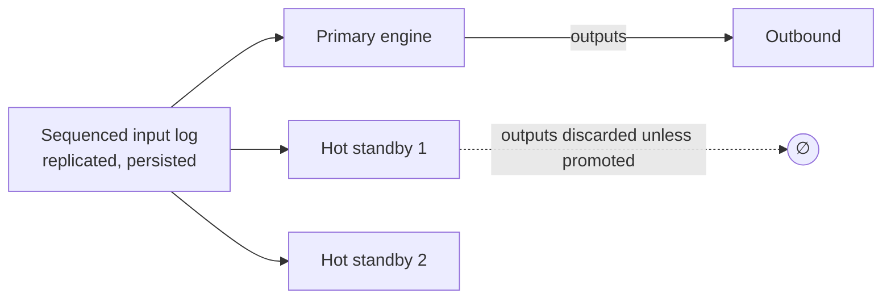

# 19 — Stock Exchange (Order Matching)

> **Kind:** reference design with documented real parts. Real exchanges publish **protocol specifications** (Nasdaq ITCH, OUCH, MoldUDP64, FIX) and market-structure rules, and the LMAX team published its **architecture** in detail. They do not publish a full internal design of a production exchange's matching engine, so the diagram below combines the standard design with LMAX's documented approach `[INDUSTRY PATTERN]`.
> **Basis:** upgraded from [`neokim-post/14`](../../neokim-post/14-how-stock-exchange-works.md), a summary of [Stock Exchange System Design](https://newsletter.systemdesign.one/p/stock-exchange-system-design) with reconstructed sections. Re-verified on 2026-10-27, see the log.
> **Primary sources read in this session:** Martin Fowler, [*The LMAX Architecture*](https://martinfowler.com/articles/lmax.html) (2011-07-12) · Thompson et al., [*Disruptor: High performance alternative to bounded queues*](https://lmax-exchange.github.io/disruptor/disruptor.html) · Nasdaq, [MoldUDP64 Protocol Specification V1.00](https://www.nasdaqtrader.com/content/technicalsupport/specifications/dataproducts/moldudp64.pdf) (PDF text extracted locally).
> **Dated material:** LMAX's figures come from a 2011 benchmark on Nehalem-era hardware, so treat them as design evidence, not current performance.
> **Tags:** `[CONFIRMED]` stated by a primary source we read now · `[EARLIER PASS]` verified in the neokim-post fact-check but not re-read now · `[INDUSTRY PATTERN]` standard design · `[SPECULATIVE]` plausible. The 🔧 marker is inherited from the baseline.

## Verified facts

| Claim | Source |
|---|---|
| LMAX's **Business Logic Processor "can handle 6 million orders per second on a single thread"** (benchmark on a 3 GHz dual-socket quad-core Nehalem server with 32 GB RAM). It "operates entirely in-memory, there is no database or other persistent store". The team ended up "doing all the business logic for their platform" on one thread after first trying a concurrent design | `[CONFIRMED]` Fowler (2011) |
| Architecture: an **input disruptor**, the **business logic processor** and **output disruptors**. The input stage does **unmarshalling, replication and journaling** in parallel ("they can [be] done in any order") | `[CONFIRMED]` Fowler |
| **Event sourcing for recovery:** processor state is rebuilt from its input events, snapshots speed recovery, and a full restart including a JVM restart and replaying a day's journals "takes less than a minute". Replicas let LMAX "switch between processors in a matter of micro-seconds" | `[CONFIRMED]` Fowler |
| The Disruptor paper reports, for a three-stage pipeline, mean latency "3 orders of magnitude lower" and "approximately 8 times more throughput" than the queue-based alternative. Its core is "a pre-allocated bounded data structure in the form of a ring-buffer", with the rule that "any data should be owned by only one thread for write access" (single writer). It states "over 25 million messages per second" and does **not** say that figure is single-threaded | `[CONFIRMED]` Disruptor paper |
| **MoldUDP64:** downstream packets are sent over **UDP multicast**, carry a **session** and the **sequence number of the first message**, plus a message count. Later messages are numbered implicitly in sequence. Clients may send **Request** messages to ask for retransmission of any packets, answered by unicast. One or more **re-request servers** may serve those requests | `[CONFIRMED]` MoldUDP64 spec |

---

## 🧒 Non-technical explanation

A stock exchange is a **farmers' market with a very strict referee**.

- For each stock there's a **stall**. Sellers shout "I'll sell 100 at $98!" and buyers shout "I'll buy 50 at $96!"
- The referee keeps two lines: **buyers sorted by highest price** (whoever pays most is first) and **sellers sorted by lowest price**. Among people offering the same price, **whoever arrived first goes first**.
- When the best buyer's price **meets or beats** the best seller's price, the referee **shakes their hands**: that's a trade.
- Everything must be **perfectly fair and repeatable**. The referee stamps every order with a **ticket number**, so if the market had to be replayed from the morning, exactly the same trades would happen in exactly the same order.

---

## TL;DR for engineers

- **Asynchronous, event-sourced architecture.** Every inbound event gets a **global sequence number**, and the matching engine is a **deterministic state machine** over that sequence. That gives fairness, replay, recovery and exactly-once semantics.
- **Broker → Gateway (risk check, wallet, order manager, sequencing) → Matching engine (in-memory order book per symbol) → Market data + execution reports.**
- **Order book:** two sides × price levels, each a **FIFO doubly linked list**, plus a hash map `order_id → node` for O(1) cancel. Best bid/ask tracked.
- **Price-time priority. Match while best_bid ≥ best_ask.**
- 🔧 **Low latency:** single-threaded matching per symbol shard (no locks), ring buffers (LMAX Disruptor), kernel bypass, co-location, multicast market data. LMAX runs *all* its business logic on one thread at ~6M orders/s ([Fowler](https://martinfowler.com/articles/lmax.html)).
- 🔧 **HA:** replicate the sequenced input log to hot standbys that run the same deterministic engine and fail over fast. LMAX reports switching between replicas "in a matter of micro-seconds" ([Fowler](https://martinfowler.com/articles/lmax.html)).

---

## 1. Market primer

| Term | Meaning |
|---|---|
| **Broker** | App/site (Robinhood, Schwab) that sends orders to the exchange for users |
| **Order book** | All open buy & sell orders for one symbol |
| **Market order** | Execute now at the best available price (needs liquidity). Priority, but no price protection. Execution is guaranteed, price is not ([investor.gov](https://www.investor.gov/introduction-investing/investing-basics/how-stock-markets-work/types-orders)); see Reviewer notes on "priority". |
| **Limit order** | Execute only at the limit price or better (buy ≤ $100, sell ≥ $100). Rests on the book if unmatched ([investor.gov](https://www.investor.gov/introduction-investing/investing-basics/how-stock-markets-work/types-orders)). |
| **Bid / Ask** | Best buy price / best sell price |
| **Spread** | best ask − best bid |
| **Fill** | A (partial) execution of an order |

Message mix in real exchanges: ~**50% new orders, ~40% cancels, ~2% executions** (article's figures; real venues skew further toward cancels, see Reviewer notes). **Cancels must be as fast as inserts.**

---

## 2. Requirements

- Stocks only. BUY/SELL **limit** orders (market orders as an extension). **Cancel** any time.
- Real-time matching.
- **Risk limits** (e.g., max shares per user per day).
- Real-time **market data** publication.
- 🔧 NFRs: **deterministic**, **fair** (FIFO at each price), **microsecond-to-low-millisecond latency**, **no lost or duplicated orders**, 99.99%+ availability during trading hours, full **audit trail**.

---

## 3. Architecture



### 3.1 Broker
- Sends orders, receives status, consumes market data (live + historical).
- Users ↔ broker: REST + WebSocket. **Broker ↔ exchange: FIX** (Financial Information eXchange), a session protocol with **per-message sequence numbers** (`MsgSeqNum(34)`), checksums (`CheckSum(10)`) and body length (`BodyLength(9)`) for integrity, and `ResendRequest(35=2)` for gaps ([FIX Session Layer](https://www.fixtrading.org/standards/fix-session-layer/)).

### 3.2 Gateway
Converts FIX into the internal binary format and returns execution reports. Can be **co-located** in the exchange DC for minimal latency.

| Part | Role |
|---|---|
| **Risk manager** | Enough funds/shares? Unusual activity? Daily limits. Fee calculation. |
| **Wallet** | Holds the user's funds and positions. **Reserves** funds when an order is accepted. |
| **Order manager** | Lightweight list of **all** orders (open, cancelled, rejected). Updates state. Handles cancels. **Assigns a globally increasing sequence number** to every order, cancel and fill. |

**Sequence numbers guarantee:**
- **Ordering:** fairness, timeliness, accuracy
- **Fast recovery + deterministic replay**
- **Exactly-once** (duplicates detected by sequence)
- **Gap detection** on inbound and outbound streams

**Inbound events (new orders and cancels) must share one total order per matching-engine shard.** A cancel and a fill for the same order need a defined relative order, or replay cannot reproduce the same matching and fairness is lost. Only **outbound or derived streams** (execution reports, market data, drop copies) can be split into topics with their own sequence numbers, since they are produced from the already-ordered input (reviewer correction, 2026-10-27: the earlier text suggested independent inbound sequences).

### 3.3 Matching engine
- Verifies sequence numbers, **matches**, emits **trades** → market data.
- **Determinism:** the same input sequence must produce the same output sequence. No wall-clock reads, no randomness, no iteration over unordered hash maps in the matching path.

---

## 4. Order book data structure

```
           BUY (bids, desc)                     SELL (asks, asc)
  $97  → [o12:100] ⇄ [o17:50]          $98  → [o3:200] ⇄ [o9:20]   ← best ask
  $96  → [o4:300]                       $99  → [o5:100]
  ↑ best bid                            $101 → [o21:500]

  index: order_id → *node   (O(1) cancel)
```

| Operation | Complexity | How |
|---|---|---|
| Add order at an existing level | **O(1)** | Append to the tail of that level's FIFO list |
| Cancel | **O(1)** | Hash lookup → unlink node (doubly linked) |
| Best bid/ask | **O(1)** read | Cached pointer. When the best level empties, finding the next one is O(log P) in a tree, or a scan to the next non-empty tick in an array |
| New price level | O(log P) or O(1) | Sorted map (red-black tree) of levels, or an **array indexed by tick** (prices are discrete) |
| Match | O(fills) | Walk from the best opposite level |

Closed orders leave the book and go to the transaction history.

### 🔧 Matching algorithm (price-time priority)

```python
def on_new_limit_order(o):                      # o.side in {BUY, SELL}
    book_opp = book.asks if o.side == BUY else book.bids
    crosses = (lambda p: o.price >= p) if o.side == BUY else (lambda p: o.price <= p)
    while o.qty > 0 and book_opp.best() and crosses(book_opp.best().price):
        level = book_opp.best()
        resting = level.head                    # oldest at best price (FIFO)
        q = min(o.qty, resting.qty)
        emit_trade(price=resting.price, qty=q,  # trade at the RESTING order's price
                   buy=..., sell=..., seq=next_seq())
        o.qty -= q; resting.qty -= q
        if resting.qty == 0: level.pop_head(); index.pop(resting.id)
        if level.empty(): book_opp.remove(level)
    if o.qty > 0:                               # remainder rests on the book
        book_same_side(o).level(o.price).append(o); index[o.id] = o
```

Order types beyond limit/market: IOC, FOK, stop, iceberg, post-only. Auctions (opening/closing cross) use a different uniform-price algorithm: the Nasdaq Closing Cross "crosses orders at a single price" ([Nasdaq](https://www.nasdaq.com/products/north-american-markets/nasdaq-stock-market/closing-cross)).

---

## 5. 🔧 Market data

- Every book change (add/cancel/execute) produces an event → **L1** (top of book), **L2** (aggregated depth by level), **L3** (every order, a.k.a. market-by-order; level naming varies by vendor).
- Published via **UDP multicast** with sequence numbers (receivers detect gaps → request retransmission or snapshot), e.g., **Nasdaq TotalView-ITCH** (outbound, order-level market data) over **MoldUDP64**, whose listeners detect sequence gaps and send a request packet to a re-request server ([MoldUDP64 spec](https://www.nasdaqtrader.com/content/technicalsupport/specifications/dataproducts/moldudp64.pdf)). Book-state snapshots come from the separate **GLIMPSE** service, which tells you the ITCH sequence number to resume from ([GLIMPSE 5.0 spec](https://www.nasdaqtrader.com/content/technicalsupport/specifications/dataproducts/NQGlimpseSpecification_5.0.pdf)). Order entry uses **OUCH** (Nasdaq's binary "Order Entry Specification", [OUCH 5.0](https://www.nasdaqtrader.com/content/technicalsupport/specifications/TradingProducts/Ouch5.0.pdf)) or FIX.
- Candlestick (OHLCV) charts are built downstream from the trade stream.
- **Fairness:** all participants should receive data at the same time (multicast, and co-location whose terms the SEC says "must not be unfairly discriminatory" ([SEC concept release 34-61358](https://www.sec.gov/rules/concept/2010/34-61358.pdf)); venues also try to equalize physical latency such as cable length).

---

## 6. 🔧 Low-latency engineering

| Technique | Why |
|---|---|
| **Single-threaded matching per symbol (or symbol shard)** | No locks, cache-friendly. Throughput via **sharding by symbol**. |
| **LMAX Disruptor ring buffers** | Lock-free, pre-allocated, mechanical-sympathy queues between stages ([Disruptor paper](https://lmax-exchange.github.io/disruptor/disruptor.html)) |
| **Everything in memory** | The book is RAM-resident. Durability comes from the **input log**, not DB writes. |
| **Kernel bypass** (DPDK, Solarflare/OpenOnload), busy-spin, CPU pinning, no GC pauses (or C++/Rust) | Microsecond tails |
| **Pre-allocation / object pools** | No allocation in the hot path |
| **Co-location** | Brokers/HFTs place servers in the same DC |
| **Fixed-point prices** (integer ticks) | No floating-point errors, fast comparisons |

---

## 7. 🔧 Fault tolerance through event sourcing


- **State = f(ordered inputs).** Persist and replicate the **input log** (sequencer). Standbys consume the same log and hold an **identical book**.
- On primary failure, promote a standby (consensus such as Raft can choose the leader and replicate the log). The new primary resumes from the next sequence number. Clients reconcile via sequence numbers.
- **Snapshots** of the book + log offset make restarts fast (no replay since market open). LMAX snapshots nightly and keeps hot replicas because a snapshot-plus-replay restart (under a minute) is still too slow mid-session; it runs two processors in the main DC and a third at a DR site ([Fowler](https://martinfowler.com/articles/lmax.html)).
- **Disaster recovery:** a remote DC replays the log (async), so a small RPO gap is acceptable there.
- This is the **same idea as Kafka's metadata log** (KRaft, [KIP-500](https://cwiki.apache.org/confluence/display/KAFKA/KIP-500%3A+Replace+ZooKeeper+with+a+Self-Managed+Metadata+Quorum)): a deterministic replay of an ordered event log. Jane Street's Brian Nigito describes the same state-machine-replication core for an exchange ([talk](https://www.janestreet.com/tech-talks/building-an-exchange/)).

---

## ⚠️ Reviewer notes on the source

- **"Market order … receives priority in the order book."** A market order never sits in the order book. It is marketable on arrival and takes liquidity from resting orders. Price-time priority ranks *resting* orders, so it doesn't apply to it. The SEC defines a market order only as one that "guarantees that the order will be executed, but does not guarantee the execution price" ([investor.gov](https://www.investor.gov/introduction-investing/investing-basics/how-stock-markets-work/types-orders)). A more accurate reading: it takes precedence in *execution certainty*, not queue position.
- **Message mix "~50% new orders, ~40% cancels, ~2% executions."** This understates cancels. SEC MIDAS data shows a **trade-to-order volume ratio for US stocks of about 2.5–4.2%** (quarterly averages of 3.2–3.7%, Q4 2012–Q2 2013), and **about 0.2% for ETPs**. So roughly 96% or more of displayed order volume is cancelled (or expires) rather than filled ([SEC, Trade-to-Order Volume Ratios](https://www.sec.gov/data-research/data-visualizations/trade-order-volume-ratios)). The SEC also publishes a daily cancel-to-trade ratio ([SEC MIDAS](https://www.sec.gov/marketstructure/datavis/ma_etp_canceltotrade.html)). On such venues, cancel messages come close to matching new-order messages one for one, which makes the "cancels must be fast" point even stronger. Caveat: the SEC ratio is share-volume-based, not a message count.

## 🏛️ Architecture lens (Fundamentals of Software Architecture)

> 🔧 Extension. Vocabulary in [neokim-post/00-fundamentals.md §4](../../neokim-post/00-fundamentals.md#architecture-thinking).

- **Driving characteristics (Ch 4–5):** **performance** (µs latency; "low latency in high-frequency trading" is the book's own example of an *implicit* characteristic, Ch 4), **reliability** (no lost or duplicated orders), **fault tolerance/recoverability** (hot standbys, replay), **availability** in trading hours, and **auditability**. Fairness is domain, but it forces a structural choice: one sequencer.
- **Styles (Ch 11, 14):** the hot path is a **pipeline** with point-to-point, unidirectional pipes: gateway → sequencer → matching engine → outbound log. LMAX's Disruptor is pipes-and-filters inside one process. Downstream, market data uses the book's **broadcast capability** (Ch 14 §6, whose example is literally a stock ticker): publish once, never know who listens.
- **Quanta (Ch 7):** (1) gateway/risk/wallet, (2) sequencer + matching engine + standbys, which must share identical characteristics because standbys replay the same log, (3) market-data publishers and (4) clearing/reporting, both decoupled by the outbound log.
- **Trade-off (Ch 14, workflow event pattern):** the book's trading example warns that repaired-and-resubmitted messages arrive **out of order**, so trades for the same account must queue behind a failed one. Here that's solved by construction: nothing bypasses the sequencer. The trade is **scalability per symbol** (one thread per book) for **determinism and performance**. You scale by sharding symbols.
- **ADR sketch (Ch 19):** *"We will run a single-threaded matching engine per symbol shard over a replicated input log. We accept that a hot symbol can't be split, in exchange for lock-free, replayable matching."*
- Plain English: one referee per stall, with every shout written in a numbered notebook. A substitute referee holding a copy of the notebook can take over mid-game and make exactly the same calls.

---

## Interview questions to practice

1. Why must the matching engine be deterministic, and what common code patterns break determinism?
2. Design the order book so that cancel, the most common operation, is O(1).
3. How do you scale to 10k symbols? What about a single symbol that gets 30% of the volume?
4. A market-data subscriber misses packets 1,000,123–1,000,130. How does it recover?
5. Compare sequencing via a central sequencer vs Kafka partitions. Where does each break down?

## 📚 Further reading

- Martin Fowler, [The LMAX Architecture](https://martinfowler.com/articles/lmax.html) · [LMAX Disruptor](https://lmax-exchange.github.io/disruptor/)
- Jane Street (Brian Nigito), [How to Build an Exchange (talk)](https://www.janestreet.com/tech-talks/building-an-exchange/)
- [FIX protocol overview (OnixS)](https://www.onixs.biz/fix-protocol.html)
- [Nasdaq TotalView-ITCH spec](https://www.nasdaqtrader.com/Trader.aspx?id=Totalview2)
- [Co-location strategies (QuestDB glossary)](https://questdb.com/glossary/exchange-co-location-strategies/)
- Alex Xu, *System Design Interview Vol. 2*: "Stock Exchange" chapter
- Related in this folder: [04 Message queue / log](04-message-queue-kafka.md)

---
## ✅ Verification log

*Inherited log (neokim-post/14), 2026-10-03:* Verified 19 · Corrected 3 · Softened/removed 2.

*Re-verification for this folder, 2026-10-27.*
- Verified in Fowler's article (2011-07-12): 6 million orders per second on a single thread with the stated hardware, all in memory with no database, input disruptor doing unmarshalling, replication and journaling in parallel, event-sourced recovery under a minute, failover in "a matter of micro-seconds".
- Verified in the Disruptor paper: 3 orders of magnitude lower mean latency and about 8× throughput for a three-stage pipeline, ring-buffer core, single-writer principle, "over 25 million messages per second". The 25M figure is **not** attributed to one thread, since the source does not say so. (The page's header says May 2011 and its footer says a 2025 update date, so we cite no date.)
- Verified in the MoldUDP64 spec (text extracted locally): UDP multicast downstream, session and first-message sequence number, message count with implicit sequential numbering, Request messages answered by unicast retransmission, re-request servers.
- Not re-read now (carried over, `[EARLIER PASS]`): Nasdaq ITCH, OUCH and GLIMPSE specs, FIX session-layer details (`MsgSeqNum`, `ResendRequest`), SEC co-location and MIDAS trade-to-order ratios, Nasdaq closing cross, the matching pseudocode, the Jane Street talk. The data-structure complexity table was re-derived in the earlier pass.
- Not claimed: how any particular exchange (Nasdaq, NYSE, CME) is internally built beyond what their published protocols imply.
